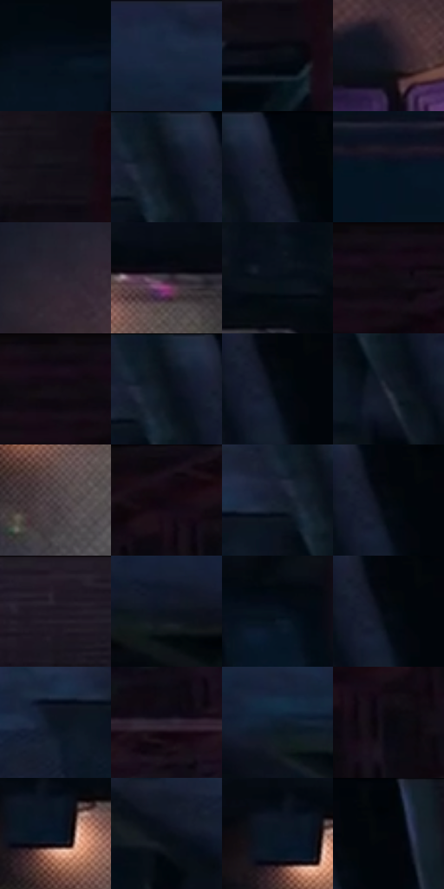

# 电影参考 302

- 状态：常规／活跃；来源世界：miles-home。
- 视角：high-angle；景别：medium；场景：city。
- 时段：night-appearance（外观依据，中置信度；具体时间／晨昏未知）；光照：night-mixed。
- 材质候选：skin, fabric, brick, metal, asphalt, sky（帧级，不是像素分割）。
- 明暗组：very-dark；L* P5/P50/P95：2.08637 / 5.33327 / 22.14318。
- 资格门禁：无附加门禁。
- 原截图 SHA-256：`2e2d959e6c3189fdcd6383798b3a155c88908c1db153a95a6e85e27596eda605`；尺寸：2880 × 1210。
- sRGB 像素 SHA-256：`811e639d11d6e72d601c3aaec4f5fedff4544d4ae61139a2acd5d7b1b8e20a04`。

## 观察与迁移

冷暗巷道俯仰视，少量暖灯与黑形保空间。

302  /  俯视／局部灯光  /  人物、下方汽车及两侧墙灯亮形分层，投影不混同材质污渍

本公开版保存32个128×128原像素色卡上下文；图集格子并非原场景相邻位置。原rect、图集tile和像素SHA见 `data/palette-crops.json`。上下文不足时不得批准替色，不能以小样推断完整构图。

## 实测色卡

颜色比例分母为保留采样像素，不是材料面积；全部 32 色参与全库匹配。表内四舍五入仅用于阅读，原精度在 JSON。

| ID | HEX | Lab | 原图 xy | 像素数 | 比例 | 明度角色 |
| --- | --- | --- | --- | ---: | ---: | --- |
| 302-S01 | #03101C | [4.279176, -0.733984, -9.13135] | [1200, 500] | 9450 | 4.870029% | deep-shadow |
| 302-S02 | #17273D | [15.328767, 1.154548, -16.106006] | [372, 60] | 8962 | 4.618540% | deep-shadow |
| 302-S03 | #080C13 | [3.266009, 0.223305, -3.913807] | [1980, 176] | 8807 | 4.538661% | deep-shadow |
| 302-S04 | #171722 | [8.221743, 3.2388, -7.617495] | [2632, 948] | 8251 | 4.252128% | deep-shadow |
| 302-S05 | #0F0E16 | [4.277565, 1.995562, -4.410398] | [1968, 72] | 7455 | 3.841912% | deep-shadow |
| 302-S06 | #0F1723 | [7.548334, 0.507628, -9.469343] | [1112, 36] | 7365 | 3.795531% | deep-shadow |
| 302-S07 | #040C15 | [3.097112, -0.370581, -5.512834] | [1180, 48] | 7010 | 3.612583% | deep-shadow |
| 302-S08 | #041320 | [5.381624, -0.931288, -10.56785] | [2272, 580] | 6983 | 3.598668% | deep-shadow |
| 302-S09 | #2E2935 | [17.570222, 5.219139, -6.90105] | [2500, 784] | 6887 | 3.549195% | deep-shadow |
| 302-S10 | #3B323E | [22.15584, 6.707298, -6.034602] | [452, 360] | 6886 | 3.548680% | shadow |
| 302-S11 | #060F19 | [4.069479, -0.281857, -7.059157] | [612, 296] | 6813 | 3.511059% | deep-shadow |
| 302-S12 | #140D16 | [4.466836, 4.390804, -4.082897] | [2420, 28] | 6753 | 3.480139% | deep-shadow |
| 302-S13 | #0F0A12 | [3.272773, 2.880843, -3.228138] | [2372, 28] | 6749 | 3.478077% | deep-shadow |
| 302-S14 | #0A111A | [4.877559, -0.05034, -6.631816] | [1108, 60] | 6606 | 3.404383% | deep-shadow |
| 302-S15 | #040A10 | [2.531796, -0.585988, -3.228344] | [1208, 116] | 6411 | 3.303890% | deep-shadow |
| 302-S16 | #1C212E | [12.808705, 1.677209, -9.361783] | [1124, 184] | 6397 | 3.296675% | deep-shadow |
| 302-S17 | #51474D | [31.327999, 5.442133, -2.034555] | [380, 500] | 6310 | 3.251840% | shadow |
| 302-S18 | #190F1A | [5.626787, 6.80312, -5.381142] | [2588, 32] | 6081 | 3.133825% | deep-shadow |
| 302-S19 | #161D2B | [10.730731, 1.405132, -10.43313] | [1060, 84] | 6028 | 3.106512% | deep-shadow |
| 302-S20 | #03080D | [2.00592, -0.576289, -2.450873] | [1208, 96] | 5781 | 2.979221% | deep-shadow |
| 302-S21 | #211723 | [9.461516, 7.859766, -6.36701] | [1500, 36] | 5675 | 2.924594% | deep-shadow |
| 302-S22 | #0E141D | [6.163589, 0.179997, -7.01699] | [168, 152] | 5647 | 2.910165% | deep-shadow |
| 302-S23 | #06121D | [5.058341, -0.785205, -8.727185] | [1728, 492] | 5075 | 2.615386% | deep-shadow |
| 302-S24 | #030910 | [2.277409, -0.446926, -3.6068] | [1208, 104] | 4952 | 2.551999% | deep-shadow |
| 302-S25 | #0A141E | [5.94847, -0.669311, -8.136412] | [988, 124] | 4871 | 2.510255% | deep-shadow |
| 302-S26 | #28202E | [13.717716, 7.237264, -7.86093] | [2428, 272] | 4759 | 2.452537% | deep-shadow |
| 302-S27 | #0F1D2C | [10.274358, -0.469911, -11.913108] | [448, 144] | 4418 | 2.276803% | deep-shadow |
| 302-S28 | #09080F | [2.40481, 1.337302, -2.835896] | [2636, 120] | 3890 | 2.004700% | deep-shadow |
| 302-S29 | #061526 | [6.457744, 0.551561, -13.468733] | [324, 392] | 3871 | 1.994908% | deep-shadow |
| 302-S30 | #090E17 | [3.920196, 0.483171, -5.710638] | [700, 208] | 3564 | 1.836697% | deep-shadow |
| 302-S31 | #0A1623 | [6.861724, -0.273754, -10.556619] | [296, 372] | 3306 | 1.703737% | deep-shadow |
| 302-S32 | #03050A | [1.353184, 0.172133, -2.07623] | [1260, 64] | 2031 | 1.046670% | deep-shadow |

## 色阶与空间分布

- 采样 ROI：`[0.01, 0.02, 0.98, 0.94]`；步长：4；样本数：194044。
- 排除区：`[]`。
- 深暗、暗、中、亮、高光五段计数：`[181615, 12044, 315, 66, 4]`。
- RGB 各 256 箱、L* 100 箱、13×5 色相明度表和 3×3 空间统计全部保存在 [总数据](../film-library.json)。
- [可视化档案](../../references/library.html)按需绘制直方图，不存 2,094 张重复图表图片。

## 纹理特征占比

**这是分块图像特征的面积占比，不是波点／排线／丝网／错版的精确语义覆盖率。** 窗格、发丝、织物也会产生方向或周期特征。
原图 ROI 像素 3109722；已测块覆盖 3109722（100.0000%）；未测 0。

| 特征 | 块覆盖像素 | 占已测面积 | 阈值敏感范围 |
| --- | ---: | ---: | --- |
| low-contrast | 713728 | 22.9515% | 15.0033% ~ 35.4810% |
| directional-structure | 561626 | 18.0603% | 5.4815% ~ 29.1697% |
| periodic-structure | 1719680 | 55.3001% | 52.7152% ~ 55.3001% |
| mixed-detail | 114688 | 3.6880% | 0.5269% ~ 6.3224% |

阈值敏感范围不是统计置信区间。逐块坐标、尺度、对比、方向一致性、频谱集中度、频率与角度见 [全量特征记录](../texture-features.jsonl)，以帧号定位。
四种印刷层的真实像素覆盖仍标为 `null`，不能填 0，也不能拿上表代替。不得据这些代理测量删除唯一证据。

[测量方法与保留策略](../../references/library-retention.md) · [分类索引](../archive/README.md)
