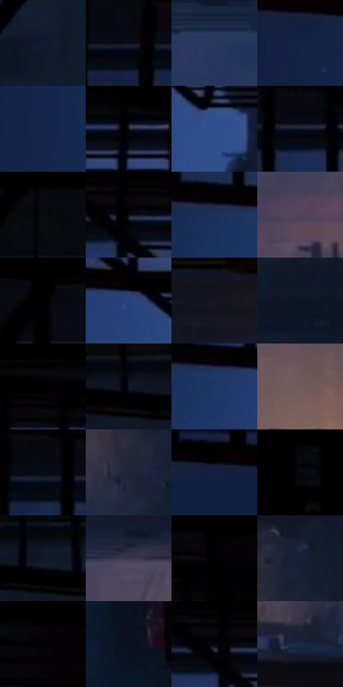

# 电影参考 303

- 状态：常规／活跃；来源世界：miles-home。
- 视角：low-angle；景别：environment-wide；场景：city。
- 时段：night-appearance（外观依据，中置信度；具体时间／晨昏未知）；光照：night-mixed。
- 材质候选：skin, fabric, brick, metal, asphalt, sky（帧级，不是像素分割）。
- 明暗组：very-dark；L* P5/P50/P95：0.2926 / 8.88427 / 34.04365。
- 资格门禁：无附加门禁。
- 原截图 SHA-256：`bd790522b8f4070149f7cf577a6b133a8fd58ab0e380c9ad6a6383f43564e62c`；尺寸：2878 × 1258。
- sRGB 像素 SHA-256：`a0a2f08bf0dc0ca3984b773376175e13236c5ee1fd730eef277e4c54708c5887`。

## 观察与迁移

冷暗巷道俯仰视，少量暖灯与黑形保空间。

303  /  稳定夜景／留白  /  开阔冷蓝与远处暖光、人物剪影；保留安静大色面

本公开版保存32个128×128原像素色卡上下文；图集格子并非原场景相邻位置。原rect、图集tile和像素SHA见 `data/palette-crops.json`。上下文不足时不得批准替色，不能以小样推断完整构图。

## 实测色卡

颜色比例分母为保留采样像素，不是材料面积；全部 32 色参与全库匹配。表内四舍五入仅用于阅读，原精度在 JSON。

| ID | HEX | Lab | 原图 xy | 像素数 | 比例 | 明度角色 |
| --- | --- | --- | --- | ---: | ---: | --- |
| 303-S01 | #121A2D | [9.455679, 3.111095, -13.912071] | [1284, 268] | 12040 | 5.968610% | deep-shadow |
| 303-S02 | #0A0E1A | [4.093349, 1.551693, -7.787982] | [336, 124] | 11524 | 5.712813% | deep-shadow |
| 303-S03 | #29375D | [23.650843, 6.637456, -24.500323] | [1256, 648] | 9233 | 4.577091% | shadow |
| 303-S04 | #132344 | [14.160375, 5.994634, -22.841729] | [256, 264] | 9220 | 4.570647% | deep-shadow |
| 303-S05 | #15274C | [16.165351, 6.785065, -25.132348] | [304, 632] | 8781 | 4.353020% | deep-shadow |
| 303-S06 | #10111D | [5.417416, 2.695064, -8.122714] | [836, 132] | 8092 | 4.011461% | deep-shadow |
| 303-S07 | #33508C | [34.668369, 9.207164, -36.624919] | [908, 392] | 8058 | 3.994606% | shadow |
| 303-S08 | #0F1727 | [7.775272, 2.090302, -12.120943] | [508, 132] | 7962 | 3.947016% | deep-shadow |
| 303-S09 | #0A0B10 | [3.082725, 0.572235, -2.381894] | [1416, 32] | 7172 | 3.555388% | deep-shadow |
| 303-S10 | #0D0D16 | [3.896154, 1.831446, -4.984679] | [660, 124] | 6997 | 3.468635% | deep-shadow |
| 303-S11 | #1A305B | [20.394816, 7.394224, -28.41807] | [520, 252] | 6973 | 3.456737% | shadow |
| 303-S12 | #4F4357 | [30.314605, 9.46588, -10.009719] | [1804, 740] | 6873 | 3.407164% | shadow |
| 303-S13 | #000000 | [0.0, 0.0, 0.0] | [60, 28] | 6560 | 3.252000% | deep-shadow |
| 303-S14 | #284379 | [29.0186, 8.64614, -33.905144] | [732, 264] | 6528 | 3.236137% | shadow |
| 303-S15 | #181722 | [8.328013, 3.656711, -7.445258] | [2400, 408] | 6450 | 3.197470% | deep-shadow |
| 303-S16 | #0A1525 | [6.633473, 1.193455, -12.422597] | [1464, 268] | 6251 | 3.098819% | deep-shadow |
| 303-S17 | #020206 | [0.627494, 0.55614, -1.513628] | [708, 36] | 5721 | 2.836081% | deep-shadow |
| 303-S18 | #121423 | [6.776696, 3.678889, -10.64014] | [1764, 172] | 5575 | 2.763705% | deep-shadow |
| 303-S19 | #1E3868 | [24.010202, 7.713839, -31.115338] | [596, 272] | 5575 | 2.763705% | shadow |
| 303-S20 | #71595B | [40.264659, 10.184311, 2.60407] | [2196, 748] | 5274 | 2.614489% | midtone |
| 303-S21 | #070C15 | [3.272038, 0.413917, -5.236418] | [424, 120] | 5220 | 2.587720% | deep-shadow |
| 303-S22 | #242538 | [15.401239, 5.011495, -12.414575] | [2680, 764] | 5220 | 2.587720% | deep-shadow |
| 303-S23 | #102040 | [12.691532, 5.930703, -22.408303] | [128, 224] | 5127 | 2.541617% | deep-shadow |
| 303-S24 | #07060A | [1.782497, 0.81757, -1.421358] | [1080, 28] | 5045 | 2.500967% | deep-shadow |
| 303-S25 | #10192A | [8.76034, 2.06573, -12.803692] | [1952, 180] | 4831 | 2.394880% | deep-shadow |
| 303-S26 | #3A384E | [24.569523, 6.46485, -13.089054] | [1928, 628] | 4804 | 2.381495% | shadow |
| 303-S27 | #020102 | [0.352269, 0.400526, -0.286252] | [2420, 28] | 4664 | 2.312093% | deep-shadow |
| 303-S28 | #161E35 | [11.662016, 4.416776, -16.218946] | [2736, 652] | 4324 | 2.143544% | deep-shadow |
| 303-S29 | #020002 | [0.156191, 0.801086, -0.57257] | [2816, 32] | 3659 | 1.813882% | deep-shadow |
| 303-S30 | #0A101F | [4.823573, 2.053853, -10.610733] | [2108, 324] | 3157 | 1.565025% | deep-shadow |
| 303-S31 | #04070F | [1.917188, 0.430366, -3.582907] | [636, 120] | 2905 | 1.440101% | deep-shadow |
| 303-S32 | #1B2742 | [15.887404, 4.190395, -18.683072] | [2524, 896] | 1907 | 0.945360% | deep-shadow |

## 色阶与空间分布

- 采样 ROI：`[0.01, 0.02, 0.98, 0.94]`；步长：4；样本数：201722。
- 排除区：`[]`。
- 深暗、暗、中、亮、高光五段计数：`[152013, 47054, 2655, 0, 0]`。
- RGB 各 256 箱、L* 100 箱、13×5 色相明度表和 3×3 空间统计全部保存在 [总数据](../film-library.json)。
- [可视化档案](../../references/library.html)按需绘制直方图，不存 2,094 张重复图表图片。

## 纹理特征占比

**这是分块图像特征的面积占比，不是波点／排线／丝网／错版的精确语义覆盖率。** 窗格、发丝、织物也会产生方向或周期特征。
原图 ROI 像素 3230344；已测块覆盖 3216384（99.5678%）；未测 13960。

| 特征 | 块覆盖像素 | 占已测面积 | 阈值敏感范围 |
| --- | ---: | ---: | --- |
| low-contrast | 1200128 | 37.3130% | 25.2786% ~ 44.6673% |
| directional-structure | 832512 | 25.8835% | 16.8099% ~ 33.3333% |
| periodic-structure | 1118208 | 34.7660% | 34.7660% ~ 39.3505% |
| mixed-detail | 65536 | 2.0376% | 2.0376% ~ 2.0376% |

阈值敏感范围不是统计置信区间。逐块坐标、尺度、对比、方向一致性、频谱集中度、频率与角度见 [全量特征记录](../texture-features.jsonl)，以帧号定位。
四种印刷层的真实像素覆盖仍标为 `null`，不能填 0，也不能拿上表代替。不得据这些代理测量删除唯一证据。

[测量方法与保留策略](../../references/library-retention.md) · [分类索引](../archive/README.md)
