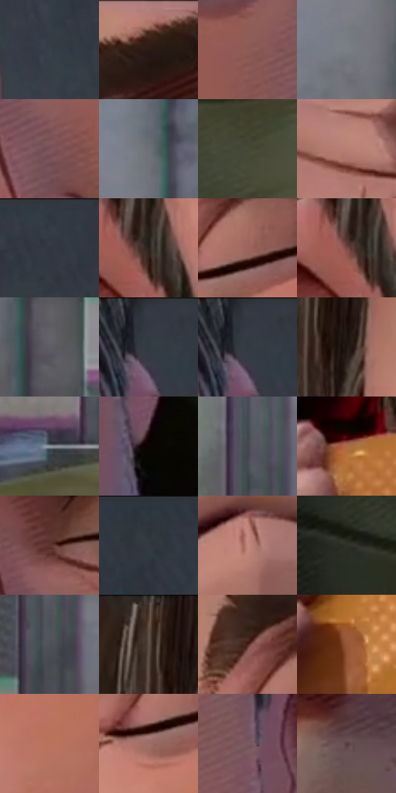

# 电影参考 304

- 状态：常规／活跃；来源世界：miles-home。
- 视角：near-level；景别：close-up；场景：portrait。
- 时段：daylight-time-unspecified（外观依据，中置信度；具体时间／晨昏未知）；光照：neutral-day。
- 材质候选：skin, hair, fabric, metal, glass, plastic, food（帧级，不是像素分割）。
- 明暗组：dark；L* P5/P50/P95：8.37601 / 37.14804 / 59.49962。
- 资格门禁：无附加门禁。
- 原截图 SHA-256：`84f7b6c8d3ae6d97d8914e5d1a15061997b04f9f255ad8271f75554a1032e025`；尺寸：2880 × 1208。
- sRGB 像素 SHA-256：`651e2cc6280a6af17daf831701779a8bde53ea846d1912f9a615dd391a2bbc2c`。

## 观察与迁移

餐厅中性光、成人与少年五官差异、手部和食物各有体块。

304  /  明亮裸脸／食物  /  暖中性肤色、眼睑与手指体积；胡茬、面包芝麻和印刷点不同

本公开版保存32个128×128原像素色卡上下文；图集格子并非原场景相邻位置。原rect、图集tile和像素SHA见 `data/palette-crops.json`。上下文不足时不得批准替色，不能以小样推断完整构图。

## 实测色卡

颜色比例分母为保留采样像素，不是材料面积；全部 32 色参与全库匹配。表内四舍五入仅用于阅读，原精度在 JSON。

| ID | HEX | Lab | 原图 xy | 像素数 | 比例 | 明度角色 |
| --- | --- | --- | --- | ---: | ---: | --- |
| 304-S01 | #39404A | [26.822716, -0.327345, -7.033391] | [2052, 204] | 10326 | 5.340685% | shadow |
| 304-S02 | #AF756A | [54.947518, 21.419801, 15.384698] | [1204, 28] | 10249 | 5.300860% | midtone |
| 304-S03 | #8D5B55 | [43.947568, 19.770529, 11.952823] | [1776, 208] | 9868 | 5.103804% | midtone |
| 304-S04 | #7C7E85 | [52.840008, 0.698311, -4.045938] | [520, 404] | 8849 | 4.576769% | midtone |
| 304-S05 | #795257 | [39.221736, 17.074892, 3.694178] | [1592, 320] | 8484 | 4.387988% | shadow |
| 304-S06 | #6E7077 | [47.281478, 0.719449, -4.130741] | [576, 148] | 7926 | 4.099387% | midtone |
| 304-S07 | #464836 | [29.919499, -4.429622, 10.559394] | [2772, 1032] | 7868 | 4.069389% | shadow |
| 304-S08 | #B97F74 | [58.747832, 21.057671, 15.066739] | [760, 924] | 7790 | 4.029046% | midtone |
| 304-S09 | #303740 | [22.760797, -0.564458, -6.580568] | [2248, 28] | 7237 | 3.743031% | shadow |
| 304-S10 | #28211A | [13.311956, 1.942625, 5.982198] | [908, 360] | 6692 | 3.461153% | deep-shadow |
| 304-S11 | #9C655C | [48.447851, 21.064743, 14.268974] | [1156, 236] | 6516 | 3.370124% | midtone |
| 304-S12 | #794944 | [36.458031, 19.82878, 11.656626] | [884, 360] | 6187 | 3.199963% | shadow |
| 304-S13 | #5D5D64 | [39.708016, 1.517619, -3.989492] | [636, 456] | 6145 | 3.178240% | shadow |
| 304-S14 | #343C45 | [24.925129, -0.963016, -6.630269] | [1956, 44] | 6000 | 3.103245% | shadow |
| 304-S15 | #333942 | [23.748362, -0.188777, -6.410263] | [1956, 28] | 5971 | 3.088246% | shadow |
| 304-S16 | #1F140F | [7.462656, 4.705919, 4.802505] | [892, 116] | 5851 | 3.026181% | deep-shadow |
| 304-S17 | #8C939D | [60.672795, -0.456735, -6.131264] | [184, 844] | 5760 | 2.979115% | light |
| 304-S18 | #0B0402 | [1.466768, 1.559005, 1.404298] | [1964, 476] | 5590 | 2.891190% | deep-shadow |
| 304-S19 | #45474F | [30.245123, 1.054177, -5.053625] | [252, 304] | 5580 | 2.886018% | shadow |
| 304-S20 | #AB6B43 | [51.359784, 21.535385, 32.815065] | [1008, 848] | 5310 | 2.746372% | midtone |
| 304-S21 | #5E342E | [26.829982, 18.139532, 11.984719] | [1552, 144] | 5255 | 2.717925% | shadow |
| 304-S22 | #2F353C | [21.860008, -0.723728, -5.243364] | [2496, 40] | 5166 | 2.671894% | shadow |
| 304-S23 | #C28A80 | [62.681946, 20.03147, 13.873442] | [1720, 992] | 4895 | 2.531731% | light |
| 304-S24 | #303127 | [19.92944, -2.620317, 6.254331] | [2460, 932] | 4522 | 2.338812% | deep-shadow |
| 304-S25 | #4E5257 | [34.685865, -0.461495, -3.471335] | [264, 616] | 4439 | 2.295884% | shadow |
| 304-S26 | #5E4E47 | [34.566852, 5.440062, 6.639359] | [840, 64] | 4386 | 2.268472% | shadow |
| 304-S27 | #4A221C | [18.731673, 18.302072, 12.733906] | [1080, 168] | 4381 | 2.265886% | deep-shadow |
| 304-S28 | #955638 | [43.259733, 23.138931, 28.473693] | [1016, 1020] | 4157 | 2.150032% | midtone |
| 304-S29 | #B9735B | [55.414228, 24.983832, 24.842154] | [1232, 468] | 3982 | 2.059520% | midtone |
| 304-S30 | #9D6E67 | [51.037033, 17.712543, 11.380337] | [1108, 288] | 2989 | 1.545933% | midtone |
| 304-S31 | #7C5C61 | [42.465022, 13.907702, 2.258505] | [1888, 240] | 2589 | 1.339050% | midtone |
| 304-S32 | #523C3F | [27.803807, 10.195942, 1.929791] | [1576, 620] | 2386 | 1.234057% | shadow |

## 色阶与空间分布

- 采样 ROI：`[0.01, 0.02, 0.98, 0.94]`；步长：4；样本数：193346。
- 排除区：`[]`。
- 深暗、暗、中、亮、高光五段计数：`[23425, 83627, 77689, 8589, 16]`。
- RGB 各 256 箱、L* 100 箱、13×5 色相明度表和 3×3 空间统计全部保存在 [总数据](../film-library.json)。
- [可视化档案](../../references/library.html)按需绘制直方图，不存 2,094 张重复图表图片。

## 纹理特征占比

**这是分块图像特征的面积占比，不是波点／排线／丝网／错版的精确语义覆盖率。** 窗格、发丝、织物也会产生方向或周期特征。
原图 ROI 像素 3104134；已测块覆盖 3104134（100.0000%）；未测 0。

| 特征 | 块覆盖像素 | 占已测面积 | 阈值敏感范围 |
| --- | ---: | ---: | --- |
| low-contrast | 469760 | 15.1334% | 11.2614% ~ 17.1539% |
| directional-structure | 1128320 | 36.3489% | 17.2487% ~ 54.7523% |
| periodic-structure | 1407110 | 45.3302% | 32.5720% ~ 60.1089% |
| mixed-detail | 98944 | 3.1875% | 1.4144% ~ 5.4884% |

阈值敏感范围不是统计置信区间。逐块坐标、尺度、对比、方向一致性、频谱集中度、频率与角度见 [全量特征记录](../texture-features.jsonl)，以帧号定位。
四种印刷层的真实像素覆盖仍标为 `null`，不能填 0，也不能拿上表代替。不得据这些代理测量删除唯一证据。

[测量方法与保留策略](../../references/library-retention.md) · [分类索引](../archive/README.md)
