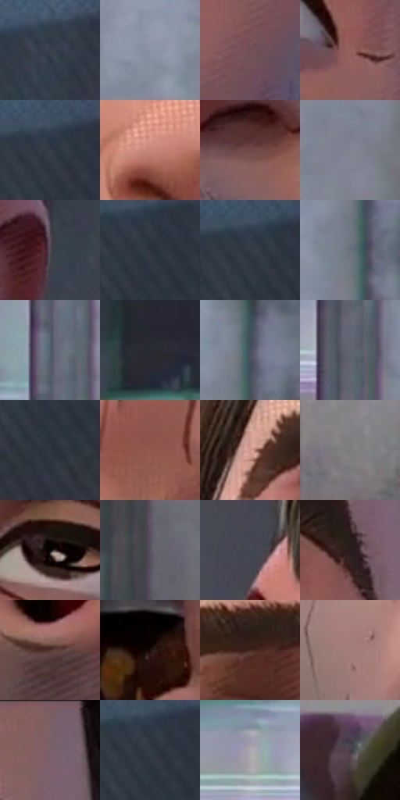

# 电影参考 305

- 状态：常规／活跃；来源世界：miles-home。
- 视角：near-level；景别：close-up；场景：portrait。
- 时段：daylight-time-unspecified（外观依据，中置信度；具体时间／晨昏未知）；光照：neutral-day。
- 材质候选：skin, hair, fabric, metal, glass, plastic, food（帧级，不是像素分割）。
- 明暗组：dark；L* P5/P50/P95：8.58478 / 35.53941 / 65.39453。
- 资格门禁：无附加门禁。
- 原截图 SHA-256：`34b644cd35850a5d7157c4d0948b8871688c4fb56301fd61e96010053d0f52ca`；尺寸：2880 × 1210。
- sRGB 像素 SHA-256：`34643a38b47fb7451bd56841108b22059a625c62359b1b3e35715bf4e5ec909e`。

## 观察与迁移

餐厅中性光、成人与少年五官差异、手部和食物各有体块。

305  /  明亮裸脸／点线  /  局部细点、阴面斜线与简洁鼻唇；不搬用进食表情或嘴边食物

本公开版保存32个128×128原像素色卡上下文；图集格子并非原场景相邻位置。原rect、图集tile和像素SHA见 `data/palette-crops.json`。上下文不足时不得批准替色，不能以小样推断完整构图。

## 实测色卡

颜色比例分母为保留采样像素，不是材料面积；全部 32 色参与全库匹配。表内四舍五入仅用于阅读，原精度在 JSON。

| ID | HEX | Lab | 原图 xy | 像素数 | 比例 | 明度角色 |
| --- | --- | --- | --- | ---: | ---: | --- |
| 305-S01 | #39404B | [26.861216, -0.055891, -7.631286] | [2528, 128] | 11652 | 6.004824% | shadow |
| 305-S02 | #8B94A4 | [61.08807, 0.163306, -9.494679] | [400, 520] | 11249 | 5.797139% | light |
| 305-S03 | #745158 | [38.380929, 15.778, 1.779922] | [1872, 744] | 8717 | 4.492280% | shadow |
| 305-S04 | #94635E | [47.012498, 19.177363, 10.934093] | [1940, 368] | 8006 | 4.125868% | midtone |
| 305-S05 | #343C46 | [24.963986, -0.685823, -7.234988] | [2764, 84] | 7968 | 4.106285% | shadow |
| 305-S06 | #C9877B | [62.657674, 23.815814, 16.785518] | [1396, 516] | 7822 | 4.031045% | light |
| 305-S07 | #6F4747 | [34.68441, 17.152474, 7.092422] | [1600, 652] | 7612 | 3.922822% | shadow |
| 305-S08 | #818590 | [55.538513, 0.825711, -6.39549] | [508, 664] | 7385 | 3.805838% | midtone |
| 305-S09 | #4C4852 | [31.301706, 3.889096, -5.339471] | [2196, 680] | 6983 | 3.598668% | shadow |
| 305-S10 | #2D333C | [21.024976, -0.160104, -6.515323] | [2784, 108] | 6801 | 3.504875% | shadow |
| 305-S11 | #323842 | [23.337055, 0.092265, -7.037979] | [2756, 88] | 6717 | 3.461586% | shadow |
| 305-S12 | #69727B | [47.582163, -1.378321, -6.111931] | [584, 344] | 6496 | 3.347694% | midtone |
| 305-S13 | #525D6A | [39.006741, -1.097343, -8.827991] | [252, 340] | 6462 | 3.330173% | shadow |
| 305-S14 | #282931 | [16.790258, 1.635292, -5.337788] | [832, 232] | 6265 | 3.228649% | deep-shadow |
| 305-S15 | #4A515E | [34.290604, 0.382969, -8.508864] | [604, 264] | 6175 | 3.182268% | shadow |
| 305-S16 | #60656F | [42.675227, 0.309805, -6.280787] | [268, 484] | 6143 | 3.165777% | midtone |
| 305-S17 | #30363F | [22.392584, -0.175248, -6.461541] | [2784, 188] | 5877 | 3.028695% | shadow |
| 305-S18 | #925A4F | [44.217473, 21.724623, 16.048735] | [1596, 104] | 5787 | 2.982313% | midtone |
| 305-S19 | #CE988D | [67.653206, 18.716532, 13.733525] | [1200, 108] | 5777 | 2.977160% | light |
| 305-S20 | #7D7980 | [51.374182, 2.919625, -3.270985] | [36, 680] | 5276 | 2.718971% | midtone |
| 305-S21 | #0A0503 | [1.622838, 1.029322, 1.217705] | [1788, 288] | 5183 | 2.671044% | deep-shadow |
| 305-S22 | #5A525F | [36.05064, 6.035082, -6.352424] | [304, 1100] | 4987 | 2.570036% | shadow |
| 305-S23 | #424650 | [29.707363, 0.785202, -6.530405] | [1032, 452] | 4630 | 2.386057% | shadow |
| 305-S24 | #291D1C | [12.182554, 5.683067, 2.964423] | [1960, 216] | 4545 | 2.342252% | deep-shadow |
| 305-S25 | #533532 | [25.611093, 13.049945, 7.418731] | [1388, 1020] | 4409 | 2.272165% | shadow |
| 305-S26 | #1C0C0B | [4.823936, 6.685552, 2.820762] | [1468, 864] | 4358 | 2.245882% | deep-shadow |
| 305-S27 | #432620 | [18.731463, 12.893732, 9.776849] | [1356, 104] | 4250 | 2.190225% | deep-shadow |
| 305-S28 | #A27D79 | [55.816689, 13.704678, 7.69994] | [1220, 948] | 3713 | 1.913484% | midtone |
| 305-S29 | #7A6069 | [43.541986, 12.09652, -1.077803] | [1984, 48] | 3566 | 1.837728% | midtone |
| 305-S30 | #323B44 | [24.396228, -1.336233, -6.777861] | [2772, 100] | 3510 | 1.808868% | shadow |
| 305-S31 | #ADA9B3 | [69.834652, 3.326486, -4.616148] | [152, 452] | 2948 | 1.519243% | light |
| 305-S32 | #473E47 | [27.407405, 5.803206, -4.053292] | [908, 896] | 2775 | 1.430088% | shadow |

## 色阶与空间分布

- 采样 ROI：`[0.01, 0.02, 0.98, 0.94]`；步长：4；样本数：194044。
- 排除区：`[]`。
- 深暗、暗、中、亮、高光五段计数：`[23947, 93369, 55151, 21470, 107]`。
- RGB 各 256 箱、L* 100 箱、13×5 色相明度表和 3×3 空间统计全部保存在 [总数据](../film-library.json)。
- [可视化档案](../../references/library.html)按需绘制直方图，不存 2,094 张重复图表图片。

## 纹理特征占比

**这是分块图像特征的面积占比，不是波点／排线／丝网／错版的精确语义覆盖率。** 窗格、发丝、织物也会产生方向或周期特征。
原图 ROI 像素 3109722；已测块覆盖 3109722（100.0000%）；未测 0。

| 特征 | 块覆盖像素 | 占已测面积 | 阈值敏感范围 |
| --- | ---: | ---: | --- |
| low-contrast | 610688 | 19.6380% | 11.4552% ~ 20.8346% |
| directional-structure | 930304 | 29.9160% | 15.6454% ~ 42.4002% |
| periodic-structure | 1480410 | 47.6059% | 45.6178% ~ 58.5724% |
| mixed-detail | 88320 | 2.8401% | 0.5269% ~ 4.9476% |

阈值敏感范围不是统计置信区间。逐块坐标、尺度、对比、方向一致性、频谱集中度、频率与角度见 [全量特征记录](../texture-features.jsonl)，以帧号定位。
四种印刷层的真实像素覆盖仍标为 `null`，不能填 0，也不能拿上表代替。不得据这些代理测量删除唯一证据。

[测量方法与保留策略](../../references/library-retention.md) · [分类索引](../archive/README.md)
