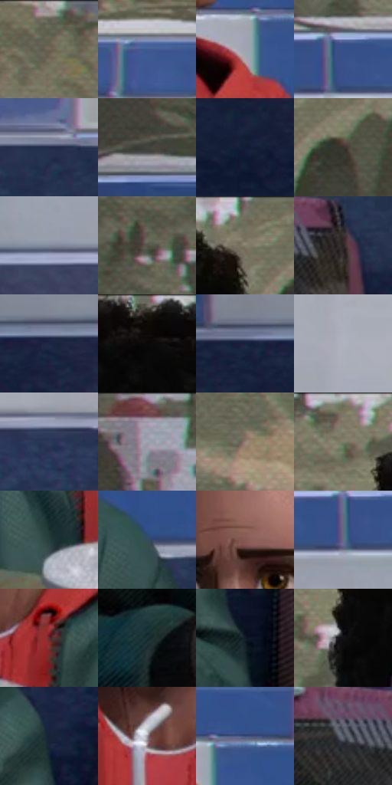

# 电影参考 306

- 状态：常规／活跃；来源世界：miles-home。
- 视角：near-level；景别：medium；场景：portrait。
- 时段：daylight-time-unspecified（外观依据，中置信度；具体时间／晨昏未知）；光照：neutral-day。
- 材质候选：skin, hair, fabric, metal, glass, plastic, food（帧级，不是像素分割）。
- 明暗组：dark；L* P5/P50/P95：6.70374 / 33.15192 / 68.38226。
- 资格门禁：无附加门禁。
- 原截图 SHA-256：`e02749a723500ac45fc646d745379069aa7310246a9219acedd999deec2aad87`；尺寸：2880 × 1210。
- sRGB 像素 SHA-256：`fb470d17d291cfe99bccfd747b066149d5c8be3d421bc4284531d084cf7e3a09`。

## 观察与迁移

餐厅中性光、成人与少年五官差异、手部和食物各有体块。

306  /  正面裸脸／日常材料  /  卷发群、肤色、外套、杯与蓝白砖分开；墙上风景是平面画，不是窗外真森林

本公开版保存32个128×128原像素色卡上下文；图集格子并非原场景相邻位置。原rect、图集tile和像素SHA见 `data/palette-crops.json`。上下文不足时不得批准替色，不能以小样推断完整构图。

## 实测色卡

颜色比例分母为保留采样像素，不是材料面积；全部 32 色参与全库匹配。表内四舍五入仅用于阅读，原精度在 JSON。

| ID | HEX | Lab | 原图 xy | 像素数 | 比例 | 明度角色 |
| --- | --- | --- | --- | ---: | ---: | --- |
| 306-S01 | #626252 | [41.122751, -3.093614, 9.134217] | [2344, 40] | 11847 | 6.105316% | midtone |
| 306-S02 | #415A92 | [38.743563, 7.863128, -33.750775] | [2236, 384] | 10719 | 5.524005% | shadow |
| 306-S03 | #A0A5B2 | [67.723142, 0.840619, -7.30087] | [1632, 496] | 10468 | 5.394653% | light |
| 306-S04 | #365189 | [34.952028, 8.083386, -34.329814] | [668, 396] | 9809 | 5.055039% | shadow |
| 306-S05 | #242E4B | [19.37831, 5.065034, -19.296681] | [2704, 680] | 8838 | 4.554637% | deep-shadow |
| 306-S06 | #41433D | [28.047455, -2.148013, 3.356213] | [284, 340] | 8128 | 4.188741% | shadow |
| 306-S07 | #111B36 | [10.328635, 5.740774, -19.074314] | [244, 928] | 8070 | 4.158851% | deep-shadow |
| 306-S08 | #3B322E | [21.610295, 3.234224, 4.033207] | [1736, 116] | 7663 | 3.949104% | shadow |
| 306-S09 | #82899C | [57.111454, 1.552927, -10.954464] | [652, 664] | 7598 | 3.915607% | midtone |
| 306-S10 | #535347 | [34.964228, -2.413907, 7.046924] | [480, 156] | 7220 | 3.720806% | shadow |
| 306-S11 | #71705E | [46.85274, -2.9906, 10.171619] | [1644, 44] | 7215 | 3.718229% | midtone |
| 306-S12 | #2B2221 | [14.21659, 4.078474, 2.282146] | [2568, 888] | 6545 | 3.372946% | deep-shadow |
| 306-S13 | #1D2744 | [16.152334, 5.511873, -19.636849] | [244, 700] | 6437 | 3.317289% | deep-shadow |
| 306-S14 | #090808 | [2.251697, 0.26136, 0.092402] | [1428, 64] | 6351 | 3.272969% | deep-shadow |
| 306-S15 | #19223E | [13.817414, 5.782041, -19.178096] | [144, 696] | 6141 | 3.164746% | deep-shadow |
| 306-S16 | #B0B2BF | [72.781248, 1.831128, -6.83717] | [1960, 584] | 5667 | 2.920472% | light |
| 306-S17 | #2D3858 | [23.968537, 5.288942, -20.703534] | [2404, 696] | 5550 | 2.860176% | shadow |
| 306-S18 | #6C4145 | [32.698681, 19.239759, 5.498728] | [132, 28] | 5400 | 2.782874% | shadow |
| 306-S19 | #958172 | [55.385849, 5.147513, 10.95134] | [908, 244] | 5392 | 2.778751% | midtone |
| 306-S20 | #7D7967 | [50.703887, -1.759818, 10.434904] | [1208, 44] | 4995 | 2.574158% | midtone |
| 306-S21 | #283F3F | [24.842571, -8.920072, -2.865963] | [1296, 752] | 4489 | 2.313393% | shadow |
| 306-S22 | #344D5A | [31.29058, -5.699878, -10.660908] | [1768, 660] | 4420 | 2.277834% | shadow |
| 306-S23 | #845852 | [41.992518, 17.374275, 10.888118] | [1464, 304] | 4326 | 2.229391% | midtone |
| 306-S24 | #636C86 | [45.768882, 2.809041, -15.448358] | [648, 440] | 4322 | 2.227330% | midtone |
| 306-S25 | #642A2E | [25.452338, 26.600324, 10.278168] | [1532, 704] | 4215 | 2.172188% | shadow |
| 306-S26 | #1B3235 | [19.102812, -8.06075, -4.746649] | [1136, 1060] | 4199 | 2.163942% | deep-shadow |
| 306-S27 | #111B27 | [9.3968, -0.304999, -9.585358] | [1932, 1052] | 3942 | 2.031498% | deep-shadow |
| 306-S28 | #121113 | [5.2076, 0.797072, -0.995211] | [1256, 176] | 3864 | 1.991301% | deep-shadow |
| 306-S29 | #162337 | [13.521645, 1.45901, -14.722869] | [1896, 900] | 3855 | 1.986663% | deep-shadow |
| 306-S30 | #9D979D | [63.123879, 3.328248, -2.359168] | [1416, 684] | 3202 | 1.650141% | light |
| 306-S31 | #3D5177 | [34.41298, 3.594379, -24.053861] | [1688, 444] | 1846 | 0.951331% | shadow |
| 306-S32 | #575C66 | [38.966841, 0.331249, -6.379731] | [2456, 884] | 1311 | 0.675620% | shadow |

## 色阶与空间分布

- 采样 ROI：`[0.01, 0.02, 0.98, 0.94]`；步长：4；样本数：194044。
- 排除区：`[]`。
- 深暗、暗、中、亮、高光五段计数：`[55139, 76327, 41539, 20849, 190]`。
- RGB 各 256 箱、L* 100 箱、13×5 色相明度表和 3×3 空间统计全部保存在 [总数据](../film-library.json)。
- [可视化档案](../../references/library.html)按需绘制直方图，不存 2,094 张重复图表图片。

## 纹理特征占比

**这是分块图像特征的面积占比，不是波点／排线／丝网／错版的精确语义覆盖率。** 窗格、发丝、织物也会产生方向或周期特征。
原图 ROI 像素 3109722；已测块覆盖 3109722（100.0000%）；未测 0。

| 特征 | 块覆盖像素 | 占已测面积 | 阈值敏感范围 |
| --- | ---: | ---: | --- |
| low-contrast | 178266 | 5.7325% | 2.1527% ~ 8.7332% |
| directional-structure | 999552 | 32.1428% | 28.2695% ~ 37.4114% |
| periodic-structure | 1789440 | 57.5434% | 55.7817% ~ 59.9090% |
| mixed-detail | 142464 | 4.5812% | 0.5269% ~ 7.2156% |

阈值敏感范围不是统计置信区间。逐块坐标、尺度、对比、方向一致性、频谱集中度、频率与角度见 [全量特征记录](../texture-features.jsonl)，以帧号定位。
四种印刷层的真实像素覆盖仍标为 `null`，不能填 0，也不能拿上表代替。不得据这些代理测量删除唯一证据。

[测量方法与保留策略](../../references/library-retention.md) · [分类索引](../archive/README.md)
