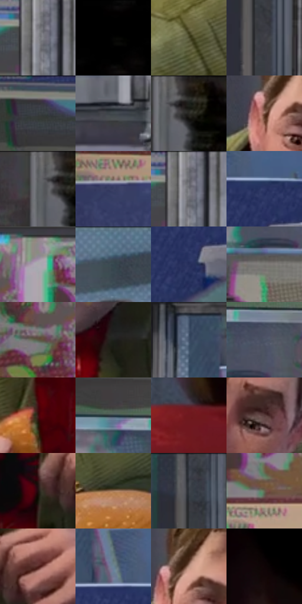

# 电影参考 307

- 状态：常规／活跃；来源世界：miles-home。
- 视角：near-level；景别：medium；场景：portrait。
- 时段：daylight-time-unspecified（外观依据，中置信度；具体时间／晨昏未知）；光照：neutral-day。
- 材质候选：skin, hair, fabric, metal, glass, plastic, food（帧级，不是像素分割）。
- 明暗组：dark；L* P5/P50/P95：1.48235 / 30.1284 / 60.79469。
- 资格门禁：无附加门禁。
- 原截图 SHA-256：`65d4ce0f440d0e4fe1de8d5d12a63836d73f3fdef7e2c78e6b0bc23cbeac49dd`；尺寸：2880 × 1210。
- sRGB 像素 SHA-256：`f88434a77fed2640ca4efbb87e8e36ba4ea7022715b5f9fbfbc5aa46d5e92d96`。

## 观察与迁移

餐厅中性光、成人与少年五官差异、手部和食物各有体块。

307  /  餐厅／光泽层级  /  一次性杯、蓝托盘、白盘、食品、金属设备与玻璃门有不同亮形

本公开版保存32个128×128原像素色卡上下文；图集格子并非原场景相邻位置。原rect、图集tile和像素SHA见 `data/palette-crops.json`。上下文不足时不得批准替色，不能以小样推断完整构图。

## 实测色卡

颜色比例分母为保留采样像素，不是材料面积；全部 32 色参与全库匹配。表内四舍五入仅用于阅读，原精度在 JSON。

| ID | HEX | Lab | 原图 xy | 像素数 | 比例 | 明度角色 |
| --- | --- | --- | --- | ---: | ---: | --- |
| 307-S01 | #88888F | [56.90514, 1.40582, -3.73257] | [952, 72] | 12388 | 6.384119% | midtone |
| 307-S02 | #010101 | [0.274173, -1.7e-05, 3.3e-05] | [2596, 28] | 8781 | 4.525262% | deep-shadow |
| 307-S03 | #504F30 | [32.943006, -5.057117, 18.482027] | [980, 660] | 8563 | 4.412917% | shadow |
| 307-S04 | #3F3E46 | [26.575132, 2.293694, -4.720041] | [1924, 196] | 8093 | 4.170704% | shadow |
| 307-S05 | #3A3538 | [22.762485, 2.858966, -1.085405] | [360, 44] | 8021 | 4.133599% | shadow |
| 307-S06 | #42494E | [30.576423, -1.629828, -3.944591] | [2312, 560] | 7744 | 3.990847% | shadow |
| 307-S07 | #30312C | [20.071357, -1.578632, 3.042751] | [2428, 40] | 7310 | 3.767187% | shadow |
| 307-S08 | #805949 | [41.557247, 13.923357, 15.682864] | [1328, 388] | 7019 | 3.617221% | midtone |
| 307-S09 | #595B5E | [38.575631, -0.139152, -1.996031] | [2380, 32] | 7002 | 3.608460% | shadow |
| 307-S10 | #393F63 | [27.642488, 7.781463, -22.02922] | [248, 816] | 6802 | 3.505391% | shadow |
| 307-S11 | #696A71 | [44.946515, 1.103325, -4.036156] | [960, 48] | 6525 | 3.362639% | midtone |
| 307-S12 | #2E3766 | [24.551514, 11.174905, -28.902262] | [2236, 804] | 6431 | 3.314197% | shadow |
| 307-S13 | #ABA9AC | [69.478393, 1.276034, -1.286113] | [416, 604] | 6335 | 3.264723% | light |
| 307-S14 | #516E83 | [44.996406, -4.875681, -14.945593] | [1480, 44] | 6109 | 3.148255% | midtone |
| 307-S15 | #272F5C | [20.968228, 11.386447, -28.115124] | [2220, 896] | 6082 | 3.134341% | shadow |
| 307-S16 | #7A7874 | [50.489554, -0.024693, 2.463983] | [516, 348] | 6012 | 3.098266% | midtone |
| 307-S17 | #5D5947 | [37.711144, -1.743239, 11.024928] | [304, 684] | 5795 | 2.986436% | shadow |
| 307-S18 | #1F211D | [12.401394, -1.912957, 2.390894] | [1468, 680] | 5626 | 2.899342% | deep-shadow |
| 307-S19 | #3E4F67 | [33.12473, 0.10774, -16.038698] | [2068, 616] | 5450 | 2.808641% | shadow |
| 307-S20 | #4D5667 | [36.389995, 0.682441, -10.955277] | [564, 252] | 5418 | 2.792150% | shadow |
| 307-S21 | #3A1312 | [12.018847, 19.244077, 10.220561] | [1312, 740] | 5412 | 2.789058% | deep-shadow |
| 307-S22 | #2B3A41 | [23.409189, -4.107714, -6.314906] | [452, 196] | 5228 | 2.694234% | shadow |
| 307-S23 | #6F191E | [24.224247, 37.573561, 19.791042] | [2564, 748] | 4924 | 2.537569% | shadow |
| 307-S24 | #593C3B | [28.568672, 12.626971, 5.763677] | [1512, 452] | 4728 | 2.436561% | shadow |
| 307-S25 | #210D0D | [5.783947, 9.635107, 3.395386] | [1404, 940] | 4683 | 2.413370% | deep-shadow |
| 307-S26 | #A0795C | [53.944608, 11.293435, 21.78911] | [1912, 1052] | 4478 | 2.307724% | midtone |
| 307-S27 | #373B43 | [24.781706, 0.3146, -5.491199] | [1908, 28] | 4449 | 2.292779% | shadow |
| 307-S28 | #696551 | [42.619643, -2.086141, 11.919918] | [512, 732] | 4106 | 2.116015% | midtone |
| 307-S29 | #51211E | [19.766488, 22.207568, 12.945436] | [1500, 908] | 4045 | 2.084579% | deep-shadow |
| 307-S30 | #6B8396 | [53.556578, -3.998804, -13.005579] | [2156, 756] | 4029 | 2.076333% | midtone |
| 307-S31 | #B58E7C | [62.191121, 12.131274, 15.236904] | [1360, 352] | 3387 | 1.745480% | light |
| 307-S32 | #0E0405 | [1.726859, 2.876361, 0.586219] | [2676, 512] | 3069 | 1.581600% | deep-shadow |

## 色阶与空间分布

- 采样 ROI：`[0.01, 0.02, 0.98, 0.94]`；步长：4；样本数：194044。
- 排除区：`[]`。
- 深暗、暗、中、亮、高光五段计数：`[36645, 97223, 49603, 10491, 82]`。
- RGB 各 256 箱、L* 100 箱、13×5 色相明度表和 3×3 空间统计全部保存在 [总数据](../film-library.json)。
- [可视化档案](../../references/library.html)按需绘制直方图，不存 2,094 张重复图表图片。

## 纹理特征占比

**这是分块图像特征的面积占比，不是波点／排线／丝网／错版的精确语义覆盖率。** 窗格、发丝、织物也会产生方向或周期特征。
原图 ROI 像素 3109722；已测块覆盖 3109722（100.0000%）；未测 0。

| 特征 | 块覆盖像素 | 占已测面积 | 阈值敏感范围 |
| --- | ---: | ---: | --- |
| low-contrast | 162010 | 5.2098% | 4.1561% ~ 5.6461% |
| directional-structure | 1069184 | 34.3820% | 21.6920% ~ 47.5989% |
| periodic-structure | 1773824 | 57.0412% | 46.9855% ~ 66.2943% |
| mixed-detail | 104704 | 3.3670% | 1.2595% ~ 6.3676% |

阈值敏感范围不是统计置信区间。逐块坐标、尺度、对比、方向一致性、频谱集中度、频率与角度见 [全量特征记录](../texture-features.jsonl)，以帧号定位。
四种印刷层的真实像素覆盖仍标为 `null`，不能填 0，也不能拿上表代替。不得据这些代理测量删除唯一证据。

[测量方法与保留策略](../../references/library-retention.md) · [分类索引](../archive/README.md)
