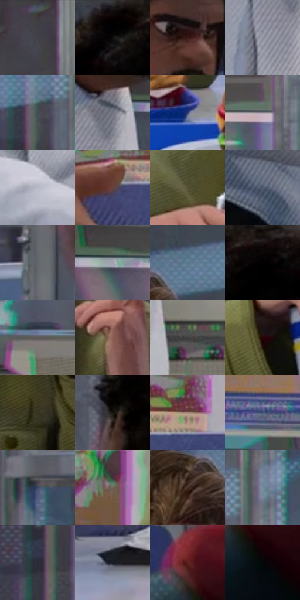

# 电影参考 308

- 状态：常规／活跃；来源世界：miles-home。
- 视角：near-level；景别：medium；场景：portrait。
- 时段：daylight-time-unspecified（外观依据，中置信度；具体时间／晨昏未知）；光照：neutral-day。
- 材质候选：skin, hair, fabric, metal, glass, plastic, food（帧级，不是像素分割）。
- 明暗组：dark；L* P5/P50/P95：0.82252 / 31.9082 / 66.89131。
- 资格门禁：无附加门禁。
- 原截图 SHA-256：`66f0e58699a7ec3c536128f13d2b842fe5e628654eb00b9f2f13bee630befa31`；尺寸：2880 × 1206。
- sRGB 像素 SHA-256：`65848c4142683d6fba0daa869307a39de34dc508f9990f0db866dd0438605f7f`。

## 观察与迁移

餐厅中性光、成人与少年五官差异、手部和食物各有体块。

308  /  多人差异／套色  /  厨师与彼得的脸型不同，白衣仍有灰蓝体积；背景彩边不自动算形体故障

本公开版保存32个128×128原像素色卡上下文；图集格子并非原场景相邻位置。原rect、图集tile和像素SHA见 `data/palette-crops.json`。上下文不足时不得批准替色，不能以小样推断完整构图。

## 实测色卡

颜色比例分母为保留采样像素，不是材料面积；全部 32 色参与全库匹配。表内四舍五入仅用于阅读，原精度在 JSON。

| ID | HEX | Lab | 原图 xy | 像素数 | 比例 | 明度角色 |
| --- | --- | --- | --- | ---: | ---: | --- |
| 308-S01 | #424049 | [27.589507, 2.924527, -5.146448] | [2304, 64] | 11872 | 6.140287% | shadow |
| 308-S02 | #010101 | [0.274173, -1.7e-05, 3.3e-05] | [2560, 48] | 9140 | 4.727276% | deep-shadow |
| 308-S03 | #3A1B17 | [14.09062, 14.745347, 9.628616] | [376, 140] | 8820 | 4.561770% | deep-shadow |
| 308-S04 | #8F919E | [60.390273, 1.92394, -7.093775] | [228, 452] | 8750 | 4.525566% | light |
| 308-S05 | #404E53 | [32.175344, -4.241929, -4.785785] | [1960, 196] | 8143 | 4.211621% | shadow |
| 308-S06 | #70727E | [48.241837, 1.817298, -6.8533] | [288, 364] | 7264 | 3.756995% | midtone |
| 308-S07 | #26336C | [23.209776, 14.369309, -34.95462] | [1828, 1120] | 7250 | 3.749754% | shadow |
| 308-S08 | #817F86 | [53.564615, 2.157874, -3.512871] | [1156, 356] | 7010 | 3.625625% | midtone |
| 308-S09 | #B6B8C7 | [75.044659, 2.217254, -7.799346] | [232, 772] | 6761 | 3.496840% | light |
| 308-S10 | #66413E | [31.701404, 15.678444, 8.472081] | [564, 840] | 6511 | 3.367538% | shadow |
| 308-S11 | #555336 | [34.770821, -4.328827, 17.318479] | [1240, 628] | 6426 | 3.323575% | shadow |
| 308-S12 | #515A6E | [38.176226, 1.441628, -12.558077] | [76, 1012] | 6391 | 3.305473% | shadow |
| 308-S13 | #61676B | [43.216689, -1.429615, -3.041995] | [2368, 708] | 6372 | 3.295646% | midtone |
| 308-S14 | #A49FAB | [66.235511, 4.112661, -5.569225] | [468, 356] | 6330 | 3.273923% | light |
| 308-S15 | #59778D | [48.560689, -4.975949, -15.418406] | [1592, 180] | 6196 | 3.204618% | midtone |
| 308-S16 | #0D0607 | [2.08814, 2.037381, 0.290685] | [2664, 40] | 6016 | 3.111520% | deep-shadow |
| 308-S17 | #5E5855 | [37.869572, 1.824252, 2.608337] | [848, 460] | 6001 | 3.103762% | shadow |
| 308-S18 | #8E6155 | [45.575533, 16.688486, 14.218031] | [1680, 592] | 5989 | 3.097556% | midtone |
| 308-S19 | #3D3C3A | [25.349394, -0.015298, 1.387173] | [388, 548] | 5959 | 3.082039% | shadow |
| 308-S20 | #260609 | [5.077978, 15.466363, 4.195797] | [1144, 784] | 5637 | 2.915499% | deep-shadow |
| 308-S21 | #3A3725 | [22.880805, -2.118567, 11.788519] | [1656, 828] | 5632 | 2.912913% | shadow |
| 308-S22 | #171410 | [6.502776, 0.523616, 2.739653] | [2468, 352] | 5611 | 2.902051% | deep-shadow |
| 308-S23 | #A47F70 | [56.329671, 12.075666, 13.646945] | [704, 796] | 5360 | 2.772232% | midtone |
| 308-S24 | #414F77 | [34.080954, 6.001399, -24.553018] | [632, 184] | 5325 | 2.754130% | shadow |
| 308-S25 | #3C415F | [28.293267, 6.139791, -18.420668] | [2080, 648] | 4975 | 2.573107% | shadow |
| 308-S26 | #74695D | [45.090881, 2.171385, 8.326636] | [916, 712] | 4764 | 2.463976% | midtone |
| 308-S27 | #47322A | [22.958549, 8.241294, 8.832973] | [1504, 248] | 4422 | 2.287092% | shadow |
| 308-S28 | #768C99 | [56.984574, -4.841205, -9.511223] | [2052, 124] | 4145 | 2.143825% | midtone |
| 308-S29 | #2A2E34 | [18.774688, -0.179653, -4.433464] | [1928, 572] | 3252 | 1.681959% | deep-shadow |
| 308-S30 | #191C27 | [10.43601, 1.900635, -7.928518] | [508, 1116] | 2503 | 1.294570% | deep-shadow |
| 308-S31 | #5E211E | [22.166495, 27.642528, 16.498966] | [2404, 896] | 2464 | 1.274399% | shadow |
| 308-S32 | #040709 | [1.783862, -0.506532, -1.033032] | [2456, 1004] | 2055 | 1.062861% | deep-shadow |

## 色阶与空间分布

- 采样 ROI：`[0.01, 0.02, 0.98, 0.94]`；步长：4；样本数：193346。
- 排除区：`[]`。
- 深暗、暗、中、亮、高光五段计数：`[44420, 77249, 51521, 19269, 887]`。
- RGB 各 256 箱、L* 100 箱、13×5 色相明度表和 3×3 空间统计全部保存在 [总数据](../film-library.json)。
- [可视化档案](../../references/library.html)按需绘制直方图，不存 2,094 张重复图表图片。

## 纹理特征占比

**这是分块图像特征的面积占比，不是波点／排线／丝网／错版的精确语义覆盖率。** 窗格、发丝、织物也会产生方向或周期特征。
原图 ROI 像素 3098546；已测块覆盖 3098546（100.0000%）；未测 0。

| 特征 | 块覆盖像素 | 占已测面积 | 阈值敏感范围 |
| --- | ---: | ---: | --- |
| low-contrast | 172338 | 5.5619% | 5.0331% ~ 6.0907% |
| directional-structure | 807936 | 26.0747% | 16.0323% ~ 39.0253% |
| periodic-structure | 2069120 | 66.7771% | 55.9416% ~ 74.3533% |
| mixed-detail | 49152 | 1.5863% | 0.0000% ~ 3.5237% |

阈值敏感范围不是统计置信区间。逐块坐标、尺度、对比、方向一致性、频谱集中度、频率与角度见 [全量特征记录](../texture-features.jsonl)，以帧号定位。
四种印刷层的真实像素覆盖仍标为 `null`，不能填 0，也不能拿上表代替。不得据这些代理测量删除唯一证据。

[测量方法与保留策略](../../references/library-retention.md) · [分类索引](../archive/README.md)
