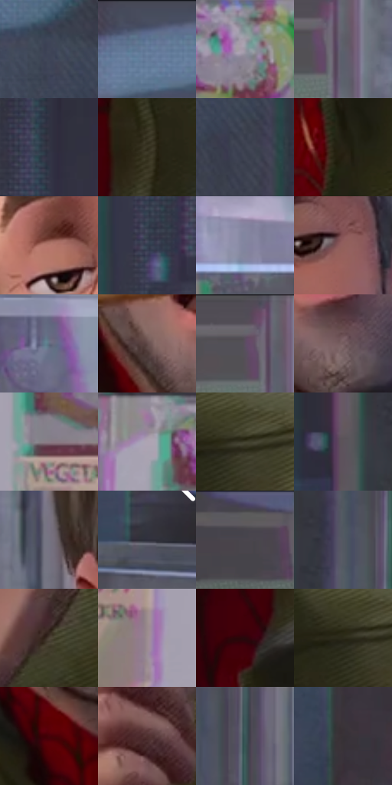

# 电影参考 309

- 状态：常规／活跃；来源世界：miles-home。
- 视角：near-level；景别：close-up；场景：portrait。
- 时段：daylight-time-unspecified（外观依据，中置信度；具体时间／晨昏未知）；光照：neutral-day。
- 材质候选：skin, hair, fabric, metal, glass, plastic, food（帧级，不是像素分割）。
- 明暗组：dark；L* P5/P50/P95：13.20476 / 32.89866 / 63.49431。
- 资格门禁：无附加门禁。
- 原截图 SHA-256：`8bd09593e8ceeca65fa6402f13ebe3c40ecdab141d7b9e99ab7f6e88807afa5b`；尺寸：2880 × 1210。
- sRGB 像素 SHA-256：`86902eedc3564f4fe53f88ed8a410694de5196157f395b7f656e90656af5d315`。

## 观察与迁移

餐厅中性光、成人与少年五官差异、手部和食物各有体块。

309  /  裸脸／表情  /  半垂眼睑、长眉与鼻体；吃东西的张嘴状态不是常规表情模板

本公开版保存32个128×128原像素色卡上下文；图集格子并非原场景相邻位置。原rect、图集tile和像素SHA见 `data/palette-crops.json`。上下文不足时不得批准替色，不能以小样推断完整构图。

## 实测色卡

颜色比例分母为保留采样像素，不是材料面积；全部 32 色参与全库匹配。表内四舍五入仅用于阅读，原精度在 JSON。

| ID | HEX | Lab | 原图 xy | 像素数 | 比例 | 明度角色 |
| --- | --- | --- | --- | ---: | ---: | --- |
| 309-S01 | #3F4557 | [29.414848, 2.194832, -11.516283] | [2008, 84] | 11813 | 6.087795% | shadow |
| 309-S02 | #484E61 | [33.327355, 2.352813, -11.875752] | [1556, 28] | 9967 | 5.136464% | shadow |
| 309-S03 | #9796A2 | [62.508051, 2.747888, -6.148259] | [332, 780] | 9582 | 4.938055% | light |
| 309-S04 | #5D606B | [40.822906, 1.294134, -6.630457] | [940, 80] | 9237 | 4.760261% | midtone |
| 309-S05 | #343543 | [22.589052, 3.155864, -8.823954] | [2232, 112] | 9113 | 4.696358% | shadow |
| 309-S06 | #373221 | [20.840479, -0.944126, 11.650013] | [1672, 864] | 9043 | 4.660283% | shadow |
| 309-S07 | #3C404F | [27.274461, 2.154867, -9.600455] | [2092, 172] | 8813 | 4.541753% | shadow |
| 309-S08 | #272216 | [13.431997, 0.029648, 8.969405] | [1612, 1124] | 7859 | 4.050112% | deep-shadow |
| 309-S09 | #B67A6E | [57.067625, 21.916706, 16.130138] | [1208, 364] | 7790 | 4.014553% | midtone |
| 309-S10 | #333D4D | [25.49377, 0.312061, -11.065949] | [2196, 612] | 7338 | 3.781617% | shadow |
| 309-S11 | #81859F | [56.032618, 4.207688, -14.313001] | [140, 336] | 6982 | 3.598153% | midtone |
| 309-S12 | #91605C | [45.851753, 19.419912, 10.456128] | [1472, 372] | 6462 | 3.330173% | midtone |
| 309-S13 | #606E81 | [45.938348, -0.667719, -12.225328] | [572, 236] | 6161 | 3.175053% | midtone |
| 309-S14 | #614947 | [33.481784, 9.869852, 5.144939] | [1284, 740] | 6156 | 3.172476% | shadow |
| 309-S15 | #504E56 | [33.61809, 2.589161, -4.402935] | [900, 28] | 5982 | 3.082806% | shadow |
| 309-S16 | #745D5F | [41.795703, 9.693795, 2.402389] | [1412, 780] | 5833 | 3.006019% | midtone |
| 309-S17 | #897D86 | [53.714783, 6.278296, -3.212127] | [236, 984] | 5740 | 2.958092% | midtone |
| 309-S18 | #AEA4B3 | [68.609331, 6.423288, -6.419235] | [184, 772] | 5700 | 2.937478% | light |
| 309-S19 | #3F3E2B | [25.792537, -3.251032, 11.88001] | [1784, 752] | 5519 | 2.844200% | shadow |
| 309-S20 | #5C535B | [36.399245, 5.322714, -3.306835] | [2404, 508] | 5234 | 2.697326% | shadow |
| 309-S21 | #757382 | [49.074917, 3.925782, -7.938425] | [1056, 432] | 5103 | 2.629816% | midtone |
| 309-S22 | #2C2D3A | [18.875776, 2.99524, -8.407865] | [2796, 676] | 4512 | 2.325246% | deep-shadow |
| 309-S23 | #46444C | [29.306553, 2.654214, -4.501825] | [368, 52] | 4413 | 2.274226% | shadow |
| 309-S24 | #525862 | [37.215904, -0.028602, -6.559295] | [2500, 372] | 4171 | 2.149512% | shadow |
| 309-S25 | #4E4338 | [29.209036, 2.690784, 8.420948] | [932, 1032] | 3937 | 2.028921% | shadow |
| 309-S26 | #9C8C91 | [59.770071, 6.880974, -0.471463] | [116, 1108] | 3884 | 2.001608% | midtone |
| 309-S27 | #27080B | [5.684297, 15.507597, 4.277024] | [1588, 956] | 3878 | 1.998516% | deep-shadow |
| 309-S28 | #2D2B1B | [17.295941, -2.244113, 10.774822] | [1748, 760] | 3852 | 1.985117% | deep-shadow |
| 309-S29 | #460209 | [11.727133, 31.084917, 14.709137] | [1332, 904] | 3546 | 1.827421% | deep-shadow |
| 309-S30 | #4E302E | [23.442679, 13.408466, 6.96251] | [1072, 812] | 3502 | 1.804745% | shadow |
| 309-S31 | #385759 | [34.758035, -10.795307, -4.794342] | [2564, 72] | 1475 | 0.760137% | shadow |
| 309-S32 | #373136 | [21.114057, 3.79052, -2.191654] | [2788, 100] | 1447 | 0.745707% | shadow |

## 色阶与空间分布

- 采样 ROI：`[0.01, 0.02, 0.98, 0.94]`；步长：4；样本数：194044。
- 排除区：`[]`。
- 深暗、暗、中、亮、高光五段计数：`[25887, 101386, 49349, 17250, 172]`。
- RGB 各 256 箱、L* 100 箱、13×5 色相明度表和 3×3 空间统计全部保存在 [总数据](../film-library.json)。
- [可视化档案](../../references/library.html)按需绘制直方图，不存 2,094 张重复图表图片。

## 纹理特征占比

**这是分块图像特征的面积占比，不是波点／排线／丝网／错版的精确语义覆盖率。** 窗格、发丝、织物也会产生方向或周期特征。
原图 ROI 像素 3109722；已测块覆盖 3109722（100.0000%）；未测 0。

| 特征 | 块覆盖像素 | 占已测面积 | 阈值敏感范围 |
| --- | ---: | ---: | --- |
| low-contrast | 114688 | 3.6880% | 2.6343% ~ 4.2149% |
| directional-structure | 1262464 | 40.5973% | 23.5278% ~ 57.2265% |
| periodic-structure | 1601498 | 51.4997% | 39.0855% ~ 66.0955% |
| mixed-detail | 131072 | 4.2149% | 1.0537% ~ 6.1618% |

阈值敏感范围不是统计置信区间。逐块坐标、尺度、对比、方向一致性、频谱集中度、频率与角度见 [全量特征记录](../texture-features.jsonl)，以帧号定位。
四种印刷层的真实像素覆盖仍标为 `null`，不能填 0，也不能拿上表代替。不得据这些代理测量删除唯一证据。

[测量方法与保留策略](../../references/library-retention.md) · [分类索引](../archive/README.md)
