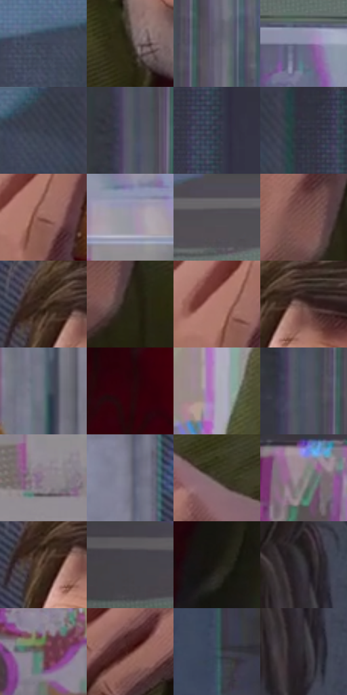

# 电影参考 310

- 状态：常规／活跃；来源世界：miles-home。
- 视角：near-level；景别：close-up；场景：portrait。
- 时段：daylight-time-unspecified（外观依据，中置信度；具体时间／晨昏未知）；光照：neutral-day。
- 材质候选：skin, hair, fabric, metal, glass, plastic, food（帧级，不是像素分割）。
- 明暗组：dark；L* P5/P50/P95：11.27815 / 33.05816 / 62.63219。
- 资格门禁：无附加门禁。
- 原截图 SHA-256：`613305e6d767f84740d5d7a7821919221cda5bea146e32929c313c9813dcdf55`；尺寸：2880 × 1200。
- sRGB 像素 SHA-256：`cd17200c7c8c5cd13afe6557223d30cf3b3e186fb1507cc639b29ca250d38002`。

## 观察与迁移

餐厅中性光、成人与少年五官差异、手部和食物各有体块。

310  /  裸脸／头发手部  /  发量与发束、胡茬、指节及食品各自概括；不添加食物拉丝

本公开版保存32个128×128原像素色卡上下文；图集格子并非原场景相邻位置。原rect、图集tile和像素SHA见 `data/palette-crops.json`。上下文不足时不得批准替色，不能以小样推断完整构图。

## 实测色卡

颜色比例分母为保留采样像素，不是材料面积；全部 32 色参与全库匹配。表内四舍五入仅用于阅读，原精度在 JSON。

| ID | HEX | Lab | 原图 xy | 像素数 | 比例 | 明度角色 |
| --- | --- | --- | --- | ---: | ---: | --- |
| 310-S01 | #3E4457 | [29.021366, 2.490374, -12.123911] | [1932, 76] | 12395 | 6.434014% | shadow |
| 310-S02 | #30291D | [17.003414, 0.961254, 9.075914] | [1316, 836] | 9322 | 4.838877% | deep-shadow |
| 310-S03 | #636171 | [41.835879, 4.297298, -8.726707] | [2596, 168] | 8974 | 4.658237% | midtone |
| 310-S04 | #7F849F | [55.601195, 4.120092, -14.980803] | [572, 196] | 8595 | 4.461505% | midtone |
| 310-S05 | #3B3F4E | [26.833551, 2.16653, -9.623182] | [2060, 32] | 8214 | 4.263735% | shadow |
| 310-S06 | #565A64 | [38.217992, 0.70815, -6.269449] | [2500, 348] | 8028 | 4.167186% | shadow |
| 310-S07 | #333A4A | [24.399158, 1.418649, -10.752889] | [2224, 208] | 8007 | 4.156285% | shadow |
| 310-S08 | #31313E | [20.817496, 3.327397, -8.155144] | [2160, 28] | 7933 | 4.117873% | shadow |
| 310-S09 | #95645B | [47.314463, 18.625803, 13.164485] | [876, 772] | 7725 | 4.009904% | midtone |
| 310-S10 | #9795A3 | [62.269197, 3.514843, -7.068273] | [712, 332] | 7312 | 3.795523% | light |
| 310-S11 | #524E56 | [33.8042, 3.379152, -4.106373] | [776, 56] | 6820 | 3.540135% | shadow |
| 310-S12 | #7D554F | [40.282879, 15.790718, 10.213306] | [836, 980] | 6323 | 3.282152% | midtone |
| 310-S13 | #49372A | [24.690577, 5.917172, 11.233703] | [1340, 228] | 6306 | 3.273328% | shadow |
| 310-S14 | #272415 | [14.100858, -1.522728, 10.550728] | [884, 1024] | 6277 | 3.258274% | deep-shadow |
| 310-S15 | #B17A70 | [56.52356, 20.155721, 14.135639] | [844, 752] | 5779 | 2.999772% | midtone |
| 310-S16 | #614641 | [32.488742, 10.794442, 7.561192] | [1400, 244] | 5771 | 2.995619% | shadow |
| 310-S17 | #64707C | [46.648133, -1.728762, -8.141758] | [1024, 532] | 5702 | 2.959802% | midtone |
| 310-S18 | #2D050B | [6.239593, 20.467995, 5.225057] | [1412, 1012] | 5615 | 2.914642% | deep-shadow |
| 310-S19 | #AFA6BB | [69.451173, 7.251139, -9.594036] | [520, 1124] | 5536 | 2.873635% | light |
| 310-S20 | #4B5061 | [34.182131, 2.154284, -10.555137] | [2512, 192] | 5510 | 2.860139% | shadow |
| 310-S21 | #877986 | [52.450204, 7.855479, -5.101275] | [680, 444] | 5485 | 2.847162% | midtone |
| 310-S22 | #747383 | [49.023333, 3.788731, -8.616554] | [1192, 140] | 5444 | 2.825879% | midtone |
| 310-S23 | #393328 | [21.545584, 0.52226, 7.965122] | [2108, 940] | 5399 | 2.802521% | shadow |
| 310-S24 | #93878E | [57.544228, 5.808579, -2.108469] | [56, 756] | 5004 | 2.597483% | midtone |
| 310-S25 | #563E32 | [28.523092, 8.671939, 11.491534] | [1340, 264] | 4965 | 2.577239% | shadow |
| 310-S26 | #45434A | [28.834758, 2.424709, -3.914402] | [264, 56] | 4327 | 2.246065% | shadow |
| 310-S27 | #1C1813 | [8.543506, 0.885111, 4.000908] | [1716, 792] | 3930 | 2.039990% | deep-shadow |
| 310-S28 | #3A383E | [23.920078, 2.258657, -3.410261] | [1796, 320] | 3021 | 1.568145% | shadow |
| 310-S29 | #645656 | [37.908812, 5.727034, 2.118337] | [312, 852] | 2967 | 1.540115% | shadow |
| 310-S30 | #481D18 | [17.097399, 20.073939, 13.315199] | [2024, 1080] | 2425 | 1.258772% | deep-shadow |
| 310-S31 | #39555C | [34.271035, -8.439928, -7.400413] | [2768, 556] | 2156 | 1.119140% | shadow |
| 310-S32 | #2A272C | [16.130688, 2.57999, -2.779117] | [1804, 396] | 1381 | 0.716851% | deep-shadow |

## 色阶与空间分布

- 采样 ROI：`[0.01, 0.02, 0.98, 0.94]`；步长：4；样本数：192648。
- 排除区：`[]`。
- 深暗、暗、中、亮、高光五段计数：`[32816, 90651, 55387, 13607, 187]`。
- RGB 各 256 箱、L* 100 箱、13×5 色相明度表和 3×3 空间统计全部保存在 [总数据](../film-library.json)。
- [可视化档案](../../references/library.html)按需绘制直方图，不存 2,094 张重复图表图片。

## 纹理特征占比

**这是分块图像特征的面积占比，不是波点／排线／丝网／错版的精确语义覆盖率。** 窗格、发丝、织物也会产生方向或周期特征。
原图 ROI 像素 3084576；已测块覆盖 3084576（100.0000%）；未测 0。

| 特征 | 块覆盖像素 | 占已测面积 | 阈值敏感范围 |
| --- | ---: | ---: | --- |
| low-contrast | 69632 | 2.2574% | 1.0623% ~ 3.9837% |
| directional-structure | 1270784 | 41.1980% | 25.4458% ~ 57.7469% |
| periodic-structure | 1678624 | 54.4199% | 40.1284% ~ 67.0515% |
| mixed-detail | 65536 | 2.1246% | 1.0623% ~ 3.5189% |

阈值敏感范围不是统计置信区间。逐块坐标、尺度、对比、方向一致性、频谱集中度、频率与角度见 [全量特征记录](../texture-features.jsonl)，以帧号定位。
四种印刷层的真实像素覆盖仍标为 `null`，不能填 0，也不能拿上表代替。不得据这些代理测量删除唯一证据。

[测量方法与保留策略](../../references/library-retention.md) · [分类索引](../archive/README.md)
