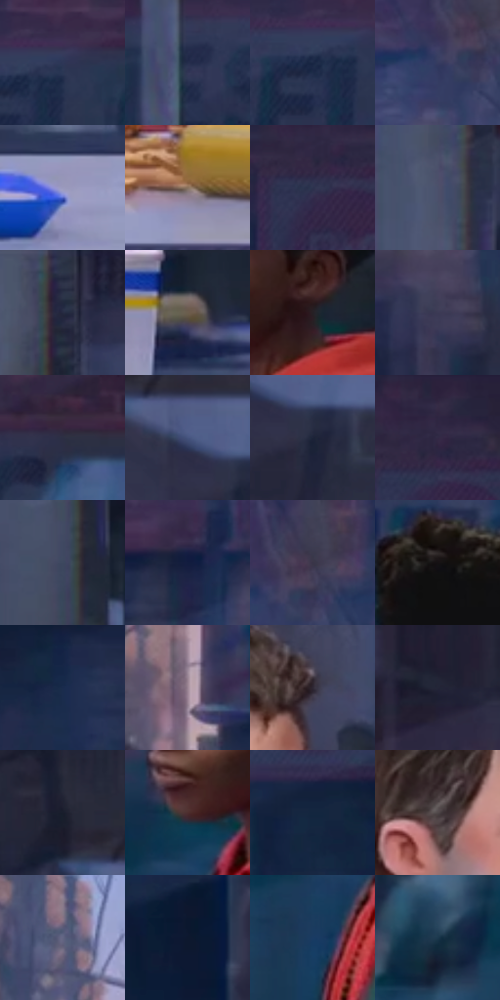

# 电影参考 311

- 状态：条件／活跃；来源世界：miles-home。
- 视角：near-level；景别：medium；场景：reflection。
- 时段：daylight-time-unspecified（外观依据，中置信度；具体时间／晨昏未知）；光照：neutral-day。
- 材质候选：skin, fabric, glass, metal, plastic, food（帧级，不是像素分割）。
- 明暗组：dark；L* P5/P50/P95：9.73033 / 21.55191 / 59.51066。
- 资格门禁：reflection。
- 原截图 SHA-256：`f4b62abdc4324fbf89932cec14bc9d445c68b7f9d38d6c658ec4215aff439455`；尺寸：2878 × 1204。
- sRGB 像素 SHA-256：`52f871387855388d69bab6737bbe19e693b3ec85d7b78c3de54061ea14d86282`。

## 观察与迁移

窗外与室内同时可见，宽反射亮带不盖住真实人物。

311  /  窗玻璃／室内外  /  窗外行人建筑与室内条形灯映像叠加，桌面与窗面不共享反射方式

本公开版保存32个128×128原像素色卡上下文；图集格子并非原场景相邻位置。原rect、图集tile和像素SHA见 `data/palette-crops.json`。上下文不足时不得批准替色，不能以小样推断完整构图。

## 实测色卡

颜色比例分母为保留采样像素，不是材料面积；全部 32 色参与全库匹配。表内四舍五入仅用于阅读，原精度在 JSON。

| ID | HEX | Lab | 原图 xy | 像素数 | 比例 | 明度角色 |
| --- | --- | --- | --- | ---: | ---: | --- |
| 311-S01 | #2E3757 | [23.675027, 5.932003, -20.500911] | [1796, 112] | 9505 | 4.933869% | shadow |
| 311-S02 | #242D4B | [19.054377, 5.77656, -19.80627] | [1584, 144] | 9247 | 4.799946% | deep-shadow |
| 311-S03 | #192744 | [15.875375, 4.436371, -20.092806] | [1752, 132] | 9170 | 4.759977% | deep-shadow |
| 311-S04 | #363C60 | [26.332805, 7.922268, -22.163003] | [2736, 148] | 8288 | 4.302147% | shadow |
| 311-S05 | #9B9ABE | [64.801046, 7.919805, -18.423179] | [2000, 972] | 8069 | 4.188468% | light |
| 311-S06 | #89725D | [49.670385, 5.707623, 15.019488] | [1524, 1024] | 7462 | 3.873386% | midtone |
| 311-S07 | #2D334E | [21.855325, 5.375822, -17.383851] | [1312, 108] | 7347 | 3.813691% | shadow |
| 311-S08 | #4B506B | [34.588712, 4.865777, -16.216453] | [68, 332] | 7194 | 3.734272% | shadow |
| 311-S09 | #252A40 | [17.54959, 4.4035, -14.641368] | [112, 40] | 7113 | 3.692226% | deep-shadow |
| 311-S10 | #6C5D4D | [40.496785, 3.335412, 11.442529] | [1688, 824] | 7111 | 3.691188% | midtone |
| 311-S11 | #262025 | [13.099798, 4.026851, -2.311147] | [2556, 668] | 6944 | 3.604501% | deep-shadow |
| 311-S12 | #3B3A55 | [25.598431, 7.4903, -16.106868] | [2780, 384] | 6747 | 3.502242% | shadow |
| 311-S13 | #2C2F44 | [19.986713, 4.605943, -13.552038] | [1940, 104] | 6529 | 3.389083% | deep-shadow |
| 311-S14 | #45537E | [35.902358, 6.782688, -26.014043] | [620, 172] | 6461 | 3.353785% | shadow |
| 311-S15 | #1D2439 | [14.503058, 3.641343, -14.563161] | [672, 224] | 6182 | 3.208961% | deep-shadow |
| 311-S16 | #332943 | [18.778091, 11.056107, -14.687412] | [1332, 36] | 6038 | 3.134214% | deep-shadow |
| 311-S17 | #3D485F | [30.527179, 1.873144, -14.963264] | [80, 516] | 5728 | 2.973298% | shadow |
| 311-S18 | #121D3F | [11.7298, 8.23435, -23.238988] | [2548, 148] | 5719 | 2.968627% | deep-shadow |
| 311-S19 | #393548 | [23.283812, 6.452054, -11.07568] | [2780, 108] | 5534 | 2.872597% | shadow |
| 311-S20 | #151113 | [5.486189, 2.04647, -0.554989] | [2468, 428] | 5362 | 2.783315% | deep-shadow |
| 311-S21 | #192B4C | [17.718337, 4.710342, -22.644443] | [1664, 352] | 5207 | 2.702857% | deep-shadow |
| 311-S22 | #9D8695 | [58.404204, 11.403775, -4.760648] | [1168, 468] | 5156 | 2.676384% | midtone |
| 311-S23 | #2E2733 | [16.849172, 6.100733, -6.591713] | [912, 400] | 4719 | 2.449545% | deep-shadow |
| 311-S24 | #242538 | [15.401239, 5.011495, -12.414575] | [324, 168] | 4669 | 2.423591% | deep-shadow |
| 311-S25 | #181D2C | [10.954961, 2.478042, -10.802613] | [524, 80] | 4474 | 2.322370% | deep-shadow |
| 311-S26 | #4E2D2E | [22.633152, 15.339728, 5.827644] | [2416, 716] | 4245 | 2.203501% | shadow |
| 311-S27 | #13263F | [14.862884, 1.673292, -18.249414] | [1352, 308] | 3957 | 2.054005% | deep-shadow |
| 311-S28 | #4F4749 | [30.996176, 3.770552, 0.027636] | [776, 500] | 3940 | 2.045181% | shadow |
| 311-S29 | #646684 | [44.056981, 6.258993, -16.855049] | [1112, 208] | 3911 | 2.030127% | midtone |
| 311-S30 | #0D182E | [8.446474, 3.658219, -16.264463] | [2092, 584] | 3818 | 1.981853% | deep-shadow |
| 311-S31 | #1A3B63 | [24.474635, 2.884513, -27.152583] | [2380, 840] | 3434 | 1.782526% | shadow |
| 311-S32 | #1B384D | [22.291252, -3.511348, -16.126769] | [2224, 780] | 3368 | 1.748266% | shadow |

## 色阶与空间分布

- 采样 ROI：`[0.01, 0.02, 0.98, 0.94]`；步长：4；样本数：192648。
- 排除区：`[]`。
- 深暗、暗、中、亮、高光五段计数：`[83276, 80522, 19584, 9143, 123]`。
- RGB 各 256 箱、L* 100 箱、13×5 色相明度表和 3×3 空间统计全部保存在 [总数据](../film-library.json)。
- [可视化档案](../../references/library.html)按需绘制直方图，不存 2,094 张重复图表图片。

## 纹理特征占比

**这是分块图像特征的面积占比，不是波点／排线／丝网／错版的精确语义覆盖率。** 窗格、发丝、织物也会产生方向或周期特征。
原图 ROI 像素 3090744；已测块覆盖 3090744（100.0000%）；未测 0。

| 特征 | 块覆盖像素 | 占已测面积 | 阈值敏感范围 |
| --- | ---: | ---: | --- |
| low-contrast | 32768 | 1.0602% | 0.0000% ~ 2.4641% |
| directional-structure | 1016704 | 32.8951% | 17.8080% ~ 49.1418% |
| periodic-structure | 2024888 | 65.5146% | 50.8582% ~ 77.6075% |
| mixed-detail | 16384 | 0.5301% | 0.0000% ~ 2.1204% |

阈值敏感范围不是统计置信区间。逐块坐标、尺度、对比、方向一致性、频谱集中度、频率与角度见 [全量特征记录](../texture-features.jsonl)，以帧号定位。
四种印刷层的真实像素覆盖仍标为 `null`，不能填 0，也不能拿上表代替。不得据这些代理测量删除唯一证据。

[测量方法与保留策略](../../references/library-retention.md) · [分类索引](../archive/README.md)
