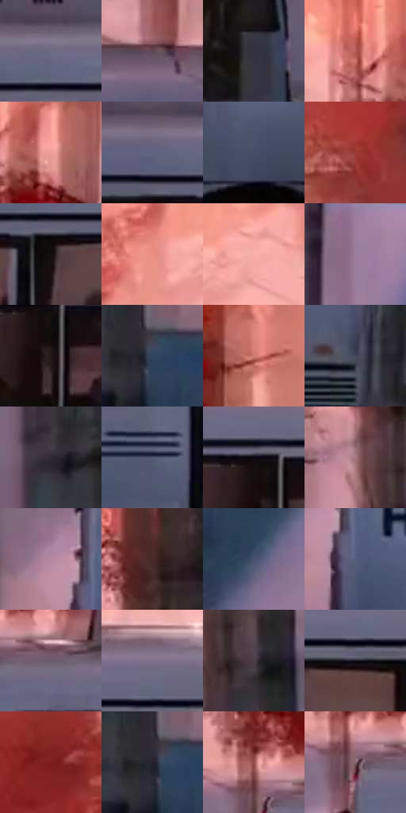

# 电影参考 312

- 状态：常规／活跃；来源世界：miles-home。
- 视角：near-level；景别：environment-wide；场景：landscape。
- 时段：daylight-time-unspecified（外观依据，中置信度；具体时间／晨昏未知）；光照：warm-day。
- 材质候选：snow, foliage, stone, fabric, metal, sky（帧级，不是像素分割）。
- 明暗组：dark；L* P5/P50/P95：4.90119 / 37.90871 / 73.23037。
- 资格门禁：无附加门禁。
- 原截图 SHA-256：`1e17d1fec2d36cbd247db2d385ce1ce7d5dea9a65dab4414e7664cc89e84f941`；尺寸：2880 × 1206。
- sRGB 像素 SHA-256：`01c492a27e45eaf759a7251e2ba9b1f96e98c71e32f7adf2692aca90e482556f`。

## 观察与迁移

暖树冠和冷雪阴影，树干与前景岩石保留厚度。

312  /  雪林／车体  /  暖树林、冷雪和浅灰车身；前景树干遮住巴士，不补全被遮文字

本公开版保存32个128×128原像素色卡上下文；图集格子并非原场景相邻位置。原rect、图集tile和像素SHA见 `data/palette-crops.json`。上下文不足时不得批准替色，不能以小样推断完整构图。

## 实测色卡

颜色比例分母为保留采样像素，不是材料面积；全部 32 色参与全库匹配。表内四舍五入仅用于阅读，原精度在 JSON。

| ID | HEX | Lab | 原图 xy | 像素数 | 比例 | 明度角色 |
| --- | --- | --- | --- | ---: | ---: | --- |
| 312-S01 | #6D6983 | [45.624432, 7.27646, -13.797918] | [1296, 472] | 8008 | 4.141798% | midtone |
| 312-S02 | #5C4851 | [32.928589, 10.178179, -2.105062] | [2276, 428] | 7666 | 3.964913% | shadow |
| 312-S03 | #323444 | [22.129063, 3.355023, -10.214306] | [2564, 860] | 7526 | 3.892504% | shadow |
| 312-S04 | #B45D57 | [49.765024, 34.559404, 19.557507] | [380, 200] | 7463 | 3.859920% | midtone |
| 312-S05 | #EC9E96 | [72.556288, 28.081799, 16.101103] | [472, 236] | 7345 | 3.798889% | light |
| 312-S06 | #61647F | [43.044737, 5.185675, -15.409944] | [1204, 484] | 7115 | 3.679931% | midtone |
| 312-S07 | #464D65 | [33.025757, 3.405758, -14.877917] | [912, 836] | 7094 | 3.669070% | shadow |
| 312-S08 | #993934 | [37.749814, 39.842733, 24.213951] | [2108, 144] | 6951 | 3.595109% | shadow |
| 312-S09 | #190F0F | [5.264797, 4.259385, 1.501398] | [1312, 564] | 6941 | 3.589937% | deep-shadow |
| 312-S10 | #E98F84 | [68.488574, 32.870362, 20.369473] | [1720, 248] | 6876 | 3.556319% | light |
| 312-S11 | #F7B0AA | [78.304458, 25.132194, 13.431167] | [1836, 232] | 6823 | 3.528907% | light |
| 312-S12 | #997C9B | [55.639069, 16.862842, -12.389422] | [844, 1052] | 6760 | 3.496323% | midtone |
| 312-S13 | #25191B | [10.317421, 6.394376, 0.952488] | [2028, 600] | 6731 | 3.481324% | deep-shadow |
| 312-S14 | #314560 | [28.781479, 0.432192, -18.368808] | [248, 956] | 6651 | 3.439947% | shadow |
| 312-S15 | #D17A72 | [60.509288, 32.960798, 19.097994] | [916, 228] | 6556 | 3.390812% | light |
| 312-S16 | #41455A | [29.708404, 3.744431, -12.985291] | [716, 872] | 6171 | 3.191687% | shadow |
| 312-S17 | #302A32 | [17.984572, 4.601993, -4.162657] | [132, 700] | 6136 | 3.173585% | deep-shadow |
| 312-S18 | #55576F | [37.653595, 4.956573, -13.941677] | [1220, 744] | 5914 | 3.058765% | shadow |
| 312-S19 | #0A080C | [2.391381, 1.094694, -1.371772] | [2008, 536] | 5547 | 2.868950% | deep-shadow |
| 312-S20 | #A87C82 | [56.439627, 18.000324, 3.463222] | [88, 448] | 5513 | 2.851365% | midtone |
| 312-S21 | #B489A0 | [61.769527, 20.113409, -5.815631] | [344, 700] | 5361 | 2.772749% | light |
| 312-S22 | #4A2B2B | [21.425352, 14.38174, 6.090646] | [124, 292] | 5143 | 2.659998% | shadow |
| 312-S23 | #475371 | [35.435478, 3.383275, -18.682397] | [336, 1064] | 5069 | 2.621725% | shadow |
| 312-S24 | #555E7F | [40.358678, 4.934851, -19.611143] | [400, 764] | 5042 | 2.607760% | midtone |
| 312-S25 | #6D5C6F | [41.300809, 10.645145, -8.211707] | [476, 448] | 4982 | 2.576728% | midtone |
| 312-S26 | #81708B | [49.64092, 11.993579, -12.304081] | [1716, 464] | 4957 | 2.563798% | midtone |
| 312-S27 | #4A3B45 | [26.7734, 8.580253, -3.643276] | [176, 508] | 4866 | 2.516732% | shadow |
| 312-S28 | #15141C | [6.716616, 2.54843, -5.357455] | [1704, 540] | 4747 | 2.455184% | deep-shadow |
| 312-S29 | #7D1F1C | [27.913222, 39.941496, 26.088036] | [2296, 72] | 4590 | 2.373982% | shadow |
| 312-S30 | #24232D | [14.211219, 3.105781, -6.434108] | [232, 952] | 4540 | 2.348122% | deep-shadow |
| 312-S31 | #954D4B | [41.543136, 29.870304, 14.919929] | [384, 396] | 4292 | 2.219855% | midtone |
| 312-S32 | #886672 | [46.912217, 15.648276, -1.396315] | [396, 444] | 3970 | 2.053314% | midtone |

## 色阶与空间分布

- 采样 ROI：`[0.01, 0.02, 0.98, 0.94]`；步长：4；样本数：193346。
- 排除区：`[]`。
- 深暗、暗、中、亮、高光五段计数：`[36579, 66854, 60918, 27842, 1153]`。
- RGB 各 256 箱、L* 100 箱、13×5 色相明度表和 3×3 空间统计全部保存在 [总数据](../film-library.json)。
- [可视化档案](../../references/library.html)按需绘制直方图，不存 2,094 张重复图表图片。

## 纹理特征占比

**这是分块图像特征的面积占比，不是波点／排线／丝网／错版的精确语义覆盖率。** 窗格、发丝、织物也会产生方向或周期特征。
原图 ROI 像素 3098546；已测块覆盖 3098546（100.0000%）；未测 0。

| 特征 | 块覆盖像素 | 占已测面积 | 阈值敏感范围 |
| --- | ---: | ---: | --- |
| low-contrast | 55218 | 1.7821% | 1.4913% ~ 2.1332% |
| directional-structure | 1228288 | 39.6408% | 29.7760% ~ 45.8083% |
| periodic-structure | 1722240 | 55.5822% | 52.7004% ~ 63.5095% |
| mixed-detail | 92800 | 2.9950% | 0.0000% ~ 4.5812% |

阈值敏感范围不是统计置信区间。逐块坐标、尺度、对比、方向一致性、频谱集中度、频率与角度见 [全量特征记录](../texture-features.jsonl)，以帧号定位。
四种印刷层的真实像素覆盖仍标为 `null`，不能填 0，也不能拿上表代替。不得据这些代理测量删除唯一证据。

[测量方法与保留策略](../../references/library-retention.md) · [分类索引](../archive/README.md)
