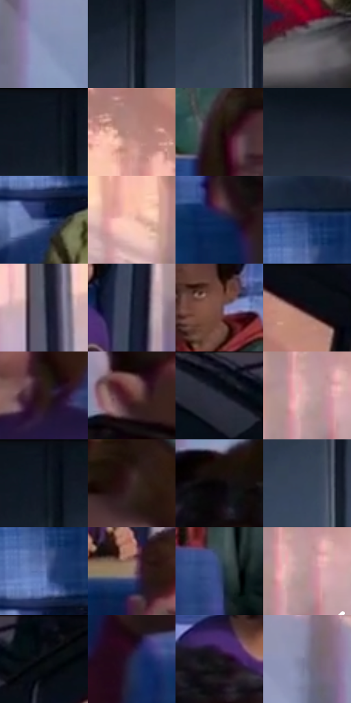

# 电影参考 313

- 状态：常规／活跃；来源世界：miles-home。
- 视角：near-level；景别：environment-wide；场景：vehicle。
- 时段：interior-time-unknown（外观依据，中置信度；具体时间／晨昏未知）；光照：interior-mixed。
- 材质候选：skin, hair, fabric, plastic, glass（帧级，不是像素分割）。
- 明暗组：dark；L* P5/P50/P95：3.34173 / 24.37928 / 71.56309。
- 资格门禁：无附加门禁。
- 原截图 SHA-256：`909415c61316568398c5e4e498a51cce1686ea9ee7d6562f835c4d4610b4acc9`；尺寸：2880 × 1208。
- sRGB 像素 SHA-256：`a2d6f864bcf1d8f3e1d006a2e951a6df1b700cdbd7e3ac9e694b555e6d2c1559`。

## 观察与迁移

车窗暖光与冷车厢，座椅织纹不可泛化到脸。

313  /  群像／织物  /  不同年龄感脸形、头发与眼镜；蓝座椅织纹不是半调点，多人不自动启用感应

本公开版保存32个128×128原像素色卡上下文；图集格子并非原场景相邻位置。原rect、图集tile和像素SHA见 `data/palette-crops.json`。上下文不足时不得批准替色，不能以小样推断完整构图。

## 实测色卡

颜色比例分母为保留采样像素，不是材料面积；全部 32 色参与全库匹配。表内四舍五入仅用于阅读，原精度在 JSON。

| ID | HEX | Lab | 原图 xy | 像素数 | 比例 | 明度角色 |
| --- | --- | --- | --- | ---: | ---: | --- |
| 313-S01 | #8792B7 | [60.893255, 4.452772, -20.576093] | [264, 628] | 11813 | 6.109772% | light |
| 313-S02 | #282E3C | [18.933753, 1.368308, -9.729519] | [1520, 156] | 9299 | 4.809512% | deep-shadow |
| 313-S03 | #303E4D | [25.591155, -1.379374, -10.937861] | [1476, 268] | 8336 | 4.311442% | shadow |
| 313-S04 | #6C6870 | [44.601584, 3.212252, -3.914611] | [1708, 888] | 8163 | 4.221965% | midtone |
| 313-S05 | #0F1723 | [7.548334, 0.507628, -9.469343] | [1492, 52] | 7825 | 4.047149% | deep-shadow |
| 313-S06 | #B4857D | [59.853209, 16.894159, 11.385636] | [344, 152] | 7776 | 4.021805% | midtone |
| 313-S07 | #1E100F | [6.152752, 6.535659, 2.873179] | [804, 796] | 7610 | 3.935949% | deep-shadow |
| 313-S08 | #1D2331 | [13.738588, 1.591748, -10.075158] | [1784, 92] | 7511 | 3.884745% | deep-shadow |
| 313-S09 | #455589 | [37.054983, 9.047206, -30.942697] | [1432, 668] | 7459 | 3.857851% | shadow |
| 313-S10 | #F6C4B6 | [83.153722, 15.800464, 13.814959] | [140, 228] | 6959 | 3.599247% | highlight |
| 313-S11 | #0F2651 | [15.909607, 8.628619, -28.955873] | [2064, 916] | 6920 | 3.579076% | deep-shadow |
| 313-S12 | #1E376B | [23.899614, 9.62542, -33.226295] | [1436, 512] | 6416 | 3.318403% | shadow |
| 313-S13 | #45495A | [31.273558, 2.59125, -10.569739] | [2560, 620] | 6226 | 3.220134% | shadow |
| 313-S14 | #121A2E | [9.51809, 3.508874, -14.546949] | [2404, 660] | 6125 | 3.167896% | deep-shadow |
| 313-S15 | #704E48 | [36.672217, 13.457879, 9.272748] | [1244, 652] | 6060 | 3.134277% | shadow |
| 313-S16 | #0B0E14 | [3.935776, 0.292386, -3.563222] | [440, 32] | 6025 | 3.116175% | deep-shadow |
| 313-S17 | #2C1819 | [10.985956, 10.225885, 3.538321] | [1016, 952] | 5998 | 3.102211% | deep-shadow |
| 313-S18 | #592D2C | [24.267415, 19.981945, 9.70404] | [2728, 836] | 5983 | 3.094452% | shadow |
| 313-S19 | #0F141D | [6.237647, 0.512129, -6.898225] | [2324, 32] | 5908 | 3.055662% | deep-shadow |
| 313-S20 | #CFA5A8 | [71.558045, 15.88119, 4.341957] | [2784, 516] | 5433 | 2.809988% | light |
| 313-S21 | #0A111C | [4.96116, 0.537129, -8.070593] | [1512, 32] | 5199 | 2.688962% | deep-shadow |
| 313-S22 | #382524 | [16.947764, 8.848903, 4.271941] | [952, 748] | 4961 | 2.565866% | deep-shadow |
| 313-S23 | #090607 | [1.839754, 0.923437, -0.10181] | [292, 872] | 4600 | 2.379154% | deep-shadow |
| 313-S24 | #374659 | [29.193247, -0.607724, -13.199161] | [1484, 328] | 4525 | 2.340364% | shadow |
| 313-S25 | #5F77B1 | [50.4519, 7.193558, -33.512093] | [1436, 584] | 4507 | 2.331054% | midtone |
| 313-S26 | #957D72 | [54.314934, 7.432231, 9.441392] | [2400, 820] | 4361 | 2.255542% | midtone |
| 313-S27 | #364872 | [30.957295, 5.923245, -26.380003] | [1272, 868] | 4236 | 2.190891% | shadow |
| 313-S28 | #B89498 | [64.674528, 14.109121, 3.019593] | [2804, 524] | 4104 | 2.122620% | light |
| 313-S29 | #070910 | [2.510644, 0.599071, -3.238246] | [2440, 28] | 3746 | 1.937459% | deep-shadow |
| 313-S30 | #252848 | [17.360552, 8.596311, -20.432] | [2140, 1076] | 3292 | 1.702647% | deep-shadow |
| 313-S31 | #1D181D | [9.018069, 3.699522, -2.578213] | [2208, 704] | 3038 | 1.571276% | deep-shadow |
| 313-S32 | #787690 | [50.644238, 6.404599, -13.81077] | [184, 444] | 2932 | 1.516452% | midtone |

## 色阶与空间分布

- 采样 ROI：`[0.01, 0.02, 0.98, 0.94]`；步长：4；样本数：193346。
- 排除区：`[]`。
- 深暗、暗、中、亮、高光五段计数：`[84065, 51610, 30837, 21679, 5155]`。
- RGB 各 256 箱、L* 100 箱、13×5 色相明度表和 3×3 空间统计全部保存在 [总数据](../film-library.json)。
- [可视化档案](../../references/library.html)按需绘制直方图，不存 2,094 张重复图表图片。

## 纹理特征占比

**这是分块图像特征的面积占比，不是波点／排线／丝网／错版的精确语义覆盖率。** 窗格、发丝、织物也会产生方向或周期特征。
原图 ROI 像素 3104134；已测块覆盖 3104134（100.0000%）；未测 0。

| 特征 | 块覆盖像素 | 占已测面积 | 阈值敏感范围 |
| --- | ---: | ---: | --- |
| low-contrast | 49152 | 1.5834% | 1.5834% ~ 4.5812% |
| directional-structure | 849792 | 27.3761% | 15.6653% ~ 41.0458% |
| periodic-structure | 2128518 | 68.5704% | 57.0120% ~ 75.5310% |
| mixed-detail | 76672 | 2.4700% | 0.3587% ~ 4.2225% |

阈值敏感范围不是统计置信区间。逐块坐标、尺度、对比、方向一致性、频谱集中度、频率与角度见 [全量特征记录](../texture-features.jsonl)，以帧号定位。
四种印刷层的真实像素覆盖仍标为 `null`，不能填 0，也不能拿上表代替。不得据这些代理测量删除唯一证据。

[测量方法与保留策略](../../references/library-retention.md) · [分类索引](../archive/README.md)
