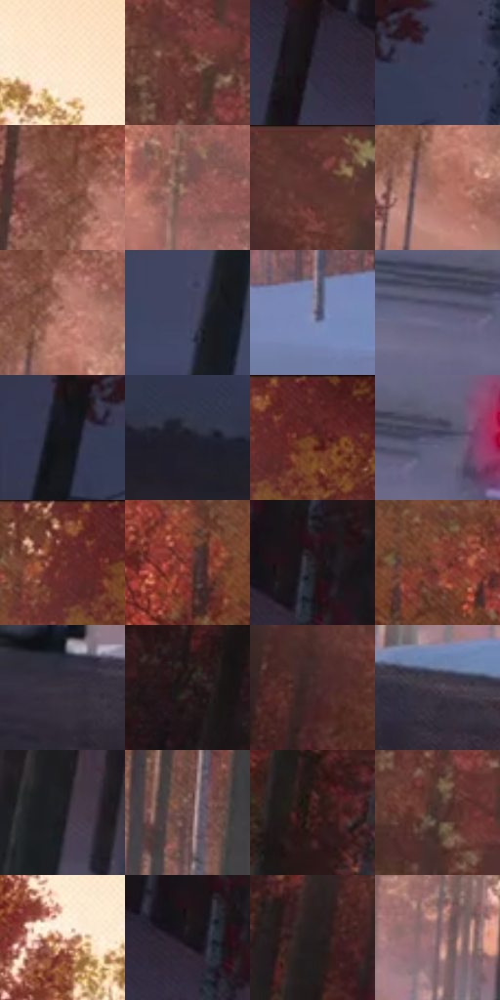

# 电影参考 314

- 状态：常规／活跃；来源世界：miles-home。
- 视角：low-angle；景别：environment-wide；场景：landscape。
- 时段：daylight-time-unspecified（外观依据，中置信度；具体时间／晨昏未知）；光照：warm-day。
- 材质候选：snow, foliage, stone, fabric, metal, sky（帧级，不是像素分割）。
- 明暗组：dark；L* P5/P50/P95：10.01035 / 29.07605 / 82.62051。
- 资格门禁：无附加门禁。
- 原截图 SHA-256：`16c615d5726d6fdc9f951e29b3e44c865f27b8b8be4d243cb7c2c7c0b87be144`；尺寸：2880 × 1206。
- sRGB 像素 SHA-256：`32ea2360a0cd7cd12f8e9c6d0a7d397f08b0af1ea568769c19225c9576ac532e`。

## 观察与迁移

暖树冠和冷雪阴影，树干与前景岩石保留厚度。

314  /  林地远景／冷暖  /  暖叶簇、冷雪、暗路、尾灯各占不同角色；不是所有外景都变秋林

本公开版保存32个128×128原像素色卡上下文；图集格子并非原场景相邻位置。原rect、图集tile和像素SHA见 `data/palette-crops.json`。上下文不足时不得批准替色，不能以小样推断完整构图。

## 实测色卡

颜色比例分母为保留采样像素，不是材料面积；全部 32 色参与全库匹配。表内四舍五入仅用于阅读，原精度在 JSON。

| ID | HEX | Lab | 原图 xy | 像素数 | 比例 | 明度角色 |
| --- | --- | --- | --- | ---: | ---: | --- |
| 314-S01 | #FCE4CA | [91.885721, 4.187157, 15.685284] | [1796, 100] | 8006 | 4.140763% | highlight |
| 314-S02 | #6A3D33 | [30.976219, 18.544706, 14.615303] | [1300, 292] | 7611 | 3.936466% | shadow |
| 314-S03 | #2F2B38 | [18.442312, 5.0351, -7.655928] | [136, 284] | 7500 | 3.879056% | deep-shadow |
| 314-S04 | #3A3D57 | [26.519916, 5.722783, -15.996391] | [156, 520] | 7500 | 3.879056% | shadow |
| 314-S05 | #7D483C | [36.597015, 21.238991, 16.920631] | [1492, 432] | 7484 | 3.870781% | shadow |
| 314-S06 | #8F625A | [46.061752, 17.164051, 11.913662] | [1952, 736] | 7348 | 3.800441% | midtone |
| 314-S07 | #5C352F | [26.812352, 16.739153, 11.254677] | [848, 32] | 7253 | 3.751306% | shadow |
| 314-S08 | #AA6D5E | [52.167297, 22.501139, 18.455051] | [1516, 544] | 6965 | 3.602350% | midtone |
| 314-S09 | #BE8677 | [61.072984, 19.53291, 16.662817] | [1528, 468] | 6953 | 3.596144% | light |
| 314-S10 | #434764 | [30.92479, 5.989577, -17.499117] | [360, 680] | 6849 | 3.542354% | shadow |
| 314-S11 | #7F7F9C | [54.123104, 6.316777, -15.48643] | [2772, 1064] | 6694 | 3.462187% | midtone |
| 314-S12 | #62617F | [42.274157, 7.363169, -16.579433] | [1624, 956] | 6375 | 3.297198% | midtone |
| 314-S13 | #313347 | [21.855419, 4.549544, -12.6616] | [44, 532] | 6366 | 3.292543% | shadow |
| 314-S14 | #20202B | [12.699869, 3.03607, -7.328871] | [316, 932] | 6242 | 3.228409% | deep-shadow |
| 314-S15 | #5B2823 | [23.215573, 22.908775, 14.387403] | [2784, 60] | 6203 | 3.208238% | shadow |
| 314-S16 | #4F4F6A | [34.589109, 6.596071, -15.560307] | [1700, 936] | 6119 | 3.164793% | shadow |
| 314-S17 | #6C3029 | [28.015165, 26.084407, 17.213888] | [2720, 36] | 6095 | 3.152380% | shadow |
| 314-S18 | #7C342D | [31.651013, 30.765379, 19.847714] | [2500, 292] | 5940 | 3.072213% | shadow |
| 314-S19 | #2B252C | [15.584531, 4.436174, -3.580233] | [256, 224] | 5795 | 2.997217% | deep-shadow |
| 314-S20 | #934B40 | [40.584557, 29.125727, 20.308715] | [2624, 288] | 5714 | 2.955324% | midtone |
| 314-S21 | #3A3440 | [22.743039, 5.432133, -6.513785] | [1800, 1116] | 5701 | 2.948600% | shadow |
| 314-S22 | #261719 | [9.759976, 7.960945, 1.664009] | [124, 68] | 5491 | 2.839986% | deep-shadow |
| 314-S23 | #442928 | [19.916399, 12.478425, 5.90807] | [776, 132] | 5481 | 2.834814% | deep-shadow |
| 314-S24 | #48404C | [28.290914, 6.053784, -5.997279] | [1968, 1116] | 5202 | 2.690513% | shadow |
| 314-S25 | #1D1C23 | [10.653341, 2.351607, -4.60734] | [640, 596] | 5100 | 2.637758% | deep-shadow |
| 314-S26 | #6C4C4A | [35.697775, 13.24628, 6.576905] | [2184, 824] | 4940 | 2.555005% | shadow |
| 314-S27 | #3E1E1D | [15.704266, 15.390923, 7.636937] | [896, 424] | 4778 | 2.471217% | deep-shadow |
| 314-S28 | #4C3432 | [24.395534, 10.494442, 5.575766] | [1312, 396] | 4769 | 2.466563% | shadow |
| 314-S29 | #EBBCA3 | [79.770473, 13.369775, 19.069547] | [1656, 100] | 4759 | 2.461390% | light |
| 314-S30 | #18161A | [7.611056, 2.012317, -2.45935] | [220, 256] | 4606 | 2.382258% | deep-shadow |
| 314-S31 | #251E21 | [12.167084, 4.053654, -0.784714] | [692, 192] | 4126 | 2.133998% | deep-shadow |
| 314-S32 | #7C6169 | [44.024133, 12.293352, -0.346604] | [2048, 1000] | 3381 | 1.748679% | midtone |

## 色阶与空间分布

- 采样 ROI：`[0.01, 0.02, 0.98, 0.94]`；步长：4；样本数：193346。
- 排除区：`[]`。
- 深暗、暗、中、亮、高光五段计数：`[47224, 94398, 34720, 6644, 10360]`。
- RGB 各 256 箱、L* 100 箱、13×5 色相明度表和 3×3 空间统计全部保存在 [总数据](../film-library.json)。
- [可视化档案](../../references/library.html)按需绘制直方图，不存 2,094 张重复图表图片。

## 纹理特征占比

**这是分块图像特征的面积占比，不是波点／排线／丝网／错版的精确语义覆盖率。** 窗格、发丝、织物也会产生方向或周期特征。
原图 ROI 像素 3098546；已测块覆盖 3098546（100.0000%）；未测 0。

| 特征 | 块覆盖像素 | 占已测面积 | 阈值敏感范围 |
| --- | ---: | ---: | --- |
| low-contrast | 87168 | 2.8132% | 0.5288% ~ 4.7465% |
| directional-structure | 311168 | 10.0424% | 5.1100% ~ 21.6711% |
| periodic-structure | 2094514 | 67.5967% | 62.6643% ~ 71.8185% |
| mixed-detail | 605696 | 19.5477% | 5.9816% ~ 27.4792% |

阈值敏感范围不是统计置信区间。逐块坐标、尺度、对比、方向一致性、频谱集中度、频率与角度见 [全量特征记录](../texture-features.jsonl)，以帧号定位。
四种印刷层的真实像素覆盖仍标为 `null`，不能填 0，也不能拿上表代替。不得据这些代理测量删除唯一证据。

[测量方法与保留策略](../../references/library-retention.md) · [分类索引](../archive/README.md)
