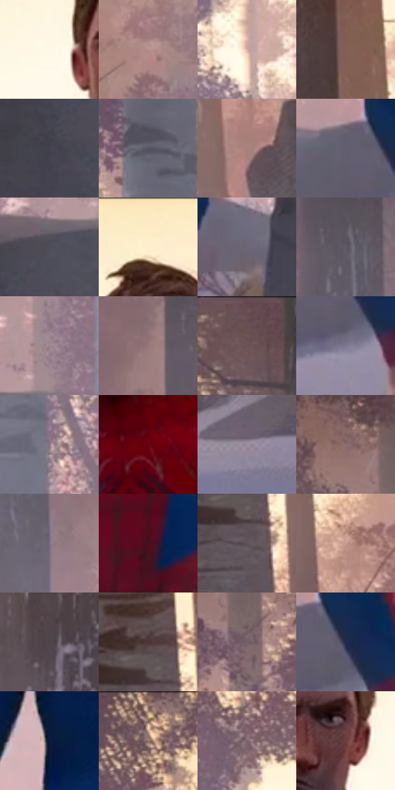

# 电影参考 315

- 状态：常规／活跃；来源世界：miles-home。
- 视角：near-level；景别：medium；场景：landscape。
- 时段：daylight-time-unspecified（外观依据，中置信度；具体时间／晨昏未知）；光照：warm-day。
- 材质候选：snow, foliage, stone, fabric, metal, sky（帧级，不是像素分割）。
- 明暗组：middle；L* P5/P50/P95：16.42045 / 44.85451 / 95.92165。
- 资格门禁：无附加门禁。
- 原截图 SHA-256：`822a81b60daabd174d93d35a31a11e18a563a10989994b34ab7c0d2a2712dc74`；尺寸：2880 × 1202。
- sRGB 像素 SHA-256：`19e9755b783a4c5f8f44ea644e069eabfe6fcc0a500a552eb41c3a23f19240af`。

## 观察与迁移

暖树冠和冷雪阴影，树干与前景岩石保留厚度。

315  /  日光人物／雪石  /  暖背光与脸部暗面，雪的圆弧厚度不同于石头硬面；不借入战衣

本公开版保存32个128×128原像素色卡上下文；图集格子并非原场景相邻位置。原rect、图集tile和像素SHA见 `data/palette-crops.json`。上下文不足时不得批准替色，不能以小样推断完整构图。

## 实测色卡

颜色比例分母为保留采样像素，不是材料面积；全部 32 色参与全库匹配。表内四舍五入仅用于阅读，原精度在 JSON。

| ID | HEX | Lab | 原图 xy | 像素数 | 比例 | 明度角色 |
| --- | --- | --- | --- | ---: | ---: | --- |
| 315-S01 | #FEF8E7 | [97.622301, -0.841907, 8.874911] | [1320, 260] | 8654 | 4.492131% | highlight |
| 315-S02 | #B5908C | [63.065102, 13.310954, 7.436801] | [2696, 784] | 7977 | 4.140713% | light |
| 315-S03 | #D7B1A5 | [75.207972, 11.931549, 11.312205] | [1056, 460] | 7823 | 4.060774% | light |
| 315-S04 | #825F55 | [43.634671, 12.783094, 11.314809] | [1980, 304] | 7757 | 4.026515% | midtone |
| 315-S05 | #43424F | [28.52265, 3.50308, -7.65314] | [556, 916] | 7584 | 3.936714% | shadow |
| 315-S06 | #565463 | [36.404187, 4.186716, -8.363907] | [800, 412] | 7122 | 3.696898% | shadow |
| 315-S07 | #A9817B | [57.623665, 14.506423, 9.215062] | [2096, 840] | 7060 | 3.664715% | midtone |
| 315-S08 | #625E6E | [40.780194, 5.064938, -8.486829] | [1708, 944] | 6686 | 3.470578% | midtone |
| 315-S09 | #4F4C59 | [33.032698, 4.169307, -7.190998] | [624, 824] | 6662 | 3.458121% | shadow |
| 315-S10 | #FEEECD | [94.58081, 0.245364, 17.945604] | [1420, 56] | 6552 | 3.401022% | highlight |
| 315-S11 | #6B6676 | [44.141725, 5.353252, -8.231328] | [1240, 1040] | 6513 | 3.380777% | midtone |
| 315-S12 | #615A66 | [39.263803, 5.335026, -5.843444] | [168, 384] | 6445 | 3.345480% | shadow |
| 315-S13 | #9B848E | [57.486854, 10.505909, -2.107176] | [708, 728] | 6338 | 3.289938% | midtone |
| 315-S14 | #96777B | [53.068098, 12.734603, 2.422045] | [320, 428] | 6309 | 3.274885% | midtone |
| 315-S15 | #6C5254 | [37.595921, 11.173021, 3.021819] | [48, 44] | 6254 | 3.246335% | shadow |
| 315-S16 | #7F7990 | [52.062883, 7.074187, -11.610984] | [1756, 1032] | 6127 | 3.180412% | midtone |
| 315-S17 | #8D7887 | [52.77979, 10.871144, -5.136388] | [868, 712] | 6074 | 3.152901% | midtone |
| 315-S18 | #690213 | [20.419126, 41.72643, 22.344455] | [1484, 484] | 5950 | 3.088535% | shadow |
| 315-S19 | #9B8EA0 | [60.651485, 8.267082, -7.735448] | [2360, 1040] | 5910 | 3.067771% | light |
| 315-S20 | #8D6D6B | [49.083998, 12.366667, 5.999527] | [632, 88] | 5886 | 3.055313% | midtone |
| 315-S21 | #7D6D7B | [47.914889, 8.955677, -5.429373] | [220, 616] | 5656 | 2.935925% | midtone |
| 315-S22 | #48111C | [14.750429, 26.910002, 7.359045] | [1516, 876] | 5568 | 2.890245% | deep-shadow |
| 315-S23 | #5F5259 | [36.345509, 6.734726, -2.09897] | [2500, 436] | 5354 | 2.779162% | shadow |
| 315-S24 | #C89D90 | [68.32084, 14.064709, 12.913916] | [2624, 416] | 5315 | 2.758918% | light |
| 315-S25 | #52464B | [31.072414, 6.080525, -1.111576] | [1868, 496] | 5158 | 2.677422% | shadow |
| 315-S26 | #4A3536 | [24.540328, 9.59634, 3.069] | [2488, 356] | 5046 | 2.619285% | shadow |
| 315-S27 | #735C65 | [41.593636, 10.981898, -1.581022] | [700, 184] | 5046 | 2.619285% | midtone |
| 315-S28 | #222A48 | [17.753683, 6.255222, -19.827537] | [1768, 960] | 4341 | 2.253333% | deep-shadow |
| 315-S29 | #0C1A3D | [10.211426, 8.494093, -24.284756] | [1308, 764] | 4330 | 2.247623% | deep-shadow |
| 315-S30 | #F3D3B2 | [86.43465, 6.302672, 20.480022] | [1020, 48] | 4327 | 2.246065% | highlight |
| 315-S31 | #7E656D | [45.424744, 11.417993, -0.693044] | [1060, 212] | 4087 | 2.121486% | midtone |
| 315-S32 | #6B4040 | [32.176118, 18.732817, 7.952521] | [1492, 288] | 2737 | 1.420726% | shadow |

## 色阶与空间分布

- 采样 ROI：`[0.01, 0.02, 0.98, 0.94]`；步长：4；样本数：192648。
- 排除区：`[]`。
- 深暗、暗、中、亮、高光五段计数：`[16130, 57094, 75703, 23955, 19766]`。
- RGB 各 256 箱、L* 100 箱、13×5 色相明度表和 3×3 空间统计全部保存在 [总数据](../film-library.json)。
- [可视化档案](../../references/library.html)按需绘制直方图，不存 2,094 张重复图表图片。

## 纹理特征占比

**这是分块图像特征的面积占比，不是波点／排线／丝网／错版的精确语义覆盖率。** 窗格、发丝、织物也会产生方向或周期特征。
原图 ROI 像素 3087370；已测块覆盖 3087370（100.0000%）；未测 0。

| 特征 | 块覆盖像素 | 占已测面积 | 阈值敏感范围 |
| --- | ---: | ---: | --- |
| low-contrast | 156160 | 5.0580% | 3.5199% ~ 5.7297% |
| directional-structure | 671744 | 21.7578% | 8.4909% ~ 30.3896% |
| periodic-structure | 1730058 | 56.0366% | 56.0366% ~ 60.4355% |
| mixed-detail | 529408 | 17.1475% | 5.6550% ~ 27.7611% |

阈值敏感范围不是统计置信区间。逐块坐标、尺度、对比、方向一致性、频谱集中度、频率与角度见 [全量特征记录](../texture-features.jsonl)，以帧号定位。
四种印刷层的真实像素覆盖仍标为 `null`，不能填 0，也不能拿上表代替。不得据这些代理测量删除唯一证据。

[测量方法与保留策略](../../references/library-retention.md) · [分类索引](../archive/README.md)
