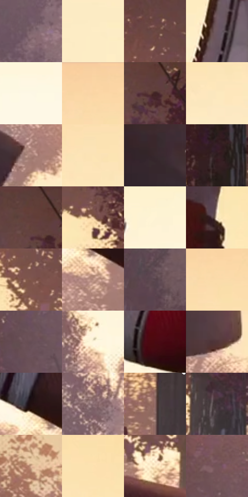

# 电影参考 316

- 状态：条件／活跃；来源世界：miles-home。
- 视角：low-angle；景别：detail；场景：detail。
- 时段：daylight-time-unspecified（外观依据，中置信度；具体时间／晨昏未知）；光照：warm-day。
- 材质候选：skin, fabric, foliage, sky（帧级，不是像素分割）。
- 明暗组：middle；L* P5/P50/P95：12.8085 / 49.002 / 96.95913。
- 资格门禁：motion。
- 原截图 SHA-256：`243f85598acdd698dbd5c3750e71ca66e1171f668aa23d5d532c7593e6e00f6b`；尺寸：2880 × 1206。
- sRGB 像素 SHA-256：`7a36dd21fb36e3eaa5192e3a102ef2a764eb669e421d5c8e57641393d4ebef22`。

## 观察与迁移

抛物与脚部仰视，保留现有动作不新增飞物。

316  /  鞋袜／仰视  /  鞋面分片、橡胶底和袜子针织分别处理；上方衣物不是故障碎片

本公开版保存32个128×128原像素色卡上下文；图集格子并非原场景相邻位置。原rect、图集tile和像素SHA见 `data/palette-crops.json`。上下文不足时不得批准替色，不能以小样推断完整构图。

## 实测色卡

颜色比例分母为保留采样像素，不是材料面积；全部 32 色参与全库匹配。表内四舍五入仅用于阅读，原精度在 JSON。

| ID | HEX | Lab | 原图 xy | 像素数 | 比例 | 明度角色 |
| --- | --- | --- | --- | ---: | ---: | --- |
| 316-S01 | #7B616A | [43.946803, 12.075715, -1.079574] | [440, 868] | 9391 | 4.857096% | midtone |
| 316-S02 | #FEEDC6 | [94.191782, -0.23953, 21.006358] | [1160, 500] | 8700 | 4.499705% | highlight |
| 316-S03 | #6B4842 | [34.302585, 14.110112, 9.646276] | [2112, 128] | 8600 | 4.447984% | shadow |
| 316-S04 | #6E5761 | [39.571727, 11.271502, -2.151869] | [1480, 584] | 8189 | 4.235412% | shadow |
| 316-S05 | #FDF8E5 | [97.501033, -1.50667, 9.719309] | [1212, 944] | 7488 | 3.872850% | highlight |
| 316-S06 | #FAD5A3 | [87.270709, 6.035997, 29.540908] | [1244, 36] | 7131 | 3.688207% | highlight |
| 316-S07 | #412225 | [17.468078, 15.252111, 4.49053] | [2320, 104] | 7123 | 3.684069% | deep-shadow |
| 316-S08 | #FDE9BE | [92.962006, 0.328807, 23.406287] | [1172, 320] | 7087 | 3.665450% | highlight |
| 316-S09 | #A67F76 | [56.6787, 13.722896, 10.713362] | [760, 460] | 6967 | 3.603385% | midtone |
| 316-S10 | #FCE4B6 | [91.48798, 1.446463, 25.48566] | [1280, 228] | 6741 | 3.486496% | highlight |
| 316-S11 | #38282C | [18.099907, 8.249567, 0.308128] | [536, 348] | 6716 | 3.473566% | deep-shadow |
| 316-S12 | #2E1C1E | [12.641047, 9.235314, 2.250156] | [2576, 284] | 6684 | 3.457015% | deep-shadow |
| 316-S13 | #5E3D38 | [29.420485, 13.793725, 9.007552] | [2284, 28] | 6568 | 3.397019% | shadow |
| 316-S14 | #EDC8A3 | [82.892138, 7.816694, 23.401368] | [2316, 364] | 6183 | 3.197894% | highlight |
| 316-S15 | #FEF3D5 | [95.987435, -1.110138, 15.806028] | [1976, 676] | 6137 | 3.174102% | highlight |
| 316-S16 | #FEF1CD | [95.325261, -1.271817, 18.988443] | [1704, 416] | 6026 | 3.116692% | highlight |
| 316-S17 | #7F554B | [40.439487, 16.121384, 12.922569] | [2104, 300] | 5814 | 3.007044% | midtone |
| 316-S18 | #BA9181 | [63.570797, 13.13044, 14.422715] | [2164, 1100] | 5651 | 2.922740% | light |
| 316-S19 | #59454D | [31.615265, 10.05006, -1.512496] | [288, 1088] | 5602 | 2.897396% | shadow |
| 316-S20 | #FADCAA | [89.118422, 3.273739, 28.417509] | [1264, 104] | 5563 | 2.877225% | highlight |
| 316-S21 | #664E55 | [35.84877, 11.318162, -0.226099] | [112, 640] | 5460 | 2.823953% | shadow |
| 316-S22 | #FFF6DD | [96.980789, -1.059881, 13.110289] | [872, 900] | 5206 | 2.692582% | highlight |
| 316-S23 | #4A0912 | [13.799642, 30.114244, 13.211775] | [1472, 820] | 5178 | 2.678100% | deep-shadow |
| 316-S24 | #513536 | [25.449212, 12.749399, 4.489995] | [740, 300] | 4866 | 2.516732% | shadow |
| 316-S25 | #221012 | [6.814525, 9.523523, 2.202162] | [2120, 1000] | 4861 | 2.514146% | deep-shadow |
| 316-S26 | #907276 | [51.004704, 12.440606, 2.293338] | [892, 1064] | 4852 | 2.509491% | midtone |
| 316-S27 | #8E6864 | [47.716786, 14.63367, 8.236887] | [2796, 684] | 4763 | 2.463459% | midtone |
| 316-S28 | #43343B | [23.55595, 8.10291, -1.826502] | [2576, 732] | 4641 | 2.400360% | shadow |
| 316-S29 | #D7AF94 | [74.347694, 10.668894, 19.340166] | [160, 100] | 4535 | 2.345536% | light |
| 316-S30 | #FDE1AF | [90.702661, 2.464541, 28.032213] | [1432, 212] | 4496 | 2.325365% | highlight |
| 316-S31 | #FCE9C4 | [92.997245, 0.78357, 20.350218] | [2364, 844] | 3878 | 2.005731% | highlight |
| 316-S32 | #745458 | [39.171247, 13.957476, 2.923174] | [116, 336] | 2249 | 1.163200% | shadow |

## 色阶与空间分布

- 采样 ROI：`[0.01, 0.02, 0.98, 0.94]`；步长：4；样本数：193346。
- 排除区：`[]`。
- 深暗、暗、中、亮、高光五段计数：`[28902, 46969, 33044, 9927, 74504]`。
- RGB 各 256 箱、L* 100 箱、13×5 色相明度表和 3×3 空间统计全部保存在 [总数据](../film-library.json)。
- [可视化档案](../../references/library.html)按需绘制直方图，不存 2,094 张重复图表图片。

## 纹理特征占比

**这是分块图像特征的面积占比，不是波点／排线／丝网／错版的精确语义覆盖率。** 窗格、发丝、织物也会产生方向或周期特征。
原图 ROI 像素 3098546；已测块覆盖 3098546（100.0000%）；未测 0。

| 特征 | 块覆盖像素 | 占已测面积 | 阈值敏感范围 |
| --- | ---: | ---: | --- |
| low-contrast | 584320 | 18.8579% | 15.8629% ~ 23.9679% |
| directional-structure | 393216 | 12.6903% | 6.3452% ~ 17.1204% |
| periodic-structure | 1143986 | 36.9201% | 33.0494% ~ 46.8493% |
| mixed-detail | 977024 | 31.5317% | 20.1674% ~ 36.6376% |

阈值敏感范围不是统计置信区间。逐块坐标、尺度、对比、方向一致性、频谱集中度、频率与角度见 [全量特征记录](../texture-features.jsonl)，以帧号定位。
四种印刷层的真实像素覆盖仍标为 `null`，不能填 0，也不能拿上表代替。不得据这些代理测量删除唯一证据。

[测量方法与保留策略](../../references/library-retention.md) · [分类索引](../archive/README.md)
