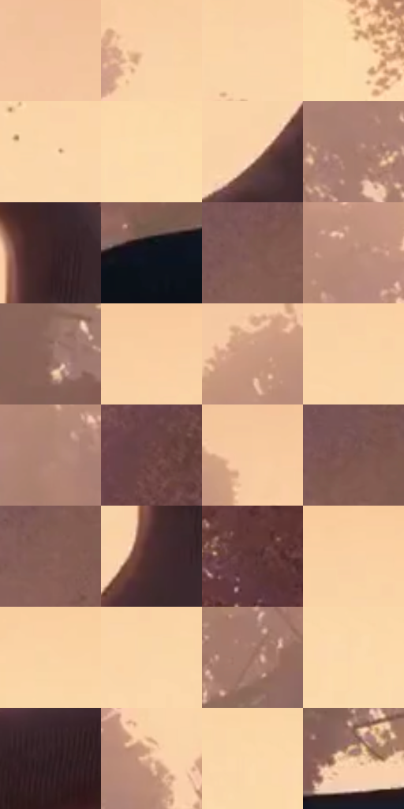

# 电影参考 317

- 状态：条件／活跃；来源世界：miles-home。
- 视角：low-angle；景别：detail；场景：detail。
- 时段：daylight-time-unspecified（外观依据，中置信度；具体时间／晨昏未知）；光照：warm-day。
- 材质候选：skin, fabric, foliage, sky（帧级，不是像素分割）。
- 明暗组：very-light；L* P5/P50/P95：14.32772 / 81.64394 / 88.89231。
- 资格门禁：motion。
- 原截图 SHA-256：`5420bbee5091285d1ca38f6679ac9324a930f13e792f9f51e7b626cb52ebc970`；尺寸：2880 × 1204。
- sRGB 像素 SHA-256：`89b98f29bb83c5c6c794bad92061de45126e2d74b7f02011ff0c70b449e71346`。

## 观察与迁移

抛物与脚部仰视，保留现有动作不新增飞物。

317  /  脚部／林冠  /  足部体积简化、树叶成簇；空中可见碎屑不当均匀印刷点

本公开版保存32个128×128原像素色卡上下文；图集格子并非原场景相邻位置。原rect、图集tile和像素SHA见 `data/palette-crops.json`。上下文不足时不得批准替色，不能以小样推断完整构图。

## 实测色卡

颜色比例分母为保留采样像素，不是材料面积；全部 32 色参与全库匹配。表内四舍五入仅用于阅读，原精度在 JSON。

| ID | HEX | Lab | 原图 xy | 像素数 | 比例 | 明度角色 |
| --- | --- | --- | --- | ---: | ---: | --- |
| 317-S01 | #F2C49E | [82.286599, 11.215683, 25.287927] | [308, 100] | 10095 | 5.240127% | highlight |
| 317-S02 | #F8D2A9 | [86.462969, 7.548575, 25.29864] | [800, 248] | 8928 | 4.634359% | highlight |
| 317-S03 | #F9D5AA | [87.306558, 6.498938, 25.942733] | [888, 300] | 8460 | 4.391429% | highlight |
| 317-S04 | #FCDCAF | [89.38349, 4.648541, 26.22348] | [2136, 236] | 7728 | 4.011461% | highlight |
| 317-S05 | #FBD6AC | [87.767872, 6.987766, 25.560976] | [1048, 352] | 7497 | 3.891554% | highlight |
| 317-S06 | #FCDAAE | [88.873801, 5.551942, 26.046189] | [2020, 244] | 7430 | 3.856775% | highlight |
| 317-S07 | #FAD2AD | [86.720102, 8.805128, 23.590615] | [1316, 796] | 7413 | 3.847951% | highlight |
| 317-S08 | #A57B6D | [55.350165, 14.348945, 14.030023] | [236, 508] | 7252 | 3.764379% | midtone |
| 317-S09 | #3D2529 | [17.80753, 12.051985, 2.074473] | [1500, 552] | 7246 | 3.761264% | deep-shadow |
| 317-S10 | #0F121A | [5.498606, 0.864978, -5.677352] | [388, 1004] | 7207 | 3.741020% | deep-shadow |
| 317-S11 | #815B52 | [42.39842, 14.323132, 11.396773] | [2560, 144] | 6990 | 3.628379% | midtone |
| 317-S12 | #B98B78 | [61.772612, 14.880032, 16.976263] | [612, 256] | 6578 | 3.414518% | light |
| 317-S13 | #8E675D | [47.291217, 14.227434, 11.813607] | [672, 728] | 6557 | 3.403617% | midtone |
| 317-S14 | #F9CEA3 | [85.46849, 9.278697, 27.092853] | [1480, 84] | 6508 | 3.378182% | highlight |
| 317-S15 | #C89980 | [66.992842, 14.159467, 19.932507] | [196, 240] | 6469 | 3.357938% | light |
| 317-S16 | #FAD4A9 | [87.133256, 7.272746, 26.241828] | [1676, 140] | 6308 | 3.274366% | highlight |
| 317-S17 | #AF8373 | [58.58912, 14.678042, 15.245288] | [276, 384] | 6110 | 3.171588% | midtone |
| 317-S18 | #6D4542 | [33.776857, 16.819786, 8.953429] | [2700, 460] | 6015 | 3.122275% | shadow |
| 317-S19 | #F6CAA1 | [84.178875, 9.973155, 26.343662] | [720, 156] | 5920 | 3.072962% | highlight |
| 317-S20 | #79524C | [38.936616, 15.472783, 10.112086] | [2608, 100] | 5702 | 2.959802% | shadow |
| 317-S21 | #876056 | [44.503463, 14.447527, 12.007416] | [2540, 216] | 5638 | 2.926581% | midtone |
| 317-S22 | #4C2E31 | [22.697425, 14.242533, 3.83953] | [1460, 668] | 5543 | 2.877268% | shadow |
| 317-S23 | #5E3837 | [28.072458, 16.78397, 7.78359] | [2624, 852] | 5524 | 2.867406% | shadow |
| 317-S24 | #F9D1A5 | [86.236089, 7.960294, 27.09035] | [1676, 84] | 4830 | 2.507163% | highlight |
| 317-S25 | #FAD4A6 | [87.078758, 6.909039, 27.727159] | [1892, 108] | 4791 | 2.486919% | highlight |
| 317-S26 | #FAD6AA | [87.64134, 6.36177, 26.413347] | [1728, 180] | 4514 | 2.343134% | highlight |
| 317-S27 | #9C7061 | [51.290883, 15.370963, 15.235016] | [456, 640] | 4223 | 2.192081% | midtone |
| 317-S28 | #FBD8AC | [88.257715, 5.955699, 26.228942] | [1916, 220] | 4095 | 2.125638% | highlight |
| 317-S29 | #2E1C20 | [12.707759, 9.600795, 0.881904] | [1132, 980] | 3362 | 1.745152% | deep-shadow |
| 317-S30 | #DFB192 | [75.581891, 12.458883, 22.23939] | [776, 372] | 3215 | 1.668847% | light |
| 317-S31 | #FAD8AA | [88.132372, 5.330148, 27.080873] | [1832, 192] | 2537 | 1.316910% | highlight |
| 317-S32 | #F5CFAA | [85.475226, 8.093321, 23.379775] | [628, 916] | 1963 | 1.018957% | highlight |

## 色阶与空间分布

- 采样 ROI：`[0.01, 0.02, 0.98, 0.94]`；步长：4；样本数：192648。
- 排除区：`[]`。
- 深暗、暗、中、亮、高光五段计数：`[17003, 21633, 39028, 16054, 98930]`。
- RGB 各 256 箱、L* 100 箱、13×5 色相明度表和 3×3 空间统计全部保存在 [总数据](../film-library.json)。
- [可视化档案](../../references/library.html)按需绘制直方图，不存 2,094 张重复图表图片。

## 纹理特征占比

**这是分块图像特征的面积占比，不是波点／排线／丝网／错版的精确语义覆盖率。** 窗格、发丝、织物也会产生方向或周期特征。
原图 ROI 像素 3092958；已测块覆盖 3092958（100.0000%）；未测 0。

| 特征 | 块覆盖像素 | 占已测面积 | 阈值敏感范围 |
| --- | ---: | ---: | --- |
| low-contrast | 962176 | 31.1086% | 29.7057% ~ 35.3464% |
| directional-structure | 507008 | 16.3923% | 13.4002% ~ 19.5707% |
| periodic-structure | 622592 | 20.1293% | 15.1756% ~ 32.3832% |
| mixed-detail | 1001182 | 32.3697% | 18.3404% ~ 36.0778% |

阈值敏感范围不是统计置信区间。逐块坐标、尺度、对比、方向一致性、频谱集中度、频率与角度见 [全量特征记录](../texture-features.jsonl)，以帧号定位。
四种印刷层的真实像素覆盖仍标为 `null`，不能填 0，也不能拿上表代替。不得据这些代理测量删除唯一证据。

[测量方法与保留策略](../../references/library-retention.md) · [分类索引](../archive/README.md)
