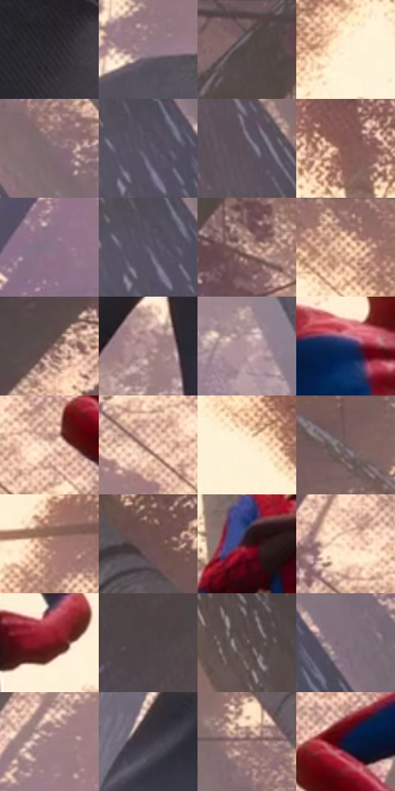

# 电影参考 318

- 状态：常规／活跃；来源世界：miles-home。
- 视角：low-angle；景别：full-body；场景：landscape。
- 时段：daylight-time-unspecified（外观依据，中置信度；具体时间／晨昏未知）；光照：warm-day。
- 材质候选：snow, foliage, stone, fabric, metal, sky（帧级，不是像素分割）。
- 明暗组：middle；L* P5/P50/P95：15.69316 / 47.08462 / 94.91633。
- 资格门禁：无附加门禁。
- 原截图 SHA-256：`14dabaae1e3c30c4fb8226bb6e13f7b55aa3619ebd179238ef216ed46be01f53`；尺寸：2880 × 1206。
- sRGB 像素 SHA-256：`ef722a2c7ec18003065c54d0fda81a1b5a0b00632878aa7073f3946d0e1ca731`。

## 观察与迁移

暖树冠和冷雪阴影，树干与前景岩石保留厚度。

318  /  面罩／林冠  /  面罩眼片、衣料、灰粉远树与暖天空；不作为裸脸眼睛比例

本公开版保存32个128×128原像素色卡上下文；图集格子并非原场景相邻位置。原rect、图集tile和像素SHA见 `data/palette-crops.json`。上下文不足时不得批准替色，不能以小样推断完整构图。

## 实测色卡

颜色比例分母为保留采样像素，不是材料面积；全部 32 色参与全库匹配。表内四舍五入仅用于阅读，原精度在 JSON。

| ID | HEX | Lab | 原图 xy | 像素数 | 比例 | 明度角色 |
| --- | --- | --- | --- | ---: | ---: | --- |
| 318-S01 | #2F2B33 | [18.2372, 3.725545, -4.492797] | [1092, 672] | 10286 | 5.319996% | deep-shadow |
| 318-S02 | #997F8B | [55.902836, 12.072357, -2.724397] | [1276, 992] | 9014 | 4.662108% | midtone |
| 318-S03 | #56494A | [32.34295, 5.665531, 1.434832] | [628, 40] | 8869 | 4.587113% | shadow |
| 318-S04 | #FDF1D6 | [95.433815, -0.303566, 14.497684] | [1412, 188] | 8850 | 4.577286% | highlight |
| 318-S05 | #806D71 | [47.90418, 8.189185, 0.553285] | [2544, 532] | 8650 | 4.473845% | midtone |
| 318-S06 | #56505F | [35.087019, 5.748129, -7.835027] | [2528, 756] | 8363 | 4.325406% | shadow |
| 318-S07 | #5E545E | [36.982689, 6.135434, -4.297541] | [2412, 568] | 8159 | 4.219896% | shadow |
| 318-S08 | #8C635E | [46.053596, 15.875585, 9.449181] | [1584, 212] | 7673 | 3.968533% | midtone |
| 318-S09 | #8B7487 | [51.529879, 12.461275, -7.014282] | [240, 824] | 7245 | 3.747168% | midtone |
| 318-S10 | #655E6E | [41.053372, 6.18357, -8.049285] | [2520, 760] | 7081 | 3.662346% | midtone |
| 318-S11 | #D2AFA2 | [74.171829, 10.685102, 11.412341] | [716, 176] | 6764 | 3.498391% | light |
| 318-S12 | #99746D | [52.251092, 13.471858, 9.498508] | [1136, 28] | 6631 | 3.429603% | midtone |
| 318-S13 | #654B49 | [34.560018, 10.685319, 5.476246] | [248, 332] | 6626 | 3.427017% | shadow |
| 318-S14 | #AA8B8B | [60.672379, 11.716703, 4.42625] | [972, 932] | 6446 | 3.333920% | light |
| 318-S15 | #B3989C | [65.311422, 10.67452, 1.634335] | [2364, 948] | 6251 | 3.233064% | light |
| 318-S16 | #132C5C | [18.852044, 9.529867, -31.573934] | [1012, 320] | 6027 | 3.117210% | deep-shadow |
| 318-S17 | #EAC5B0 | [82.142595, 9.983045, 15.426916] | [668, 456] | 5986 | 3.096004% | highlight |
| 318-S18 | #C69D8C | [68.031673, 12.737282, 14.696474] | [592, 492] | 5389 | 2.787231% | light |
| 318-S19 | #FEEDD2 | [94.437912, 1.482761, 15.164684] | [1872, 220] | 5355 | 2.769646% | highlight |
| 318-S20 | #785D5D | [42.173697, 10.999708, 4.226193] | [2780, 40] | 5279 | 2.730338% | midtone |
| 318-S21 | #AE8173 | [57.978709, 15.398857, 14.382167] | [1952, 356] | 5074 | 2.624311% | midtone |
| 318-S22 | #725352 | [38.504949, 12.763274, 5.662303] | [2444, 52] | 5037 | 2.605174% | shadow |
| 318-S23 | #361316 | [11.332383, 17.86586, 6.503491] | [1672, 584] | 4953 | 2.561729% | deep-shadow |
| 318-S24 | #F9DCC1 | [89.476587, 5.925016, 16.949844] | [564, 404] | 4824 | 2.495009% | highlight |
| 318-S25 | #771A23 | [26.10823, 40.160787, 19.162858] | [1248, 624] | 4471 | 2.312435% | shadow |
| 318-S26 | #4E4447 | [29.933728, 4.852987, -0.245795] | [64, 332] | 4431 | 2.291746% | shadow |
| 318-S27 | #655756 | [38.296664, 5.528685, 2.692093] | [2216, 388] | 4120 | 2.130895% | shadow |
| 318-S28 | #83717F | [49.699421, 9.653896, -5.096039] | [2644, 764] | 3853 | 1.992800% | midtone |
| 318-S29 | #9B7C7F | [54.986778, 12.472485, 2.930613] | [448, 564] | 3537 | 1.829363% | midtone |
| 318-S30 | #3E3946 | [24.928986, 5.196658, -7.197593] | [604, 1128] | 3172 | 1.640582% | shadow |
| 318-S31 | #A2817F | [56.992734, 12.351601, 5.912229] | [2508, 428] | 3066 | 1.585758% | midtone |
| 318-S32 | #0D1939 | [9.609938, 7.690806, -22.394685] | [752, 396] | 1864 | 0.964075% | deep-shadow |

## 色阶与空间分布

- 采样 ROI：`[0.01, 0.02, 0.98, 0.94]`；步长：4；样本数：193346。
- 排除区：`[]`。
- 深暗、暗、中、亮、高光五段计数：`[18531, 59500, 66663, 25048, 23604]`。
- RGB 各 256 箱、L* 100 箱、13×5 色相明度表和 3×3 空间统计全部保存在 [总数据](../film-library.json)。
- [可视化档案](../../references/library.html)按需绘制直方图，不存 2,094 张重复图表图片。

## 纹理特征占比

**这是分块图像特征的面积占比，不是波点／排线／丝网／错版的精确语义覆盖率。** 窗格、发丝、织物也会产生方向或周期特征。
原图 ROI 像素 3098546；已测块覆盖 3098546（100.0000%）；未测 0。

| 特征 | 块覆盖像素 | 占已测面积 | 阈值敏感范围 |
| --- | ---: | ---: | --- |
| low-contrast | 87296 | 2.8173% | 1.0575% ~ 4.5771% |
| directional-structure | 505088 | 16.3008% | 8.3693% ~ 23.8770% |
| periodic-structure | 1837490 | 59.3017% | 51.7296% ~ 64.0564% |
| mixed-detail | 668672 | 21.5802% | 11.0090% ~ 35.3239% |

阈值敏感范围不是统计置信区间。逐块坐标、尺度、对比、方向一致性、频谱集中度、频率与角度见 [全量特征记录](../texture-features.jsonl)，以帧号定位。
四种印刷层的真实像素覆盖仍标为 `null`，不能填 0，也不能拿上表代替。不得据这些代理测量删除唯一证据。

[测量方法与保留策略](../../references/library-retention.md) · [分类索引](../archive/README.md)
