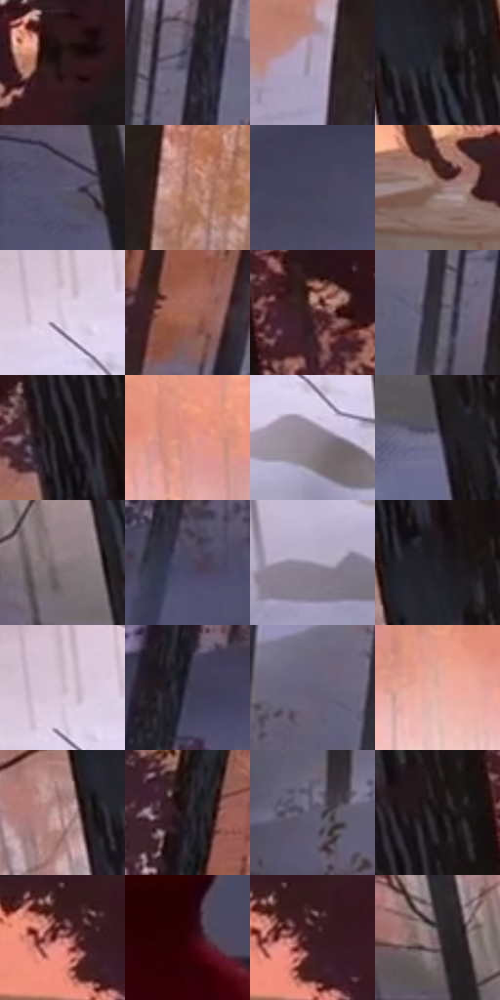

# 电影参考 319

- 状态：常规／活跃；来源世界：miles-home。
- 视角：high-angle；景别：environment-wide；场景：landscape。
- 时段：daylight-time-unspecified（外观依据，中置信度；具体时间／晨昏未知）；光照：warm-day。
- 材质候选：snow, foliage, stone, fabric, metal, sky（帧级，不是像素分割）。
- 明暗组：dark；L* P5/P50/P95：8.86322 / 37.14853 / 78.22893。
- 资格门禁：无附加门禁。
- 原截图 SHA-256：`64885a641894ff340fb683497a25309b93bbe01e49e985f3dfd82bb47fbf0a02`；尺寸：2880 × 1208。
- sRGB 像素 SHA-256：`de52be704c2cd79557dfe0ead0c472e1ad0c826bb84dd4543ed646af9dd2924a`。

## 观察与迁移

暖树冠和冷雪阴影，树干与前景岩石保留厚度。

319  /  建筑全景／深度  /  近暗树干、雪地道路与远建筑分层；底部字幕不授权新增文案

本公开版保存32个128×128原像素色卡上下文；图集格子并非原场景相邻位置。原rect、图集tile和像素SHA见 `data/palette-crops.json`。上下文不足时不得批准替色，不能以小样推断完整构图。

## 实测色卡

颜色比例分母为保留采样像素，不是材料面积；全部 32 色参与全库匹配。表内四舍五入仅用于阅读，原精度在 JSON。

| ID | HEX | Lab | 原图 xy | 像素数 | 比例 | 明度角色 |
| --- | --- | --- | --- | ---: | ---: | --- |
| 319-S01 | #30191D | [12.040486, 12.122938, 2.164305] | [1828, 36] | 8444 | 4.367300% | deep-shadow |
| 319-S02 | #4F4B60 | [33.003433, 6.534028, -11.67869] | [2248, 708] | 8277 | 4.280926% | shadow |
| 319-S03 | #AFA5BA | [69.161741, 7.602298, -9.471838] | [2004, 556] | 7999 | 4.137143% | light |
| 319-S04 | #2C2932 | [17.233873, 3.585212, -5.331577] | [292, 316] | 7659 | 3.961292% | deep-shadow |
| 319-S05 | #55536D | [36.407799, 6.948885, -14.602623] | [32, 592] | 7370 | 3.811819% | shadow |
| 319-S06 | #AF796C | [55.960643, 19.415494, 15.626232] | [2128, 336] | 7158 | 3.702171% | midtone |
| 319-S07 | #46445A | [29.848284, 6.19313, -12.732143] | [2412, 880] | 7052 | 3.647347% | shadow |
| 319-S08 | #84635C | [45.085198, 12.257279, 9.156572] | [1504, 152] | 6954 | 3.596661% | midtone |
| 319-S09 | #DBCBE0 | [83.523387, 9.312394, -8.364414] | [736, 432] | 6847 | 3.541320% | highlight |
| 319-S10 | #9F6450 | [48.343291, 21.553478, 21.270462] | [2764, 552] | 6801 | 3.517528% | midtone |
| 319-S11 | #4B282C | [20.810913, 16.903858, 4.558781] | [384, 80] | 6617 | 3.422362% | shadow |
| 319-S12 | #32303C | [20.511295, 3.867826, -7.245477] | [2188, 768] | 6570 | 3.398053% | shadow |
| 319-S13 | #1D191D | [9.362372, 2.950462, -2.066464] | [220, 152] | 6540 | 3.382537% | deep-shadow |
| 319-S14 | #DE9380 | [67.990309, 26.093471, 21.690353] | [1104, 200] | 6515 | 3.369607% | light |
| 319-S15 | #908492 | [56.592185, 7.20525, -5.848934] | [772, 536] | 6353 | 3.285819% | midtone |
| 319-S16 | #716C83 | [46.809269, 6.881486, -11.97097] | [280, 656] | 6333 | 3.275475% | midtone |
| 319-S17 | #86787C | [51.788364, 6.120106, -0.219107] | [216, 512] | 6286 | 3.251166% | midtone |
| 319-S18 | #4A4861 | [31.700815, 6.912879, -14.343795] | [2808, 740] | 6199 | 3.206169% | shadow |
| 319-S19 | #9B94A6 | [62.4244, 6.095427, -8.49883] | [604, 612] | 6162 | 3.187033% | light |
| 319-S20 | #212027 | [12.626024, 2.301307, -4.52943] | [272, 252] | 5900 | 3.051524% | deep-shadow |
| 319-S21 | #CBB8C8 | [76.768665, 9.577017, -5.602331] | [732, 400] | 5785 | 2.992045% | light |
| 319-S22 | #3D3A4C | [25.38171, 5.693624, -10.497811] | [2612, 764] | 5752 | 2.974978% | shadow |
| 319-S23 | #666178 | [42.353754, 7.034056, -12.1798] | [2120, 736] | 5708 | 2.952220% | midtone |
| 319-S24 | #E5AD9F | [75.483153, 18.549164, 15.160847] | [980, 232] | 5472 | 2.830159% | light |
| 319-S25 | #B58E8E | [62.612267, 14.732584, 5.655938] | [204, 328] | 5440 | 2.813609% | light |
| 319-S26 | #2A2327 | [14.6287, 4.200412, -1.441254] | [2652, 388] | 4629 | 2.394153% | deep-shadow |
| 319-S27 | #5F5A6F | [39.399384, 6.659454, -11.208215] | [1600, 908] | 4377 | 2.263817% | shadow |
| 319-S28 | #171113 | [5.691566, 2.967533, -0.230455] | [264, 80] | 4284 | 2.215717% | deep-shadow |
| 319-S29 | #451619 | [15.005369, 22.897249, 9.77558] | [2524, 52] | 3895 | 2.014523% | deep-shadow |
| 319-S30 | #2E0409 | [6.210846, 21.319011, 6.032978] | [960, 1040] | 3594 | 1.858844% | deep-shadow |
| 319-S31 | #5B3D40 | [29.240753, 13.663883, 3.490534] | [2552, 36] | 3423 | 1.770401% | shadow |
| 319-S32 | #624F55 | [35.683718, 9.042173, -0.520179] | [76, 460] | 2951 | 1.526279% | shadow |

## 色阶与空间分布

- 采样 ROI：`[0.01, 0.02, 0.98, 0.94]`；步长：4；样本数：193346。
- 排除区：`[]`。
- 深暗、暗、中、亮、高光五段计数：`[49675, 53617, 47061, 35854, 7139]`。
- RGB 各 256 箱、L* 100 箱、13×5 色相明度表和 3×3 空间统计全部保存在 [总数据](../film-library.json)。
- [可视化档案](../../references/library.html)按需绘制直方图，不存 2,094 张重复图表图片。

## 纹理特征占比

**这是分块图像特征的面积占比，不是波点／排线／丝网／错版的精确语义覆盖率。** 窗格、发丝、织物也会产生方向或周期特征。
原图 ROI 像素 3104134；已测块覆盖 3104134（100.0000%）；未测 0。

| 特征 | 块覆盖像素 | 占已测面积 | 阈值敏感范围 |
| --- | ---: | ---: | --- |
| low-contrast | 32768 | 1.0556% | 1.0556% ~ 1.0556% |
| directional-structure | 897408 | 28.9101% | 19.1414% ~ 40.1838% |
| periodic-structure | 1966598 | 63.3542% | 55.6844% ~ 68.0138% |
| mixed-detail | 207360 | 6.6801% | 3.0762% ~ 11.7892% |

阈值敏感范围不是统计置信区间。逐块坐标、尺度、对比、方向一致性、频谱集中度、频率与角度见 [全量特征记录](../texture-features.jsonl)，以帧号定位。
四种印刷层的真实像素覆盖仍标为 `null`，不能填 0，也不能拿上表代替。不得据这些代理测量删除唯一证据。

[测量方法与保留策略](../../references/library-retention.md) · [分类索引](../archive/README.md)
