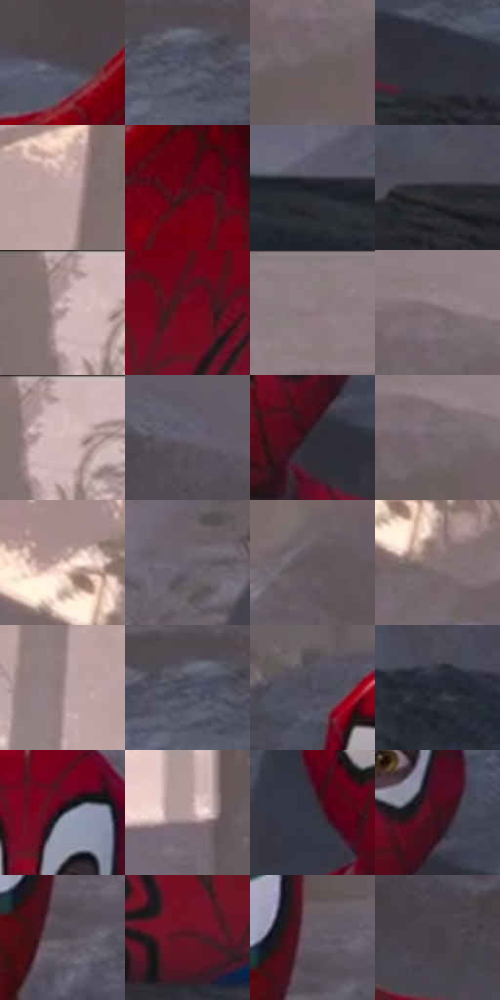

# 电影参考 320

- 状态：常规／活跃；来源世界：miles-home。
- 视角：near-level；景别：medium；场景：landscape。
- 时段：daylight-time-unspecified（外观依据，中置信度；具体时间／晨昏未知）；光照：warm-day。
- 材质候选：snow, foliage, stone, fabric, metal, sky（帧级，不是像素分割）。
- 明暗组：dark；L* P5/P50/P95：13.11833 / 36.28252 / 73.99514。
- 资格门禁：无附加门禁。
- 原截图 SHA-256：`dc26d15f73211de9eaf307d30b94865d8354a1ec8fe055675bfbbf9c80dfb7b9`；尺寸：2880 × 1198。
- sRGB 像素 SHA-256：`93118269a24880992353915e5549d5fb47ee99cf8902f953c34f95005e6aeaf9`。

## 观察与迁移

暖树冠和冷雪阴影，树干与前景岩石保留厚度。

320  /  岩石／遮挡  /  岩石硬面与表面笔触，人物被岩石遮挡；保留遮挡不补身躯

本公开版保存32个128×128原像素色卡上下文；图集格子并非原场景相邻位置。原rect、图集tile和像素SHA见 `data/palette-crops.json`。上下文不足时不得批准替色，不能以小样推断完整构图。

## 实测色卡

颜色比例分母为保留采样像素，不是材料面积；全部 32 色参与全库匹配。表内四舍五入仅用于阅读，原精度在 JSON。

| ID | HEX | Lab | 原图 xy | 像素数 | 比例 | 明度角色 |
| --- | --- | --- | --- | ---: | ---: | --- |
| 320-S01 | #4A4853 | [31.14925, 3.339531, -6.228737] | [1616, 548] | 11689 | 6.067543% | shadow |
| 320-S02 | #545566 | [36.632679, 3.554383, -9.909264] | [1348, 516] | 9432 | 4.895976% | shadow |
| 320-S03 | #6A5D60 | [40.79604, 5.807291, 0.209993] | [2188, 212] | 8425 | 4.373261% | midtone |
| 320-S04 | #2E313A | [20.372874, 1.033038, -6.124791] | [1208, 860] | 8251 | 4.282941% | shadow |
| 320-S05 | #BFA4A4 | [69.688827, 9.854435, 3.659286] | [276, 96] | 7522 | 3.904531% | light |
| 320-S06 | #560D19 | [17.165206, 33.218366, 13.279749] | [1720, 624] | 7392 | 3.837050% | deep-shadow |
| 320-S07 | #1C1E26 | [11.382304, 1.329177, -5.725339] | [172, 892] | 7042 | 3.655371% | deep-shadow |
| 320-S08 | #26272D | [15.760607, 1.101725, -4.081786] | [652, 876] | 6809 | 3.534425% | deep-shadow |
| 320-S09 | #A88F8F | [61.614298, 9.363627, 3.485853] | [2488, 28] | 6764 | 3.511067% | light |
| 320-S10 | #76071C | [23.962186, 44.636492, 21.180282] | [1740, 740] | 6720 | 3.488227% | shadow |
| 320-S11 | #8E7D80 | [54.002548, 7.03853, 0.761616] | [2100, 24] | 6425 | 3.335098% | midtone |
| 320-S12 | #7A6C72 | [47.076479, 6.620614, -1.32369] | [2196, 140] | 6254 | 3.246335% | midtone |
| 320-S13 | #CFB3B2 | [75.277549, 9.885523, 4.231855] | [2516, 24] | 6179 | 3.207404% | light |
| 320-S14 | #64606E | [41.533511, 4.587971, -7.339914] | [2364, 512] | 6063 | 3.147191% | midtone |
| 320-S15 | #2D2D32 | [18.648682, 1.231952, -3.206084] | [1088, 816] | 5965 | 3.096321% | deep-shadow |
| 320-S16 | #72666C | [44.465874, 5.902609, -1.635987] | [2208, 172] | 5959 | 3.093206% | midtone |
| 320-S17 | #EDD0C8 | [85.649229, 8.83996, 7.689329] | [1316, 220] | 5820 | 3.021054% | highlight |
| 320-S18 | #6B646F | [43.341967, 5.022152, -5.186246] | [676, 604] | 5792 | 3.006520% | midtone |
| 320-S19 | #62575B | [38.143257, 5.259449, -0.673174] | [2524, 352] | 5665 | 2.940596% | shadow |
| 320-S20 | #847577 | [50.640817, 6.162618, 1.027459] | [1376, 296] | 5653 | 2.934367% | midtone |
| 320-S21 | #988485 | [56.950456, 7.757363, 2.264231] | [108, 288] | 5488 | 2.848719% | midtone |
| 320-S22 | #4C4E5E | [33.548628, 3.007366, -9.611296] | [1328, 508] | 5465 | 2.836780% | shadow |
| 320-S23 | #504F5D | [34.164803, 3.61808, -8.015736] | [888, 560] | 5376 | 2.790582% | shadow |
| 320-S24 | #262B36 | [17.488474, 0.876492, -7.795947] | [2444, 948] | 5236 | 2.717910% | deep-shadow |
| 320-S25 | #1F242F | [14.163623, 0.970696, -7.98048] | [1052, 616] | 5221 | 2.710124% | deep-shadow |
| 320-S26 | #B29A9C | [65.731002, 9.191734, 2.232438] | [880, 352] | 4907 | 2.547133% | light |
| 320-S27 | #343842 | [23.511035, 0.863937, -6.758657] | [896, 784] | 3987 | 2.069578% | shadow |
| 320-S28 | #35151B | [11.773621, 16.795919, 3.381708] | [1108, 748] | 3959 | 2.055043% | deep-shadow |
| 320-S29 | #575059 | [34.972951, 4.774593, -4.216312] | [1948, 412] | 3863 | 2.005212% | shadow |
| 320-S30 | #5D1927 | [20.71062, 31.922614, 8.367532] | [1928, 868] | 3771 | 1.957456% | shadow |
| 320-S31 | #615B66 | [39.55163, 4.720399, -5.414932] | [1952, 356] | 3494 | 1.813671% | shadow |
| 320-S32 | #483F47 | [27.812017, 5.56524, -3.441214] | [2100, 540] | 2060 | 1.069308% | shadow |

## 色阶与空间分布

- 采样 ROI：`[0.01, 0.02, 0.98, 0.94]`；步长：4；样本数：192648。
- 排除区：`[]`。
- 深暗、暗、中、亮、高光五段计数：`[44306, 67544, 51237, 23914, 5647]`。
- RGB 各 256 箱、L* 100 箱、13×5 色相明度表和 3×3 空间统计全部保存在 [总数据](../film-library.json)。
- [可视化档案](../../references/library.html)按需绘制直方图，不存 2,094 张重复图表图片。

## 纹理特征占比

**这是分块图像特征的面积占比，不是波点／排线／丝网／错版的精确语义覆盖率。** 窗格、发丝、织物也会产生方向或周期特征。
原图 ROI 像素 3081782；已测块覆盖 3081782（100.0000%）；未测 0。

| 特征 | 块覆盖像素 | 占已测面积 | 阈值敏感范围 |
| --- | ---: | ---: | --- |
| low-contrast | 229376 | 7.4430% | 0.9844% ~ 16.0050% |
| directional-structure | 406784 | 13.1996% | 3.7215% ~ 34.4653% |
| periodic-structure | 2310710 | 74.9797% | 63.4871% ~ 75.1607% |
| mixed-detail | 134912 | 4.3777% | 1.0633% ~ 5.1129% |

阈值敏感范围不是统计置信区间。逐块坐标、尺度、对比、方向一致性、频谱集中度、频率与角度见 [全量特征记录](../texture-features.jsonl)，以帧号定位。
四种印刷层的真实像素覆盖仍标为 `null`，不能填 0，也不能拿上表代替。不得据这些代理测量删除唯一证据。

[测量方法与保留策略](../../references/library-retention.md) · [分类索引](../archive/README.md)
