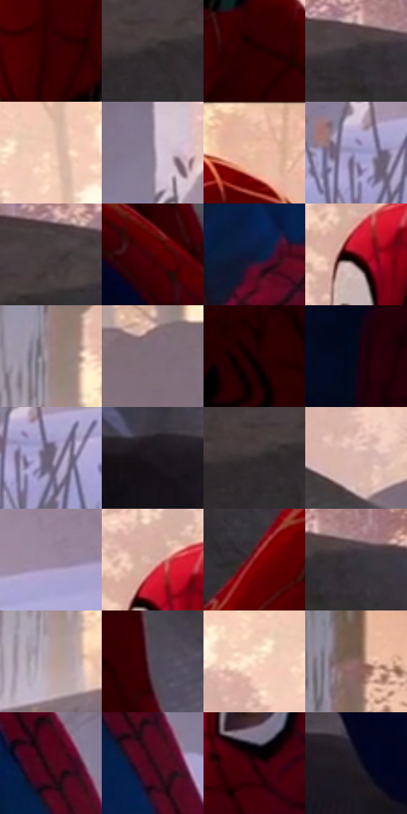

# 电影参考 321

- 状态：常规／活跃；来源世界：miles-home。
- 视角：high-angle；景别：medium；场景：landscape。
- 时段：daylight-time-unspecified（外观依据，中置信度；具体时间／晨昏未知）；光照：warm-day。
- 材质候选：snow, foliage, stone, fabric, metal, sky（帧级，不是像素分割）。
- 明暗组：dark；L* P5/P50/P95：3.07295 / 23.19929 / 84.52585。
- 资格门禁：无附加门禁。
- 原截图 SHA-256：`3a4f80060a3f978a080aa4a98a23c69bafe568b78f085e9e440159fac86946c6`；尺寸：2880 × 1208。
- sRGB 像素 SHA-256：`84be4bd9e9056507f7410da5026005f8284bee7b0e75422dc35f5d3bbacba2f2`。

## 观察与迁移

暖树冠和冷雪阴影，树干与前景岩石保留厚度。

321  /  面罩／柔和补光  /  薄暖边、红布和雪地亮面；蜘蛛网图案是衣服内容不是通用排线

本公开版保存32个128×128原像素色卡上下文；图集格子并非原场景相邻位置。原rect、图集tile和像素SHA见 `data/palette-crops.json`。上下文不足时不得批准替色，不能以小样推断完整构图。

## 实测色卡

颜色比例分母为保留采样像素，不是材料面积；全部 32 色参与全库匹配。表内四舍五入仅用于阅读，原精度在 JSON。

| ID | HEX | Lab | 原图 xy | 像素数 | 比例 | 明度角色 |
| --- | --- | --- | --- | ---: | ---: | --- |
| 321-S01 | #360003 | [7.145972, 26.698023, 10.062875] | [1156, 304] | 9387 | 4.855027% | deep-shadow |
| 321-S02 | #2C2729 | [16.238691, 2.761526, -0.47335] | [300, 148] | 8865 | 4.585044% | deep-shadow |
| 321-S03 | #290103 | [4.515131, 18.967847, 5.882142] | [1236, 496] | 8606 | 4.451088% | deep-shadow |
| 321-S04 | #353033 | [20.478519, 2.903012, -1.099749] | [520, 104] | 8597 | 4.446433% | shadow |
| 321-S05 | #F3CCB8 | [84.844987, 10.76875, 15.096704] | [1868, 180] | 8174 | 4.227654% | highlight |
| 321-S06 | #86788D | [52.313778, 9.50699, -9.414986] | [2380, 712] | 7917 | 4.094732% | midtone |
| 321-S07 | #E9BCA7 | [79.660848, 13.134579, 16.74596] | [1176, 32] | 7543 | 3.901296% | light |
| 321-S08 | #A09BC8 | [65.815409, 11.244145, -22.42302] | [2392, 844] | 7432 | 3.843886% | light |
| 321-S09 | #443A3E | [25.572232, 5.191032, -0.855799] | [348, 84] | 7334 | 3.793200% | shadow |
| 321-S10 | #480106 | [12.044103, 31.99273, 16.446629] | [1400, 916] | 7253 | 3.751306% | deep-shadow |
| 321-S11 | #09193C | [9.636293, 8.318649, -24.508844] | [2156, 996] | 6841 | 3.538216% | deep-shadow |
| 321-S12 | #5C020A | [17.185569, 37.715394, 22.441765] | [1752, 416] | 6807 | 3.520631% | deep-shadow |
| 321-S13 | #968182 | [55.883815, 8.177285, 2.427271] | [2140, 316] | 6557 | 3.391330% | midtone |
| 321-S14 | #7E6E79 | [48.21997, 8.343993, -3.775087] | [2808, 300] | 6465 | 3.343746% | midtone |
| 321-S15 | #1B0005 | [2.204412, 10.137731, 1.434924] | [1012, 784] | 5903 | 3.053076% | deep-shadow |
| 321-S16 | #060616 | [2.049349, 2.841007, -7.73221] | [772, 1004] | 5893 | 3.047904% | deep-shadow |
| 321-S17 | #685D71 | [41.158919, 8.592112, -9.698396] | [2428, 860] | 5678 | 2.936704% | midtone |
| 321-S18 | #1D171F | [8.763977, 4.981336, -4.467222] | [1172, 996] | 5671 | 2.933084% | deep-shadow |
| 321-S19 | #322B2D | [18.34456, 3.631235, -0.119901] | [276, 152] | 5458 | 2.822918% | deep-shadow |
| 321-S20 | #DDB9B0 | [77.996768, 11.507419, 9.390044] | [1512, 552] | 5370 | 2.777404% | light |
| 321-S21 | #9A8A9F | [59.480349, 9.984697, -8.920454] | [2592, 768] | 5351 | 2.767577% | midtone |
| 321-S22 | #D4AEA1 | [74.090027, 11.835078, 11.868596] | [1756, 364] | 5170 | 2.673963% | light |
| 321-S23 | #8B101A | [29.250195, 48.769371, 29.624317] | [504, 588] | 5083 | 2.628966% | shadow |
| 321-S24 | #39343B | [22.449413, 3.795724, -3.587114] | [576, 104] | 5047 | 2.610346% | shadow |
| 321-S25 | #B6A0A0 | [67.743752, 8.043795, 2.961901] | [2140, 460] | 4885 | 2.526559% | light |
| 321-S26 | #534957 | [32.463192, 7.171513, -6.731457] | [1388, 676] | 4815 | 2.490354% | shadow |
| 321-S27 | #FBDDC4 | [89.956707, 6.563616, 16.082534] | [1800, 192] | 4752 | 2.457770% | highlight |
| 321-S28 | #8D6B65 | [48.40912, 12.616506, 8.605091] | [2168, 92] | 4321 | 2.234854% | midtone |
| 321-S29 | #4B0A1D | [14.412395, 30.903322, 6.263024] | [2196, 776] | 3901 | 2.017626% | deep-shadow |
| 321-S30 | #350918 | [9.143954, 23.16715, 1.900685] | [2224, 840] | 3487 | 1.803503% | deep-shadow |
| 321-S31 | #2C020A | [5.428521, 21.255929, 4.434113] | [1856, 592] | 3249 | 1.680407% | deep-shadow |
| 321-S32 | #201E28 | [11.882955, 3.617142, -6.390736] | [1300, 1008] | 1534 | 0.793396% | deep-shadow |

## 色阶与空间分布

- 采样 ROI：`[0.01, 0.02, 0.98, 0.94]`；步长：4；样本数：193346。
- 排除区：`[]`。
- 深暗、暗、中、亮、高光五段计数：`[84905, 30275, 33041, 28287, 16838]`。
- RGB 各 256 箱、L* 100 箱、13×5 色相明度表和 3×3 空间统计全部保存在 [总数据](../film-library.json)。
- [可视化档案](../../references/library.html)按需绘制直方图，不存 2,094 张重复图表图片。

## 纹理特征占比

**这是分块图像特征的面积占比，不是波点／排线／丝网／错版的精确语义覆盖率。** 窗格、发丝、织物也会产生方向或周期特征。
原图 ROI 像素 3104134；已测块覆盖 3104134（100.0000%）；未测 0。

| 特征 | 块覆盖像素 | 占已测面积 | 阈值敏感范围 |
| --- | ---: | ---: | --- |
| low-contrast | 479104 | 15.4344% | 9.1006% ~ 19.4878% |
| directional-structure | 732288 | 23.5907% | 11.3521% ~ 42.0848% |
| periodic-structure | 1728902 | 55.6968% | 48.2868% ~ 56.6617% |
| mixed-detail | 163840 | 5.2781% | 0.5278% ~ 12.4984% |

阈值敏感范围不是统计置信区间。逐块坐标、尺度、对比、方向一致性、频谱集中度、频率与角度见 [全量特征记录](../texture-features.jsonl)，以帧号定位。
四种印刷层的真实像素覆盖仍标为 `null`，不能填 0，也不能拿上表代替。不得据这些代理测量删除唯一证据。

[测量方法与保留策略](../../references/library-retention.md) · [分类索引](../archive/README.md)
