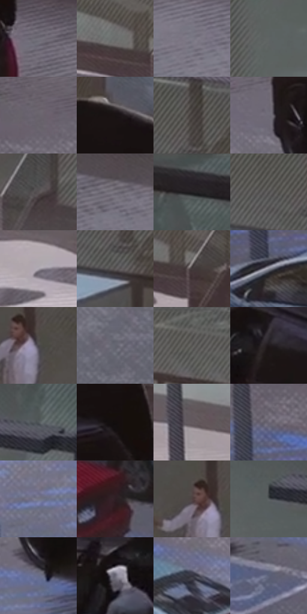

# 电影参考 322

- 状态：常规／活跃；来源世界：miles-home。
- 视角：high-angle；景别：environment-wide；场景：street。
- 时段：daylight-time-unspecified（外观依据，中置信度；具体时间／晨昏未知）；光照：neutral-day。
- 材质候选：skin, fabric, snow, asphalt, glass, painted-metal（帧级，不是像素分割）。
- 明暗组：middle；L* P5/P50/P95：6.24709 / 40.21955 / 57.28957。
- 资格门禁：无附加门禁。
- 原截图 SHA-256：`e897c64bc099591d04aef3c4eb56d9367743b2f75c7e3ee5315c461b2c90aaef`；尺寸：2880 × 1206。
- sRGB 像素 SHA-256：`ac5fb7da77779b8cf3073a9cb47db185a7268cc4af56a3c9dbd4c37a0db5ab65`。

## 观察与迁移

停车场、白衣和积雪，白材质仍有不同亮度与纹理。

322  /  车漆／建筑玻璃  /  黑SUV少量反光、实验楼入口与白衣；不把黑车全部截成无体积黑块

本公开版保存32个128×128原像素色卡上下文；图集格子并非原场景相邻位置。原rect、图集tile和像素SHA见 `data/palette-crops.json`。上下文不足时不得批准替色，不能以小样推断完整构图。

## 实测色卡

颜色比例分母为保留采样像素，不是材料面积；全部 32 色参与全库匹配。表内四舍五入仅用于阅读，原精度在 JSON。

| ID | HEX | Lab | 原图 xy | 像素数 | 比例 | 明度角色 |
| --- | --- | --- | --- | ---: | ---: | --- |
| 322-S01 | #72707A | [47.714669, 2.849979, -5.239719] | [1676, 704] | 9529 | 4.928470% | midtone |
| 322-S02 | #6B6E6E | [46.181815, -1.148392, -0.398424] | [988, 376] | 8592 | 4.443847% | midtone |
| 322-S03 | #7D7A86 | [51.837449, 3.59256, -6.107304] | [1988, 780] | 8492 | 4.392126% | midtone |
| 322-S04 | #5F6363 | [41.622255, -1.555824, -0.539043] | [2296, 352] | 8198 | 4.240067% | midtone |
| 322-S05 | #67626A | [42.245751, 3.630267, -3.810571] | [240, 588] | 8020 | 4.148004% | midtone |
| 322-S06 | #181213 | [6.086746, 2.8699, 0.359639] | [1512, 480] | 7238 | 3.743548% | deep-shadow |
| 322-S07 | #504A48 | [31.968013, 2.088767, 2.093641] | [1816, 80] | 6952 | 3.595626% | shadow |
| 322-S08 | #6E6A76 | [45.5396, 4.062582, -6.116453] | [740, 704] | 6946 | 3.592523% | midtone |
| 322-S09 | #585253 | [35.466855, 2.653726, 0.299164] | [2172, 580] | 6888 | 3.562525% | shadow |
| 322-S10 | #77737D | [49.086091, 3.574973, -4.941088] | [2352, 724] | 6582 | 3.404260% | midtone |
| 322-S11 | #2D282E | [16.858036, 3.701445, -3.07426] | [2764, 36] | 6430 | 3.325644% | deep-shadow |
| 322-S12 | #504E4E | [33.35939, 0.817574, 0.292505] | [1744, 108] | 6340 | 3.279096% | shadow |
| 322-S13 | #ADA7B0 | [69.224052, 3.840896, -3.856008] | [512, 384] | 6275 | 3.245477% | light |
| 322-S14 | #5C5858 | [37.769475, 1.607294, 0.576344] | [1804, 176] | 6260 | 3.237719% | shadow |
| 322-S15 | #41393A | [24.813955, 3.700594, 0.659654] | [1056, 404] | 6254 | 3.234616% | shadow |
| 322-S16 | #898A96 | [57.748459, 2.086583, -6.499746] | [72, 804] | 5833 | 3.016871% | midtone |
| 322-S17 | #484649 | [30.007812, 1.492382, -1.500984] | [1856, 420] | 5815 | 3.007562% | shadow |
| 322-S18 | #646570 | [43.042802, 2.012639, -6.304519] | [2632, 1064] | 5761 | 2.979632% | midtone |
| 322-S19 | #5D5E5C | [39.757206, -0.81501, 1.007856] | [1364, 28] | 5286 | 2.733959% | shadow |
| 322-S20 | #1F191B | [9.52738, 3.424971, -0.294219] | [1032, 580] | 5257 | 2.718960% | deep-shadow |
| 322-S21 | #505659 | [36.142092, -1.693507, -2.556793] | [2772, 268] | 5179 | 2.678618% | shadow |
| 322-S22 | #130E0E | [4.37414, 1.826763, 0.644221] | [1572, 600] | 5142 | 2.659481% | deep-shadow |
| 322-S23 | #615960 | [38.778636, 4.655657, -2.8522] | [52, 268] | 5122 | 2.649137% | shadow |
| 322-S24 | #6B6774 | [44.357742, 4.304946, -6.700702] | [96, 672] | 4907 | 2.537937% | midtone |
| 322-S25 | #757686 | [50.049118, 3.054832, -8.845359] | [588, 860] | 4890 | 2.529145% | midtone |
| 322-S26 | #2D1E23 | [13.277993, 8.294915, -0.493718] | [260, 1040] | 4860 | 2.513628% | deep-shadow |
| 322-S27 | #4F4040 | [28.64108, 6.481401, 2.439932] | [1808, 400] | 4860 | 2.513628% | shadow |
| 322-S28 | #565B5D | [38.288879, -1.523276, -1.828092] | [2664, 304] | 4630 | 2.394671% | shadow |
| 322-S29 | #686D88 | [46.521916, 4.383175, -15.458891] | [796, 824] | 4521 | 2.338295% | midtone |
| 322-S30 | #686674 | [43.809279, 3.796151, -7.547278] | [900, 608] | 4499 | 2.326917% | midtone |
| 322-S31 | #35343F | [22.20176, 3.146092, -6.703669] | [396, 784] | 4473 | 2.313469% | shadow |
| 322-S32 | #5C6178 | [41.501514, 3.519375, -13.552898] | [576, 1044] | 3315 | 1.714543% | midtone |

## 色阶与空间分布

- 采样 ROI：`[0.01, 0.02, 0.98, 0.94]`；步长：4；样本数：193346。
- 排除区：`[]`。
- 深暗、暗、中、亮、高光五段计数：`[28968, 66281, 90414, 7642, 41]`。
- RGB 各 256 箱、L* 100 箱、13×5 色相明度表和 3×3 空间统计全部保存在 [总数据](../film-library.json)。
- [可视化档案](../../references/library.html)按需绘制直方图，不存 2,094 张重复图表图片。

## 纹理特征占比

**这是分块图像特征的面积占比，不是波点／排线／丝网／错版的精确语义覆盖率。** 窗格、发丝、织物也会产生方向或周期特征。
原图 ROI 像素 3098546；已测块覆盖 3098546（100.0000%）；未测 0。

| 特征 | 块覆盖像素 | 占已测面积 | 阈值敏感范围 |
| --- | ---: | ---: | --- |
| low-contrast | 125568 | 4.0525% | 2.1151% ~ 7.9273% |
| directional-structure | 1160320 | 37.4472% | 19.0355% ~ 55.5946% |
| periodic-structure | 1551026 | 50.0566% | 37.1886% ~ 59.4834% |
| mixed-detail | 261632 | 8.4437% | 5.1017% ~ 13.5537% |

阈值敏感范围不是统计置信区间。逐块坐标、尺度、对比、方向一致性、频谱集中度、频率与角度见 [全量特征记录](../texture-features.jsonl)，以帧号定位。
四种印刷层的真实像素覆盖仍标为 `null`，不能填 0，也不能拿上表代替。不得据这些代理测量删除唯一证据。

[测量方法与保留策略](../../references/library-retention.md) · [分类索引](../archive/README.md)
