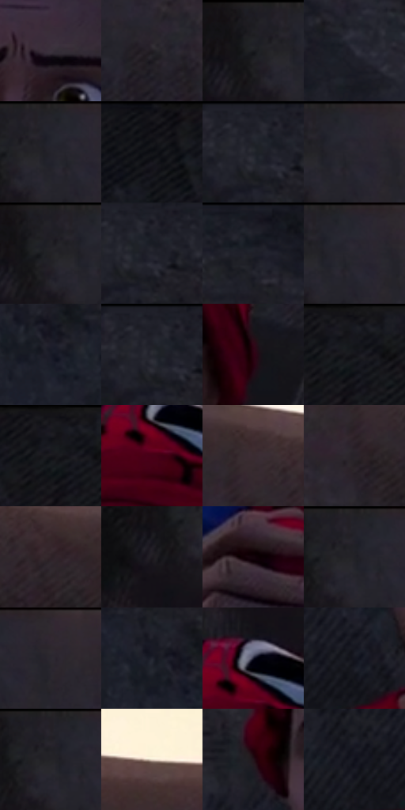

# 电影参考 323

- 状态：常规／活跃；来源世界：miles-home。
- 视角：near-level；景别：close-up；场景：portrait。
- 时段：daylight-time-unspecified（外观依据，中置信度；具体时间／晨昏未知）；光照：neutral-day。
- 材质候选：skin, hair, fabric, stone（帧级，不是像素分割）。
- 明暗组：very-dark；L* P5/P50/P95：5.32085 / 12.69201 / 20.73461。
- 资格门禁：无附加门禁。
- 原截图 SHA-256：`d89793ebecc1f41b7d326b53be1b8fc72293f3a2f9de829df6223eabb5777816`；尺寸：2880 × 1210。
- sRGB 像素 SHA-256：`3a3351282fe0095e4e3a3bbf9013aec41b3f385967a8d0a76eedd394c9efe0d0`。

## 观察与迁移

岩后阴影近景脸，暗色仍分冷暖，五官留净。

323  /  阴面裸脸／表情  /  睁眼惊讶、岩石背景和柔和脸面；不把惊讶眼型当默认比例

本公开版保存32个128×128原像素色卡上下文；图集格子并非原场景相邻位置。原rect、图集tile和像素SHA见 `data/palette-crops.json`。上下文不足时不得批准替色，不能以小样推断完整构图。

## 实测色卡

颜色比例分母为保留采样像素，不是材料面积；全部 32 色参与全库匹配。表内四舍五入仅用于阅读，原精度在 JSON。

| ID | HEX | Lab | 原图 xy | 像素数 | 比例 | 明度角色 |
| --- | --- | --- | --- | ---: | ---: | --- |
| 323-S01 | #3A323D | [22.008207, 6.048617, -5.589488] | [1488, 504] | 10749 | 5.539465% | shadow |
| 323-S02 | #221D24 | [11.594807, 4.12796, -3.873821] | [1764, 180] | 9513 | 4.902496% | deep-shadow |
| 323-S03 | #1E1D23 | [11.107221, 2.056863, -3.914522] | [1536, 28] | 9322 | 4.804065% | deep-shadow |
| 323-S04 | #292A35 | [17.387262, 2.467284, -7.226555] | [748, 528] | 9069 | 4.673682% | deep-shadow |
| 323-S05 | #25242C | [14.606929, 2.530356, -5.111426] | [1596, 60] | 9028 | 4.652553% | deep-shadow |
| 323-S06 | #141318 | [6.146092, 1.617131, -3.121525] | [1116, 32] | 8509 | 4.385088% | deep-shadow |
| 323-S07 | #1D1E27 | [11.52643, 2.051643, -6.230056] | [68, 28] | 8333 | 4.294387% | deep-shadow |
| 323-S08 | #282730 | [16.08223, 2.768179, -5.699787] | [1628, 60] | 7758 | 3.998062% | deep-shadow |
| 323-S09 | #212027 | [12.626024, 2.301307, -4.52943] | [1552, 28] | 7653 | 3.943951% | deep-shadow |
| 323-S10 | #21222C | [13.526776, 2.291064, -6.783222] | [96, 68] | 7484 | 3.856857% | deep-shadow |
| 323-S11 | #1C1C24 | [10.592294, 2.206608, -5.449067] | [300, 28] | 7408 | 3.817691% | deep-shadow |
| 323-S12 | #26262F | [15.505619, 2.362105, -5.881856] | [1628, 28] | 6518 | 3.359032% | deep-shadow |
| 323-S13 | #191A26 | [9.683289, 3.076497, -8.344517] | [140, 232] | 6428 | 3.312651% | deep-shadow |
| 323-S14 | #1F2029 | [12.508515, 2.022667, -6.179337] | [32, 28] | 6093 | 3.140009% | deep-shadow |
| 323-S15 | #2C0211 | [5.596066, 22.08707, 1.229803] | [1696, 536] | 6086 | 3.136402% | deep-shadow |
| 323-S16 | #191A21 | [9.44346, 1.500828, -4.98696] | [1260, 32] | 6065 | 3.125580% | deep-shadow |
| 323-S17 | #18181F | [8.53647, 1.964857, -4.866639] | [1240, 32] | 6025 | 3.104966% | deep-shadow |
| 323-S18 | #470117 | [12.113757, 32.583331, 7.446177] | [1504, 304] | 6007 | 3.095690% | deep-shadow |
| 323-S19 | #3B2C32 | [19.889332, 8.089456, -1.198145] | [1952, 80] | 5660 | 2.916864% | deep-shadow |
| 323-S20 | #282229 | [14.146749, 4.487957, -3.617821] | [1924, 148] | 5198 | 2.678774% | deep-shadow |
| 323-S21 | #2F2228 | [14.962503, 7.447686, -1.596006] | [2040, 120] | 4923 | 2.537053% | deep-shadow |
| 323-S22 | #1E1A21 | [9.989201, 3.72918, -4.110653] | [1500, 112] | 4905 | 2.527777% | deep-shadow |
| 323-S23 | #13030A | [2.037101, 5.799155, -0.948474] | [1164, 1008] | 4642 | 2.392241% | deep-shadow |
| 323-S24 | #23222A | [13.641673, 2.555404, -5.150641] | [1584, 28] | 4528 | 2.333491% | deep-shadow |
| 323-S25 | #2E272E | [16.646659, 4.845893, -3.376828] | [1688, 48] | 4226 | 2.177857% | deep-shadow |
| 323-S26 | #222530 | [14.825671, 1.739102, -7.658899] | [104, 196] | 3985 | 2.053658% | deep-shadow |
| 323-S27 | #1E1F31 | [12.46549, 4.900376, -12.037181] | [1516, 244] | 3730 | 1.922244% | deep-shadow |
| 323-S28 | #151620 | [7.565153, 2.485763, -7.129236] | [1276, 708] | 3453 | 1.779493% | deep-shadow |
| 323-S29 | #242229 | [13.704784, 2.714306, -4.324976] | [1576, 32] | 3371 | 1.737235% | deep-shadow |
| 323-S30 | #E5D8C6 | [86.922275, 1.491783, 10.478288] | [2456, 84] | 2964 | 1.527489% | highlight |
| 323-S31 | #23151B | [8.763131, 8.351271, -1.354861] | [1272, 568] | 2339 | 1.205397% | deep-shadow |
| 323-S32 | #10101C | [5.09964, 2.945579, -7.82052] | [1184, 720] | 2072 | 1.067799% | deep-shadow |

## 色阶与空间分布

- 采样 ROI：`[0.01, 0.02, 0.98, 0.94]`；步长：4；样本数：194044。
- 排除区：`[]`。
- 深暗、暗、中、亮、高光五段计数：`[181878, 9427, 244, 67, 2428]`。
- RGB 各 256 箱、L* 100 箱、13×5 色相明度表和 3×3 空间统计全部保存在 [总数据](../film-library.json)。
- [可视化档案](../../references/library.html)按需绘制直方图，不存 2,094 张重复图表图片。

## 纹理特征占比

**这是分块图像特征的面积占比，不是波点／排线／丝网／错版的精确语义覆盖率。** 窗格、发丝、织物也会产生方向或周期特征。
原图 ROI 像素 3109722；已测块覆盖 3109722（100.0000%）；未测 0。

| 特征 | 块覆盖像素 | 占已测面积 | 阈值敏感范围 |
| --- | ---: | ---: | --- |
| low-contrast | 649178 | 20.8758% | 1.3571% ~ 41.6539% |
| directional-structure | 221568 | 7.1250% | 5.1781% ~ 16.8144% |
| periodic-structure | 2006016 | 64.5079% | 40.6138% ~ 79.8116% |
| mixed-detail | 232960 | 7.4913% | 2.0169% ~ 12.5542% |

阈值敏感范围不是统计置信区间。逐块坐标、尺度、对比、方向一致性、频谱集中度、频率与角度见 [全量特征记录](../texture-features.jsonl)，以帧号定位。
四种印刷层的真实像素覆盖仍标为 `null`，不能填 0，也不能拿上表代替。不得据这些代理测量删除唯一证据。

[测量方法与保留策略](../../references/library-retention.md) · [分类索引](../archive/README.md)
