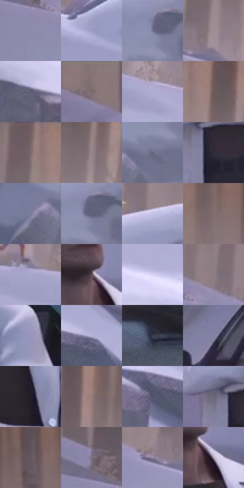

# 电影参考 324

- 状态：常规／活跃；来源世界：miles-home。
- 视角：near-level；景别：medium；场景：street。
- 时段：daylight-time-unspecified（外观依据，中置信度；具体时间／晨昏未知）；光照：neutral-day。
- 材质候选：skin, fabric, snow, asphalt, glass, painted-metal（帧级，不是像素分割）。
- 明暗组：middle；L* P5/P50/P95：18.6538 / 52.22792 / 79.29097。
- 资格门禁：无附加门禁。
- 原截图 SHA-256：`aa7e98547d10ef72282549d95c32d9e6faf19f8bd42a5ef96a5a29a5ba12bf0a`；尺寸：2880 × 1194。
- sRGB 像素 SHA-256：`bec54cdb45aa27186d8d4575ea25ef367dc41020f1b5d1ff521fe0461a93e313`。

## 观察与迁移

停车场、白衣和积雪，白材质仍有不同亮度与纹理。

324  /  配角脸／条件文字  /  研究人员不同头形与眼镜；远处小人思想泡只记录，不自动给照片配想法

本公开版保存32个128×128原像素色卡上下文；图集格子并非原场景相邻位置。原rect、图集tile和像素SHA见 `data/palette-crops.json`。上下文不足时不得批准替色，不能以小样推断完整构图。

## 实测色卡

颜色比例分母为保留采样像素，不是材料面积；全部 32 色参与全库匹配。表内四舍五入仅用于阅读，原精度在 JSON。

| ID | HEX | Lab | 原图 xy | 像素数 | 比例 | 明度角色 |
| --- | --- | --- | --- | ---: | ---: | --- |
| 324-S01 | #8D8CAF | [59.446688, 7.879255, -18.203117] | [232, 260] | 9508 | 4.953373% | midtone |
| 324-S02 | #9E9EC4 | [66.295972, 8.001899, -19.478164] | [1944, 588] | 9299 | 4.844491% | light |
| 324-S03 | #6F7190 | [48.514782, 6.329753, -17.116239] | [2736, 444] | 9129 | 4.755926% | midtone |
| 324-S04 | #A08E94 | [60.74472, 7.789968, -0.713885] | [572, 232] | 8782 | 4.575150% | light |
| 324-S05 | #5D5D75 | [40.311876, 5.564164, -13.523201] | [340, 572] | 8578 | 4.468872% | midtone |
| 324-S06 | #88767A | [51.378096, 7.684709, 0.380485] | [40, 48] | 8522 | 4.439698% | midtone |
| 324-S07 | #AEACD1 | [71.627226, 8.243835, -18.454579] | [752, 372] | 8390 | 4.370930% | light |
| 324-S08 | #6E5A5B | [40.218245, 8.336458, 2.49622] | [792, 84] | 8343 | 4.346444% | midtone |
| 324-S09 | #7A6668 | [45.137424, 8.324027, 1.854394] | [720, 52] | 7849 | 4.089086% | midtone |
| 324-S10 | #96848A | [56.901567, 7.893714, -0.714012] | [1020, 124] | 7819 | 4.073457% | midtone |
| 324-S11 | #676783 | [44.550306, 6.413032, -15.478755] | [2716, 532] | 7637 | 3.978640% | midtone |
| 324-S12 | #2E2A37 | [17.975446, 5.054909, -7.680095] | [864, 1088] | 7440 | 3.876009% | deep-shadow |
| 324-S13 | #7A7A9B | [52.311894, 7.34337, -17.697208] | [2620, 556] | 6725 | 3.503517% | midtone |
| 324-S14 | #60627D | [42.311579, 5.557042, -15.325608] | [2752, 444] | 6661 | 3.470175% | midtone |
| 324-S15 | #C4C2E6 | [79.631922, 7.795131, -17.587639] | [2312, 416] | 6606 | 3.441521% | light |
| 324-S16 | #836E6F | [48.417587, 8.428739, 2.527674] | [2380, 184] | 6496 | 3.384215% | midtone |
| 324-S17 | #A8A6CC | [69.438383, 8.538131, -19.066332] | [1008, 408] | 6292 | 3.277937% | light |
| 324-S18 | #55464F | [31.52359, 8.152529, -2.983896] | [2284, 788] | 6102 | 3.178953% | shadow |
| 324-S19 | #D8D4F6 | [86.175729, 7.855125, -16.109266] | [728, 520] | 5984 | 3.117479% | highlight |
| 324-S20 | #8C7C84 | [53.661207, 7.598339, -2.092617] | [324, 164] | 5674 | 2.955978% | midtone |
| 324-S21 | #9796BA | [63.290473, 7.97251, -18.504394] | [2524, 960] | 5569 | 2.901276% | light |
| 324-S22 | #B6B4D8 | [74.536931, 7.936801, -17.817207] | [1460, 696] | 5275 | 2.748111% | light |
| 324-S23 | #393C4F | [25.761059, 3.700302, -11.929913] | [196, 1084] | 4967 | 2.587653% | shadow |
| 324-S24 | #8381A3 | [55.246758, 8.135515, -17.796213] | [1184, 1016] | 4912 | 2.559000% | midtone |
| 324-S25 | #1E1D28 | [11.330812, 3.511825, -7.250687] | [2380, 1028] | 4622 | 2.407919% | deep-shadow |
| 324-S26 | #977D7A | [54.712536, 9.507114, 5.390101] | [1460, 120] | 4486 | 2.337067% | midtone |
| 324-S27 | #50536B | [35.894208, 4.673723, -14.180144] | [1352, 724] | 4341 | 2.261526% | shadow |
| 324-S28 | #6D677C | [44.810854, 6.843036, -10.825815] | [812, 1044] | 1332 | 0.693931% | midtone |
| 324-S29 | #655760 | [38.599528, 7.474276, -3.072361] | [2560, 152] | 1304 | 0.679344% | shadow |
| 324-S30 | #7C7283 | [49.445687, 7.281757, -7.91225] | [184, 152] | 1189 | 0.619432% | midtone |
| 324-S31 | #968CA3 | [59.784268, 8.258772, -10.785594] | [496, 268] | 1079 | 0.562126% | midtone |
| 324-S32 | #AA9FB4 | [67.004296, 8.000869, -9.398414] | [2320, 824] | 1038 | 0.540766% | light |

## 色阶与空间分布

- 采样 ROI：`[0.01, 0.02, 0.98, 0.94]`；步长：4；样本数：191950。
- 排除区：`[]`。
- 深暗、暗、中、亮、高光五段计数：`[10850, 24618, 99191, 48482, 8809]`。
- RGB 各 256 箱、L* 100 箱、13×5 色相明度表和 3×3 空间统计全部保存在 [总数据](../film-library.json)。
- [可视化档案](../../references/library.html)按需绘制直方图，不存 2,094 张重复图表图片。

## 纹理特征占比

**这是分块图像特征的面积占比，不是波点／排线／丝网／错版的精确语义覆盖率。** 窗格、发丝、织物也会产生方向或周期特征。
原图 ROI 像素 3070606；已测块覆盖 3070606（100.0000%）；未测 0。

| 特征 | 块覆盖像素 | 占已测面积 | 阈值敏感范围 |
| --- | ---: | ---: | --- |
| low-contrast | 16384 | 0.5336% | 0.5336% ~ 0.8462% |
| directional-structure | 1594382 | 51.9240% | 36.6337% ~ 64.6006% |
| periodic-structure | 1417472 | 46.1626% | 34.0196% ~ 58.7850% |
| mixed-detail | 42368 | 1.3798% | 0.8462% ~ 3.7350% |

阈值敏感范围不是统计置信区间。逐块坐标、尺度、对比、方向一致性、频谱集中度、频率与角度见 [全量特征记录](../texture-features.jsonl)，以帧号定位。
四种印刷层的真实像素覆盖仍标为 `null`，不能填 0，也不能拿上表代替。不得据这些代理测量删除唯一证据。

[测量方法与保留策略](../../references/library-retention.md) · [分类索引](../archive/README.md)
