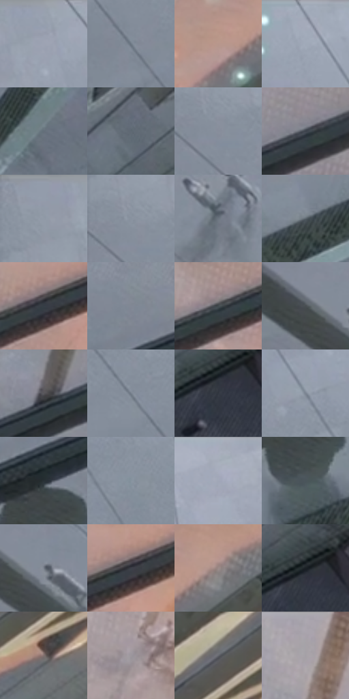

# 电影参考 325

- 状态：条件／活跃；来源世界：miles-home。
- 视角：high-angle；景别：environment-wide；场景：reflection。
- 时段：daylight-time-unspecified（外观依据，中置信度；具体时间／晨昏未知）；光照：neutral-day。
- 材质候选：glass, metal, stone（帧级，不是像素分割）。
- 明暗组：middle；L* P5/P50/P95：21.23393 / 50.17 / 68.06609。
- 资格门禁：reflection。
- 原截图 SHA-256：`71d4155cda6c14682c5ddae93722c4ba1b678a6c963c8e1d359bec70fe20024f`；尺寸：2878 × 1210。
- sRGB 像素 SHA-256：`7f120141df9673ba6d6a524cdaa7390fa436a91f9851779b733a7536e1491212`。

## 观察与迁移

玻璃立面与真实字构件，透射与映像分层。

325  /  玻璃／多层空间  /  实体字、窗框、玻璃内的人与地面、外部环境分层；不简化成平铺青玻璃

本公开版保存32个128×128原像素色卡上下文；图集格子并非原场景相邻位置。原rect、图集tile和像素SHA见 `data/palette-crops.json`。上下文不足时不得批准替色，不能以小样推断完整构图。

## 实测色卡

颜色比例分母为保留采样像素，不是材料面积；全部 32 色参与全库匹配。表内四舍五入仅用于阅读，原精度在 JSON。

| ID | HEX | Lab | 原图 xy | 像素数 | 比例 | 明度角色 |
| --- | --- | --- | --- | ---: | ---: | --- |
| 325-S01 | #969FAD | [65.197568, -0.29316, -8.348547] | [232, 28] | 9773 | 5.036487% | light |
| 325-S02 | #6E7985 | [50.314027, -1.387803, -7.917883] | [724, 576] | 8948 | 4.611325% | midtone |
| 325-S03 | #B8978C | [65.135531, 10.5861, 10.422677] | [2568, 156] | 8391 | 4.324277% | light |
| 325-S04 | #9EA5B4 | [67.631259, 0.583965, -8.565735] | [484, 28] | 7622 | 3.927975% | light |
| 325-S05 | #646F7A | [46.288775, -1.61801, -7.484176] | [2052, 592] | 7487 | 3.858403% | midtone |
| 325-S06 | #5E6973 | [43.829161, -1.856367, -6.998993] | [2268, 600] | 7420 | 3.823875% | midtone |
| 325-S07 | #878E9B | [58.847377, 0.196734, -7.746124] | [76, 212] | 7412 | 3.819752% | midtone |
| 325-S08 | #3D434C | [28.189235, -0.224776, -6.254997] | [1820, 324] | 7102 | 3.659995% | shadow |
| 325-S09 | #8E97A4 | [62.137725, -0.500459, -7.905235] | [40, 52] | 7023 | 3.619282% | light |
| 325-S10 | #838C99 | [57.92387, -0.488264, -8.010034] | [52, 184] | 6635 | 3.419328% | midtone |
| 325-S11 | #6B747F | [48.446698, -0.916811, -7.183956] | [468, 500] | 6624 | 3.413659% | midtone |
| 325-S12 | #58626A | [40.97742, -1.982845, -5.831271] | [1744, 568] | 6537 | 3.368824% | midtone |
| 325-S13 | #353D46 | [25.371046, -0.966054, -6.614139] | [2224, 172] | 6529 | 3.364701% | shadow |
| 325-S14 | #818894 | [56.499166, -0.013139, -7.275537] | [1372, 440] | 6395 | 3.295644% | midtone |
| 325-S15 | #414A4F | [30.844618, -2.393579, -4.197882] | [2096, 212] | 6373 | 3.284307% | shadow |
| 325-S16 | #494E52 | [32.863261, -1.088325, -3.049908] | [108, 444] | 6244 | 3.217827% | shadow |
| 325-S17 | #58575B | [37.200205, 1.259574, -2.167438] | [1676, 368] | 6192 | 3.191029% | shadow |
| 325-S18 | #76808C | [53.149148, -1.046075, -7.722148] | [648, 480] | 6035 | 3.110119% | midtone |
| 325-S19 | #313740 | [22.845795, -0.179925, -6.44418] | [2480, 680] | 6032 | 3.108573% | shadow |
| 325-S20 | #7B8591 | [55.103159, -1.049585, -7.671838] | [684, 332] | 5823 | 3.000866% | midtone |
| 325-S21 | #293036 | [19.439446, -1.389996, -4.827572] | [1392, 548] | 5817 | 2.997774% | deep-shadow |
| 325-S22 | #85939E | [60.178575, -2.635846, -7.490781] | [812, 448] | 5573 | 2.872029% | light |
| 325-S23 | #A7ADBA | [70.627101, 0.488986, -7.359693] | [1240, 36] | 5547 | 2.858630% | light |
| 325-S24 | #4A555B | [35.415852, -2.861035, -4.938689] | [1400, 668] | 5286 | 2.724124% | shadow |
| 325-S25 | #757C87 | [51.776314, -0.219153, -6.854798] | [168, 452] | 5033 | 2.593742% | midtone |
| 325-S26 | #3B3E47 | [26.244582, 0.95426, -5.91125] | [2292, 140] | 4629 | 2.385541% | shadow |
| 325-S27 | #9C8A89 | [59.022048, 6.580117, 3.014603] | [2660, 124] | 4331 | 2.231968% | midtone |
| 325-S28 | #1A2024 | [11.823688, -1.56814, -3.615379] | [2488, 648] | 4170 | 2.148997% | deep-shadow |
| 325-S29 | #80706E | [48.640473, 5.881551, 3.407067] | [2728, 348] | 3500 | 1.803715% | midtone |
| 325-S30 | #9C979E | [63.069051, 3.162545, -3.013901] | [1988, 96] | 3257 | 1.678485% | light |
| 325-S31 | #65676C | [43.580279, 0.294874, -3.073745] | [2744, 232] | 3205 | 1.651687% | midtone |
| 325-S32 | #A4A0A7 | [66.385364, 2.773913, -3.112672] | [1740, 64] | 3099 | 1.597060% | light |

## 色阶与空间分布

- 采样 ROI：`[0.01, 0.02, 0.98, 0.94]`；步长：4；样本数：194044。
- 排除区：`[]`。
- 深暗、暗、中、亮、高光五段计数：`[7825, 51632, 84211, 50306, 70]`。
- RGB 各 256 箱、L* 100 箱、13×5 色相明度表和 3×3 空间统计全部保存在 [总数据](../film-library.json)。
- [可视化档案](../../references/library.html)按需绘制直方图，不存 2,094 张重复图表图片。

## 纹理特征占比

**这是分块图像特征的面积占比，不是波点／排线／丝网／错版的精确语义覆盖率。** 窗格、发丝、织物也会产生方向或周期特征。
原图 ROI 像素 3107496；已测块覆盖 3107496（100.0000%）；未测 0。

| 特征 | 块覆盖像素 | 占已测面积 | 阈值敏感范围 |
| --- | ---: | ---: | --- |
| low-contrast | 137472 | 4.4239% | 0.3666% ~ 7.4267% |
| directional-structure | 1209344 | 38.9170% | 22.6714% ~ 57.1109% |
| periodic-structure | 1639592 | 52.7625% | 41.9952% ~ 58.4180% |
| mixed-detail | 121088 | 3.8966% | 0.5272% ~ 11.4840% |

阈值敏感范围不是统计置信区间。逐块坐标、尺度、对比、方向一致性、频谱集中度、频率与角度见 [全量特征记录](../texture-features.jsonl)，以帧号定位。
四种印刷层的真实像素覆盖仍标为 `null`，不能填 0，也不能拿上表代替。不得据这些代理测量删除唯一证据。

[测量方法与保留策略](../../references/library-retention.md) · [分类索引](../archive/README.md)
