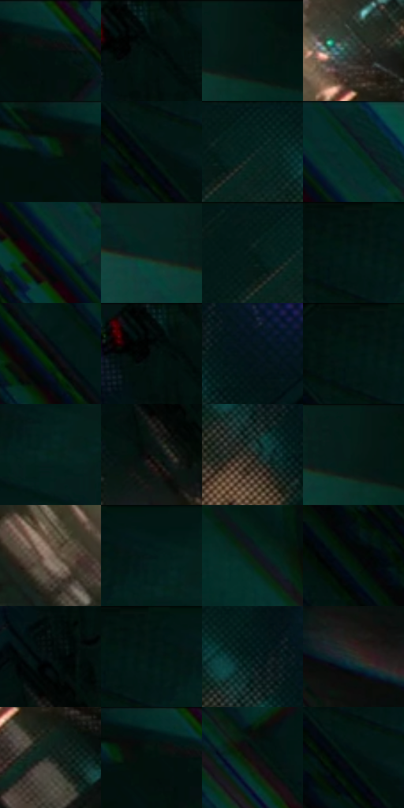

# 电影参考 326

- 状态：常规／活跃；来源世界：miles-home。
- 视角：overhead；景别：environment-wide；场景：industrial。
- 时段：interior-time-unknown（外观依据，中置信度；具体时间／晨昏未知）；光照：dark-interior。
- 材质候选：metal, paint, plastic（帧级，不是像素分割）。
- 明暗组：very-dark；L* P5/P50/P95：2.01983 / 6.16595 / 24.55721。
- 资格门禁：无附加门禁。
- 原截图 SHA-256：`7738149ebe4acfe995bc62f8aeb3059cb5e5e3469c2bb4fd0280c880e2482ff3`；尺寸：2880 × 1206。
- sRGB 像素 SHA-256：`de7fe5b13efdbad7aa05ccf569826b244671ee5804514291a31efe1ce41634ac`。

## 观察与迁移

竖井深暗结构与远端暖亮，不因黑场而统一柔糊。

326  /  井道／窄彩边  /  管线透视通向暖亮开口，主体结构稳定；边缘彩线不是自动故障

本公开版保存32个128×128原像素色卡上下文；图集格子并非原场景相邻位置。原rect、图集tile和像素SHA见 `data/palette-crops.json`。上下文不足时不得批准替色，不能以小样推断完整构图。

## 实测色卡

颜色比例分母为保留采样像素，不是材料面积；全部 32 色参与全库匹配。表内四舍五入仅用于阅读，原精度在 JSON。

| ID | HEX | Lab | 原图 xy | 像素数 | 比例 | 明度角色 |
| --- | --- | --- | --- | ---: | ---: | --- |
| 326-S01 | #062F2B | [16.728591, -14.895202, -1.442359] | [1884, 32] | 11779 | 6.092187% | deep-shadow |
| 326-S02 | #02100F | [3.775277, -4.126688, -0.883668] | [1412, 28] | 10873 | 5.623597% | deep-shadow |
| 326-S03 | #031713 | [6.134442, -7.539596, 0.239781] | [2744, 44] | 9402 | 4.862785% | deep-shadow |
| 326-S04 | #2B3D36 | [24.05547, -9.034626, 1.980726] | [1596, 628] | 9266 | 4.792445% | shadow |
| 326-S05 | #02100C | [3.703539, -4.630795, 0.488318] | [1792, 28] | 8702 | 4.500740% | deep-shadow |
| 326-S06 | #020706 | [1.607884, -1.446662, -0.082038] | [36, 168] | 8556 | 4.425227% | deep-shadow |
| 326-S07 | #051E1D | [9.396699, -9.84072, -2.217202] | [1032, 28] | 8321 | 4.303684% | deep-shadow |
| 326-S08 | #032423 | [11.973248, -12.058638, -2.805008] | [2140, 28] | 8274 | 4.279375% | deep-shadow |
| 326-S09 | #021810 | [6.354985, -9.157477, 2.340387] | [2148, 172] | 8112 | 4.195587% | deep-shadow |
| 326-S10 | #062420 | [11.988587, -12.314435, -0.59081] | [2600, 32] | 7691 | 3.977843% | deep-shadow |
| 326-S11 | #021916 | [6.919537, -8.630588, -0.648616] | [980, 28] | 7534 | 3.896641% | deep-shadow |
| 326-S12 | #01130F | [4.576516, -6.144128, 0.279329] | [84, 36] | 7199 | 3.723377% | deep-shadow |
| 326-S13 | #07080A | [2.174653, 0.016449, -0.848722] | [2452, 496] | 6359 | 3.288922% | deep-shadow |
| 326-S14 | #020C0A | [2.689503, -2.938401, -0.131897] | [1388, 40] | 5927 | 3.065489% | deep-shadow |
| 326-S15 | #041318 | [5.035481, -3.363667, -4.876495] | [1244, 128] | 5802 | 3.000838% | deep-shadow |
| 326-S16 | #01120E | [4.252121, -5.709373, 0.322974] | [64, 28] | 5671 | 2.933084% | deep-shadow |
| 326-S17 | #05241A | [11.746423, -14.61336, 3.395375] | [212, 108] | 5624 | 2.908775% | deep-shadow |
| 326-S18 | #0C100E | [4.3398, -1.658845, 0.528732] | [1372, 280] | 5449 | 2.818264% | deep-shadow |
| 326-S19 | #1D1E19 | [10.992454, -1.680443, 3.273853] | [1148, 172] | 5388 | 2.786714% | deep-shadow |
| 326-S20 | #051D17 | [8.762695, -10.876415, 1.326072] | [2704, 28] | 4894 | 2.531213% | deep-shadow |
| 326-S21 | #816E60 | [47.833968, 5.125567, 10.581833] | [1300, 712] | 4703 | 2.432427% | midtone |
| 326-S22 | #031A1A | [7.521372, -8.115605, -2.765821] | [192, 44] | 4686 | 2.423634% | deep-shadow |
| 326-S23 | #0C1A16 | [7.902349, -6.789314, 0.857246] | [1960, 268] | 4369 | 2.259680% | deep-shadow |
| 326-S24 | #03160A | [5.555764, -8.413165, 4.060485] | [52, 296] | 4327 | 2.237957% | deep-shadow |
| 326-S25 | #060E0F | [3.498125, -2.038039, -1.260394] | [1384, 180] | 4256 | 2.201235% | deep-shadow |
| 326-S26 | #021512 | [5.355301, -6.602442, -0.283269] | [112, 28] | 3835 | 1.983491% | deep-shadow |
| 326-S27 | #011314 | [4.721137, -5.127867, -2.486542] | [1152, 88] | 3748 | 1.938494% | deep-shadow |
| 326-S28 | #242C29 | [17.16237, -4.253539, 0.779916] | [2748, 1020] | 3223 | 1.666960% | deep-shadow |
| 326-S29 | #19231F | [12.656453, -5.523989, 1.238859] | [1640, 744] | 3056 | 1.580586% | deep-shadow |
| 326-S30 | #06140F | [5.180284, -5.474462, 1.195938] | [1844, 48] | 2683 | 1.387668% | deep-shadow |
| 326-S31 | #150F12 | [4.920819, 2.927534, -0.758889] | [928, 1044] | 2654 | 1.372669% | deep-shadow |
| 326-S32 | #01130D | [4.527478, -6.488723, 1.217183] | [60, 164] | 983 | 0.508415% | deep-shadow |

## 色阶与空间分布

- 采样 ROI：`[0.01, 0.02, 0.98, 0.94]`；步长：4；样本数：193346。
- 排除区：`[]`。
- 深暗、暗、中、亮、高光五段计数：`[178000, 12872, 1669, 242, 563]`。
- RGB 各 256 箱、L* 100 箱、13×5 色相明度表和 3×3 空间统计全部保存在 [总数据](../film-library.json)。
- [可视化档案](../../references/library.html)按需绘制直方图，不存 2,094 张重复图表图片。

## 纹理特征占比

**这是分块图像特征的面积占比，不是波点／排线／丝网／错版的精确语义覆盖率。** 窗格、发丝、织物也会产生方向或周期特征。
原图 ROI 像素 3098546；已测块覆盖 3098546（100.0000%）；未测 0。

| 特征 | 块覆盖像素 | 占已测面积 | 阈值敏感范围 |
| --- | ---: | ---: | --- |
| low-contrast | 510080 | 16.4619% | 7.8282% ~ 23.1582% |
| directional-structure | 587008 | 18.9446% | 3.1726% ~ 33.2130% |
| periodic-structure | 1799474 | 58.0748% | 55.4351% ~ 64.4844% |
| mixed-detail | 201984 | 6.5187% | 3.5237% ~ 9.1848% |

阈值敏感范围不是统计置信区间。逐块坐标、尺度、对比、方向一致性、频谱集中度、频率与角度见 [全量特征记录](../texture-features.jsonl)，以帧号定位。
四种印刷层的真实像素覆盖仍标为 `null`，不能填 0，也不能拿上表代替。不得据这些代理测量删除唯一证据。

[测量方法与保留策略](../../references/library-retention.md) · [分类索引](../archive/README.md)
