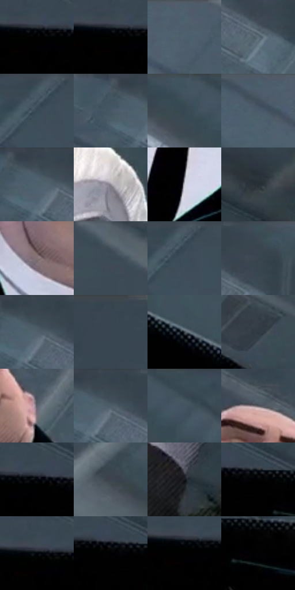

# 电影参考 327

- 状态：常规／活跃；来源世界：miles-home。
- 视角：low-angle；景别：medium；场景：portrait。
- 时段：interior-time-unknown（外观依据，中置信度；具体时间／晨昏未知）；光照：cool-interior。
- 材质候选：skin, hair, fabric, metal（帧级，不是像素分割）。
- 明暗组：dark；L* P5/P50/P95：0.0 / 30.08361 / 57.69034。
- 资格门禁：无附加门禁。
- 原截图 SHA-256：`87c46f4069818b148e64ec158b8c84417387cadf048f8997949e5e869dbe5017`；尺寸：2880 × 1208。
- sRGB 像素 SHA-256：`91e9d33756330693f507c5f0de0dd04c4d6100837ce9d8eb62e2f7f99763f8c5`。

## 观察与迁移

仰视成人强形体与灰白顶棚，黑衣保持大暗形。

327  /  极端角色造型／黑形  /  巨大黑西装体块与极端浅肤大颌角色；只学剪影和明暗设计，不移植身体比例、肤色或五官到普通人像

本公开版保存32个128×128原像素色卡上下文；图集格子并非原场景相邻位置。原rect、图集tile和像素SHA见 `data/palette-crops.json`。上下文不足时不得批准替色，不能以小样推断完整构图。

## 实测色卡

颜色比例分母为保留采样像素，不是材料面积；全部 32 色参与全库匹配。表内四舍五入仅用于阅读，原精度在 JSON。

| ID | HEX | Lab | 原图 xy | 像素数 | 比例 | 明度角色 |
| --- | --- | --- | --- | ---: | ---: | --- |
| 327-S01 | #000000 | [0.0, 0.0, 0.0] | [84, 232] | 36083 | 18.662398% | deep-shadow |
| 327-S02 | #010101 | [0.274173, -1.7e-05, 3.3e-05] | [32, 232] | 25904 | 13.397743% | deep-shadow |
| 327-S03 | #4F606D | [39.801486, -3.177042, -9.499095] | [1628, 44] | 9611 | 4.970881% | shadow |
| 327-S04 | #5D6D79 | [45.143366, -3.105763, -8.652981] | [1144, 124] | 8585 | 4.440226% | midtone |
| 327-S05 | #485965 | [36.858476, -3.430277, -9.039643] | [2324, 40] | 7331 | 3.791648% | shadow |
| 327-S06 | #465561 | [35.324929, -2.735692, -8.86721] | [976, 32] | 6960 | 3.599764% | shadow |
| 327-S07 | #41545F | [34.580411, -4.372525, -8.769224] | [2044, 28] | 6699 | 3.464773% | shadow |
| 327-S08 | #4D5D6A | [38.63255, -2.830848, -9.428352] | [1468, 28] | 6615 | 3.421328% | shadow |
| 327-S09 | #3D4A54 | [30.710953, -2.554301, -7.639484] | [1028, 32] | 6355 | 3.286854% | shadow |
| 327-S10 | #8F8B95 | [58.485001, 3.451274, -4.780292] | [2464, 724] | 6009 | 3.107900% | midtone |
| 327-S11 | #C9C9D7 | [81.344773, 2.63956, -6.939915] | [576, 592] | 5994 | 3.100142% | highlight |
| 327-S12 | #273036 | [19.272561, -2.173356, -5.094762] | [1928, 980] | 5850 | 3.025664% | deep-shadow |
| 327-S13 | #827377 | [49.905359, 6.554732, -0.067728] | [448, 352] | 5826 | 3.013251% | midtone |
| 327-S14 | #434F5A | [32.969506, -1.936896, -8.023337] | [2748, 48] | 5361 | 2.772749% | shadow |
| 327-S15 | #3E4F5A | [32.599571, -3.684658, -8.617058] | [2344, 28] | 5098 | 2.636724% | shadow |
| 327-S16 | #3A4953 | [30.130005, -3.259982, -7.893664] | [1176, 28] | 5070 | 2.622242% | shadow |
| 327-S17 | #3F4D57 | [31.925895, -2.913507, -7.715783] | [1052, 48] | 4880 | 2.523973% | shadow |
| 327-S18 | #384651 | [28.940671, -2.619704, -8.410763] | [372, 28] | 4656 | 2.408118% | shadow |
| 327-S19 | #343F48 | [26.018565, -2.087844, -6.968756] | [1372, 620] | 4083 | 2.111758% | shadow |
| 327-S20 | #2F3941 | [23.378763, -1.988192, -6.330088] | [1752, 756] | 3953 | 2.044521% | shadow |
| 327-S21 | #5F616B | [41.28549, 1.429101, -5.922853] | [832, 328] | 3606 | 1.865050% | midtone |
| 327-S22 | #37444D | [28.066343, -2.822266, -7.139292] | [1064, 28] | 3352 | 1.733680% | shadow |
| 327-S23 | #3C4D56 | [31.670005, -4.238595, -7.48469] | [2136, 28] | 3348 | 1.731611% | shadow |
| 327-S24 | #56555C | [36.457659, 1.933762, -3.908536] | [644, 116] | 2579 | 1.333878% | shadow |
| 327-S25 | #020306 | [0.823572, 0.15558, -1.22731] | [128, 224] | 2211 | 1.143546% | deep-shadow |
| 327-S26 | #3E454E | [28.980233, -0.60957, -6.36061] | [2612, 456] | 2075 | 1.073206% | shadow |
| 327-S27 | #14171B | [7.593326, -0.259696, -3.293022] | [2100, 1128] | 1524 | 0.788224% | deep-shadow |
| 327-S28 | #030304 | [0.842307, 0.138992, -0.378325] | [208, 240] | 1375 | 0.711160% | deep-shadow |
| 327-S29 | #000306 | [0.706955, -0.367419, -1.411587] | [76, 220] | 1274 | 0.658922% | deep-shadow |
| 327-S30 | #000002 | [0.039574, 0.278088, -0.756847] | [168, 240] | 549 | 0.283947% | deep-shadow |
| 327-S31 | #010100 | [0.254387, -0.139061, 0.378457] | [72, 240] | 305 | 0.157748% | deep-shadow |
| 327-S32 | #020002 | [0.156191, 0.801086, -0.57257] | [280, 284] | 225 | 0.116372% | deep-shadow |

## 色阶与空间分布

- 采样 ROI：`[0.01, 0.02, 0.98, 0.94]`；步长：4；样本数：193346。
- 排除区：`[]`。
- 深暗、暗、中、亮、高光五段计数：`[72411, 86935, 25390, 5205, 3405]`。
- RGB 各 256 箱、L* 100 箱、13×5 色相明度表和 3×3 空间统计全部保存在 [总数据](../film-library.json)。
- [可视化档案](../../references/library.html)按需绘制直方图，不存 2,094 张重复图表图片。

## 纹理特征占比

**这是分块图像特征的面积占比，不是波点／排线／丝网／错版的精确语义覆盖率。** 窗格、发丝、织物也会产生方向或周期特征。
原图 ROI 像素 3104134；已测块覆盖 3104134（100.0000%）；未测 0。

| 特征 | 块覆盖像素 | 占已测面积 | 阈值敏感范围 |
| --- | ---: | ---: | --- |
| low-contrast | 975104 | 31.4131% | 29.8296% ~ 32.4687% |
| directional-structure | 573440 | 18.4734% | 6.8616% ~ 30.8811% |
| periodic-structure | 1542022 | 49.6764% | 39.2892% ~ 58.6492% |
| mixed-detail | 13568 | 0.4371% | 0.0000% ~ 2.0205% |

阈值敏感范围不是统计置信区间。逐块坐标、尺度、对比、方向一致性、频谱集中度、频率与角度见 [全量特征记录](../texture-features.jsonl)，以帧号定位。
四种印刷层的真实像素覆盖仍标为 `null`，不能填 0，也不能拿上表代替。不得据这些代理测量删除唯一证据。

[测量方法与保留策略](../../references/library-retention.md) · [分类索引](../archive/README.md)
