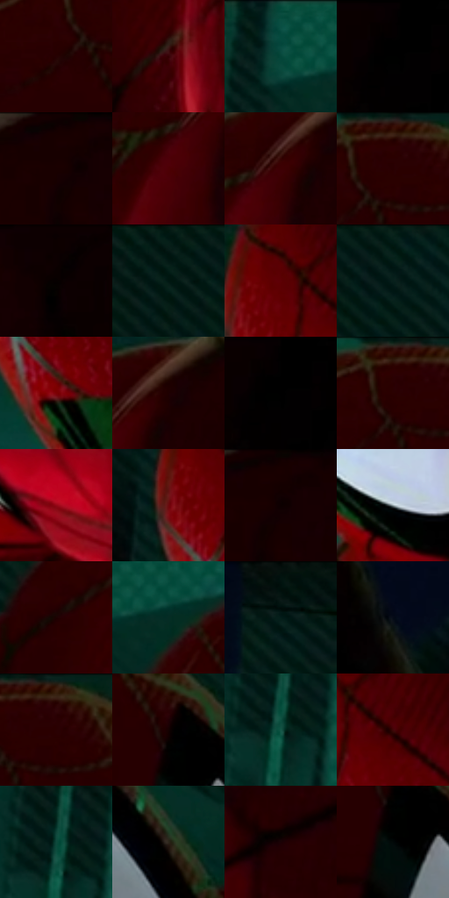

# 电影参考 328

- 状态：常规／活跃；来源世界：miles-home。
- 视角：high-angle；景别：close-up；场景：detail。
- 时段：interior-time-unknown（外观依据，中置信度；具体时间／晨昏未知）；光照：dark-interior。
- 材质候选：fabric, glass, skin（帧级，不是像素分割）。
- 明暗组：very-dark；L* P5/P50/P95：0.25302 / 6.0477 / 31.77053。
- 资格门禁：无附加门禁。
- 原截图 SHA-256：`d9034d1ee1b0777f7b9c2ca496e2e5df660db9b93463b15ebc1ed2d0884b65b6`；尺寸：2880 × 1206。
- sRGB 像素 SHA-256：`54678849fd069ff0c97f91019f6bac753945befad93527c8297b746792204ae7`。

## 观察与迁移

面罩曲面亮带与可见真实眼睛分别处理，不虚构倒影。

328  /  面罩／投影  /  两个重叠面罩与横向暗带，红布细纹独立；不合并头部或误判为镜像

本公开版保存32个128×128原像素色卡上下文；图集格子并非原场景相邻位置。原rect、图集tile和像素SHA见 `data/palette-crops.json`。上下文不足时不得批准替色，不能以小样推断完整构图。

## 实测色卡

颜色比例分母为保留采样像素，不是材料面积；全部 32 色参与全库匹配。表内四舍五入仅用于阅读，原精度在 JSON。

| ID | HEX | Lab | 原图 xy | 像素数 | 比例 | 明度角色 |
| --- | --- | --- | --- | ---: | ---: | --- |
| 328-S01 | #260102 | [3.959081, 16.576122, 5.413172] | [688, 116] | 10597 | 5.480848% | deep-shadow |
| 328-S02 | #340103 | [6.852253, 25.324378, 9.575224] | [1468, 440] | 9503 | 4.915023% | deep-shadow |
| 328-S03 | #054639 | [25.885022, -22.685199, 2.453989] | [384, 64] | 9428 | 4.876232% | shadow |
| 328-S04 | #040001 | [0.253022, 1.185041, -0.009869] | [2260, 28] | 9240 | 4.778997% | deep-shadow |
| 328-S05 | #180000 | [1.754689, 7.869317, 2.772731] | [1800, 28] | 8981 | 4.645040% | deep-shadow |
| 328-S06 | #4D0005 | [13.164619, 33.841248, 18.582605] | [1568, 172] | 8763 | 4.532289% | deep-shadow |
| 328-S07 | #3D0002 | [8.964857, 28.935246, 13.341085] | [1612, 116] | 7869 | 4.069906% | deep-shadow |
| 328-S08 | #230000 | [3.228764, 14.480153, 5.10204] | [748, 32] | 7731 | 3.998531% | deep-shadow |
| 328-S09 | #0C0000 | [0.706272, 3.167442, 1.116039] | [1992, 28] | 7728 | 3.996980% | deep-shadow |
| 328-S10 | #041B17 | [7.871991, -9.492889, 0.024901] | [40, 56] | 7569 | 3.914744% | deep-shadow |
| 328-S11 | #5C0004 | [16.916184, 38.141439, 24.556037] | [420, 332] | 7399 | 3.826818% | deep-shadow |
| 328-S12 | #07211B | [10.645132, -11.916693, 1.102596] | [192, 40] | 7168 | 3.707343% | deep-shadow |
| 328-S13 | #7C0003 | [24.617632, 47.016172, 35.632692] | [460, 528] | 6983 | 3.611660% | shadow |
| 328-S14 | #1F0001 | [2.652012, 11.943877, 3.780975] | [1656, 84] | 6869 | 3.552698% | deep-shadow |
| 328-S15 | #000000 | [0.0, 0.0, 0.0] | [2268, 28] | 6794 | 3.513908% | deep-shadow |
| 328-S16 | #2C0100 | [5.034575, 20.680591, 7.93203] | [724, 36] | 6316 | 3.266683% | deep-shadow |
| 328-S17 | #910815 | [30.033473, 51.718712, 33.786426] | [1876, 964] | 6184 | 3.198411% | shadow |
| 328-S18 | #6B090D | [21.399034, 40.443736, 26.893038] | [368, 380] | 6171 | 3.191687% | shadow |
| 328-S19 | #120102 | [1.397657, 5.088812, 1.365652] | [1824, 52] | 6102 | 3.156000% | deep-shadow |
| 328-S20 | #8E9DA2 | [63.731748, -4.25616, -4.414354] | [708, 772] | 6049 | 3.128588% | light |
| 328-S21 | #1D0202 | [2.792013, 10.062214, 3.54547] | [1372, 232] | 5367 | 2.775853% | deep-shadow |
| 328-S22 | #052C24 | [15.280485, -15.824288, 1.342576] | [464, 88] | 4974 | 2.572590% | deep-shadow |
| 328-S23 | #011510 | [5.240452, -7.261253, 0.705923] | [2820, 28] | 4511 | 2.333123% | deep-shadow |
| 328-S24 | #050A17 | [2.810876, 1.226896, -7.358474] | [2608, 248] | 4340 | 2.244681% | deep-shadow |
| 328-S25 | #2B0303 | [5.288372, 19.433862, 7.056964] | [780, 36] | 4108 | 2.124688% | deep-shadow |
| 328-S26 | #150102 | [1.676246, 6.33821, 1.805874] | [916, 168] | 3724 | 1.926081% | deep-shadow |
| 328-S27 | #175849 | [33.226133, -24.273944, 2.849377] | [248, 728] | 3118 | 1.612653% | shadow |
| 328-S28 | #420609 | [11.335457, 28.07329, 14.013948] | [496, 368] | 2299 | 1.189060% | deep-shadow |
| 328-S29 | #0F4A3C | [27.641266, -22.383828, 3.05923] | [244, 696] | 2090 | 1.080964% | shadow |
| 328-S30 | #2E271B | [16.059763, 0.992689, 9.144735] | [1076, 280] | 1954 | 1.010623% | deep-shadow |
| 328-S31 | #1B0104 | [2.380703, 9.598126, 2.099665] | [1688, 276] | 1947 | 1.007003% | deep-shadow |
| 328-S32 | #020808 | [1.843535, -1.569135, -0.552567] | [920, 232] | 1470 | 0.760295% | deep-shadow |

## 色阶与空间分布

- 采样 ROI：`[0.01, 0.02, 0.98, 0.94]`；步长：4；样本数：193346。
- 排除区：`[]`。
- 深暗、暗、中、亮、高光五段计数：`[154956, 31861, 3407, 1713, 1409]`。
- RGB 各 256 箱、L* 100 箱、13×5 色相明度表和 3×3 空间统计全部保存在 [总数据](../film-library.json)。
- [可视化档案](../../references/library.html)按需绘制直方图，不存 2,094 张重复图表图片。

## 纹理特征占比

**这是分块图像特征的面积占比，不是波点／排线／丝网／错版的精确语义覆盖率。** 窗格、发丝、织物也会产生方向或周期特征。
原图 ROI 像素 3098546；已测块覆盖 3098546（100.0000%）；未测 0。

| 特征 | 块覆盖像素 | 占已测面积 | 阈值敏感范围 |
| --- | ---: | ---: | --- |
| low-contrast | 985344 | 31.8002% | 28.6276% ~ 37.5521% |
| directional-structure | 862720 | 27.8427% | 12.6903% ~ 37.5340% |
| periodic-structure | 1217714 | 39.2995% | 33.3096% ~ 47.1137% |
| mixed-detail | 32768 | 1.0575% | 0.5288% ~ 2.6438% |

阈值敏感范围不是统计置信区间。逐块坐标、尺度、对比、方向一致性、频谱集中度、频率与角度见 [全量特征记录](../texture-features.jsonl)，以帧号定位。
四种印刷层的真实像素覆盖仍标为 `null`，不能填 0，也不能拿上表代替。不得据这些代理测量删除唯一证据。

[测量方法与保留策略](../../references/library-retention.md) · [分类索引](../archive/README.md)
