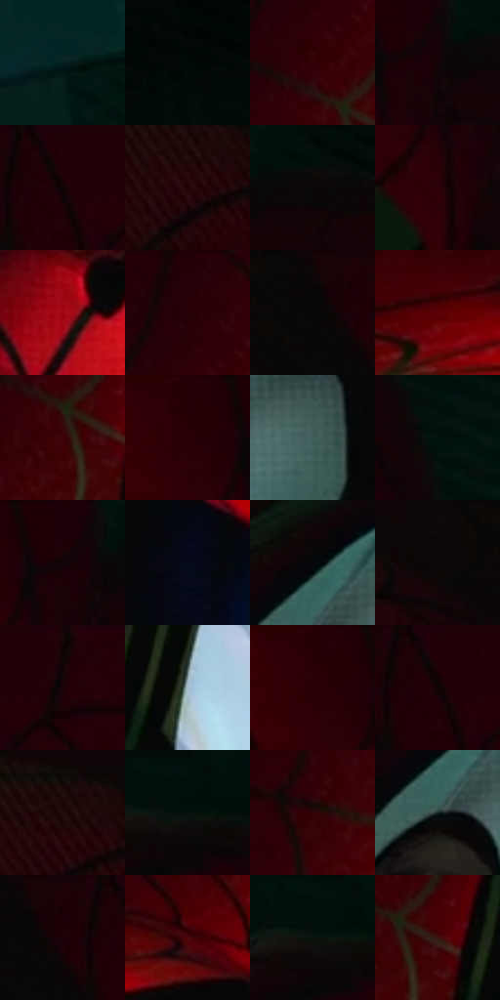

# 电影参考 329

- 状态：常规／活跃；来源世界：miles-home。
- 视角：high-angle；景别：close-up；场景：detail。
- 时段：interior-time-unknown（外观依据，中置信度；具体时间／晨昏未知）；光照：dark-interior。
- 材质候选：fabric, glass, skin（帧级，不是像素分割）。
- 明暗组：very-dark；L* P5/P50/P95：1.67288 / 4.21476 / 39.30214。
- 资格门禁：无附加门禁。
- 原截图 SHA-256：`ca9e1e75d3d3b0436f20b10cda2f6fdc8336591b99ba8da50de4e40c6a7a30e7`；尺寸：2880 × 1206。
- sRGB 像素 SHA-256：`627cb8db9d745db3d1bd0e7689030166cfa71d94d636d626905fb75b581433f1`。

## 观察与迁移

面罩曲面亮带与可见真实眼睛分别处理，不虚构倒影。

329  /  高光／眼孔  /  左侧眼罩浅色亮面与右侧可见虹膜分开；可见眼睛不是反射人物

本公开版保存32个128×128原像素色卡上下文；图集格子并非原场景相邻位置。原rect、图集tile和像素SHA见 `data/palette-crops.json`。上下文不足时不得批准替色，不能以小样推断完整构图。

## 实测色卡

颜色比例分母为保留采样像素，不是材料面积；全部 32 色参与全库匹配。表内四舍五入仅用于阅读，原精度在 JSON。

| ID | HEX | Lab | 原图 xy | 像素数 | 比例 | 明度角色 |
| --- | --- | --- | --- | ---: | ---: | --- |
| 329-S01 | #042120 | [10.687398, -11.065018, -2.522489] | [2520, 932] | 11879 | 6.143908% | deep-shadow |
| 329-S02 | #040907 | [2.136444, -1.585741, 0.296451] | [2748, 40] | 9400 | 4.861750% | deep-shadow |
| 329-S03 | #340108 | [6.951187, 25.675909, 7.683107] | [1096, 152] | 8842 | 4.573149% | deep-shadow |
| 329-S04 | #140306 | [2.050801, 5.659376, 0.711936] | [1584, 76] | 8449 | 4.369886% | deep-shadow |
| 329-S05 | #220208 | [3.623403, 14.092606, 2.401076] | [604, 28] | 8094 | 4.186277% | deep-shadow |
| 329-S06 | #220004 | [3.152099, 14.337552, 3.342134] | [208, 100] | 7591 | 3.926122% | deep-shadow |
| 329-S07 | #0C0808 | [2.43319, 1.075308, 0.379195] | [1668, 60] | 7548 | 3.903882% | deep-shadow |
| 329-S08 | #2E0108 | [5.602825, 22.709966, 5.552448] | [1520, 184] | 7458 | 3.857333% | deep-shadow |
| 329-S09 | #9F050F | [32.954725, 55.786693, 40.621586] | [1828, 812] | 7374 | 3.813888% | shadow |
| 329-S10 | #290209 | [4.82993, 19.247305, 3.897919] | [1088, 64] | 7269 | 3.759581% | deep-shadow |
| 329-S11 | #060606 | [1.645041, -0.000104, 0.000198] | [480, 40] | 7232 | 3.740445% | deep-shadow |
| 329-S12 | #5F0309 | [18.002266, 38.276377, 24.005674] | [728, 636] | 7111 | 3.677862% | deep-shadow |
| 329-S13 | #3D0207 | [9.410713, 28.158073, 11.943614] | [1124, 228] | 6498 | 3.360814% | deep-shadow |
| 329-S14 | #250007 | [3.692474, 16.911905, 2.966954] | [1464, 32] | 6260 | 3.237719% | deep-shadow |
| 329-S15 | #41605C | [38.308328, -12.314468, -1.356371] | [2104, 284] | 6205 | 3.209272% | shadow |
| 329-S16 | #02140F | [4.947049, -6.520459, 0.827384] | [2592, 348] | 6185 | 3.198928% | deep-shadow |
| 329-S17 | #1B0208 | [2.655928, 9.753741, 0.872289] | [1556, 52] | 5743 | 2.970323% | deep-shadow |
| 329-S18 | #050A1B | [2.966808, 2.322642, -10.278068] | [1032, 772] | 5697 | 2.946531% | deep-shadow |
| 329-S19 | #06070C | [1.962068, 0.449257, -2.026644] | [1944, 240] | 5524 | 2.857054% | deep-shadow |
| 329-S20 | #0C0706 | [2.197538, 1.197781, 0.849724] | [360, 28] | 5456 | 2.821884% | deep-shadow |
| 329-S21 | #100406 | [1.898423, 3.696082, 0.44763] | [700, 40] | 5190 | 2.684307% | deep-shadow |
| 329-S22 | #A6C0CC | [76.170196, -6.232781, -8.966046] | [1280, 280] | 5135 | 2.655860% | light |
| 329-S23 | #280005 | [4.175191, 18.918685, 4.549116] | [1452, 28] | 4964 | 2.567418% | deep-shadow |
| 329-S24 | #210007 | [3.060124, 14.075984, 1.967725] | [600, 28] | 4573 | 2.365190% | deep-shadow |
| 329-S25 | #1E0C0C | [5.10878, 8.017692, 2.825484] | [204, 40] | 4536 | 2.346053% | deep-shadow |
| 329-S26 | #020F0C | [3.442192, -4.096898, 0.106692] | [2188, 28] | 4088 | 2.114344% | deep-shadow |
| 329-S27 | #2E0105 | [5.543465, 22.426474, 6.687718] | [1016, 324] | 4043 | 2.091070% | deep-shadow |
| 329-S28 | #142624 | [13.604382, -8.03362, -1.023162] | [1936, 316] | 3975 | 2.055900% | deep-shadow |
| 329-S29 | #1C0206 | [2.741636, 10.037505, 1.827103] | [520, 28] | 3811 | 1.971078% | deep-shadow |
| 329-S30 | #4B060B | [13.535999, 31.18617, 16.533246] | [924, 632] | 3010 | 1.556795% | deep-shadow |
| 329-S31 | #0A140F | [5.413519, -4.428464, 1.564492] | [2160, 68] | 2569 | 1.328706% | deep-shadow |
| 329-S32 | #391814 | [13.070136, 15.893368, 10.338189] | [1168, 216] | 1637 | 0.846669% | deep-shadow |

## 色阶与空间分布

- 采样 ROI：`[0.01, 0.02, 0.98, 0.94]`；步长：4；样本数：193346。
- 排除区：`[]`。
- 深暗、暗、中、亮、高光五段计数：`[172421, 11751, 4781, 1778, 2615]`。
- RGB 各 256 箱、L* 100 箱、13×5 色相明度表和 3×3 空间统计全部保存在 [总数据](../film-library.json)。
- [可视化档案](../../references/library.html)按需绘制直方图，不存 2,094 张重复图表图片。

## 纹理特征占比

**这是分块图像特征的面积占比，不是波点／排线／丝网／错版的精确语义覆盖率。** 窗格、发丝、织物也会产生方向或周期特征。
原图 ROI 像素 3098546；已测块覆盖 3098546（100.0000%）；未测 0。

| 特征 | 块覆盖像素 | 占已测面积 | 阈值敏感范围 |
| --- | ---: | ---: | --- |
| low-contrast | 1673650 | 54.0140% | 48.0241% ~ 55.9515% |
| directional-structure | 548736 | 17.7095% | 8.4602% ~ 27.5784% |
| periodic-structure | 827008 | 26.6902% | 24.3975% ~ 33.4732% |
| mixed-detail | 49152 | 1.5863% | 0.0000% ~ 2.1151% |

阈值敏感范围不是统计置信区间。逐块坐标、尺度、对比、方向一致性、频谱集中度、频率与角度见 [全量特征记录](../texture-features.jsonl)，以帧号定位。
四种印刷层的真实像素覆盖仍标为 `null`，不能填 0，也不能拿上表代替。不得据这些代理测量删除唯一证据。

[测量方法与保留策略](../../references/library-retention.md) · [分类索引](../archive/README.md)
