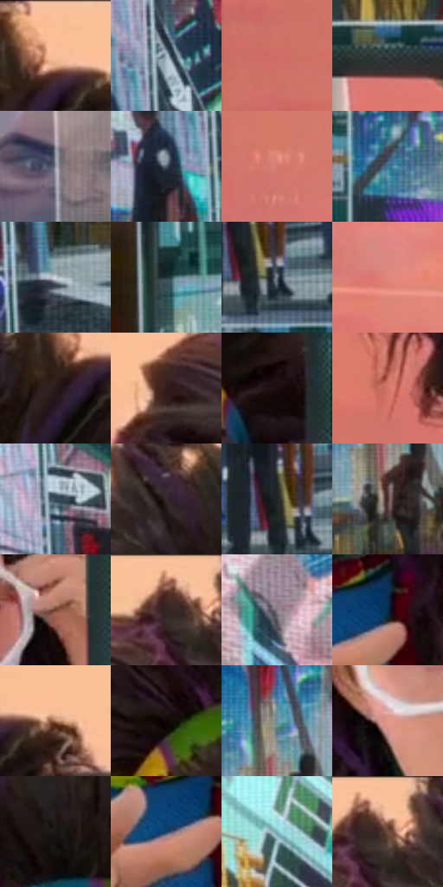

# 电影参考 330

- 状态：条件／活跃；来源世界：miles-home。
- 视角：near-level；景别：medium；场景：reflection。
- 时段：interior-time-unknown（外观依据，中置信度；具体时间／晨昏未知）；光照：interior-mixed。
- 材质候选：skin, hair, screen, glass, plastic（帧级，不是像素分割）。
- 明暗组：middle；L* P5/P50/P95：5.63995 / 45.70286 / 81.74531。
- 资格门禁：secondary-image, glitch。
- 原截图 SHA-256：`87928db40dfe8c5e5e90539bfcf8a7e77c5a825f1209f848e5238b6ddfe97f04`；尺寸：2880 × 1208。
- sRGB 像素 SHA-256：`4d0f053709ff3b20bb1a4e8814479a59b5ef8a5b7eec03e21364068cb088e2e3`。

## 观察与迁移

屏内城市、局部故障与表面人脸映像是三层证据。

330  /  屏面映像／屏内故障  /  屏内街道局部彩色结构碎裂，上方叠人脸映像；边框与讲解人物稳定，三个层次不合并

本公开版保存32个128×128原像素色卡上下文；图集格子并非原场景相邻位置。原rect、图集tile和像素SHA见 `data/palette-crops.json`。上下文不足时不得批准替色，不能以小样推断完整构图。

## 实测色卡

颜色比例分母为保留采样像素，不是材料面积；全部 32 色参与全库匹配。表内四舍五入仅用于阅读，原精度在 JSON。

| ID | HEX | Lab | 原图 xy | 像素数 | 比例 | 明度角色 |
| --- | --- | --- | --- | ---: | ---: | --- |
| 330-S01 | #F9BE95 | [81.368658, 16.043288, 28.908464] | [1072, 48] | 12626 | 6.530262% | highlight |
| 330-S02 | #A8B7C6 | [73.719199, -2.076905, -9.336345] | [2396, 672] | 9636 | 4.983811% | light |
| 330-S03 | #CC6B63 | [56.344119, 37.499586, 21.954188] | [52, 828] | 9013 | 4.661591% | midtone |
| 330-S04 | #363F45 | [26.065756, -2.158943, -4.904643] | [1352, 1068] | 8769 | 4.535393% | shadow |
| 330-S05 | #979CA8 | [64.308853, 0.64749, -6.857554] | [1688, 324] | 8400 | 4.344543% | light |
| 330-S06 | #515866 | [37.276302, 0.601324, -8.963878] | [2328, 752] | 7697 | 3.980946% | shadow |
| 330-S07 | #D67A6F | [61.10365, 34.579336, 21.717665] | [252, 740] | 7679 | 3.971636% | light |
| 330-S08 | #3A7893 | [47.543593, -11.573961, -20.649472] | [1280, 724] | 7453 | 3.854747% | midtone |
| 330-S09 | #CAD4DE | [84.440817, -1.454534, -6.085311] | [2440, 916] | 7086 | 3.664932% | highlight |
| 330-S10 | #23363D | [21.328799, -5.486558, -6.810275] | [1732, 928] | 7029 | 3.635451% | shadow |
| 330-S11 | #67707F | [46.979564, 0.035794, -9.410971] | [2220, 980] | 6743 | 3.487530% | midtone |
| 330-S12 | #DF8678 | [65.040236, 32.577631, 22.160317] | [332, 492] | 6647 | 3.437878% | light |
| 330-S13 | #261919 | [10.390983, 6.504155, 2.568554] | [1032, 116] | 6517 | 3.370641% | deep-shadow |
| 330-S14 | #361D1B | [14.072288, 11.973116, 6.620373] | [536, 140] | 6400 | 3.310128% | deep-shadow |
| 330-S15 | #1B0C0E | [4.766772, 6.602366, 1.320054] | [1144, 288] | 6389 | 3.304439% | deep-shadow |
| 330-S16 | #D17869 | [59.899135, 33.141183, 23.389165] | [512, 896] | 6149 | 3.180309% | midtone |
| 330-S17 | #384A5B | [30.624449, -2.244114, -12.289113] | [2384, 492] | 6058 | 3.133243% | shadow |
| 330-S18 | #352B2B | [18.623548, 4.593674, 1.719446] | [800, 80] | 5916 | 3.059800% | deep-shadow |
| 330-S19 | #202526 | [14.23145, -1.978382, -1.428425] | [2188, 948] | 5884 | 3.043249% | deep-shadow |
| 330-S20 | #4B3533 | [24.580524, 9.543451, 5.150511] | [1492, 772] | 5028 | 2.600519% | shadow |
| 330-S21 | #6D3F2F | [31.8348, 18.26522, 18.346235] | [1144, 512] | 4895 | 2.531731% | shadow |
| 330-S22 | #855B4F | [42.814782, 15.638559, 13.866021] | [672, 40] | 4782 | 2.473286% | midtone |
| 330-S23 | #8A7D88 | [53.865676, 7.044525, -4.145254] | [2672, 308] | 4565 | 2.361052% | midtone |
| 330-S24 | #0D2B45 | [16.712784, -0.622462, -19.496808] | [1088, 992] | 4537 | 2.346570% | deep-shadow |
| 330-S25 | #AC795B | [55.280384, 16.246176, 24.370736] | [1148, 84] | 4523 | 2.339329% | midtone |
| 330-S26 | #100707 | [2.506443, 2.633444, 0.92816] | [776, 256] | 4491 | 2.322779% | deep-shadow |
| 330-S27 | #6892A2 | [58.139585, -10.232756, -13.016746] | [1492, 660] | 4261 | 2.203821% | midtone |
| 330-S28 | #E69987 | [70.426242, 26.746152, 21.301519] | [816, 632] | 4057 | 2.098311% | light |
| 330-S29 | #1C1515 | [7.56398, 3.51735, 1.24942] | [892, 164] | 3660 | 1.892979% | deep-shadow |
| 330-S30 | #194566 | [27.903757, -2.819361, -23.671084] | [1040, 1024] | 3245 | 1.678338% | shadow |
| 330-S31 | #75AFB6 | [67.885781, -17.010773, -9.570472] | [2436, 256] | 2328 | 1.204059% | light |
| 330-S32 | #F6C2A3 | [82.284034, 14.40086, 22.704264] | [704, 44] | 883 | 0.456694% | highlight |

## 色阶与空间分布

- 采样 ROI：`[0.01, 0.02, 0.98, 0.94]`；步长：4；样本数：193346。
- 排除区：`[]`。
- 深暗、暗、中、亮、高光五段计数：`[44841, 43010, 42796, 43423, 19276]`。
- RGB 各 256 箱、L* 100 箱、13×5 色相明度表和 3×3 空间统计全部保存在 [总数据](../film-library.json)。
- [可视化档案](../../references/library.html)按需绘制直方图，不存 2,094 张重复图表图片。

## 纹理特征占比

**这是分块图像特征的面积占比，不是波点／排线／丝网／错版的精确语义覆盖率。** 窗格、发丝、织物也会产生方向或周期特征。
原图 ROI 像素 3104134；已测块覆盖 3104134（100.0000%）；未测 0。

| 特征 | 块覆盖像素 | 占已测面积 | 阈值敏感范围 |
| --- | ---: | ---: | --- |
| low-contrast | 174976 | 5.6369% | 2.9978% ~ 6.6925% |
| directional-structure | 554246 | 17.8551% | 9.0924% ~ 29.5659% |
| periodic-structure | 2344960 | 75.5431% | 67.4363% ~ 80.6111% |
| mixed-detail | 29952 | 0.9649% | 0.0000% ~ 3.6040% |

阈值敏感范围不是统计置信区间。逐块坐标、尺度、对比、方向一致性、频谱集中度、频率与角度见 [全量特征记录](../texture-features.jsonl)，以帧号定位。
四种印刷层的真实像素覆盖仍标为 `null`，不能填 0，也不能拿上表代替。不得据这些代理测量删除唯一证据。

[测量方法与保留策略](../../references/library-retention.md) · [分类索引](../archive/README.md)
