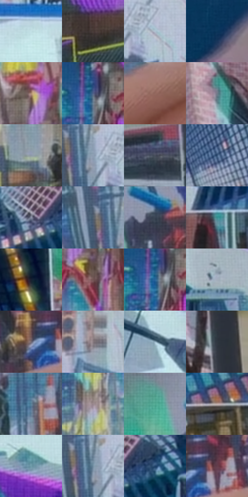

# 电影参考 331

- 状态：条件／活跃；来源世界：miles-home。
- 视角：near-level；景别：detail；场景：reflection。
- 时段：interior-time-unknown（外观依据，中置信度；具体时间／晨昏未知）；光照：interior-mixed。
- 材质候选：skin, hair, screen, glass, plastic（帧级，不是像素分割）。
- 明暗组：middle；L* P5/P50/P95：20.50644 / 50.36549 / 83.74511。
- 资格门禁：secondary-image, glitch。
- 原截图 SHA-256：`f7c95d8e638767370d226cbad527fbe8d346978d33545b7b2c1b20d8b1c33510`；尺寸：2880 × 1208。
- sRGB 像素 SHA-256：`1c4ed5926d2eaad835eadf6f8a1ba14ef7bb5bc72634271a80a00841b70a3f5e`。

## 观察与迁移

屏内城市、局部故障与表面人脸映像是三层证据。

331  /  屏内图像／反光与故障  /  显示窗口内街道图像、屏面淡映像与前方手指分层；手指不是视频内容，屏内异常不扩散到整个房间

本公开版保存32个128×128原像素色卡上下文；图集格子并非原场景相邻位置。原rect、图集tile和像素SHA见 `data/palette-crops.json`。上下文不足时不得批准替色，不能以小样推断完整构图。

## 实测色卡

颜色比例分母为保留采样像素，不是材料面积；全部 32 色参与全库匹配。表内四舍五入仅用于阅读，原精度在 JSON。

| ID | HEX | Lab | 原图 xy | 像素数 | 比例 | 明度角色 |
| --- | --- | --- | --- | ---: | ---: | --- |
| 331-S01 | #C2E0E5 | [87.210363, -8.824739, -5.758177] | [1852, 260] | 10065 | 5.205693% | highlight |
| 331-S02 | #483A37 | [25.802435, 5.591091, 4.177357] | [92, 964] | 9968 | 5.155524% | shadow |
| 331-S03 | #AFC3D2 | [77.754507, -3.678227, -9.787839] | [1340, 128] | 8137 | 4.208517% | light |
| 331-S04 | #0B355A | [21.413351, 1.118454, -26.166876] | [356, 132] | 8088 | 4.183174% | shadow |
| 331-S05 | #A88670 | [58.551912, 9.750461, 16.785365] | [436, 392] | 7874 | 4.072492% | midtone |
| 331-S06 | #516189 | [41.381239, 4.759248, -24.111359] | [176, 460] | 7603 | 3.932329% | midtone |
| 331-S07 | #93685F | [48.173053, 15.996088, 11.939086] | [1548, 1008] | 7264 | 3.756995% | midtone |
| 331-S08 | #717A8A | [50.995073, 0.23827, -9.813983] | [2288, 88] | 7256 | 3.752858% | midtone |
| 331-S09 | #8E9AA7 | [63.053747, -1.516766, -8.234465] | [304, 884] | 7126 | 3.685621% | light |
| 331-S10 | #8EA0B4 | [65.110559, -1.918314, -12.456129] | [1260, 116] | 6861 | 3.548561% | light |
| 331-S11 | #484F5D | [33.477555, 0.654724, -9.118844] | [2800, 1100] | 6452 | 3.337023% | shadow |
| 331-S12 | #335176 | [33.765382, 0.677857, -24.488441] | [2200, 320] | 6314 | 3.265648% | shadow |
| 331-S13 | #878CA3 | [58.55635, 3.1221, -12.754132] | [2072, 772] | 6307 | 3.262028% | midtone |
| 331-S14 | #4F606E | [39.837643, -2.912386, -10.057956] | [1196, 88] | 6176 | 3.194273% | shadow |
| 331-S15 | #394453 | [28.454969, -0.4118, -10.434774] | [1020, 444] | 5802 | 3.000838% | shadow |
| 331-S16 | #358C8E | [53.454061, -24.876758, -8.780216] | [1836, 1012] | 5769 | 2.983770% | midtone |
| 331-S17 | #182030 | [12.224876, 1.674374, -11.732122] | [2468, 388] | 5748 | 2.972909% | deep-shadow |
| 331-S18 | #715453 | [38.68429, 11.89014, 5.281422] | [484, 504] | 5631 | 2.912395% | shadow |
| 331-S19 | #286599 | [41.306613, -1.32858, -33.975077] | [168, 480] | 5492 | 2.840504% | midtone |
| 331-S20 | #A3ADBC | [70.388303, -0.43029, -8.849416] | [2412, 744] | 5319 | 2.751027% | light |
| 331-S21 | #726872 | [45.210898, 5.918242, -4.158183] | [1220, 856] | 5239 | 2.709650% | midtone |
| 331-S22 | #877B80 | [52.813062, 5.519977, -1.053617] | [1504, 128] | 5192 | 2.685341% | midtone |
| 331-S23 | #92AFC0 | [69.877407, -6.084362, -11.940513] | [1628, 328] | 5121 | 2.648620% | light |
| 331-S24 | #303740 | [22.760797, -0.564458, -6.580568] | [2804, 68] | 5102 | 2.638793% | shadow |
| 331-S25 | #588199 | [51.920725, -7.653224, -17.339122] | [1020, 952] | 5042 | 2.607760% | midtone |
| 331-S26 | #9A888E | [58.444671, 7.851244, -0.714049] | [216, 700] | 4744 | 2.453632% | midtone |
| 331-S27 | #52AB94 | [64.206089, -32.408176, 3.730767] | [904, 388] | 4514 | 2.334675% | light |
| 331-S28 | #BFABA7 | [71.550273, 6.5328, 4.692358] | [2168, 992] | 4307 | 2.227613% | light |
| 331-S29 | #6E9BA8 | [61.293111, -11.877411, -11.64708] | [1784, 748] | 4288 | 2.217786% | light |
| 331-S30 | #718CA0 | [56.883926, -4.709724, -13.712769] | [1248, 112] | 4275 | 2.211062% | midtone |
| 331-S31 | #20426A | [27.417667, 1.98675, -26.975324] | [2176, 760] | 3748 | 1.938494% | shadow |
| 331-S32 | #633D4B | [30.63711, 18.868102, -1.514373] | [1292, 840] | 2522 | 1.304397% | shadow |

## 色阶与空间分布

- 采样 ROI：`[0.01, 0.02, 0.98, 0.94]`；步长：4；样本数：193346。
- 排除区：`[]`。
- 深暗、暗、中、亮、高光五段计数：`[8725, 56965, 66394, 49579, 11683]`。
- RGB 各 256 箱、L* 100 箱、13×5 色相明度表和 3×3 空间统计全部保存在 [总数据](../film-library.json)。
- [可视化档案](../../references/library.html)按需绘制直方图，不存 2,094 张重复图表图片。

## 纹理特征占比

**这是分块图像特征的面积占比，不是波点／排线／丝网／错版的精确语义覆盖率。** 窗格、发丝、织物也会产生方向或周期特征。
原图 ROI 像素 3104134；已测块覆盖 3104134（100.0000%）；未测 0。

| 特征 | 块覆盖像素 | 占已测面积 | 阈值敏感范围 |
| --- | ---: | ---: | --- |
| low-contrast | 60288 | 1.9422% | 1.0556% ~ 1.9422% |
| directional-structure | 325760 | 10.4944% | 3.5462% ~ 23.2609% |
| periodic-structure | 2493958 | 80.3431% | 73.5723% ~ 81.4853% |
| mixed-detail | 224128 | 7.2203% | 2.1112% ~ 13.0262% |

阈值敏感范围不是统计置信区间。逐块坐标、尺度、对比、方向一致性、频谱集中度、频率与角度见 [全量特征记录](../texture-features.jsonl)，以帧号定位。
四种印刷层的真实像素覆盖仍标为 `null`，不能填 0，也不能拿上表代替。不得据这些代理测量删除唯一证据。

[测量方法与保留策略](../../references/library-retention.md) · [分类索引](../archive/README.md)
