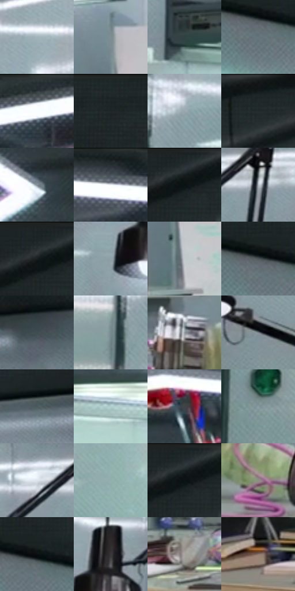

# 电影参考 332

- 状态：常规／活跃；来源世界：miles-home。
- 视角：low-angle；景别：environment-wide；场景：interior。
- 时段：interior-time-unknown（外观依据，中置信度；具体时间／晨昏未知）；光照：cool-interior。
- 材质候选：skin, hair, fabric, glass, metal, plastic, paint（帧级，不是像素分割）。
- 明暗组：middle；L* P5/P50/P95：8.24295 / 56.01487 / 91.18537。
- 资格门禁：无附加门禁。
- 原截图 SHA-256：`5e272569bef6fd4c5fe097c2d339a90a4b1a999c5c624fe87967bbceff88dd83`；尺寸：2880 × 1202。
- sRGB 像素 SHA-256：`25f52ddd8aba05f39b90fd24c7a4d1ebae0cd3285d3ee0d2491998a778b32553`。

## 观察与迁移

实验室灯具、灰青墙、台面与人物；实体灯环不是感应圈。

332  /  室内空间／反光  /  灰青实验室、顶灯多边形与墙面较淡映像，仪器各有光泽；灯环不是心理或运动符号

本公开版保存32个128×128原像素色卡上下文；图集格子并非原场景相邻位置。原rect、图集tile和像素SHA见 `data/palette-crops.json`。上下文不足时不得批准替色，不能以小样推断完整构图。

## 实测色卡

颜色比例分母为保留采样像素，不是材料面积；全部 32 色参与全库匹配。表内四舍五入仅用于阅读，原精度在 JSON。

| ID | HEX | Lab | 原图 xy | 像素数 | 比例 | 明度角色 |
| --- | --- | --- | --- | ---: | ---: | --- |
| 332-S01 | #A1B5BA | [72.341408, -5.831903, -4.869965] | [2668, 508] | 10057 | 5.220402% | light |
| 332-S02 | #7C8D93 | [57.502491, -4.784262, -5.251703] | [1316, 700] | 9829 | 5.102051% | midtone |
| 332-S03 | #304243 | [26.534034, -6.849821, -2.94161] | [544, 596] | 8747 | 4.540405% | shadow |
| 332-S04 | #67767C | [48.629956, -4.185068, -5.165909] | [80, 220] | 8188 | 4.250239% | midtone |
| 332-S05 | #F5F9FD | [97.734784, -0.602677, -2.369023] | [1284, 52] | 7757 | 4.026515% | highlight |
| 332-S06 | #212829 | [15.492315, -2.811961, -1.696208] | [112, 28] | 7740 | 4.017690% | deep-shadow |
| 332-S07 | #98A7AE | [67.552357, -3.798848, -5.395846] | [284, 572] | 7607 | 3.948652% | light |
| 332-S08 | #121718 | [7.292446, -1.911701, -1.46798] | [2724, 28] | 6986 | 3.626303% | deep-shadow |
| 332-S09 | #84929A | [59.703881, -3.30082, -5.927219] | [1760, 212] | 6871 | 3.566609% | midtone |
| 332-S10 | #2A3337 | [20.579141, -2.733017, -3.802062] | [1628, 32] | 6423 | 3.334060% | shadow |
| 332-S11 | #242D2F | [17.723051, -3.321531, -2.583813] | [2588, 28] | 6397 | 3.320564% | deep-shadow |
| 332-S12 | #B3BAC1 | [75.171362, -1.065546, -4.370679] | [2280, 576] | 6390 | 3.316930% | light |
| 332-S13 | #1B2426 | [13.43968, -3.386228, -2.648264] | [2548, 28] | 6387 | 3.315373% | deep-shadow |
| 332-S14 | #8DA1A5 | [64.857955, -6.142366, -4.443238] | [1996, 712] | 6106 | 3.169511% | light |
| 332-S15 | #C4CACE | [80.978761, -1.297266, -2.700174] | [1340, 856] | 6093 | 3.162763% | highlight |
| 332-S16 | #5E6468 | [41.989726, -1.43493, -3.057174] | [36, 188] | 5974 | 3.100992% | midtone |
| 332-S17 | #3F4D50 | [31.677963, -4.763438, -3.618823] | [2272, 420] | 5830 | 3.026245% | shadow |
| 332-S18 | #748A8C | [55.869692, -7.401697, -3.702492] | [200, 640] | 5640 | 2.927619% | midtone |
| 332-S19 | #919B9E | [63.285561, -2.957005, -2.795478] | [2032, 996] | 5485 | 2.847162% | light |
| 332-S20 | #788288 | [53.745324, -2.386343, -4.491545] | [2532, 760] | 5447 | 2.827437% | midtone |
| 332-S21 | #4B595E | [36.833886, -4.191609, -4.697468] | [2056, 420] | 5281 | 2.741269% | shadow |
| 332-S22 | #B0CECB | [80.562382, -10.577034, -1.866775] | [784, 636] | 5211 | 2.704933% | highlight |
| 332-S23 | #3F4448 | [28.53481, -1.102687, -3.117655] | [1448, 188] | 5142 | 2.669117% | shadow |
| 332-S24 | #859B9E | [62.420716, -7.064666, -4.168231] | [268, 920] | 5065 | 2.629147% | light |
| 332-S25 | #DDE4EA | [90.228998, -1.227895, -3.725687] | [2184, 560] | 4719 | 2.449545% | highlight |
| 332-S26 | #91B0AD | [69.531109, -11.166891, -1.981731] | [432, 780] | 4683 | 2.430858% | light |
| 332-S27 | #191F20 | [11.211691, -2.455192, -1.602853] | [2584, 48] | 4477 | 2.323928% | deep-shadow |
| 332-S28 | #8D8F80 | [58.850348, -3.547663, 7.737039] | [2396, 1068] | 4357 | 2.261638% | midtone |
| 332-S29 | #0B1011 | [4.355548, -1.387024, -1.084931] | [104, 184] | 4074 | 2.114738% | deep-shadow |
| 332-S30 | #39383A | [23.683648, 0.889243, -1.089945] | [2080, 624] | 3307 | 1.716602% | shadow |
| 332-S31 | #A9A5A1 | [67.960652, 0.696077, 2.580758] | [832, 1044] | 3227 | 1.675076% | light |
| 332-S32 | #8B7468 | [50.663719, 7.004305, 9.983492] | [544, 1032] | 3151 | 1.635626% | midtone |

## 色阶与空间分布

- 采样 ROI：`[0.01, 0.02, 0.98, 0.94]`；步长：4；样本数：192648。
- 排除区：`[]`。
- 深暗、暗、中、亮、高光五段计数：`[39125, 32351, 44637, 57488, 19047]`。
- RGB 各 256 箱、L* 100 箱、13×5 色相明度表和 3×3 空间统计全部保存在 [总数据](../film-library.json)。
- [可视化档案](../../references/library.html)按需绘制直方图，不存 2,094 张重复图表图片。

## 纹理特征占比

**这是分块图像特征的面积占比，不是波点／排线／丝网／错版的精确语义覆盖率。** 窗格、发丝、织物也会产生方向或周期特征。
原图 ROI 像素 3087370；已测块覆盖 3087370（100.0000%）；未测 0。

| 特征 | 块覆盖像素 | 占已测面积 | 阈值敏感范围 |
| --- | ---: | ---: | --- |
| low-contrast | 114688 | 3.7147% | 3.7147% ~ 5.3068% |
| directional-structure | 1320586 | 42.7738% | 33.6113% ~ 52.3758% |
| periodic-structure | 1592576 | 51.5836% | 43.0430% ~ 55.8290% |
| mixed-detail | 59520 | 1.9279% | 0.8665% ~ 5.2529% |

阈值敏感范围不是统计置信区间。逐块坐标、尺度、对比、方向一致性、频谱集中度、频率与角度见 [全量特征记录](../texture-features.jsonl)，以帧号定位。
四种印刷层的真实像素覆盖仍标为 `null`，不能填 0，也不能拿上表代替。不得据这些代理测量删除唯一证据。

[测量方法与保留策略](../../references/library-retention.md) · [分类索引](../archive/README.md)
