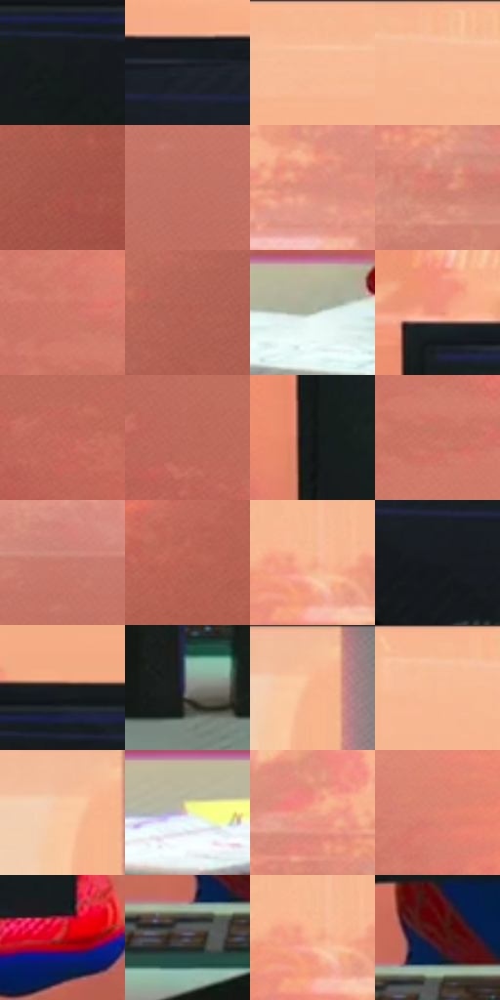

# 电影参考 333

- 状态：常规／活跃；来源世界：miles-home。
- 视角：near-level；景别：medium；场景：interior。
- 时段：interior-time-unknown（外观依据，中置信度；具体时间／晨昏未知）；光照：cool-interior。
- 材质候选：skin, hair, fabric, glass, metal, plastic, paint（帧级，不是像素分割）。
- 明暗组：middle；L* P5/P50/P95：8.76259 / 57.48195 / 80.8282。
- 资格门禁：无附加门禁。
- 原截图 SHA-256：`78a8382eea74ed8bb0f5ffa919f48927a8c02cec7aa765c1ba7414e57e178756`；尺寸：2880 × 1210。
- sRGB 像素 SHA-256：`941d28ccd77a8348d4aecc56dcb29eefafba8c6f6021906888dfba5b75b73efc`。

## 观察与迁移

实验室灯具、灰青墙、台面与人物；实体灯环不是感应圈。

333  /  物件材质／遮挡  /  显示器背壳大暗面、暖窗外与桌面小物；不把背壳画成镜面屏，不补被遮住身体

本公开版保存32个128×128原像素色卡上下文；图集格子并非原场景相邻位置。原rect、图集tile和像素SHA见 `data/palette-crops.json`。上下文不足时不得批准替色，不能以小样推断完整构图。

## 实测色卡

颜色比例分母为保留采样像素，不是材料面积；全部 32 色参与全库匹配。表内四舍五入仅用于阅读，原精度在 JSON。

| ID | HEX | Lab | 原图 xy | 像素数 | 比例 | 明度角色 |
| --- | --- | --- | --- | ---: | ---: | --- |
| 333-S01 | #161B1C | [9.306158, -2.045794, -1.481254] | [1204, 444] | 13293 | 6.850508% | deep-shadow |
| 333-S02 | #1C212B | [12.664872, 0.697312, -7.416817] | [1808, 392] | 9955 | 5.130280% | deep-shadow |
| 333-S03 | #F8B892 | [79.793677, 18.482953, 28.364927] | [2108, 28] | 9853 | 5.077714% | light |
| 333-S04 | #F7B58F | [78.93111, 19.354082, 28.782101] | [1832, 28] | 9426 | 4.857661% | light |
| 333-S05 | #AA594D | [47.273314, 31.878528, 21.906561] | [2768, 876] | 8868 | 4.570098% | midtone |
| 333-S06 | #C27062 | [56.029998, 30.895726, 21.868579] | [160, 480] | 8575 | 4.419101% | midtone |
| 333-S07 | #DC8D7E | [66.347744, 28.316433, 20.525369] | [200, 228] | 7704 | 3.970234% | light |
| 333-S08 | #D28071 | [61.942573, 30.041378, 21.630017] | [2700, 348] | 7517 | 3.873864% | light |
| 333-S09 | #CF7767 | [59.380862, 32.708979, 23.785856] | [708, 524] | 6923 | 3.567748% | midtone |
| 333-S10 | #B35F52 | [49.953563, 32.653386, 22.722473] | [2708, 720] | 6657 | 3.430665% | midtone |
| 333-S11 | #A9B3A0 | [71.699439, -7.022828, 8.512999] | [656, 1088] | 6527 | 3.363670% | light |
| 333-S12 | #EB947B | [69.665757, 30.104012, 26.958675] | [964, 352] | 6347 | 3.270908% | light |
| 333-S13 | #C66A5B | [55.146705, 35.020449, 24.818217] | [408, 796] | 6182 | 3.185875% | midtone |
| 333-S14 | #BF6A5C | [54.196285, 32.377793, 22.812174] | [272, 724] | 5911 | 3.046216% | midtone |
| 333-S15 | #111616 | [6.782817, -2.083482, -0.733075] | [944, 480] | 5852 | 3.015811% | deep-shadow |
| 333-S16 | #CB7162 | [57.455197, 33.879876, 23.979417] | [740, 596] | 5699 | 2.936963% | midtone |
| 333-S17 | #C87669 | [58.28216, 30.704039, 21.017166] | [140, 392] | 5638 | 2.905527% | midtone |
| 333-S18 | #BC6356 | [52.1632, 34.398682, 23.529335] | [2172, 912] | 5521 | 2.845231% | midtone |
| 333-S19 | #F4AD88 | [76.619486, 21.678396, 29.366848] | [560, 196] | 5430 | 2.798334% | light |
| 333-S20 | #191C20 | [10.118171, -0.281644, -3.227694] | [1408, 472] | 5391 | 2.778236% | deep-shadow |
| 333-S21 | #161D1F | [10.169583, -2.60406, -2.437684] | [1260, 368] | 5205 | 2.682381% | deep-shadow |
| 333-S22 | #838584 | [55.345536, -0.94137, 0.280583] | [1428, 1136] | 4772 | 2.459236% | midtone |
| 333-S23 | #F7B48D | [78.661727, 19.671515, 29.482911] | [1408, 64] | 4649 | 2.395848% | light |
| 333-S24 | #F6BB97 | [80.38806, 16.677644, 26.481095] | [1780, 52] | 4533 | 2.336068% | highlight |
| 333-S25 | #F9C8A2 | [83.997114, 12.286156, 25.619299] | [1376, 68] | 4369 | 2.251551% | highlight |
| 333-S26 | #E6DDC7 | [88.285485, -0.575187, 11.90446] | [96, 1092] | 4250 | 2.190225% | highlight |
| 333-S27 | #ED9D87 | [72.142624, 27.321519, 23.768141] | [2632, 260] | 4226 | 2.177857% | light |
| 333-S28 | #E2846F | [64.821802, 33.934148, 26.951149] | [748, 452] | 3429 | 1.767125% | light |
| 333-S29 | #BD1318 | [40.170526, 62.000725, 44.703866] | [1920, 948] | 3058 | 1.575931% | midtone |
| 333-S30 | #44424C | [28.504194, 3.150424, -5.718785] | [1180, 1072] | 3051 | 1.572324% | shadow |
| 333-S31 | #F7B08E | [77.746023, 21.883255, 27.728618] | [552, 200] | 2629 | 1.354847% | light |
| 333-S32 | #531210 | [17.034676, 29.733309, 18.904319] | [1220, 1008] | 2604 | 1.341964% | deep-shadow |

## 色阶与空间分布

- 采样 ROI：`[0.01, 0.02, 0.98, 0.94]`；步长：4；样本数：194044。
- 排除区：`[]`。
- 深暗、暗、中、亮、高光五段计数：`[41809, 4674, 63110, 69655, 14796]`。
- RGB 各 256 箱、L* 100 箱、13×5 色相明度表和 3×3 空间统计全部保存在 [总数据](../film-library.json)。
- [可视化档案](../../references/library.html)按需绘制直方图，不存 2,094 张重复图表图片。

## 纹理特征占比

**这是分块图像特征的面积占比，不是波点／排线／丝网／错版的精确语义覆盖率。** 窗格、发丝、织物也会产生方向或周期特征。
原图 ROI 像素 3109722；已测块覆盖 3109722（100.0000%）；未测 0。

| 特征 | 块覆盖像素 | 占已测面积 | 阈值敏感范围 |
| --- | ---: | ---: | --- |
| low-contrast | 764416 | 24.5815% | 16.2422% ~ 31.3402% |
| directional-structure | 610432 | 19.6298% | 11.8421% ~ 29.8913% |
| periodic-structure | 1478362 | 47.5400% | 40.2545% ~ 51.2322% |
| mixed-detail | 256512 | 8.2487% | 2.6343% ~ 16.5633% |

阈值敏感范围不是统计置信区间。逐块坐标、尺度、对比、方向一致性、频谱集中度、频率与角度见 [全量特征记录](../texture-features.jsonl)，以帧号定位。
四种印刷层的真实像素覆盖仍标为 `null`，不能填 0，也不能拿上表代替。不得据这些代理测量删除唯一证据。

[测量方法与保留策略](../../references/library-retention.md) · [分类索引](../archive/README.md)
