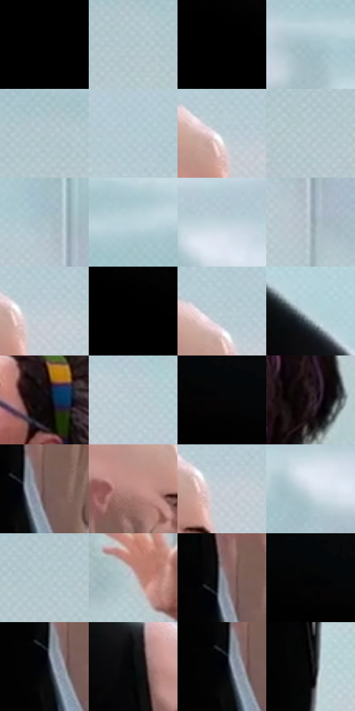

# 电影参考 334

- 状态：常规／活跃；来源世界：miles-home。
- 视角：low-angle；景别：medium；场景：interior。
- 时段：interior-time-unknown（外观依据，中置信度；具体时间／晨昏未知）；光照：cool-interior。
- 材质候选：skin, hair, fabric, glass, metal, plastic, paint（帧级，不是像素分割）。
- 明暗组：very-dark；L* P5/P50/P95：0.0 / 2.32213 / 82.59418。
- 资格门禁：无附加门禁。
- 原截图 SHA-256：`cdea1ba8327cdecccc515d8a75ce171ac6adc2464675223d177f3db3ecdf801c`；尺寸：2880 × 1196。
- sRGB 像素 SHA-256：`9ffd4a8212707019e5fece6159b3324ec6bd1c197a6badf395e6f1f633b75a1a`。

## 观察与迁移

实验室灯具、灰青墙、台面与人物；实体灯环不是感应圈。

334  /  角色对照／衣物  /  巨大黑色身形与细长白衣人形成质量对比；极端头身比不是普通人像模板

本公开版保存32个128×128原像素色卡上下文；图集格子并非原场景相邻位置。原rect、图集tile和像素SHA见 `data/palette-crops.json`。上下文不足时不得批准替色，不能以小样推断完整构图。

## 实测色卡

颜色比例分母为保留采样像素，不是材料面积；全部 32 色参与全库匹配。表内四舍五入仅用于阅读，原精度在 JSON。

| ID | HEX | Lab | 原图 xy | 像素数 | 比例 | 明度角色 |
| --- | --- | --- | --- | ---: | ---: | --- |
| 334-S01 | #000000 | [0.0, 0.0, 0.0] | [32, 24] | 81722 | 42.420373% | deep-shadow |
| 334-S02 | #B5CACF | [79.936447, -6.065452, -4.893296] | [2612, 324] | 7317 | 3.798119% | light |
| 334-S03 | #010101 | [0.274173, -1.7e-05, 3.3e-05] | [612, 24] | 6481 | 3.364167% | deep-shadow |
| 334-S04 | #A7C2CA | [76.716602, -7.403882, -7.064471] | [2376, 116] | 6133 | 3.183526% | light |
| 334-S05 | #B2C7CC | [78.851071, -6.078674, -4.905122] | [2584, 292] | 5521 | 2.865849% | light |
| 334-S06 | #B5CED6 | [81.19263, -6.715736, -6.787852] | [1656, 168] | 5279 | 2.740231% | highlight |
| 334-S07 | #BBCAD1 | [80.408806, -3.703297, -5.222316] | [1608, 244] | 4877 | 2.531560% | highlight |
| 334-S08 | #B5C6CC | [78.793345, -4.572511, -4.96682] | [2504, 364] | 4761 | 2.471347% | light |
| 334-S09 | #AEC4CA | [77.722284, -6.210733, -5.524214] | [1952, 260] | 4629 | 2.402828% | light |
| 334-S10 | #AFCAD1 | [79.589439, -7.578354, -6.525012] | [2812, 40] | 4591 | 2.383103% | light |
| 334-S11 | #C0D4DB | [83.655969, -5.29756, -5.729226] | [2188, 80] | 4451 | 2.310431% | highlight |
| 334-S12 | #A8B7BE | [73.486317, -3.753694, -5.31235] | [1984, 332] | 4426 | 2.297454% | light |
| 334-S13 | #C2CED6 | [82.090971, -2.511007, -5.359459] | [1644, 256] | 4227 | 2.194157% | highlight |
| 334-S14 | #020202 | [0.548347, -3.5e-05, 6.6e-05] | [652, 24] | 4174 | 2.166646% | deep-shadow |
| 334-S15 | #B7CBD1 | [80.393748, -5.53325, -5.275953] | [1596, 216] | 4146 | 2.152112% | highlight |
| 334-S16 | #BBD1D8 | [82.444522, -5.951469, -5.959533] | [1324, 80] | 4114 | 2.135501% | highlight |
| 334-S17 | #140D10 | [4.281588, 3.08905, -0.540025] | [2424, 788] | 4046 | 2.100203% | deep-shadow |
| 334-S18 | #BCCED3 | [81.585446, -5.072789, -4.549828] | [1800, 300] | 4040 | 2.097089% | highlight |
| 334-S19 | #060607 | [1.664828, 0.138939, -0.378226] | [1012, 84] | 3993 | 2.072692% | deep-shadow |
| 334-S20 | #2C1F24 | [13.489052, 7.319278, -0.926402] | [2664, 960] | 3594 | 1.865579% | deep-shadow |
| 334-S21 | #6E5250 | [37.715226, 11.358512, 5.718055] | [1484, 452] | 3323 | 1.724908% | shadow |
| 334-S22 | #BD8A83 | [62.199453, 18.466726, 11.41844] | [1536, 320] | 3285 | 1.705183% | light |
| 334-S23 | #C3CAD1 | [80.986201, -1.055404, -4.305372] | [1636, 272] | 3225 | 1.674038% | highlight |
| 334-S24 | #D3DEE8 | [87.928543, -1.772715, -6.147862] | [2160, 132] | 3151 | 1.635626% | highlight |
| 334-S25 | #B8CED2 | [81.283372, -6.574362, -4.491545] | [2552, 336] | 2918 | 1.514680% | highlight |
| 334-S26 | #C0C4CA | [79.012628, -0.242278, -3.475373] | [1924, 1056] | 2322 | 1.205307% | light |
| 334-S27 | #8A8F98 | [59.264699, 0.031452, -5.387329] | [1460, 420] | 1357 | 0.704394% | midtone |
| 334-S28 | #030405 | [1.058172, -0.122525, -0.47043] | [972, 68] | 443 | 0.229953% | deep-shadow |
| 334-S29 | #03050C | [1.394986, 0.46588, -2.875695] | [1448, 468] | 67 | 0.034778% | deep-shadow |
| 334-S30 | #020204 | [0.587921, 0.278053, -0.756781] | [1416, 244] | 22 | 0.011420% | deep-shadow |
| 334-S31 | #01010A | [0.452255, 1.251377, -3.405779] | [1444, 460] | 7 | 0.003634% | deep-shadow |
| 334-S32 | #000002 | [0.039574, 0.278088, -0.756847] | [1492, 804] | 6 | 0.003114% | deep-shadow |

## 色阶与空间分布

- 采样 ROI：`[0.01, 0.02, 0.98, 0.94]`；步长：4；样本数：192648。
- 排除区：`[]`。
- 深暗、暗、中、亮、高光五段计数：`[104195, 1782, 3834, 40259, 42578]`。
- RGB 各 256 箱、L* 100 箱、13×5 色相明度表和 3×3 空间统计全部保存在 [总数据](../film-library.json)。
- [可视化档案](../../references/library.html)按需绘制直方图，不存 2,094 张重复图表图片。

## 纹理特征占比

**这是分块图像特征的面积占比，不是波点／排线／丝网／错版的精确语义覆盖率。** 窗格、发丝、织物也会产生方向或周期特征。
原图 ROI 像素 3076194；已测块覆盖 3076194（100.0000%）；未测 0。

| 特征 | 块覆盖像素 | 占已测面积 | 阈值敏感范围 |
| --- | ---: | ---: | --- |
| low-contrast | 1864034 | 60.5955% | 48.2633% ~ 65.6469% |
| directional-structure | 216320 | 7.0321% | 4.9016% ~ 11.8255% |
| periodic-structure | 979456 | 31.8399% | 27.8536% ~ 39.3786% |
| mixed-detail | 16384 | 0.5326% | 0.5326% ~ 1.5978% |

阈值敏感范围不是统计置信区间。逐块坐标、尺度、对比、方向一致性、频谱集中度、频率与角度见 [全量特征记录](../texture-features.jsonl)，以帧号定位。
四种印刷层的真实像素覆盖仍标为 `null`，不能填 0，也不能拿上表代替。不得据这些代理测量删除唯一证据。

[测量方法与保留策略](../../references/library-retention.md) · [分类索引](../archive/README.md)
