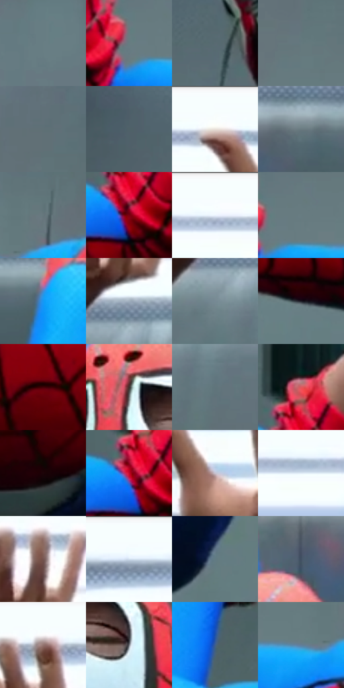

# 电影参考 335

- 状态：常规／活跃；来源世界：miles-home。
- 视角：near-level；景别：medium；场景：interior。
- 时段：interior-time-unknown（外观依据，中置信度；具体时间／晨昏未知）；光照：cool-interior。
- 材质候选：skin, hair, fabric, glass, metal, plastic, paint（帧级，不是像素分割）。
- 明暗组：middle；L* P5/P50/P95：8.37795 / 49.91827 / 99.14816。
- 资格门禁：无附加门禁。
- 原截图 SHA-256：`edf5afe26213d2b5f5ff36767312ab062fe28038860b7bebada0ffffb3a71341`；尺寸：2880 × 1208。
- sRGB 像素 SHA-256：`9511758015b717708e8c56ff4a9cd364dca6c780d64804db316b31dd8350b3c9`。

## 观察与迁移

实验室灯具、灰青墙、台面与人物；实体灯环不是感应圈。

335  /  倒置姿态／透视  /  面罩、手和近大远小的头部；面罩眼孔及透视夸张不当裸脸比例

本公开版保存32个128×128原像素色卡上下文；图集格子并非原场景相邻位置。原rect、图集tile和像素SHA见 `data/palette-crops.json`。上下文不足时不得批准替色，不能以小样推断完整构图。

## 实测色卡

颜色比例分母为保留采样像素，不是材料面积；全部 32 色参与全库匹配。表内四舍五入仅用于阅读，原精度在 JSON。

| ID | HEX | Lab | 原图 xy | 像素数 | 比例 | 明度角色 |
| --- | --- | --- | --- | ---: | ---: | --- |
| 335-S01 | #687E83 | [51.270462, -6.789238, -5.366296] | [352, 620] | 17197 | 8.894417% | midtone |
| 335-S02 | #657D81 | [50.70865, -7.706773, -5.048398] | [764, 600] | 14066 | 7.275041% | midtone |
| 335-S03 | #586A72 | [43.649748, -4.790883, -6.709701] | [1012, 392] | 11397 | 5.894614% | midtone |
| 335-S04 | #64797E | [49.362321, -6.479091, -5.285823] | [2628, 548] | 9016 | 4.663143% | midtone |
| 335-S05 | #5F7076 | [46.081348, -4.908988, -5.440755] | [2648, 408] | 8757 | 4.529186% | midtone |
| 335-S06 | #4F6168 | [39.933229, -5.072879, -6.23385] | [148, 328] | 8073 | 4.175416% | shadow |
| 335-S07 | #F7FDFE | [98.899216, -1.791911, -1.160584] | [2088, 28] | 8020 | 4.148004% | highlight |
| 335-S08 | #6A7A81 | [50.177649, -4.285854, -5.797809] | [1556, 292] | 7776 | 4.021805% | midtone |
| 335-S09 | #65767C | [48.484012, -4.882462, -5.398389] | [996, 568] | 7591 | 3.926122% | midtone |
| 335-S10 | #79010F | [24.072314, 46.243731, 29.672107] | [1996, 604] | 7197 | 3.722342% | shadow |
| 335-S11 | #F9FEFF | [99.316616, -1.464563, -1.046193] | [1724, 44] | 6586 | 3.406329% | highlight |
| 335-S12 | #677C81 | [50.55042, -6.461775, -5.267909] | [812, 580] | 6390 | 3.304956% | midtone |
| 335-S13 | #1798F5 | [60.981603, 1.094686, -55.333858] | [1692, 312] | 6228 | 3.221168% | light |
| 335-S14 | #A0AEBE | [70.498816, -1.533855, -9.81007] | [2396, 216] | 6219 | 3.216513% | light |
| 335-S15 | #778994 | [56.038469, -3.995858, -8.040995] | [2356, 296] | 6166 | 3.189101% | midtone |
| 335-S16 | #1D1B25 | [10.39881, 3.678657, -6.472169] | [928, 848] | 5974 | 3.089798% | deep-shadow |
| 335-S17 | #420207 | [10.685008, 29.7486, 13.92455] | [1356, 836] | 5950 | 3.077385% | deep-shadow |
| 335-S18 | #3F312E | [21.765694, 5.772941, 4.318031] | [1320, 496] | 5780 | 2.989459% | shadow |
| 335-S19 | #60757B | [47.801842, -6.261119, -5.856796] | [2444, 352] | 5565 | 2.878260% | midtone |
| 335-S20 | #E0585F | [55.743244, 53.522885, 24.019777] | [2000, 500] | 5517 | 2.853434% | midtone |
| 335-S21 | #1C0408 | [3.173365, 9.514471, 1.642892] | [1452, 988] | 5446 | 2.816712% | deep-shadow |
| 335-S22 | #C50627 | [41.455021, 65.990717, 38.459347] | [1976, 580] | 5442 | 2.814643% | midtone |
| 335-S23 | #C7C2CF | [79.173935, 4.150531, -5.870612] | [2176, 152] | 4580 | 2.368810% | light |
| 335-S24 | #E0ECF6 | [92.79118, -2.081908, -6.191636] | [1596, 88] | 4134 | 2.138136% | highlight |
| 335-S25 | #765550 | [39.459636, 12.946659, 8.319328] | [2396, 104] | 3108 | 1.607481% | shadow |
| 335-S26 | #F4FDFF | [98.710907, -2.586157, -1.975221] | [288, 48] | 2897 | 1.498350% | highlight |
| 335-S27 | #627B83 | [49.978494, -7.080636, -7.331384] | [1684, 1044] | 2230 | 1.153373% | midtone |
| 335-S28 | #415063 | [33.481498, -0.747555, -12.952946] | [1396, 348] | 2163 | 1.118720% | shadow |
| 335-S29 | #93736E | [51.371832, 11.769103, 7.575725] | [528, 68] | 1726 | 0.892700% | midtone |
| 335-S30 | #7A7E85 | [52.677616, -0.026742, -4.304111] | [1440, 576] | 1058 | 0.547206% | midtone |
| 335-S31 | #405F89 | [39.71435, 1.429137, -26.789607] | [1800, 496] | 549 | 0.283947% | shadow |
| 335-S32 | #617F9B | [51.933936, -3.401555, -18.435239] | [920, 628] | 548 | 0.283430% | midtone |

## 色阶与空间分布

- 采样 ROI：`[0.01, 0.02, 0.98, 0.94]`；步长：4；样本数：193346。
- 排除区：`[]`。
- 深暗、暗、中、亮、高光五段计数：`[20692, 20054, 113422, 14591, 24587]`。
- RGB 各 256 箱、L* 100 箱、13×5 色相明度表和 3×3 空间统计全部保存在 [总数据](../film-library.json)。
- [可视化档案](../../references/library.html)按需绘制直方图，不存 2,094 张重复图表图片。

## 纹理特征占比

**这是分块图像特征的面积占比，不是波点／排线／丝网／错版的精确语义覆盖率。** 窗格、发丝、织物也会产生方向或周期特征。
原图 ROI 像素 3104134；已测块覆盖 3104134（100.0000%）；未测 0。

| 特征 | 块覆盖像素 | 占已测面积 | 阈值敏感范围 |
| --- | ---: | ---: | --- |
| low-contrast | 767750 | 24.7331% | 22.1848% ~ 27.7310% |
| directional-structure | 1238016 | 39.8828% | 26.1514% ~ 50.9669% |
| periodic-structure | 1032832 | 33.2728% | 26.8483% ~ 42.9507% |
| mixed-detail | 65536 | 2.1112% | 0.0000% ~ 3.1669% |

阈值敏感范围不是统计置信区间。逐块坐标、尺度、对比、方向一致性、频谱集中度、频率与角度见 [全量特征记录](../texture-features.jsonl)，以帧号定位。
四种印刷层的真实像素覆盖仍标为 `null`，不能填 0，也不能拿上表代替。不得据这些代理测量删除唯一证据。

[测量方法与保留策略](../../references/library-retention.md) · [分类索引](../archive/README.md)
