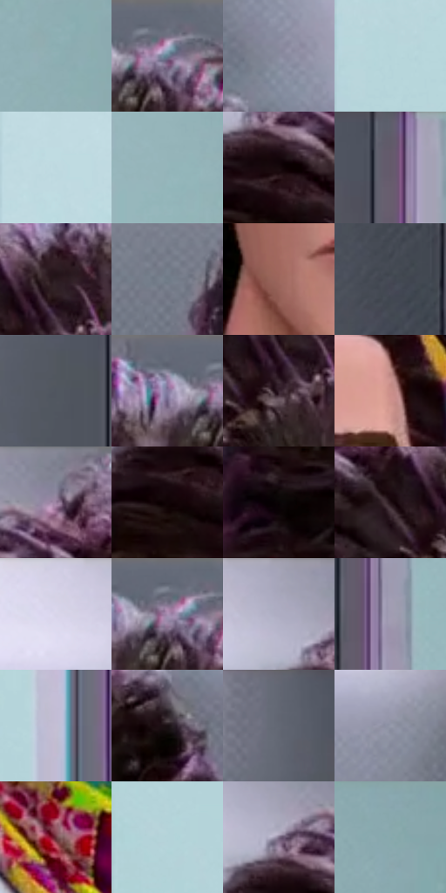

# 电影参考 336

- 状态：常规／活跃；来源世界：miles-home。
- 视角：near-level；景别：close-up；场景：interior。
- 时段：interior-time-unknown（外观依据，中置信度；具体时间／晨昏未知）；光照：cool-interior。
- 材质候选：skin, hair, fabric, glass, metal, plastic, paint（帧级，不是像素分割）。
- 明暗组：middle；L* P5/P50/P95：2.27537 / 51.20404 / 84.16676。
- 资格门禁：无附加门禁。
- 原截图 SHA-256：`307cbaa33d8cc8e28a29bacd92998712dff72537d2166d5fdc70c219285d868e`；尺寸：2880 × 1202。
- sRGB 像素 SHA-256：`2dd8e01f852c9711b5d0b507406aae932bae05258e24b6c7d5fda6909fa79277`。

## 观察与迁移

实验室灯具、灰青墙、台面与人物；实体灯环不是感应圈。

336、356研究员正面  /  偏长的颅面、收束下颌、明确眉形与眼睑；鼻体由侧面色阶和小暗面组织。卷发先大轮廓与卷曲群，唇保留体积而非一条黑线  /  学体块分工，不把每个人拉成长脸或移植巨大卷发；原照眉形、眼距、鼻唇与脸宽仍是身份锚点

336  /  面部基准／卷发眼镜  /  长脸、明晰眉睑、鼻侧面与唇体积，白框下视线可读；大卷发先发量再卷束，保留用户自身脸型与发型

本公开版保存32个128×128原像素色卡上下文；图集格子并非原场景相邻位置。原rect、图集tile和像素SHA见 `data/palette-crops.json`。上下文不足时不得批准替色，不能以小样推断完整构图。

## 实测色卡

颜色比例分母为保留采样像素，不是材料面积；全部 32 色参与全库匹配。表内四舍五入仅用于阅读，原精度在 JSON。

| ID | HEX | Lab | 原图 xy | 像素数 | 比例 | 明度角色 |
| --- | --- | --- | --- | ---: | ---: | --- |
| 336-S01 | #8FAFB4 | [69.322335, -9.752083, -6.167766] | [2736, 420] | 10236 | 5.313318% | light |
| 336-S02 | #6E7381 | [48.462489, 1.194053, -8.321632] | [1588, 36] | 9724 | 5.047548% | midtone |
| 336-S03 | #8A8C9F | [58.66046, 3.242427, -10.287359] | [1844, 80] | 9058 | 4.701840% | midtone |
| 336-S04 | #B5D4DA | [82.898077, -8.997628, -6.398977] | [64, 488] | 9025 | 4.684710% | highlight |
| 336-S05 | #BDD8DF | [84.615913, -7.512243, -6.457147] | [64, 88] | 8756 | 4.545077% | highlight |
| 336-S06 | #95B5BA | [71.542238, -9.713146, -6.140721] | [2592, 592] | 8702 | 4.517047% | light |
| 336-S07 | #16090C | [3.545659, 4.991407, 0.428678] | [1172, 168] | 7284 | 3.780989% | deep-shadow |
| 336-S08 | #5F5A69 | [39.182008, 5.250642, -7.83712] | [2460, 32] | 6849 | 3.555189% | shadow |
| 336-S09 | #27191E | [10.707008, 7.990829, -0.682561] | [1400, 140] | 6752 | 3.504838% | deep-shadow |
| 336-S10 | #717B88 | [51.21398, -0.810465, -8.31255] | [856, 556] | 6642 | 3.447739% | midtone |
| 336-S11 | #9D675B | [49.038634, 20.214156, 15.691504] | [1340, 780] | 6558 | 3.404136% | midtone |
| 336-S12 | #484A55 | [31.649443, 1.779322, -6.779678] | [2380, 1016] | 6417 | 3.330946% | shadow |
| 336-S13 | #505660 | [36.376815, -0.02371, -6.583981] | [2380, 272] | 6394 | 3.319007% | shadow |
| 336-S14 | #7A7D8D | [52.650104, 2.309767, -9.018102] | [1504, 40] | 6364 | 3.303434% | midtone |
| 336-S15 | #38242E | [16.988321, 11.397045, -2.733291] | [1384, 212] | 6189 | 3.212595% | deep-shadow |
| 336-S16 | #CB918B | [65.603358, 21.119577, 11.92315] | [1608, 376] | 6074 | 3.152901% | light |
| 336-S17 | #838595 | [55.856794, 2.61975, -8.79353] | [1248, 40] | 5923 | 3.074519% | midtone |
| 336-S18 | #100406 | [1.898423, 3.696082, 0.44763] | [1144, 216] | 5824 | 3.023130% | deep-shadow |
| 336-S19 | #080304 | [1.133851, 1.446488, 0.082368] | [1036, 432] | 5804 | 3.012749% | deep-shadow |
| 336-S20 | #211015 | [6.757727, 9.529398, 0.154982] | [1312, 172] | 5798 | 3.009634% | deep-shadow |
| 336-S21 | #D7D5E9 | [85.96563, 4.42197, -9.552804] | [940, 64] | 5246 | 2.723101% | highlight |
| 336-S22 | #6A6C7B | [45.932926, 2.529759, -8.565233] | [1564, 44] | 5139 | 2.667559% | midtone |
| 336-S23 | #ACACC1 | [70.957418, 4.164779, -10.683458] | [1104, 56] | 5017 | 2.604232% | light |
| 336-S24 | #A09CB1 | [65.29824, 5.620266, -10.356302] | [2500, 912] | 4865 | 2.525331% | light |
| 336-S25 | #C4BFD4 | [78.3161, 5.722399, -9.866524] | [348, 692] | 4661 | 2.419439% | light |
| 336-S26 | #190F12 | [5.34771, 4.842026, -0.084323] | [1804, 196] | 4545 | 2.359225% | deep-shadow |
| 336-S27 | #626773 | [43.558198, 0.772162, -7.370469] | [2332, 32] | 4381 | 2.274096% | midtone |
| 336-S28 | #9499A9 | [63.295362, 1.505136, -8.953157] | [2132, 188] | 4161 | 2.159898% | light |
| 336-S29 | #683238 | [28.142349, 24.795678, 7.446192] | [1396, 1060] | 3783 | 1.963685% | shadow |
| 336-S30 | #B1D3D8 | [82.320594, -10.150414, -6.21592] | [32, 824] | 3250 | 1.687015% | highlight |
| 336-S31 | #786A83 | [46.895521, 10.586486, -11.778829] | [1144, 100] | 2328 | 1.208422% | midtone |
| 336-S32 | #87A9AD | [66.932596, -10.651065, -5.884262] | [2812, 68] | 899 | 0.466654% | light |

## 色阶与空间分布

- 采样 ROI：`[0.01, 0.02, 0.98, 0.94]`；步长：4；样本数：192648。
- 排除区：`[]`。
- 深暗、暗、中、亮、高光五段计数：`[41426, 21964, 56996, 44577, 27685]`。
- RGB 各 256 箱、L* 100 箱、13×5 色相明度表和 3×3 空间统计全部保存在 [总数据](../film-library.json)。
- [可视化档案](../../references/library.html)按需绘制直方图，不存 2,094 张重复图表图片。

## 纹理特征占比

**这是分块图像特征的面积占比，不是波点／排线／丝网／错版的精确语义覆盖率。** 窗格、发丝、织物也会产生方向或周期特征。
原图 ROI 像素 3087370；已测块覆盖 3087370（100.0000%）；未测 0。

| 特征 | 块覆盖像素 | 占已测面积 | 阈值敏感范围 |
| --- | ---: | ---: | --- |
| low-contrast | 590602 | 19.1296% | 16.1404% ~ 22.1188% |
| directional-structure | 598528 | 19.3863% | 14.8051% ~ 27.3465% |
| periodic-structure | 1750784 | 56.7079% | 53.5778% ~ 56.7079% |
| mixed-detail | 147456 | 4.7761% | 2.1227% ~ 9.4983% |

阈值敏感范围不是统计置信区间。逐块坐标、尺度、对比、方向一致性、频谱集中度、频率与角度见 [全量特征记录](../texture-features.jsonl)，以帧号定位。
四种印刷层的真实像素覆盖仍标为 `null`，不能填 0，也不能拿上表代替。不得据这些代理测量删除唯一证据。

[测量方法与保留策略](../../references/library-retention.md) · [分类索引](../archive/README.md)
