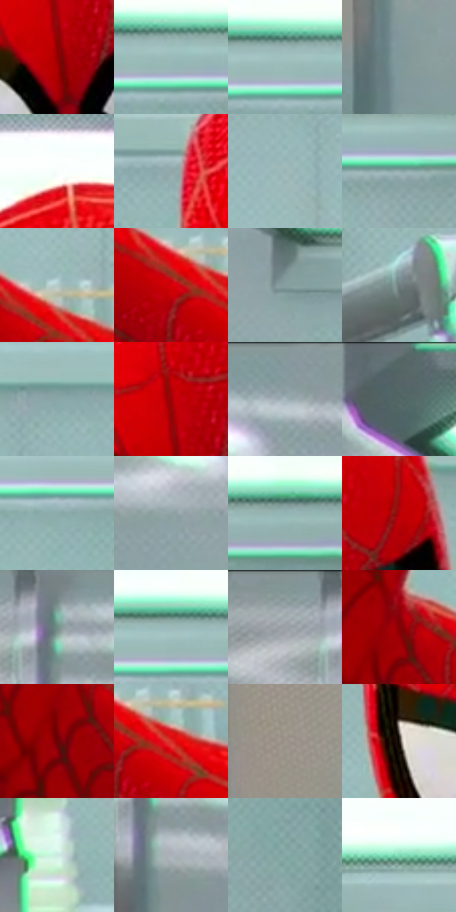

# 电影参考 337

- 状态：常规／活跃；来源世界：miles-home。
- 视角：near-level；景别：close-up；场景：interior。
- 时段：interior-time-unknown（外观依据，中置信度；具体时间／晨昏未知）；光照：cool-interior。
- 材质候选：skin, hair, fabric, glass, metal, plastic, paint（帧级，不是像素分割）。
- 明暗组：light；L* P5/P50/P95：25.7533 / 65.31457 / 92.6961。
- 资格门禁：无附加门禁。
- 原截图 SHA-256：`154928dc4eee190b7046ceff1218f5a333d0252f59e0373983ee91c808945da7`；尺寸：2880 × 1212。
- sRGB 像素 SHA-256：`f7561c0e756ed3ea4827a5b46323d3f2845b67ec64242b1c596a0c598dcb8227`。

## 观察与迁移

实验室灯具、灰青墙、台面与人物；实体灯环不是感应圈。

337  /  稳定人物／衣物  /  红色面罩织面与蛛网线、稳定人体和灰色背景；材料结构线与印刷细网分开

本公开版保存32个128×128原像素色卡上下文；图集格子并非原场景相邻位置。原rect、图集tile和像素SHA见 `data/palette-crops.json`。上下文不足时不得批准替色，不能以小样推断完整构图。

## 实测色卡

颜色比例分母为保留采样像素，不是材料面积；全部 32 色参与全库匹配。表内四舍五入仅用于阅读，原精度在 JSON。

| ID | HEX | Lab | 原图 xy | 像素数 | 比例 | 明度角色 |
| --- | --- | --- | --- | ---: | ---: | --- |
| 337-S01 | #940004 | [30.173577, 53.443912, 42.183774] | [1500, 380] | 11612 | 5.984210% | shadow |
| 337-S02 | #99BBBA | [73.452567, -11.605859, -3.292736] | [2400, 188] | 10716 | 5.522459% | light |
| 337-S03 | #9FC1BF | [75.61971, -11.764937, -2.782396] | [2360, 180] | 9325 | 4.805611% | light |
| 337-S04 | #809799 | [60.800711, -7.646471, -3.76862] | [196, 708] | 8960 | 4.617509% | light |
| 337-S05 | #F8FEFC | [99.169713, -2.325643, 0.270039] | [1452, 80] | 8703 | 4.485065% | highlight |
| 337-S06 | #91A8AA | [67.221839, -7.531138, -3.715598] | [1284, 248] | 7495 | 3.862526% | light |
| 337-S07 | #98B3B3 | [70.987488, -9.197138, -3.093093] | [1900, 348] | 7396 | 3.811507% | light |
| 337-S08 | #93AEAE | [69.133604, -9.235946, -3.102657] | [2504, 228] | 7393 | 3.809961% | light |
| 337-S09 | #B5CCCB | [80.359412, -7.916243, -2.125526] | [1884, 668] | 7090 | 3.653810% | highlight |
| 337-S10 | #D40006 | [44.254244, 69.727345, 56.52484] | [1852, 716] | 7048 | 3.632166% | midtone |
| 337-S11 | #879E9F | [63.4313, -7.814949, -3.226312] | [900, 220] | 6905 | 3.558471% | light |
| 337-S12 | #6C7D7E | [51.107295, -5.989994, -2.643758] | [1092, 516] | 6673 | 3.438911% | midtone |
| 337-S13 | #8AA7A7 | [66.389665, -9.948209, -3.325272] | [1976, 240] | 6669 | 3.436849% | light |
| 337-S14 | #A20106 | [33.390248, 56.98729, 45.050747] | [1496, 304] | 6559 | 3.380161% | shadow |
| 337-S15 | #8EA0A3 | [64.592677, -5.68766, -3.705869] | [644, 52] | 6371 | 3.283276% | light |
| 337-S16 | #546564 | [41.393563, -6.643426, -1.585482] | [812, 32] | 6206 | 3.198244% | midtone |
| 337-S17 | #8CACAB | [68.035147, -11.097752, -3.111049] | [2240, 244] | 5994 | 3.088990% | light |
| 337-S18 | #90A4A5 | [65.901097, -6.764607, -2.882321] | [548, 176] | 5959 | 3.070953% | light |
| 337-S19 | #91B3B2 | [70.506132, -11.677448, -3.303514] | [2640, 172] | 5450 | 2.808641% | light |
| 337-S20 | #B50006 | [37.554054, 61.98498, 49.543394] | [1652, 276] | 4921 | 2.536023% | shadow |
| 337-S21 | #718E88 | [56.716678, -11.520852, -0.18096] | [188, 68] | 4899 | 2.524685% | midtone |
| 337-S22 | #9DB9B8 | [73.105826, -9.687303, -2.680792] | [2312, 172] | 4772 | 2.459236% | light |
| 337-S23 | #8A999B | [62.127449, -4.909171, -2.866038] | [100, 32] | 4629 | 2.385541% | light |
| 337-S24 | #820206 | [26.168813, 48.322159, 36.366715] | [1684, 632] | 4553 | 2.346375% | shadow |
| 337-S25 | #6B0205 | [20.755481, 41.902335, 29.553196] | [1660, 692] | 4542 | 2.340706% | shadow |
| 337-S26 | #D92D2A | [48.007553, 64.443322, 44.68855] | [1912, 720] | 4282 | 2.206716% | midtone |
| 337-S27 | #9C918A | [60.917421, 2.816611, 5.179439] | [40, 520] | 4200 | 2.164458% | light |
| 337-S28 | #221714 | [9.02005, 4.990613, 4.140879] | [1336, 396] | 3734 | 1.924306% | deep-shadow |
| 337-S29 | #CAEAE1 | [90.246541, -12.161391, 0.855656] | [2300, 716] | 3436 | 1.770732% | highlight |
| 337-S30 | #ACB2B9 | [72.304543, -0.729873, -4.286059] | [208, 152] | 3219 | 1.658902% | light |
| 337-S31 | #82A8A2 | [66.026927, -14.164796, -1.131736] | [2820, 444] | 2868 | 1.478015% | light |
| 337-S32 | #7CD8B2 | [79.958874, -36.131451, 10.247418] | [1120, 156] | 1465 | 0.754983% | light |

## 色阶与空间分布

- 采样 ROI：`[0.01, 0.02, 0.98, 0.94]`；步长：4；样本数：194044。
- 排除区：`[]`。
- 深暗、暗、中、亮、高光五段计数：`[4301, 33914, 29148, 110149, 16532]`。
- RGB 各 256 箱、L* 100 箱、13×5 色相明度表和 3×3 空间统计全部保存在 [总数据](../film-library.json)。
- [可视化档案](../../references/library.html)按需绘制直方图，不存 2,094 张重复图表图片。

## 纹理特征占比

**这是分块图像特征的面积占比，不是波点／排线／丝网／错版的精确语义覆盖率。** 窗格、发丝、织物也会产生方向或周期特征。
原图 ROI 像素 3115310；已测块覆盖 3115310（100.0000%）；未测 0。

| 特征 | 块覆盖像素 | 占已测面积 | 阈值敏感范围 |
| --- | ---: | ---: | --- |
| low-contrast | 675200 | 21.6736% | 15.1695% ~ 29.6322% |
| directional-structure | 808110 | 25.9400% | 15.1997% ~ 35.7804% |
| periodic-structure | 1566464 | 50.2828% | 47.4724% ~ 50.2828% |
| mixed-detail | 65536 | 2.1037% | 1.5778% ~ 7.3629% |

阈值敏感范围不是统计置信区间。逐块坐标、尺度、对比、方向一致性、频谱集中度、频率与角度见 [全量特征记录](../texture-features.jsonl)，以帧号定位。
四种印刷层的真实像素覆盖仍标为 `null`，不能填 0，也不能拿上表代替。不得据这些代理测量删除唯一证据。

[测量方法与保留策略](../../references/library-retention.md) · [分类索引](../archive/README.md)
