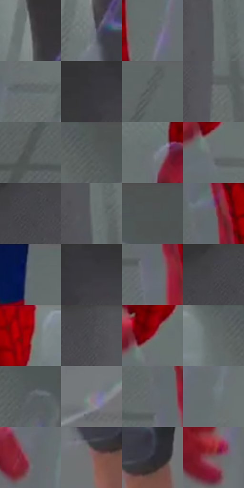

# 电影参考 338

- 状态：条件／活跃；来源世界：miles-home。
- 视角：high-angle；景别：detail；场景：interior。
- 时段：interior-time-unknown（外观依据，中置信度；具体时间／晨昏未知）；光照：cool-interior。
- 材质候选：skin, fabric, glass, metal, plastic（帧级，不是像素分割）。
- 明暗组：middle；L* P5/P50/P95：23.18162 / 43.50226 / 49.42238。
- 资格门禁：invisibility。
- 原截图 SHA-256：`e654651d205372a70e8cda9666946dd6a0298a1af19bd3591e60b27af48fc1a1`；尺寸：2880 × 1204。
- sRGB 像素 SHA-256：`bca3807ee79870bcd017103f6da5443d29a23b3fb4cb93b7d813e0df995b1663`。

## 观察与迁移

透明人体属于特殊能力，不能当作普通皮肤或镜面。

338  /  特殊能力／透明边界  /  近景透明手可透见地面与背景；不是普通玻璃手，也不是皮肤默认材质

本公开版保存32个128×128原像素色卡上下文；图集格子并非原场景相邻位置。原rect、图集tile和像素SHA见 `data/palette-crops.json`。上下文不足时不得批准替色，不能以小样推断完整构图。

## 实测色卡

颜色比例分母为保留采样像素，不是材料面积；全部 32 色参与全库匹配。表内四舍五入仅用于阅读，原精度在 JSON。

| ID | HEX | Lab | 原图 xy | 像素数 | 比例 | 明度角色 |
| --- | --- | --- | --- | ---: | ---: | --- |
| 338-S01 | #707375 | [48.248038, -0.722603, -1.497409] | [1044, 80] | 13912 | 7.221461% | midtone |
| 338-S02 | #72767D | [49.514026, -0.022102, -4.353955] | [1048, 216] | 10861 | 5.637743% | midtone |
| 338-S03 | #676C6C | [45.208448, -1.912797, -0.661961] | [760, 192] | 10841 | 5.627362% | midtone |
| 338-S04 | #606667 | [42.716031, -2.095273, -1.361435] | [1868, 120] | 8589 | 4.458390% | midtone |
| 338-S05 | #61686A | [43.481397, -2.246013, -2.04647] | [904, 296] | 8093 | 4.200926% | midtone |
| 338-S06 | #363539 | [22.393907, 1.372619, -2.350043] | [1248, 28] | 7922 | 4.112163% | shadow |
| 338-S07 | #5A6060 | [40.219554, -2.336241, -0.805792] | [184, 32] | 7622 | 3.956439% | midtone |
| 338-S08 | #6B6F71 | [46.560908, -1.102869, -1.637937] | [1876, 332] | 7535 | 3.911279% | midtone |
| 338-S09 | #515656 | [36.131583, -1.986361, -0.685929] | [100, 244] | 7314 | 3.796562% | shadow |
| 338-S10 | #555A5B | [37.840396, -1.749745, -1.256649] | [2476, 56] | 6882 | 3.572318% | shadow |
| 338-S11 | #6D7476 | [48.322752, -2.208605, -2.009807] | [2020, 76] | 6843 | 3.552074% | midtone |
| 338-S12 | #6C7174 | [47.312753, -1.259136, -2.314495] | [2172, 292] | 6730 | 3.493418% | midtone |
| 338-S13 | #45454A | [29.452386, 1.137703, -2.99896] | [1696, 76] | 6482 | 3.364686% | shadow |
| 338-S14 | #686E6F | [45.964536, -2.069925, -1.344685] | [1872, 188] | 6374 | 3.308625% | midtone |
| 338-S15 | #505254 | [34.762294, -0.363928, -1.448502] | [2628, 48] | 5917 | 3.071405% | shadow |
| 338-S16 | #64696A | [44.02134, -1.707135, -1.225156] | [564, 180] | 5737 | 2.977970% | midtone |
| 338-S17 | #666D6F | [45.510124, -2.229981, -2.030717] | [716, 56] | 5705 | 2.961360% | midtone |
| 338-S18 | #3B3A3E | [24.651106, 1.351962, -2.317084] | [1296, 64] | 5617 | 2.915680% | shadow |
| 338-S19 | #656B74 | [45.001578, -0.295646, -5.796165] | [556, 308] | 5461 | 2.834704% | midtone |
| 338-S20 | #414045 | [27.353304, 1.563167, -2.886434] | [1660, 32] | 5370 | 2.787467% | shadow |
| 338-S21 | #85040E | [27.036703, 48.929538, 33.953067] | [2248, 64] | 4910 | 2.548690% | shadow |
| 338-S22 | #4B4B4F | [32.016564, 0.890949, -2.367742] | [1784, 36] | 4900 | 2.543499% | shadow |
| 338-S23 | #882A3B | [32.274596, 41.151345, 12.055196] | [2180, 236] | 4857 | 2.521179% | shadow |
| 338-S24 | #5E6464 | [41.866706, -2.320617, -0.800808] | [2388, 28] | 4589 | 2.382065% | midtone |
| 338-S25 | #5C6265 | [41.136749, -1.663736, -2.50244] | [2536, 136] | 4510 | 2.341057% | midtone |
| 338-S26 | #868086 | [54.268081, 3.429016, -2.428023] | [952, 940] | 4177 | 2.168203% | midtone |
| 338-S27 | #64696F | [44.175541, -0.607828, -4.017355] | [524, 240] | 4087 | 2.121486% | midtone |
| 338-S28 | #687273 | [47.255655, -3.538501, -1.839294] | [864, 172] | 3896 | 2.022341% | midtone |
| 338-S29 | #6A6668 | [43.604643, 1.969647, -0.564911] | [904, 556] | 2463 | 1.278498% | midtone |
| 338-S30 | #7D6C6D | [47.222271, 6.863457, 1.913984] | [1256, 876] | 1993 | 1.034529% | midtone |
| 338-S31 | #282834 | [16.585166, 3.187086, -7.753579] | [1316, 828] | 1537 | 0.797828% | deep-shadow |
| 338-S32 | #705A5B | [40.431108, 9.163102, 2.83083] | [816, 696] | 922 | 0.478593% | midtone |

## 色阶与空间分布

- 采样 ROI：`[0.01, 0.02, 0.98, 0.94]`；步长：4；样本数：192648。
- 排除区：`[]`。
- 深暗、暗、中、亮、高光五段计数：`[1955, 62529, 127745, 419, 0]`。
- RGB 各 256 箱、L* 100 箱、13×5 色相明度表和 3×3 空间统计全部保存在 [总数据](../film-library.json)。
- [可视化档案](../../references/library.html)按需绘制直方图，不存 2,094 张重复图表图片。

## 纹理特征占比

**这是分块图像特征的面积占比，不是波点／排线／丝网／错版的精确语义覆盖率。** 窗格、发丝、织物也会产生方向或周期特征。
原图 ROI 像素 3092958；已测块覆盖 3092958（100.0000%）；未测 0。

| 特征 | 块覆盖像素 | 占已测面积 | 阈值敏感范围 |
| --- | ---: | ---: | --- |
| low-contrast | 947166 | 30.6233% | 18.1873% ~ 40.1334% |
| directional-structure | 559104 | 18.0767% | 10.9379% ~ 35.8099% |
| periodic-structure | 1472000 | 47.5920% | 44.6909% ~ 47.5920% |
| mixed-detail | 114688 | 3.7080% | 1.3119% ~ 4.2378% |

阈值敏感范围不是统计置信区间。逐块坐标、尺度、对比、方向一致性、频谱集中度、频率与角度见 [全量特征记录](../texture-features.jsonl)，以帧号定位。
四种印刷层的真实像素覆盖仍标为 `null`，不能填 0，也不能拿上表代替。不得据这些代理测量删除唯一证据。

[测量方法与保留策略](../../references/library-retention.md) · [分类索引](../archive/README.md)
