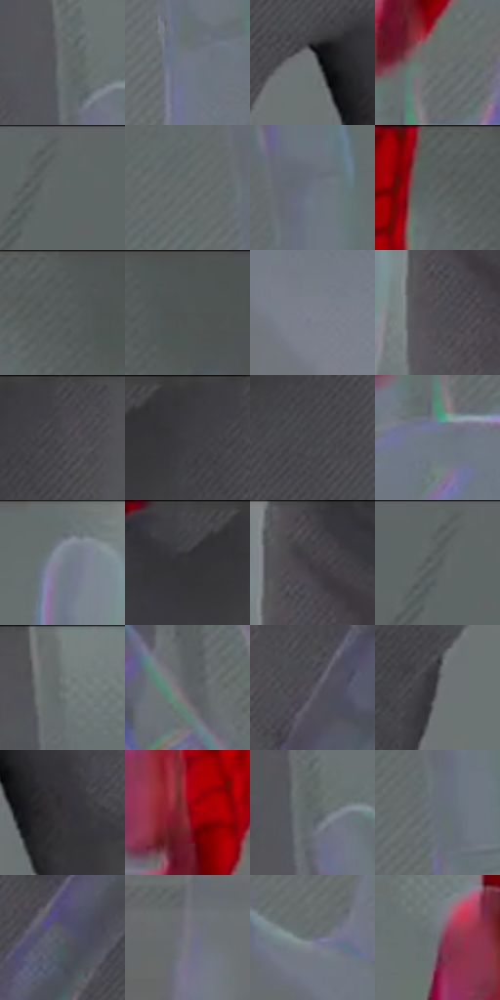

# 电影参考 339

- 状态：条件／活跃；来源世界：miles-home。
- 视角：high-angle；景别：detail；场景：interior。
- 时段：interior-time-unknown（外观依据，中置信度；具体时间／晨昏未知）；光照：cool-interior。
- 材质候选：skin, fabric, glass, metal, plastic（帧级，不是像素分割）。
- 明暗组：middle；L* P5/P50/P95：25.00347 / 43.23058 / 50.74968。
- 资格门禁：invisibility。
- 原截图 SHA-256：`576186e136bba943815589b2ec245db089b4b6b9701745a2888f58730a1b5d26`；尺寸：2880 × 1208。
- sRGB 像素 SHA-256：`e5a03a9b122f0eb936f92a0a71a88f25536214c3a8dc8c1a08fa9dd5273f9bf5`。

## 观察与迁移

透明人体属于特殊能力，不能当作普通皮肤或镜面。

339  /  特殊能力／手部姿态  /  另一透明手部形态，薄边与可见掌纹帮助读取；只记录隐身表现，不赋予用户人物新能力

本公开版保存32个128×128原像素色卡上下文；图集格子并非原场景相邻位置。原rect、图集tile和像素SHA见 `data/palette-crops.json`。上下文不足时不得批准替色，不能以小样推断完整构图。

## 实测色卡

颜色比例分母为保留采样像素，不是材料面积；全部 32 色参与全库匹配。表内四舍五入仅用于阅读，原精度在 JSON。

| ID | HEX | Lab | 原图 xy | 像素数 | 比例 | 明度角色 |
| --- | --- | --- | --- | ---: | ---: | --- |
| 339-S01 | #6A7071 | [46.769985, -2.063865, -1.340681] | [1900, 236] | 13539 | 7.002472% | midtone |
| 339-S02 | #717787 | [50.041377, 1.289135, -9.479705] | [676, 436] | 12187 | 6.303208% | midtone |
| 339-S03 | #707475 | [48.535776, -1.305618, -1.075517] | [1516, 468] | 10701 | 5.534637% | midtone |
| 339-S04 | #676B6B | [44.886106, -1.535506, -0.532224] | [2324, 464] | 8475 | 4.383334% | midtone |
| 339-S05 | #606666 | [42.6859, -2.313034, -0.79838] | [240, 28] | 8372 | 4.330061% | midtone |
| 339-S06 | #646969 | [43.991461, -1.921898, -0.664956] | [568, 196] | 7930 | 4.101455% | midtone |
| 339-S07 | #6C737F | [48.236894, 0.023553, -7.488702] | [656, 152] | 7418 | 3.836645% | midtone |
| 339-S08 | #5A6060 | [40.219554, -2.336241, -0.805792] | [2392, 28] | 7388 | 3.821129% | midtone |
| 339-S09 | #545959 | [37.391346, -1.975302, -0.682362] | [2452, 44] | 7218 | 3.733204% | shadow |
| 339-S10 | #4F5454 | [35.287517, -1.993943, -0.688367] | [2512, 28] | 7003 | 3.622004% | shadow |
| 339-S11 | #7A7F8C | [53.178008, 0.927205, -7.646163] | [712, 848] | 6883 | 3.559939% | midtone |
| 339-S12 | #4E4E53 | [33.335122, 1.111398, -2.938784] | [1016, 136] | 6386 | 3.302887% | shadow |
| 339-S13 | #444348 | [28.671619, 1.550593, -2.865164] | [1788, 28] | 6220 | 3.217031% | shadow |
| 339-S14 | #3A393D | [24.202219, 1.355947, -2.323458] | [1724, 28] | 6129 | 3.169965% | shadow |
| 339-S15 | #4A4A4F | [31.619243, 1.122646, -2.964636] | [1740, 184] | 5973 | 3.089280% | shadow |
| 339-S16 | #6C7782 | [49.487783, -1.620202, -7.398335] | [2296, 552] | 5597 | 2.894810% | midtone |
| 339-S17 | #636C70 | [45.007965, -2.528193, -3.398532] | [900, 36] | 5526 | 2.858089% | midtone |
| 339-S18 | #47464B | [29.980294, 1.538596, -2.844795] | [1644, 28] | 5358 | 2.771198% | shadow |
| 339-S19 | #403F43 | [26.877425, 1.333024, -2.286699] | [1036, 32] | 5328 | 2.755682% | shadow |
| 339-S20 | #5E6464 | [41.866706, -2.320617, -0.800808] | [212, 28] | 5315 | 2.748958% | midtone |
| 339-S21 | #6C7575 | [48.504653, -3.373097, -1.158849] | [1908, 48] | 5219 | 2.699306% | midtone |
| 339-S22 | #5B6167 | [40.820268, -0.983352, -4.202962] | [1936, 540] | 4966 | 2.568452% | midtone |
| 339-S23 | #54525B | [35.350285, 2.794277, -4.945207] | [1116, 252] | 4518 | 2.336743% | shadow |
| 339-S24 | #636468 | [42.409162, 0.46045, -2.391239] | [1408, 608] | 4190 | 2.167099% | midtone |
| 339-S25 | #343033 | [20.373316, 2.462029, -1.266545] | [1596, 524] | 3887 | 2.010386% | shadow |
| 339-S26 | #881421 | [29.020641, 47.215471, 24.811951] | [2292, 336] | 3819 | 1.975215% | shadow |
| 339-S27 | #5F686A | [43.321369, -2.992943, -2.300293] | [1916, 264] | 3613 | 1.868671% | midtone |
| 339-S28 | #666D77 | [45.762305, -0.429075, -6.456855] | [628, 232] | 3468 | 1.793676% | midtone |
| 339-S29 | #575963 | [37.970873, 1.460638, -6.009233] | [1244, 432] | 3172 | 1.640582% | shadow |
| 339-S30 | #75747D | [49.195494, 2.248145, -4.797911] | [604, 1068] | 2786 | 1.440940% | midtone |
| 339-S31 | #6A7177 | [47.243767, -1.337788, -4.222826] | [596, 600] | 2490 | 1.287847% | midtone |
| 339-S32 | #716D75 | [46.621367, 3.185263, -3.88331] | [2200, 192] | 2272 | 1.175095% | midtone |

## 色阶与空间分布

- 采样 ROI：`[0.01, 0.02, 0.98, 0.94]`；步长：4；样本数：193346。
- 排除区：`[]`。
- 深暗、暗、中、亮、高光五段计数：`[1238, 67429, 124606, 73, 0]`。
- RGB 各 256 箱、L* 100 箱、13×5 色相明度表和 3×3 空间统计全部保存在 [总数据](../film-library.json)。
- [可视化档案](../../references/library.html)按需绘制直方图，不存 2,094 张重复图表图片。

## 纹理特征占比

**这是分块图像特征的面积占比，不是波点／排线／丝网／错版的精确语义覆盖率。** 窗格、发丝、织物也会产生方向或周期特征。
原图 ROI 像素 3104134；已测块覆盖 3104134（100.0000%）；未测 0。

| 特征 | 块覆盖像素 | 占已测面积 | 阈值敏感范围 |
| --- | ---: | ---: | --- |
| low-contrast | 618496 | 19.9249% | 14.6468% ~ 30.7081% |
| directional-structure | 712832 | 22.9640% | 9.3316% ~ 44.2251% |
| periodic-structure | 1674502 | 53.9443% | 40.0725% ~ 56.7934% |
| mixed-detail | 98304 | 3.1669% | 1.0556% ~ 3.1669% |

阈值敏感范围不是统计置信区间。逐块坐标、尺度、对比、方向一致性、频谱集中度、频率与角度见 [全量特征记录](../texture-features.jsonl)，以帧号定位。
四种印刷层的真实像素覆盖仍标为 `null`，不能填 0，也不能拿上表代替。不得据这些代理测量删除唯一证据。

[测量方法与保留策略](../../references/library-retention.md) · [分类索引](../archive/README.md)
