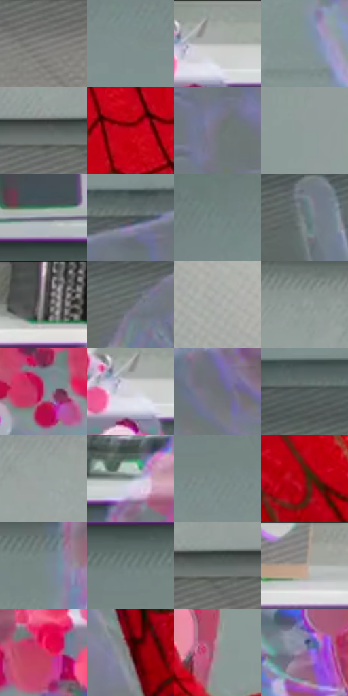

# 电影参考 340

- 状态：条件／活跃；来源世界：miles-home。
- 视角：high-angle；景别：detail；场景：interior。
- 时段：interior-time-unknown（外观依据，中置信度；具体时间／晨昏未知）；光照：cool-interior。
- 材质候选：skin, fabric, glass, metal, plastic（帧级，不是像素分割）。
- 明暗组：middle；L* P5/P50/P95：33.0138 / 54.03398 / 71.39282。
- 资格门禁：invisibility。
- 原截图 SHA-256：`709c9c576a2718ec2c63ad36ec05d1b9820d5753db6a534839dbe495186e3ec7`；尺寸：2880 × 1200。
- sRGB 像素 SHA-256：`d20465c278e522732667e0e555913590782609741878a687965346ed23a1dd93`。

## 观察与迁移

透明人体属于特殊能力，不能当作普通皮肤或镜面。

340  /  特殊接触／彩色显形  /  指尖接触透明头部附近出现大小不同的粉紫圆斑；不混为日常拍击爆点或通用印刷网点

本公开版保存32个128×128原像素色卡上下文；图集格子并非原场景相邻位置。原rect、图集tile和像素SHA见 `data/palette-crops.json`。上下文不足时不得批准替色，不能以小样推断完整构图。

## 实测色卡

颜色比例分母为保留采样像素，不是材料面积；全部 32 色参与全库匹配。表内四舍五入仅用于阅读，原精度在 JSON。

| ID | HEX | Lab | 原图 xy | 像素数 | 比例 | 明度角色 |
| --- | --- | --- | --- | ---: | ---: | --- |
| 340-S01 | #848481 | [55.065205, -0.588534, 1.618731] | [2536, 800] | 9067 | 4.706511% | midtone |
| 340-S02 | #809090 | [58.55442, -5.730864, -1.95] | [824, 324] | 8793 | 4.564283% | midtone |
| 340-S03 | #9EA5A1 | [67.09085, -3.259282, 1.209675] | [1616, 32] | 8657 | 4.493688% | light |
| 340-S04 | #839196 | [59.230432, -3.957832, -4.35574] | [1080, 484] | 8418 | 4.369628% | midtone |
| 340-S05 | #5A605E | [40.159634, -2.77186, 0.334099] | [2392, 712] | 8058 | 4.182758% | midtone |
| 340-S06 | #C8041A | [41.914558, 66.627025, 46.109322] | [1736, 672] | 7868 | 4.084133% | midtone |
| 340-S07 | #74767B | [49.61697, 0.283227, -3.001307] | [1124, 876] | 7247 | 3.761783% | midtone |
| 340-S08 | #909B9B | [63.12591, -3.921229, -1.348548] | [1888, 332] | 7027 | 3.647585% | light |
| 340-S09 | #78798C | [51.337215, 3.715361, -10.417598] | [424, 96] | 6931 | 3.597753% | midtone |
| 340-S10 | #484F50 | [33.024895, -2.572613, -1.550325] | [1132, 744] | 6846 | 3.553631% | shadow |
| 340-S11 | #738483 | [53.798834, -6.380495, -1.548918] | [468, 272] | 6673 | 3.463830% | midtone |
| 340-S12 | #717D80 | [51.537562, -3.772422, -3.140492] | [504, 852] | 6595 | 3.423342% | midtone |
| 340-S13 | #B9ACB1 | [71.550961, 5.550209, -0.875593] | [2372, 24] | 6487 | 3.367281% | light |
| 340-S14 | #666C6D | [45.15647, -2.076092, -1.34876] | [928, 848] | 6369 | 3.306030% | midtone |
| 340-S15 | #A5A7A7 | [68.333943, -0.712604, -0.246141] | [2744, 184] | 6199 | 3.217786% | light |
| 340-S16 | #959F9C | [64.632497, -4.152885, 0.337003] | [2108, 208] | 6059 | 3.145114% | light |
| 340-S17 | #AC537B | [47.48102, 41.003079, -5.457366] | [1296, 212] | 5735 | 2.976932% | midtone |
| 340-S18 | #D2D1D8 | [84.101129, 1.625283, -3.329361] | [1588, 84] | 5656 | 2.935925% | highlight |
| 340-S19 | #6C7174 | [47.312753, -1.259136, -2.314495] | [1276, 792] | 5636 | 2.925543% | midtone |
| 340-S20 | #525D5B | [38.51196, -4.714681, -0.301852] | [792, 752] | 5604 | 2.908932% | shadow |
| 340-S21 | #98A1A1 | [65.544208, -3.195893, -1.103197] | [2312, 264] | 5506 | 2.858062% | light |
| 340-S22 | #8B9799 | [61.586604, -3.876435, -2.521601] | [1136, 92] | 5493 | 2.851314% | light |
| 340-S23 | #7C8C8B | [56.982658, -5.970401, -1.424695] | [880, 268] | 5237 | 2.718429% | midtone |
| 340-S24 | #930811 | [30.446415, 52.170967, 36.510474] | [1996, 1120] | 5187 | 2.692475% | shadow |
| 340-S25 | #788788 | [55.173334, -5.220839, -2.385878] | [1076, 216] | 5067 | 2.630186% | midtone |
| 340-S26 | #6B7B7A | [50.330226, -6.094565, -1.444002] | [852, 192] | 4875 | 2.530522% | midtone |
| 340-S27 | #5E6866 | [43.121845, -4.254028, -0.179793] | [2456, 716] | 4864 | 2.524812% | midtone |
| 340-S28 | #8E8C8A | [58.360272, 0.351735, 1.329289] | [2060, 52] | 4050 | 2.102280% | midtone |
| 340-S29 | #C63A5E | [46.768524, 57.414954, 11.717552] | [1464, 160] | 3650 | 1.894647% | midtone |
| 340-S30 | #5A2D2F | [24.500962, 20.773317, 8.034847] | [1820, 1112] | 3595 | 1.866098% | shadow |
| 340-S31 | #9F8E95 | [60.682041, 7.60191, -1.38596] | [1680, 464] | 3181 | 1.651198% | light |
| 340-S32 | #8F6E97 | [50.950844, 20.668552, -17.256503] | [1332, 512] | 2018 | 1.047506% | midtone |

## 色阶与空间分布

- 采样 ROI：`[0.01, 0.02, 0.98, 0.94]`；步长：4；样本数：192648。
- 排除区：`[]`。
- 深暗、暗、中、亮、高光五段计数：`[1700, 26595, 109458, 50689, 4206]`。
- RGB 各 256 箱、L* 100 箱、13×5 色相明度表和 3×3 空间统计全部保存在 [总数据](../film-library.json)。
- [可视化档案](../../references/library.html)按需绘制直方图，不存 2,094 张重复图表图片。

## 纹理特征占比

**这是分块图像特征的面积占比，不是波点／排线／丝网／错版的精确语义覆盖率。** 窗格、发丝、织物也会产生方向或周期特征。
原图 ROI 像素 3084576；已测块覆盖 3084576（100.0000%）；未测 0。

| 特征 | 块覆盖像素 | 占已测面积 | 阈值敏感范围 |
| --- | ---: | ---: | --- |
| low-contrast | 859392 | 27.8609% | 19.8936% ~ 33.3219% |
| directional-structure | 695552 | 22.5494% | 15.8435% ~ 28.3257% |
| periodic-structure | 1450528 | 47.0252% | 44.9504% ~ 49.6561% |
| mixed-detail | 79104 | 2.5645% | 2.1246% ~ 5.8842% |

阈值敏感范围不是统计置信区间。逐块坐标、尺度、对比、方向一致性、频谱集中度、频率与角度见 [全量特征记录](../texture-features.jsonl)，以帧号定位。
四种印刷层的真实像素覆盖仍标为 `null`，不能填 0，也不能拿上表代替。不得据这些代理测量删除唯一证据。

[测量方法与保留策略](../../references/library-retention.md) · [分类索引](../archive/README.md)
