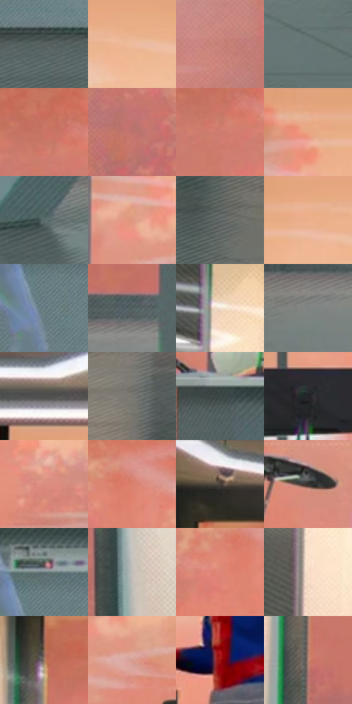

# 电影参考 341

- 状态：条件／活跃；来源世界：miles-home。
- 视角：near-level；景别：environment-wide；场景：interior。
- 时段：interior-time-unknown（外观依据，中置信度；具体时间／晨昏未知）；光照：cool-interior。
- 材质候选：skin, fabric, glass, metal, plastic（帧级，不是像素分割）。
- 明暗组：middle；L* P5/P50/P95：24.93253 / 55.53206 / 81.18344。
- 资格门禁：invisibility。
- 原截图 SHA-256：`7acd14f78fb4152e9f87ac13afe218a5eee81feab1ec92827e1ff31dbd98198c`；尺寸：2880 × 1208。
- sRGB 像素 SHA-256：`c9644b225403712124205bbddd478d9d4a4055f14193daa41cec8476b9813e0c`。

## 观察与迁移

透明人体属于特殊能力，不能当作普通皮肤或镜面。

341  /  人体透明／室内反射  /  透明人物与不透明人物并存，背景有淡灯环映像；分清隐身、反光与真实另一人

本公开版保存32个128×128原像素色卡上下文；图集格子并非原场景相邻位置。原rect、图集tile和像素SHA见 `data/palette-crops.json`。上下文不足时不得批准替色，不能以小样推断完整构图。

## 实测色卡

颜色比例分母为保留采样像素，不是材料面积；全部 32 色参与全库匹配。表内四舍五入仅用于阅读，原精度在 JSON。

| ID | HEX | Lab | 原图 xy | 像素数 | 比例 | 明度角色 |
| --- | --- | --- | --- | ---: | ---: | --- |
| 341-S01 | #596262 | [40.801317, -3.470937, -1.188428] | [1448, 960] | 10697 | 5.532569% | midtone |
| 341-S02 | #EFBB9C | [79.781294, 14.557986, 22.883204] | [1220, 200] | 9823 | 5.080529% | light |
| 341-S03 | #CA847C | [62.097736, 25.962746, 15.463164] | [2480, 448] | 9471 | 4.898472% | light |
| 341-S04 | #667576 | [48.076859, -5.334569, -2.433474] | [2364, 1128] | 8822 | 4.562805% | midtone |
| 341-S05 | #CB7565 | [58.378887, 32.028114, 23.495225] | [404, 252] | 8691 | 4.495050% | midtone |
| 341-S06 | #BC716A | [55.629017, 28.813885, 16.578106] | [2564, 632] | 8532 | 4.412814% | midtone |
| 341-S07 | #CD7E6F | [60.827097, 28.958373, 21.147223] | [416, 292] | 7810 | 4.039391% | light |
| 341-S08 | #E9A580 | [73.412986, 20.78696, 29.177424] | [916, 196] | 7709 | 3.987153% | light |
| 341-S09 | #5A6A6B | [43.570215, -5.772131, -2.582499] | [1960, 928] | 7476 | 3.866643% | midtone |
| 341-S10 | #DE9981 | [69.398441, 22.980197, 23.049066] | [872, 316] | 7208 | 3.728032% | light |
| 341-S11 | #646B6A | [44.610873, -2.887522, -0.361959] | [2796, 996] | 6955 | 3.597178% | midtone |
| 341-S12 | #EBB08D | [76.459975, 17.098075, 26.316108] | [1036, 192] | 6940 | 3.589420% | light |
| 341-S13 | #71868C | [54.505179, -6.174019, -5.744284] | [1328, 808] | 6843 | 3.539251% | midtone |
| 341-S14 | #50605F | [39.406763, -6.325983, -1.474852] | [708, 840] | 6610 | 3.418742% | shadow |
| 341-S15 | #F3E2D1 | [90.803715, 3.039556, 10.400203] | [76, 216] | 6456 | 3.339092% | highlight |
| 341-S16 | #818583 | [55.155462, -1.880895, 0.562408] | [500, 908] | 6287 | 3.251684% | midtone |
| 341-S17 | #50514F | [34.303307, -0.835891, 1.034012] | [864, 76] | 6273 | 3.244443% | shadow |
| 341-S18 | #777570 | [49.270297, -0.21657, 3.026956] | [144, 936] | 5365 | 2.774818% | midtone |
| 341-S19 | #3D4847 | [29.617504, -4.663568, -0.893074] | [812, 676] | 5229 | 2.704478% | shadow |
| 341-S20 | #242227 | [13.624336, 2.182951, -3.003259] | [1496, 576] | 5224 | 2.701892% | deep-shadow |
| 341-S21 | #DB8E7D | [66.43583, 27.28534, 21.182212] | [2024, 440] | 5208 | 2.693617% | light |
| 341-S22 | #DB816F | [63.270035, 32.810165, 24.732127] | [608, 248] | 4970 | 2.570521% | light |
| 341-S23 | #786354 | [43.591387, 5.98537, 11.689873] | [256, 56] | 4787 | 2.475872% | midtone |
| 341-S24 | #353431 | [21.706682, -0.233829, 2.052403] | [1072, 480] | 4734 | 2.448460% | shadow |
| 341-S25 | #697C7F | [50.629133, -6.241334, -3.96047] | [1340, 732] | 4734 | 2.448460% | midtone |
| 341-S26 | #C2BDB8 | [76.875777, 0.852278, 3.146408] | [2784, 496] | 4240 | 2.192960% | light |
| 341-S27 | #DE8676 | [64.876332, 31.995157, 23.035421] | [564, 288] | 4163 | 2.153135% | light |
| 341-S28 | #AA9E96 | [65.905878, 2.963946, 5.752786] | [56, 548] | 3219 | 1.664891% | light |
| 341-S29 | #9A7664 | [52.672769, 11.481617, 15.352491] | [224, 212] | 2716 | 1.404736% | midtone |
| 341-S30 | #D49D92 | [69.603755, 18.968439, 13.787897] | [932, 380] | 2484 | 1.284743% | light |
| 341-S31 | #9C1413 | [33.173369, 52.604279, 38.549518] | [1632, 492] | 2199 | 1.137339% | shadow |
| 341-S32 | #AF8375 | [58.632609, 14.941187, 14.164422] | [220, 568] | 1471 | 0.760812% | midtone |

## 色阶与空间分布

- 采样 ROI：`[0.01, 0.02, 0.98, 0.94]`；步长：4；样本数：193346。
- 排除区：`[]`。
- 深暗、暗、中、亮、高光五段计数：`[7142, 23613, 84180, 65986, 12425]`。
- RGB 各 256 箱、L* 100 箱、13×5 色相明度表和 3×3 空间统计全部保存在 [总数据](../film-library.json)。
- [可视化档案](../../references/library.html)按需绘制直方图，不存 2,094 张重复图表图片。

## 纹理特征占比

**这是分块图像特征的面积占比，不是波点／排线／丝网／错版的精确语义覆盖率。** 窗格、发丝、织物也会产生方向或周期特征。
原图 ROI 像素 3104134；已测块覆盖 3104134（100.0000%）；未测 0。

| 特征 | 块覆盖像素 | 占已测面积 | 阈值敏感范围 |
| --- | ---: | ---: | --- |
| low-contrast | 136960 | 4.4122% | 1.5834% ~ 6.8822% |
| directional-structure | 1522054 | 49.0331% | 23.4794% ~ 65.8736% |
| periodic-structure | 1417600 | 45.6681% | 32.5429% ~ 65.7541% |
| mixed-detail | 27520 | 0.8866% | 0.0000% ~ 3.8844% |

阈值敏感范围不是统计置信区间。逐块坐标、尺度、对比、方向一致性、频谱集中度、频率与角度见 [全量特征记录](../texture-features.jsonl)，以帧号定位。
四种印刷层的真实像素覆盖仍标为 `null`，不能填 0，也不能拿上表代替。不得据这些代理测量删除唯一证据。

[测量方法与保留策略](../../references/library-retention.md) · [分类索引](../archive/README.md)
