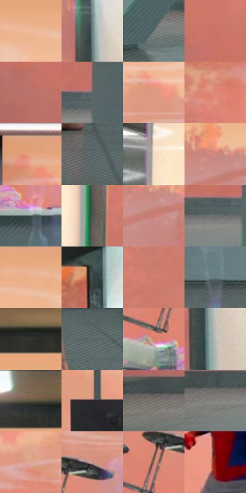

# 电影参考 342

- 状态：条件／活跃；来源世界：miles-home。
- 视角：near-level；景别：environment-wide；场景：interior。
- 时段：interior-time-unknown（外观依据，中置信度；具体时间／晨昏未知）；光照：cool-interior。
- 材质候选：skin, fabric, glass, metal, plastic（帧级，不是像素分割）。
- 明暗组：middle；L* P5/P50/P95：24.13418 / 55.4147 / 81.23419。
- 资格门禁：invisibility。
- 原截图 SHA-256：`3d96460d61ded7a313d4fc5439704759e1c5c589079d3bcdd9713ab762576db0`；尺寸：2880 × 1208。
- sRGB 像素 SHA-256：`12a4fd3dde8d33f61df3ba3c5d5aa46be6872fab07cf1d9b595083e0efcd5e7a`。

## 观察与迁移

透明人体属于特殊能力，不能当作普通皮肤或镜面。

342  /  人体透明／姿态变化  /  人物姿态变化而墙面灯环仍属环境；单帧不能由此测得显形周期或接触力

本公开版保存32个128×128原像素色卡上下文；图集格子并非原场景相邻位置。原rect、图集tile和像素SHA见 `data/palette-crops.json`。上下文不足时不得批准替色，不能以小样推断完整构图。

## 实测色卡

颜色比例分母为保留采样像素，不是材料面积；全部 32 色参与全库匹配。表内四舍五入仅用于阅读，原精度在 JSON。

| ID | HEX | Lab | 原图 xy | 像素数 | 比例 | 明度角色 |
| --- | --- | --- | --- | ---: | ---: | --- |
| 342-S01 | #F0BC9D | [80.139731, 14.535054, 22.857154] | [1200, 196] | 9838 | 5.088287% | highlight |
| 342-S02 | #738486 | [53.886831, -5.720784, -3.162118] | [2764, 404] | 8625 | 4.460915% | midtone |
| 342-S03 | #677576 | [48.15129, -4.975646, -2.315414] | [1988, 900] | 8497 | 4.394712% | midtone |
| 342-S04 | #CB7566 | [58.397425, 32.121892, 22.950892] | [452, 608] | 8417 | 4.353335% | midtone |
| 342-S05 | #BD726B | [56.005064, 28.769683, 16.535882] | [396, 692] | 8076 | 4.176968% | midtone |
| 342-S06 | #5C6564 | [42.004046, -3.675851, -0.618892] | [748, 824] | 7817 | 4.043011% | midtone |
| 342-S07 | #DD9982 | [69.305035, 22.697533, 22.35449] | [1064, 320] | 7600 | 3.930777% | light |
| 342-S08 | #DF8979 | [65.720174, 31.088877, 22.520579] | [556, 260] | 7575 | 3.917847% | light |
| 342-S09 | #E7A47F | [72.941698, 20.42758, 29.051008] | [872, 160] | 7327 | 3.789579% | light |
| 342-S10 | #5D6D6E | [44.78699, -5.749645, -2.573555] | [1616, 1116] | 7060 | 3.651485% | midtone |
| 342-S11 | #F6DECE | [89.995354, 5.708131, 10.84892] | [64, 308] | 7050 | 3.646313% | highlight |
| 342-S12 | #CE877E | [63.308886, 26.120679, 16.083761] | [2456, 300] | 6604 | 3.415638% | light |
| 342-S13 | #556364 | [40.855981, -5.097691, -2.367453] | [1088, 664] | 6578 | 3.402191% | midtone |
| 342-S14 | #525351 | [35.151662, -0.832463, 1.029713] | [192, 460] | 6242 | 3.228409% | shadow |
| 342-S15 | #C67F76 | [60.333433, 26.431322, 16.357154] | [2484, 352] | 6171 | 3.191687% | light |
| 342-S16 | #676C6B | [45.179042, -2.124596, -0.104006] | [692, 860] | 5924 | 3.063937% | midtone |
| 342-S17 | #EBB18A | [76.645547, 16.238846, 28.166062] | [1076, 188] | 5894 | 3.048421% | light |
| 342-S18 | #3F4948 | [30.131685, -4.2631, -0.765713] | [2736, 144] | 5787 | 2.993080% | shadow |
| 342-S19 | #D17D6D | [61.071684, 30.860333, 22.693952] | [356, 360] | 5764 | 2.981184% | light |
| 342-S20 | #697C81 | [50.690782, -5.777941, -5.044413] | [1240, 932] | 5271 | 2.726201% | midtone |
| 342-S21 | #333330 | [21.150454, -0.681999, 1.903604] | [1616, 92] | 5162 | 2.669825% | shadow |
| 342-S22 | #4F605F | [39.333409, -6.691635, -1.591095] | [1828, 1012] | 5119 | 2.647585% | shadow |
| 342-S23 | #DA846F | [63.802401, 30.830839, 25.416732] | [972, 584] | 5099 | 2.637241% | light |
| 342-S24 | #B7B7B3 | [74.310498, -0.739192, 2.032817] | [2784, 528] | 5084 | 2.629483% | light |
| 342-S25 | #78614E | [42.903244, 6.309981, 14.348098] | [1336, 32] | 5034 | 2.603623% | midtone |
| 342-S26 | #292324 | [14.405614, 3.046812, 0.370435] | [1448, 540] | 4922 | 2.545695% | deep-shadow |
| 342-S27 | #78746E | [49.019367, 0.376006, 3.858901] | [348, 872] | 4422 | 2.287092% | midtone |
| 342-S28 | #8A8683 | [56.180097, 0.917423, 2.144056] | [460, 884] | 4200 | 2.172271% | midtone |
| 342-S29 | #DDA79B | [73.140566, 18.198211, 13.936707] | [956, 368] | 3330 | 1.722301% | light |
| 342-S30 | #C7958E | [66.207009, 17.786692, 11.032949] | [1072, 452] | 3257 | 1.684545% | light |
| 342-S31 | #A57463 | [53.37647, 17.059935, 17.095003] | [1000, 504] | 3040 | 1.572311% | midtone |
| 342-S32 | #890D0E | [28.48454, 48.481081, 35.538547] | [1652, 532] | 2560 | 1.324051% | shadow |

## 色阶与空间分布

- 采样 ROI：`[0.01, 0.02, 0.98, 0.94]`；步长：4；样本数：193346。
- 排除区：`[]`。
- 深暗、暗、中、亮、高光五段计数：`[7411, 23765, 84041, 65515, 12614]`。
- RGB 各 256 箱、L* 100 箱、13×5 色相明度表和 3×3 空间统计全部保存在 [总数据](../film-library.json)。
- [可视化档案](../../references/library.html)按需绘制直方图，不存 2,094 张重复图表图片。

## 纹理特征占比

**这是分块图像特征的面积占比，不是波点／排线／丝网／错版的精确语义覆盖率。** 窗格、发丝、织物也会产生方向或周期特征。
原图 ROI 像素 3104134；已测块覆盖 3104134（100.0000%）；未测 0。

| 特征 | 块覆盖像素 | 占已测面积 | 阈值敏感范围 |
| --- | ---: | ---: | --- |
| low-contrast | 120576 | 3.8844% | 1.0556% ~ 6.3544% |
| directional-structure | 1434246 | 46.2044% | 23.4794% ~ 66.4014% |
| periodic-structure | 1521792 | 49.0247% | 32.5429% ~ 66.2819% |
| mixed-detail | 27520 | 0.8866% | 0.0000% ~ 3.8844% |

阈值敏感范围不是统计置信区间。逐块坐标、尺度、对比、方向一致性、频谱集中度、频率与角度见 [全量特征记录](../texture-features.jsonl)，以帧号定位。
四种印刷层的真实像素覆盖仍标为 `null`，不能填 0，也不能拿上表代替。不得据这些代理测量删除唯一证据。

[测量方法与保留策略](../../references/library-retention.md) · [分类索引](../archive/README.md)
