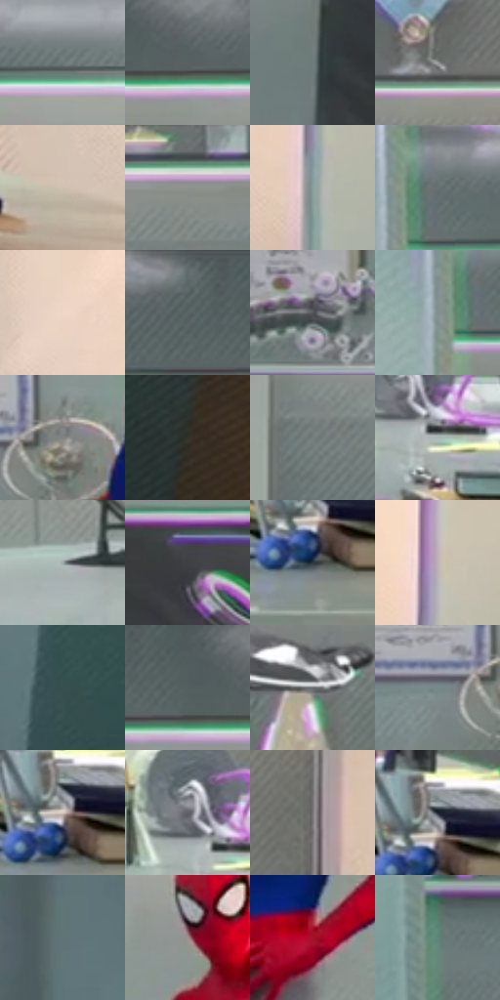

# 电影参考 343

- 状态：条件／活跃；来源世界：miles-home。
- 视角：near-level；景别：full-body；场景：interior。
- 时段：interior-time-unknown（外观依据，中置信度；具体时间／晨昏未知）；光照：cool-interior。
- 材质候选：skin, fabric, glass, metal, plastic（帧级，不是像素分割）。
- 明暗组：middle；L* P5/P50/P95：21.30709 / 50.29157 / 82.50367。
- 资格门禁：invisibility。
- 原截图 SHA-256：`e452e8edfc1850cd52f05370ecb7ec5a4b1da6b25d90f43f4ad63bf29eb9828b`；尺寸：2880 × 1204。
- sRGB 像素 SHA-256：`18b0cb0a1f5bfb12eac12de6d53dcfa8260e4cd95ee6b86d4cfd3e7dcd06e771`。

## 观察与迁移

透明人体属于特殊能力，不能当作普通皮肤或镜面。

343  /  稳定空间／光照  /  白衣与实验室大灰青面、桌面器物和反射；可作异常场景旁的稳定基准

本公开版保存32个128×128原像素色卡上下文；图集格子并非原场景相邻位置。原rect、图集tile和像素SHA见 `data/palette-crops.json`。上下文不足时不得批准替色，不能以小样推断完整构图。

## 实测色卡

颜色比例分母为保留采样像素，不是材料面积；全部 32 色参与全库匹配。表内四舍五入仅用于阅读，原精度在 JSON。

| ID | HEX | Lab | 原图 xy | 像素数 | 比例 | 明度角色 |
| --- | --- | --- | --- | ---: | ---: | --- |
| 343-S01 | #6B7777 | [49.07016, -4.460953, -1.522935] | [1100, 112] | 12667 | 6.575205% | midtone |
| 343-S02 | #596262 | [40.801317, -3.470937, -1.188428] | [736, 112] | 8857 | 4.597504% | midtone |
| 343-S03 | #6E7C7C | [50.903195, -5.151836, -1.752883] | [256, 324] | 8062 | 4.184835% | midtone |
| 343-S04 | #9D9F9E | [65.304771, -0.911484, 0.271786] | [2220, 256] | 7940 | 4.121507% | light |
| 343-S05 | #CEC0B1 | [78.459588, 2.408029, 9.332795] | [2508, 724] | 7734 | 4.014576% | light |
| 343-S06 | #8D928E | [60.045059, -2.604772, 1.486408] | [2016, 64] | 7202 | 3.738424% | light |
| 343-S07 | #8B9D9B | [63.317201, -6.758067, -1.111348] | [2708, 664] | 7050 | 3.659524% | light |
| 343-S08 | #677171 | [46.824389, -3.762325, -1.288809] | [144, 72] | 7025 | 3.646547% | midtone |
| 343-S09 | #EFD7C6 | [87.499813, 5.604696, 11.413631] | [2540, 492] | 6980 | 3.623188% | highlight |
| 343-S10 | #5F6A6B | [43.948034, -3.948708, -1.983142] | [564, 28] | 6941 | 3.602944% | midtone |
| 343-S11 | #515559 | [35.921664, -0.692296, -2.872506] | [972, 464] | 6840 | 3.550517% | shadow |
| 343-S12 | #80908E | [58.497655, -6.154248, -0.890099] | [96, 108] | 6670 | 3.462273% | midtone |
| 343-S13 | #828381 | [54.61975, -0.769009, 0.950487] | [1260, 368] | 6595 | 3.423342% | midtone |
| 343-S14 | #33312C | [20.370593, -0.206339, 3.510696] | [2392, 1056] | 6237 | 3.237511% | shadow |
| 343-S15 | #757F7E | [52.360906, -3.902684, -0.72535] | [1760, 136] | 6207 | 3.221938% | midtone |
| 343-S16 | #A8B7B4 | [73.211127, -5.766032, -0.251665] | [2036, 668] | 6121 | 3.177297% | light |
| 343-S17 | #9EA9A9 | [68.394256, -3.863722, -1.330621] | [1620, 640] | 6092 | 3.162244% | light |
| 343-S18 | #3F4044 | [27.132411, 0.507817, -2.577727] | [548, 252] | 6019 | 3.124351% | shadow |
| 343-S19 | #2C373F | [22.396471, -2.357355, -6.48834] | [2256, 784] | 5828 | 3.025207% | shadow |
| 343-S20 | #BEB2B4 | [73.599804, 4.620528, 0.520895] | [2720, 492] | 5666 | 2.941115% | light |
| 343-S21 | #374F50 | [31.768374, -8.835283, -3.546411] | [1776, 1128] | 5536 | 2.873635% | shadow |
| 343-S22 | #526060 | [39.587, -5.354771, -1.807762] | [652, 92] | 5372 | 2.788505% | shadow |
| 343-S23 | #6A6C6E | [45.51759, -0.350409, -1.381122] | [1912, 396] | 5306 | 2.754246% | midtone |
| 343-S24 | #758988 | [55.533169, -7.390114, -1.882246] | [1176, 384] | 4672 | 2.425148% | midtone |
| 343-S25 | #D9C9C0 | [82.018168, 4.065315, 6.507129] | [2260, 740] | 4614 | 2.395042% | highlight |
| 343-S26 | #616268 | [41.651706, 0.900729, -3.528075] | [2000, 624] | 4400 | 2.283958% | midtone |
| 343-S27 | #787474 | [49.185226, 1.528804, 0.547319] | [2372, 424] | 4219 | 2.190005% | midtone |
| 343-S28 | #202631 | [15.034613, 0.556776, -8.066662] | [2264, 716] | 4204 | 2.182218% | deep-shadow |
| 343-S29 | #607477 | [47.377367, -6.641759, -4.108639] | [1632, 948] | 3561 | 1.848449% | midtone |
| 343-S30 | #A28D8F | [60.529233, 8.212576, 1.842828] | [1360, 228] | 3236 | 1.679748% | light |
| 343-S31 | #A0122A | [34.140174, 54.876827, 26.367014] | [1460, 500] | 3027 | 1.571259% | shadow |
| 343-S32 | #61847B | [52.368154, -14.338194, 0.869144] | [132, 572] | 1768 | 0.917736% | midtone |

## 色阶与空间分布

- 采样 ROI：`[0.01, 0.02, 0.98, 0.94]`；步长：4；样本数：192648。
- 排除区：`[]`。
- 深暗、暗、中、亮、高光五段计数：`[7284, 36595, 89882, 45997, 12890]`。
- RGB 各 256 箱、L* 100 箱、13×5 色相明度表和 3×3 空间统计全部保存在 [总数据](../film-library.json)。
- [可视化档案](../../references/library.html)按需绘制直方图，不存 2,094 张重复图表图片。

## 纹理特征占比

**这是分块图像特征的面积占比，不是波点／排线／丝网／错版的精确语义覆盖率。** 窗格、发丝、织物也会产生方向或周期特征。
原图 ROI 像素 3092958；已测块覆盖 3092958（100.0000%）；未测 0。

| 特征 | 块覆盖像素 | 占已测面积 | 阈值敏感范围 |
| --- | ---: | ---: | --- |
| low-contrast | 139904 | 4.5233% | 1.7174% ~ 10.0729% |
| directional-structure | 1382528 | 44.6992% | 30.1733% ~ 59.5686% |
| periodic-structure | 1494366 | 48.3151% | 38.1842% ~ 54.4855% |
| mixed-detail | 76160 | 2.4624% | 0.5297% ~ 5.2682% |

阈值敏感范围不是统计置信区间。逐块坐标、尺度、对比、方向一致性、频谱集中度、频率与角度见 [全量特征记录](../texture-features.jsonl)，以帧号定位。
四种印刷层的真实像素覆盖仍标为 `null`，不能填 0，也不能拿上表代替。不得据这些代理测量删除唯一证据。

[测量方法与保留策略](../../references/library-retention.md) · [分类索引](../archive/README.md)
