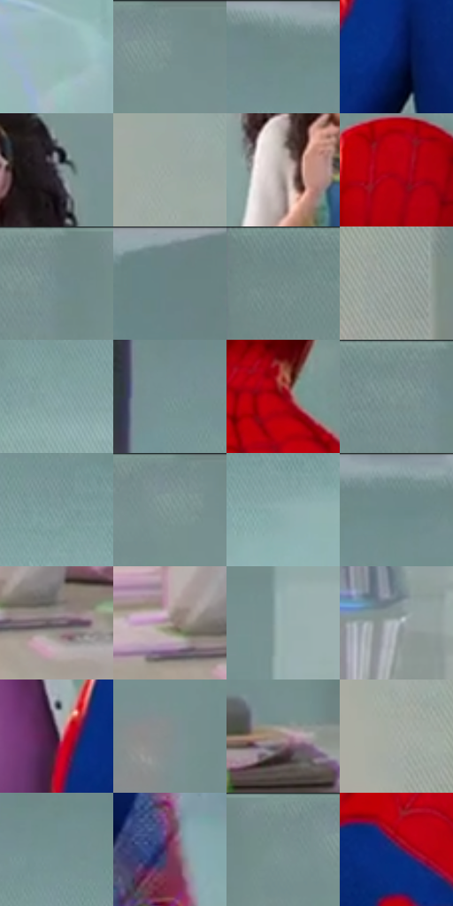

# 电影参考 344

- 状态：条件／活跃；来源世界：miles-home。
- 视角：near-level；景别：medium；场景：interior。
- 时段：interior-time-unknown（外观依据，中置信度；具体时间／晨昏未知）；光照：cool-interior。
- 材质候选：skin, fabric, glass, metal, plastic（帧级，不是像素分割）。
- 明暗组：middle；L* P5/P50/P95：16.69915 / 58.23413 / 72.71818。
- 资格门禁：invisibility。
- 原截图 SHA-256：`cf0b3056237ca25ded5ad039ab24369b18d18dcf605e0ce56d5235c2c2715ca4`；尺寸：2880 × 1206。
- sRGB 像素 SHA-256：`6ee94dfb6aa1a36e6f41f084675b86f77b41beea0f2e9bbca4dafc80b2f07fcd`。

## 观察与迁移

透明人体属于特殊能力，不能当作普通皮肤或镜面。

344  /  多层遮挡／透明与反光  /  前景人物、远处研究员与透明人物、工作台各处不同深度；不将所有低对比图像合成一层重影

本公开版保存32个128×128原像素色卡上下文；图集格子并非原场景相邻位置。原rect、图集tile和像素SHA见 `data/palette-crops.json`。上下文不足时不得批准替色，不能以小样推断完整构图。

## 实测色卡

颜色比例分母为保留采样像素，不是材料面积；全部 32 色参与全库匹配。表内四舍五入仅用于阅读，原精度在 JSON。

| ID | HEX | Lab | 原图 xy | 像素数 | 比例 | 明度角色 |
| --- | --- | --- | --- | ---: | ---: | --- |
| 344-S01 | #97B7B9 | [72.193635, -10.354609, -4.615483] | [2720, 400] | 12503 | 6.466645% | light |
| 344-S02 | #789191 | [58.308966, -8.808873, -2.947084] | [948, 28] | 11686 | 6.044087% | midtone |
| 344-S03 | #75908F | [57.761607, -9.712514, -2.631411] | [2236, 32] | 9791 | 5.063979% | midtone |
| 344-S04 | #062063 | [15.340473, 20.116261, -41.938778] | [1588, 596] | 9257 | 4.787790% | deep-shadow |
| 344-S05 | #494A53 | [31.66647, 1.673757, -5.465391] | [1412, 392] | 8779 | 4.540565% | shadow |
| 344-S06 | #9CA7A2 | [67.511707, -4.858379, 1.247846] | [240, 200] | 8066 | 4.171796% | light |
| 344-S07 | #B5A9A3 | [70.066904, 3.259042, 4.646341] | [1240, 532] | 7539 | 3.899227% | light |
| 344-S08 | #B60210 | [37.89481, 62.13163, 46.022743] | [1904, 168] | 7445 | 3.850610% | shadow |
| 344-S09 | #738988 | [55.393476, -8.080708, -2.103621] | [748, 28] | 7010 | 3.625625% | midtone |
| 344-S10 | #6A8386 | [52.968508, -8.235647, -4.588605] | [2496, 44] | 6720 | 3.475634% | midtone |
| 344-S11 | #738D8D | [56.700331, -9.179582, -3.061453] | [524, 28] | 6662 | 3.445636% | midtone |
| 344-S12 | #909A97 | [62.738751, -4.176686, 0.340092] | [324, 544] | 6481 | 3.352022% | light |
| 344-S13 | #88A5A7 | [65.696915, -9.525391, -4.361246] | [2136, 284] | 6299 | 3.257890% | light |
| 344-S14 | #789395 | [59.001778, -9.00912, -4.209337] | [2088, 116] | 5786 | 2.992563% | midtone |
| 344-S15 | #86010F | [27.091343, 49.750652, 33.572163] | [1940, 364] | 5780 | 2.989459% | shadow |
| 344-S16 | #788F8E | [57.646183, -8.370734, -2.205007] | [700, 32] | 5758 | 2.978081% | midtone |
| 344-S17 | #7F9C9E | [62.301707, -9.59524, -4.38924] | [2344, 208] | 5552 | 2.871536% | light |
| 344-S18 | #7E9393 | [59.351052, -7.436698, -2.508208] | [912, 44] | 5536 | 2.863261% | midtone |
| 344-S19 | #8FAEB0 | [68.928542, -10.103032, -4.540014] | [2476, 264] | 5460 | 2.823953% | light |
| 344-S20 | #779291 | [58.530489, -9.693788, -2.628833] | [2320, 32] | 5292 | 2.737062% | midtone |
| 344-S21 | #71656E | [44.152555, 6.514087, -3.317913] | [444, 1132] | 5074 | 2.624311% | midtone |
| 344-S22 | #A79A93 | [64.51065, 3.530299, 5.392817] | [364, 1100] | 5049 | 2.611381% | light |
| 344-S23 | #98AEAF | [69.499333, -7.370994, -3.07822] | [1184, 116] | 4641 | 2.400360% | light |
| 344-S24 | #B6BFC5 | [76.822597, -1.932415, -4.083627] | [1112, 1036] | 4583 | 2.370362% | light |
| 344-S25 | #2C1F32 | [14.092124, 10.689667, -10.111479] | [1396, 832] | 4554 | 2.355363% | deep-shadow |
| 344-S26 | #828C8D | [57.486989, -3.423776, -1.781146] | [720, 388] | 4113 | 2.127274% | midtone |
| 344-S27 | #9C8683 | [57.806162, 7.819255, 4.700256] | [708, 964] | 3879 | 2.006248% | midtone |
| 344-S28 | #A6ABA6 | [69.459473, -2.718942, 1.957088] | [216, 424] | 3281 | 1.696958% | light |
| 344-S29 | #739192 | [58.008708, -10.240994, -3.99891] | [2260, 116] | 3124 | 1.615756% | midtone |
| 344-S30 | #75395D | [32.917434, 31.138721, -9.460713] | [2200, 1132] | 2861 | 1.479731% | shadow |
| 344-S31 | #768C8C | [56.585553, -7.833541, -2.63215] | [848, 28] | 2555 | 1.321465% | midtone |
| 344-S32 | #182B70 | [20.405745, 19.340797, -42.112182] | [1712, 504] | 2230 | 1.153373% | shadow |

## 色阶与空间分布

- 采样 ROI：`[0.01, 0.02, 0.98, 0.94]`；步长：4；样本数：193346。
- 排除区：`[]`。
- 深暗、暗、中、亮、高光五段计数：`[13628, 25716, 82632, 70555, 815]`。
- RGB 各 256 箱、L* 100 箱、13×5 色相明度表和 3×3 空间统计全部保存在 [总数据](../film-library.json)。
- [可视化档案](../../references/library.html)按需绘制直方图，不存 2,094 张重复图表图片。

## 纹理特征占比

**这是分块图像特征的面积占比，不是波点／排线／丝网／错版的精确语义覆盖率。** 窗格、发丝、织物也会产生方向或周期特征。
原图 ROI 像素 3098546；已测块覆盖 3098546（100.0000%）；未测 0。

| 特征 | 块覆盖像素 | 占已测面积 | 阈值敏感范围 |
| --- | ---: | ---: | --- |
| low-contrast | 816384 | 26.3473% | 21.5884% ~ 30.3998% |
| directional-structure | 1080704 | 34.8778% | 17.6186% ~ 46.0644% |
| periodic-structure | 1168690 | 37.7174% | 30.7608% ~ 49.8665% |
| mixed-detail | 32768 | 1.0575% | 1.0575% ~ 2.1151% |

阈值敏感范围不是统计置信区间。逐块坐标、尺度、对比、方向一致性、频谱集中度、频率与角度见 [全量特征记录](../texture-features.jsonl)，以帧号定位。
四种印刷层的真实像素覆盖仍标为 `null`，不能填 0，也不能拿上表代替。不得据这些代理测量删除唯一证据。

[测量方法与保留策略](../../references/library-retention.md) · [分类索引](../archive/README.md)
