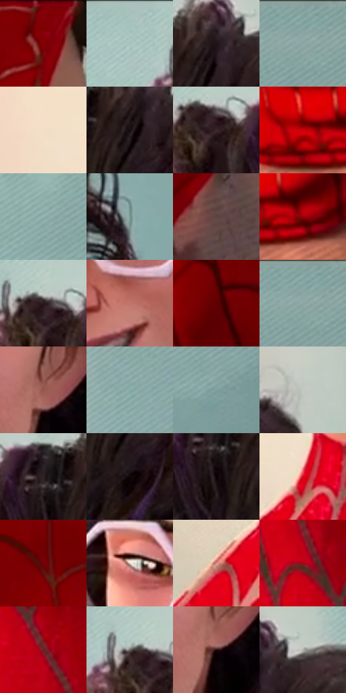

# 电影参考 345

- 状态：常规／活跃；来源世界：miles-home。
- 视角：near-level；景别：close-up；场景：portrait。
- 时段：interior-time-unknown（外观依据，中置信度；具体时间／晨昏未知）；光照：cool-interior。
- 材质候选：skin, hair, fabric, glass, metal, paint（帧级，不是像素分割）。
- 明暗组：middle；L* P5/P50/P95：2.82408 / 41.16299 / 84.71797。
- 资格门禁：无附加门禁。
- 原截图 SHA-256：`97503ca92b83d1b39bd2dff3033799db5d8c04cf7e96e895362fea94a948b8df`；尺寸：2880 × 1204。
- sRGB 像素 SHA-256：`f77d9e8b74b145ef33cecca8beec434ead93f8844852f87fb3e65b5f73fdd477`。

## 观察与迁移

近景表情与轻接触，不凭背景星形制造撞击爆点。

345、347、351  /  微笑、侧转与看显微镜时的单眼闭合改变眼睑和口形；牙齿组织成较整洁亮形，少量口角线负责表情  /  用眼睑／眉的关系与嘴角表达原表情，不复制笑容或闭眼。牙齿不逐颗刻成高反差栅栏，遮住的眼睛不补造

345  /  面部表情／眼镜卷发  /  研究员微笑、嘴内亮牙形、眉眼变化；不画逐颗高反差牙列，不把笑容强加到原照

本公开版保存32个128×128原像素色卡上下文；图集格子并非原场景相邻位置。原rect、图集tile和像素SHA见 `data/palette-crops.json`。上下文不足时不得批准替色，不能以小样推断完整构图。

## 实测色卡

颜色比例分母为保留采样像素，不是材料面积；全部 32 色参与全库匹配。表内四舍五入仅用于阅读，原精度在 JSON。

| ID | HEX | Lab | 原图 xy | 像素数 | 比例 | 明度角色 |
| --- | --- | --- | --- | ---: | ---: | --- |
| 345-S01 | #840008 | [26.519139, 49.26262, 36.041401] | [904, 52] | 9304 | 4.829534% | shadow |
| 345-S02 | #A7C1BD | [76.086796, -9.584172, -0.952302] | [1332, 56] | 9291 | 4.822786% | light |
| 345-S03 | #1F1417 | [7.709802, 6.252549, 0.075846] | [1684, 116] | 8310 | 4.313567% | deep-shadow |
| 345-S04 | #87A7A5 | [66.139152, -11.362768, -2.601859] | [2736, 28] | 8168 | 4.239857% | light |
| 345-S05 | #F4DEC8 | [89.695419, 4.088228, 13.539111] | [144, 572] | 8143 | 4.226880% | highlight |
| 345-S06 | #170D0F | [4.55734, 4.258672, 0.441779] | [1664, 156] | 7980 | 4.142270% | deep-shadow |
| 345-S07 | #3E2A2F | [19.579209, 10.211132, 0.469241] | [1468, 128] | 7837 | 4.068041% | deep-shadow |
| 345-S08 | #CC010A | [42.589863, 67.6913, 53.508022] | [424, 600] | 7753 | 4.024438% | midtone |
| 345-S09 | #93B2AF | [70.272458, -11.147919, -1.981136] | [2624, 432] | 7613 | 3.951767% | light |
| 345-S10 | #769492 | [59.072216, -10.895371, -2.410349] | [2316, 800] | 7251 | 3.763859% | midtone |
| 345-S11 | #5F4443 | [31.744897, 11.480612, 5.194468] | [824, 364] | 6817 | 3.538578% | shadow |
| 345-S12 | #99000A | [31.339008, 54.838555, 41.098214] | [508, 616] | 6668 | 3.461235% | shadow |
| 345-S13 | #2B181D | [10.961819, 10.434758, 0.505652] | [1452, 100] | 6597 | 3.424380% | deep-shadow |
| 345-S14 | #C1746A | [56.949991, 29.143217, 18.488064] | [1544, 824] | 6548 | 3.398945% | midtone |
| 345-S15 | #5C0003 | [16.905662, 38.112686, 24.950433] | [440, 184] | 6248 | 3.243221% | deep-shadow |
| 345-S16 | #82A19F | [63.948082, -11.094893, -2.504392] | [2732, 28] | 5989 | 3.108779% | light |
| 345-S17 | #94554C | [43.235893, 25.090536, 16.577459] | [1724, 796] | 5921 | 3.073481% | midtone |
| 345-S18 | #89ABA9 | [67.507225, -11.97066, -2.80041] | [2400, 164] | 5813 | 3.017420% | light |
| 345-S19 | #7C9E9C | [62.624073, -12.100043, -2.808678] | [2712, 496] | 5662 | 2.939039% | light |
| 345-S20 | #C2C8C0 | [79.944784, -3.532654, 3.281812] | [2164, 264] | 5581 | 2.896993% | light |
| 345-S21 | #2C2124 | [14.120044, 5.89375, -0.002048] | [1572, 132] | 5531 | 2.871039% | deep-shadow |
| 345-S22 | #0F0608 | [2.252434, 2.824503, 0.14061] | [1668, 252] | 5506 | 2.858062% | deep-shadow |
| 345-S23 | #060102 | [0.585504, 1.446523, 0.082302] | [1580, 188] | 5493 | 2.851314% | deep-shadow |
| 345-S24 | #D4081E | [44.616373, 69.326487, 47.398282] | [288, 752] | 5253 | 2.726735% | midtone |
| 345-S25 | #740106 | [22.823984, 44.676076, 31.994974] | [684, 108] | 4746 | 2.463560% | shadow |
| 345-S26 | #E4CDC0 | [83.946932, 5.926631, 9.394721] | [1340, 668] | 4485 | 2.328080% | highlight |
| 345-S27 | #DD9386 | [67.994108, 26.371303, 18.351774] | [156, 880] | 4221 | 2.191043% | light |
| 345-S28 | #A1061C | [33.549375, 56.473104, 34.34753] | [624, 932] | 3382 | 1.755533% | shadow |
| 345-S29 | #652524 | [24.379453, 28.806709, 15.574787] | [700, 1040] | 3271 | 1.697915% | shadow |
| 345-S30 | #6A6564 | [43.199577, 1.764602, 1.269147] | [1424, 92] | 3140 | 1.629916% | midtone |
| 345-S31 | #2B0A0C | [6.841228, 17.035592, 5.61276] | [1724, 828] | 2420 | 1.256177% | deep-shadow |
| 345-S32 | #B3B4AF | [73.10303, -1.279046, 2.425186] | [1748, 92] | 1706 | 0.885553% | light |

## 色阶与空间分布

- 采样 ROI：`[0.01, 0.02, 0.98, 0.94]`；步长：4；样本数：192648。
- 排除区：`[]`。
- 深暗、暗、中、亮、高光五段计数：`[51967, 42444, 26586, 56691, 14960]`。
- RGB 各 256 箱、L* 100 箱、13×5 色相明度表和 3×3 空间统计全部保存在 [总数据](../film-library.json)。
- [可视化档案](../../references/library.html)按需绘制直方图，不存 2,094 张重复图表图片。

## 纹理特征占比

**这是分块图像特征的面积占比，不是波点／排线／丝网／错版的精确语义覆盖率。** 窗格、发丝、织物也会产生方向或周期特征。
原图 ROI 像素 3092958；已测块覆盖 3092958（100.0000%）；未测 0。

| 特征 | 块覆盖像素 | 占已测面积 | 阈值敏感范围 |
| --- | ---: | ---: | --- |
| low-contrast | 291328 | 9.4191% | 6.2408% ~ 12.5974% |
| directional-structure | 843392 | 27.2681% | 14.3024% ~ 47.9686% |
| periodic-structure | 1846366 | 59.6958% | 44.2926% ~ 65.2454% |
| mixed-detail | 111872 | 3.6170% | 1.4981% ~ 7.8547% |

阈值敏感范围不是统计置信区间。逐块坐标、尺度、对比、方向一致性、频谱集中度、频率与角度见 [全量特征记录](../texture-features.jsonl)，以帧号定位。
四种印刷层的真实像素覆盖仍标为 `null`，不能填 0，也不能拿上表代替。不得据这些代理测量删除唯一证据。

[测量方法与保留策略](../../references/library-retention.md) · [分类索引](../archive/README.md)
