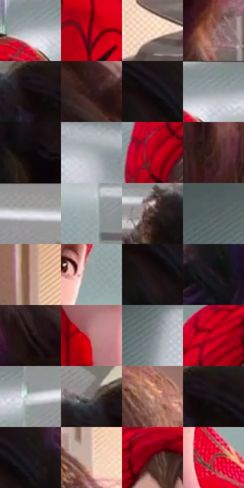

# 电影参考 346

- 状态：常规／活跃；来源世界：miles-home。
- 视角：near-level；景别：close-up；场景：portrait。
- 时段：interior-time-unknown（外观依据，中置信度；具体时间／晨昏未知）；光照：cool-interior。
- 材质候选：skin, hair, fabric, glass, metal, paint（帧级，不是像素分割）。
- 明暗组：middle；L* P5/P50/P95：2.39424 / 43.28144 / 85.33621。
- 资格门禁：无附加门禁。
- 原截图 SHA-256：`001044f8437bd3182790106e475e60c588d56ef44d047fa5388ffd3045a2080d`；尺寸：2880 × 1208。
- sRGB 像素 SHA-256：`51e6195bb1b846b248080c69dad4da3507f78a68b72ed443a64930bb0acc3d41`。

## 观察与迁移

近景表情与轻接触，不凭背景星形制造撞击爆点。

346  /  接触形变／人脸  /  手捏住彼得脸颊，口形与局部轮廓受挤压；未见大撞击爆点，头后星状物不作为接触符号证据

本公开版保存32个128×128原像素色卡上下文；图集格子并非原场景相邻位置。原rect、图集tile和像素SHA见 `data/palette-crops.json`。上下文不足时不得批准替色，不能以小样推断完整构图。

## 实测色卡

颜色比例分母为保留采样像素，不是材料面积；全部 32 色参与全库匹配。表内四舍五入仅用于阅读，原精度在 JSON。

| ID | HEX | Lab | 原图 xy | 像素数 | 比例 | 明度角色 |
| --- | --- | --- | --- | ---: | ---: | --- |
| 346-S01 | #B5BBBF | [75.529443, -1.313131, -2.738622] | [1176, 80] | 9546 | 4.937263% | light |
| 346-S02 | #840215 | [26.748167, 49.189543, 29.621151] | [948, 956] | 9205 | 4.760895% | shadow |
| 346-S03 | #F8DBBF | [89.103328, 5.7938, 17.45886] | [2680, 976] | 8991 | 4.650213% | highlight |
| 346-S04 | #9B6C66 | [50.280289, 17.912314, 10.875721] | [2520, 1100] | 8121 | 4.200242% | midtone |
| 346-S05 | #0D080A | [2.539656, 1.653391, -0.27195] | [1740, 252] | 7947 | 4.110248% | deep-shadow |
| 346-S06 | #2C1517 | [10.059648, 12.010227, 3.723842] | [2184, 296] | 7933 | 4.103007% | deep-shadow |
| 346-S07 | #120E11 | [4.364283, 1.983752, -1.009902] | [1856, 312] | 7508 | 3.883194% | deep-shadow |
| 346-S08 | #8A9496 | [60.591202, -3.186068, -2.29159] | [1224, 36] | 7216 | 3.732169% | light |
| 346-S09 | #0A0507 | [1.701985, 1.585497, -0.29599] | [1896, 552] | 7215 | 3.731652% | deep-shadow |
| 346-S10 | #A7B0B1 | [71.173312, -2.950413, -1.597569] | [380, 344] | 6874 | 3.555284% | light |
| 346-S11 | #A70018 | [34.567796, 58.704832, 38.045304] | [876, 312] | 6842 | 3.538734% | shadow |
| 346-S12 | #4B2A28 | [21.227407, 15.074196, 7.889249] | [2420, 672] | 6807 | 3.520631% | shadow |
| 346-S13 | #999998 | [63.195315, -0.193549, 0.527112] | [1588, 28] | 6798 | 3.515977% | light |
| 346-S14 | #9DABAC | [68.94781, -4.686819, -2.18926] | [1340, 324] | 6634 | 3.431155% | light |
| 346-S15 | #5D4A47 | [33.307261, 7.502983, 4.834151] | [1588, 260] | 6196 | 3.204618% | shadow |
| 346-S16 | #586263 | [40.752648, -3.621601, -1.881126] | [512, 84] | 6147 | 3.179274% | midtone |
| 346-S17 | #BC9389 | [64.456634, 13.920401, 11.20198] | [2584, 264] | 6113 | 3.161689% | light |
| 346-S18 | #97A3A3 | [66.072534, -4.235672, -1.455567] | [1256, 408] | 5787 | 2.993080% | light |
| 346-S19 | #1D0F10 | [5.783969, 6.654786, 1.77572] | [1852, 360] | 5557 | 2.874122% | deep-shadow |
| 346-S20 | #201923 | [9.98212, 5.922205, -5.588028] | [1484, 624] | 5535 | 2.862743% | deep-shadow |
| 346-S21 | #18090A | [3.717259, 5.65471, 1.565358] | [2116, 384] | 5224 | 2.701892% | deep-shadow |
| 346-S22 | #B87E7A | [58.526591, 21.979117, 11.301072] | [1064, 808] | 4965 | 2.567935% | midtone |
| 346-S23 | #7B858A | [54.887139, -2.597011, -3.939451] | [648, 88] | 4750 | 2.456736% | midtone |
| 346-S24 | #D30023 | [44.196779, 69.906117, 44.359901] | [936, 196] | 4639 | 2.399326% | midtone |
| 346-S25 | #D5D9DD | [86.500091, -0.615521, -2.43109] | [1368, 76] | 4585 | 2.371396% | highlight |
| 346-S26 | #776F6E | [47.516632, 2.907619, 1.673848] | [1688, 208] | 4452 | 2.302608% | midtone |
| 346-S27 | #DFAD97 | [74.706254, 15.223182, 18.332116] | [2452, 408] | 4425 | 2.288643% | light |
| 346-S28 | #181317 | [6.520042, 3.200402, -1.766739] | [1784, 252] | 4343 | 2.246232% | deep-shadow |
| 346-S29 | #1A1419 | [7.137147, 4.119604, -2.366722] | [1904, 308] | 4076 | 2.108138% | deep-shadow |
| 346-S30 | #DABEB3 | [79.034661, 8.189663, 9.216096] | [2604, 492] | 3934 | 2.034694% | light |
| 346-S31 | #431517 | [14.354514, 22.431335, 10.284021] | [1044, 192] | 2926 | 1.513349% | deep-shadow |
| 346-S32 | #943939 | [36.965628, 38.34546, 19.94885] | [1192, 848] | 2055 | 1.062861% | shadow |

## 色阶与空间分布

- 采样 ROI：`[0.01, 0.02, 0.98, 0.94]`；步长：4；样本数：193346。
- 排除区：`[]`。
- 深暗、暗、中、亮、高光五段计数：`[61033, 30878, 32152, 53776, 15507]`。
- RGB 各 256 箱、L* 100 箱、13×5 色相明度表和 3×3 空间统计全部保存在 [总数据](../film-library.json)。
- [可视化档案](../../references/library.html)按需绘制直方图，不存 2,094 张重复图表图片。

## 纹理特征占比

**这是分块图像特征的面积占比，不是波点／排线／丝网／错版的精确语义覆盖率。** 窗格、发丝、织物也会产生方向或周期特征。
原图 ROI 像素 3104134；已测块覆盖 3104134（100.0000%）；未测 0。

| 特征 | 块覆盖像素 | 占已测面积 | 阈值敏感范围 |
| --- | ---: | ---: | --- |
| low-contrast | 88448 | 2.8494% | 1.0762% ~ 4.9606% |
| directional-structure | 999296 | 32.1924% | 15.8344% ~ 47.8577% |
| periodic-structure | 1918086 | 61.7913% | 50.0104% ~ 71.2672% |
| mixed-detail | 98304 | 3.1669% | 1.0556% ~ 7.9378% |

阈值敏感范围不是统计置信区间。逐块坐标、尺度、对比、方向一致性、频谱集中度、频率与角度见 [全量特征记录](../texture-features.jsonl)，以帧号定位。
四种印刷层的真实像素覆盖仍标为 `null`，不能填 0，也不能拿上表代替。不得据这些代理测量删除唯一证据。

[测量方法与保留策略](../../references/library-retention.md) · [分类索引](../archive/README.md)
