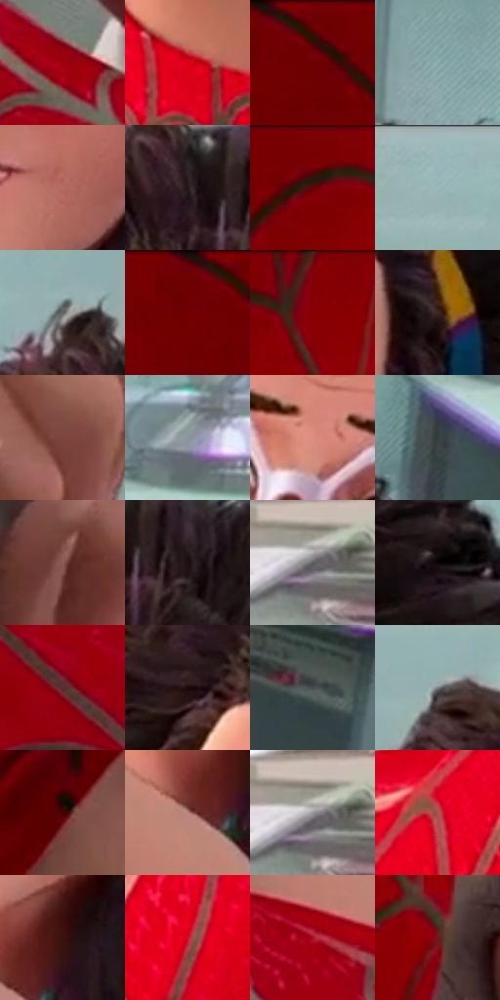

# 电影参考 347

- 状态：常规／活跃；来源世界：miles-home。
- 视角：high-angle；景别：close-up；场景：portrait。
- 时段：interior-time-unknown（外观依据，中置信度；具体时间／晨昏未知）；光照：cool-interior。
- 材质候选：skin, hair, fabric, glass, metal, paint（帧级，不是像素分割）。
- 明暗组：dark；L* P5/P50/P95：4.01455 / 33.38224 / 73.41481。
- 资格门禁：无附加门禁。
- 原截图 SHA-256：`396d0a953088674e0fad1fbde770fc75e29c24db27e8728056a82e945f6d4077`；尺寸：2880 × 1208。
- sRGB 像素 SHA-256：`d17bf0b7709b0610c964bf44e447ae2ed4011d53c61bc6705af4b80655471e6f`。

## 观察与迁移

近景表情与轻接触，不凭背景星形制造撞击爆点。

345、347、351  /  微笑、侧转与看显微镜时的单眼闭合改变眼睑和口形；牙齿组织成较整洁亮形，少量口角线负责表情  /  用眼睑／眉的关系与嘴角表达原表情，不复制笑容或闭眼。牙齿不逐颗刻成高反差栅栏，遮住的眼睛不补造

347  /  面部表情／接触  /  反向视角的笑脸与手部接触；同一个人随角度改变的鼻唇与眼镜关系，不是另一套固定五官比例

本公开版保存32个128×128原像素色卡上下文；图集格子并非原场景相邻位置。原rect、图集tile和像素SHA见 `data/palette-crops.json`。上下文不足时不得批准替色，不能以小样推断完整构图。

## 实测色卡

颜色比例分母为保留采样像素，不是材料面积；全部 32 色参与全库匹配。表内四舍五入仅用于阅读，原精度在 JSON。

| ID | HEX | Lab | 原图 xy | 像素数 | 比例 | 明度角色 |
| --- | --- | --- | --- | ---: | ---: | --- |
| 347-S01 | #9F010D | [32.753608, 56.302157, 41.401696] | [1312, 880] | 10256 | 5.304480% | shadow |
| 347-S02 | #DB0019 | [45.818896, 71.658335, 51.351439] | [616, 824] | 9572 | 4.950710% | midtone |
| 347-S03 | #5D0003 | [17.153006, 38.398054, 25.30945] | [432, 48] | 9154 | 4.734517% | deep-shadow |
| 347-S04 | #8DADAE | [68.463993, -10.651726, -4.133546] | [2064, 92] | 8904 | 4.605216% | light |
| 347-S05 | #B66D62 | [53.778413, 27.776388, 18.567913] | [1916, 800] | 8847 | 4.575735% | midtone |
| 347-S06 | #24171A | [9.501617, 7.16156, 0.500769] | [1912, 208] | 8795 | 4.548840% | deep-shadow |
| 347-S07 | #760003 | [23.201103, 45.380046, 33.754324] | [1016, 28] | 7845 | 4.057493% | shadow |
| 347-S08 | #99B7B8 | [72.294519, -9.928335, -3.904511] | [1652, 32] | 7759 | 4.013013% | light |
| 347-S09 | #5F6563 | [42.217287, -2.747823, 0.330165] | [1856, 116] | 7689 | 3.976808% | midtone |
| 347-S10 | #6D0003 | [21.052162, 42.898507, 30.830157] | [376, 28] | 7474 | 3.865609% | shadow |
| 347-S11 | #860106 | [27.031488, 49.586316, 37.486329] | [1120, 52] | 7037 | 3.639589% | shadow |
| 347-S12 | #3C2626 | [17.859752, 10.408502, 4.236417] | [2124, 464] | 6569 | 3.397536% | deep-shadow |
| 347-S13 | #7D443D | [35.659233, 23.676794, 15.047561] | [1428, 412] | 6490 | 3.356677% | shadow |
| 347-S14 | #8C969B | [61.441667, -2.55474, -3.859271] | [2588, 372] | 6338 | 3.278061% | light |
| 347-S15 | #DF8D7D | [66.689152, 29.371291, 21.606033] | [1868, 508] | 6258 | 3.236684% | light |
| 347-S16 | #363F41 | [25.924154, -3.202612, -2.476186] | [2492, 476] | 6177 | 3.194791% | shadow |
| 347-S17 | #8A5C55 | [43.820731, 17.932715, 11.719217] | [1328, 492] | 6095 | 3.152380% | midtone |
| 347-S18 | #1B0F11 | [5.556796, 5.706224, 0.844612] | [2000, 236] | 5821 | 3.010665% | deep-shadow |
| 347-S19 | #CCC8CC | [81.01911, 2.106872, -1.497628] | [36, 804] | 5805 | 3.002389% | highlight |
| 347-S20 | #0B0406 | [1.545916, 2.115181, -0.109396] | [2296, 360] | 5773 | 2.985839% | deep-shadow |
| 347-S21 | #52332F | [24.849733, 13.452866, 8.334491] | [1336, 1092] | 5498 | 2.843607% | shadow |
| 347-S22 | #1B0908 | [4.028474, 6.949817, 2.876515] | [1760, 324] | 5399 | 2.792403% | deep-shadow |
| 347-S23 | #464F4F | [32.828587, -3.588031, -1.222528] | [2748, 616] | 5174 | 2.676032% | shadow |
| 347-S24 | #7A8082 | [53.15404, -1.810267, -1.851299] | [1688, 168] | 4990 | 2.580865% | midtone |
| 347-S25 | #480204 | [12.158259, 31.498816, 17.416781] | [992, 624] | 4340 | 2.244681% | deep-shadow |
| 347-S26 | #B8837B | [59.757412, 19.324194, 12.456748] | [1828, 1000] | 3910 | 2.022281% | midtone |
| 347-S27 | #ACABAD | [70.115354, 0.730323, -0.896935] | [60, 796] | 3753 | 1.941080% | light |
| 347-S28 | #AA5650 | [46.688554, 33.75414, 19.349817] | [396, 960] | 3470 | 1.794710% | midtone |
| 347-S29 | #3A120F | [11.735586, 19.575828, 11.539835] | [1888, 948] | 2627 | 1.358704% | deep-shadow |
| 347-S30 | #D40E2D | [44.94885, 69.129755, 39.618] | [544, 992] | 2122 | 1.097514% | midtone |
| 347-S31 | #A30F25 | [34.527314, 56.030111, 30.097632] | [1792, 1116] | 1810 | 0.936146% | shadow |
| 347-S32 | #75191F | [25.494813, 39.642029, 20.956875] | [1184, 236] | 1595 | 0.824946% | shadow |

## 色阶与空间分布

- 采样 ROI：`[0.01, 0.02, 0.98, 0.94]`；步长：4；样本数：193346。
- 排除区：`[]`。
- 深暗、暗、中、亮、高光五段计数：`[48534, 61172, 46034, 34245, 3361]`。
- RGB 各 256 箱、L* 100 箱、13×5 色相明度表和 3×3 空间统计全部保存在 [总数据](../film-library.json)。
- [可视化档案](../../references/library.html)按需绘制直方图，不存 2,094 张重复图表图片。

## 纹理特征占比

**这是分块图像特征的面积占比，不是波点／排线／丝网／错版的精确语义覆盖率。** 窗格、发丝、织物也会产生方向或周期特征。
原图 ROI 像素 3104134；已测块覆盖 3104134（100.0000%）；未测 0。

| 特征 | 块覆盖像素 | 占已测面积 | 阈值敏感范围 |
| --- | ---: | ---: | --- |
| low-contrast | 391942 | 12.6265% | 7.2203% ~ 16.1521% |
| directional-structure | 912512 | 29.3967% | 18.6507% ~ 51.3462% |
| periodic-structure | 1749888 | 56.3728% | 40.7160% ~ 62.5375% |
| mixed-detail | 49792 | 1.6041% | 0.7175% ~ 2.6597% |

阈值敏感范围不是统计置信区间。逐块坐标、尺度、对比、方向一致性、频谱集中度、频率与角度见 [全量特征记录](../texture-features.jsonl)，以帧号定位。
四种印刷层的真实像素覆盖仍标为 `null`，不能填 0，也不能拿上表代替。不得据这些代理测量删除唯一证据。

[测量方法与保留策略](../../references/library-retention.md) · [分类索引](../archive/README.md)
