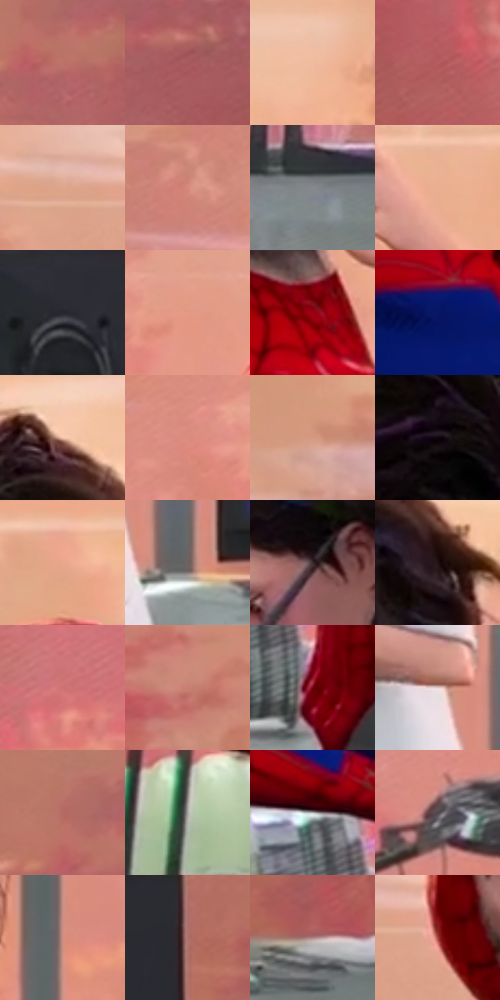

# 电影参考 348

- 状态：常规／活跃；来源世界：miles-home。
- 视角：near-level；景别：medium；场景：portrait。
- 时段：interior-time-unknown（外观依据，中置信度；具体时间／晨昏未知）；光照：cool-interior。
- 材质候选：skin, hair, fabric, glass, metal, paint（帧级，不是像素分割）。
- 明暗组：middle；L* P5/P50/P95：8.34263 / 57.84114 / 81.77431。
- 资格门禁：无附加门禁。
- 原截图 SHA-256：`a5e57d0732f8b05ca92bacc5b1e4eca0b0919780739efe2731af158b9d532e35`；尺寸：2880 × 1202。
- sRGB 像素 SHA-256：`9c00b9458cdff393ff80beebd6bb174aa4aef4b4c3dc60e7fae585d6d849d4fb`。

## 观察与迁移

近景表情与轻接触，不凭背景星形制造撞击爆点。

348  /  接触姿势／强弱对照  /  较宽构图可见托压脸与后仰，仍不靠满图爆点表达；普通按压应优先靠现有姿态与接触暗部

本公开版保存32个128×128原像素色卡上下文；图集格子并非原场景相邻位置。原rect、图集tile和像素SHA见 `data/palette-crops.json`。上下文不足时不得批准替色，不能以小样推断完整构图。

## 实测色卡

颜色比例分母为保留采样像素，不是材料面积；全部 32 色参与全库匹配。表内四舍五入仅用于阅读，原精度在 JSON。

| ID | HEX | Lab | 原图 xy | 像素数 | 比例 | 明度角色 |
| --- | --- | --- | --- | ---: | ---: | --- |
| 348-S01 | #BC7367 | [56.022225, 27.397032, 18.847901] | [2476, 500] | 11349 | 5.891055% | midtone |
| 348-S02 | #A55A5C | [47.087507, 30.849901, 12.574916] | [2704, 384] | 10561 | 5.482019% | midtone |
| 348-S03 | #EFBA9D | [79.560276, 15.20713, 22.047001] | [2196, 272] | 10035 | 5.208982% | light |
| 348-S04 | #B65D60 | [50.240617, 36.193748, 14.914329] | [88, 596] | 7922 | 4.112163% | midtone |
| 348-S05 | #DEA58C | [72.452629, 17.777387, 21.192082] | [724, 268] | 7797 | 4.047278% | light |
| 348-S06 | #D58A7B | [64.768628, 26.883498, 19.909278] | [396, 400] | 7275 | 3.776317% | light |
| 348-S07 | #85898D | [56.880807, -0.656475, -2.644673] | [2244, 1120] | 6994 | 3.630456% | midtone |
| 348-S08 | #EAAE91 | [75.953805, 18.222555, 23.467496] | [1112, 308] | 6902 | 3.582700% | light |
| 348-S09 | #26272D | [15.760607, 1.101725, -4.081786] | [2208, 852] | 6889 | 3.575952% | deep-shadow |
| 348-S10 | #E39A85 | [70.273188, 24.832458, 22.135034] | [744, 504] | 6738 | 3.497571% | light |
| 348-S11 | #9D000F | [32.269039, 55.955607, 39.911203] | [1028, 432] | 6616 | 3.434243% | shadow |
| 348-S12 | #081664 | [12.892154, 27.768216, -46.630885] | [1136, 660] | 6591 | 3.421266% | deep-shadow |
| 348-S13 | #F0C1A9 | [81.583468, 13.402533, 18.458038] | [1736, 116] | 6406 | 3.325236% | highlight |
| 348-S14 | #DD8B7F | [66.038149, 29.878267, 19.5642] | [632, 496] | 6384 | 3.313816% | light |
| 348-S15 | #D69982 | [68.528386, 19.94586, 21.16969] | [416, 180] | 6355 | 3.298763% | light |
| 348-S16 | #0E0610 | [2.357863, 3.753641, -3.409105] | [1648, 356] | 6078 | 3.154977% | deep-shadow |
| 348-S17 | #E9A58B | [73.611325, 21.950888, 23.507885] | [896, 68] | 5945 | 3.085939% | light |
| 348-S18 | #6D6261 | [42.536159, 4.187536, 2.164365] | [1936, 1064] | 5935 | 3.080748% | midtone |
| 348-S19 | #3C292F | [19.021628, 9.980768, -0.376578] | [1524, 456] | 5559 | 2.885574% | deep-shadow |
| 348-S20 | #241316 | [8.118373, 9.319571, 1.49437] | [1812, 232] | 5351 | 2.777605% | deep-shadow |
| 348-S21 | #CF7274 | [58.568752, 36.635421, 15.243372] | [448, 896] | 5288 | 2.744903% | midtone |
| 348-S22 | #C78071 | [60.582887, 25.720223, 19.559606] | [100, 332] | 5215 | 2.707010% | light |
| 348-S23 | #6E020C | [21.528034, 42.912527, 27.70485] | [940, 1084] | 5003 | 2.596964% | shadow |
| 348-S24 | #E2CECA | [84.265151, 6.282886, 4.512578] | [1848, 964] | 4866 | 2.525850% | highlight |
| 348-S25 | #B36B61 | [52.910516, 27.575743, 17.907138] | [2436, 448] | 4858 | 2.521698% | midtone |
| 348-S26 | #A8A9A1 | [68.949325, -1.84304, 4.002137] | [592, 1004] | 4765 | 2.473423% | light |
| 348-S27 | #BCBABA | [75.671297, 0.69752, 0.25094] | [872, 980] | 4679 | 2.428782% | light |
| 348-S28 | #50454B | [30.568147, 5.883792, -1.876973] | [480, 632] | 4656 | 2.416843% | shadow |
| 348-S29 | #CA8D7F | [64.274985, 21.402245, 16.78637] | [1944, 608] | 3687 | 1.913853% | light |
| 348-S30 | #AD716D | [53.814636, 23.232007, 12.029925] | [2428, 852] | 2843 | 1.475749% | midtone |
| 348-S31 | #AC8484 | [58.919137, 15.332686, 5.934524] | [2500, 1076] | 2447 | 1.270192% | midtone |
| 348-S32 | #A24540 | [41.704569, 38.167, 22.218721] | [808, 292] | 659 | 0.342075% | midtone |

## 色阶与空间分布

- 采样 ROI：`[0.01, 0.02, 0.98, 0.94]`；步长：4；样本数：192648。
- 排除区：`[]`。
- 深暗、暗、中、亮、高光五段计数：`[29576, 18851, 55491, 74246, 14484]`。
- RGB 各 256 箱、L* 100 箱、13×5 色相明度表和 3×3 空间统计全部保存在 [总数据](../film-library.json)。
- [可视化档案](../../references/library.html)按需绘制直方图，不存 2,094 张重复图表图片。

## 纹理特征占比

**这是分块图像特征的面积占比，不是波点／排线／丝网／错版的精确语义覆盖率。** 窗格、发丝、织物也会产生方向或周期特征。
原图 ROI 像素 3087370；已测块覆盖 3087370（100.0000%）；未测 0。

| 特征 | 块覆盖像素 | 占已测面积 | 阈值敏感范围 |
| --- | ---: | ---: | --- |
| low-contrast | 65536 | 2.1227% | 1.5920% ~ 2.6534% |
| directional-structure | 1037568 | 33.6069% | 15.8664% ~ 45.1367% |
| periodic-structure | 1869578 | 60.5557% | 51.1486% ~ 72.4586% |
| mixed-detail | 114688 | 3.7147% | 2.1227% ~ 9.0215% |

阈值敏感范围不是统计置信区间。逐块坐标、尺度、对比、方向一致性、频谱集中度、频率与角度见 [全量特征记录](../texture-features.jsonl)，以帧号定位。
四种印刷层的真实像素覆盖仍标为 `null`，不能填 0，也不能拿上表代替。不得据这些代理测量删除唯一证据。

[测量方法与保留策略](../../references/library-retention.md) · [分类索引](../archive/README.md)
