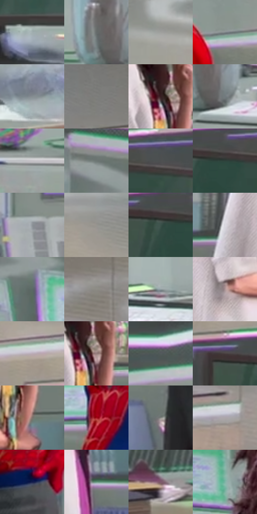

# 电影参考 349

- 状态：常规／活跃；来源世界：miles-home。
- 视角：low-angle；景别：environment-wide；场景：portrait。
- 时段：interior-time-unknown（外观依据，中置信度；具体时间／晨昏未知）；光照：cool-interior。
- 材质候选：skin, hair, fabric, glass, metal, paint（帧级，不是像素分割）。
- 明暗组：middle；L* P5/P50/P95：19.70582 / 54.27483 / 78.67678。
- 资格门禁：无附加门禁。
- 原截图 SHA-256：`2f953cc9b012024686361b4de41b963a8a459e49ba6d2bd6553ca4421c8c2856`；尺寸：2880 × 1206。
- sRGB 像素 SHA-256：`581ff42f1a06303caad03298112a0fcfcf2ddf8e19a4546a90cf775474b09b3a`。

## 观察与迁移

近景表情与轻接触，不凭背景星形制造撞击爆点。

349  /  稳定实验室／特殊透明  /  房间、架子与台面结构稳定，局部透明人物；彩色窄边不等于全局故障

本公开版保存32个128×128原像素色卡上下文；图集格子并非原场景相邻位置。原rect、图集tile和像素SHA见 `data/palette-crops.json`。上下文不足时不得批准替色，不能以小样推断完整构图。

## 实测色卡

颜色比例分母为保留采样像素，不是材料面积；全部 32 色参与全库匹配。表内四舍五入仅用于阅读，原精度在 JSON。

| ID | HEX | Lab | 原图 xy | 像素数 | 比例 | 明度角色 |
| --- | --- | --- | --- | ---: | ---: | --- |
| 349-S01 | #A2AEB0 | [70.237254, -3.78865, -2.463379] | [1988, 980] | 9796 | 5.066565% | light |
| 349-S02 | #666C6C | [45.126674, -2.291138, -0.791339] | [1264, 1032] | 9568 | 4.948641% | midtone |
| 349-S03 | #9FA09D | [65.707281, -0.931029, 1.43709] | [1428, 216] | 9283 | 4.801237% | light |
| 349-S04 | #7E8588 | [55.060007, -1.95183, -2.499999] | [1228, 404] | 8437 | 4.363680% | midtone |
| 349-S05 | #868D92 | [58.219929, -1.517419, -3.534666] | [2164, 1060] | 7919 | 4.095766% | midtone |
| 349-S06 | #7D7D7A | [52.322586, -0.593964, 1.634664] | [2376, 224] | 7788 | 4.028012% | midtone |
| 349-S07 | #361F22 | [14.843884, 11.675608, 2.661789] | [620, 532] | 7427 | 3.841300% | deep-shadow |
| 349-S08 | #727B7E | [50.97777, -2.701576, -2.782824] | [1324, 1080] | 7266 | 3.758030% | midtone |
| 349-S09 | #C4C2C7 | [78.719254, 1.615486, -2.253773] | [1132, 1116] | 6978 | 3.609074% | light |
| 349-S10 | #6D7773 | [49.108707, -4.580274, 0.916917] | [92, 132] | 6961 | 3.600281% | midtone |
| 349-S11 | #4E5051 | [33.880771, -0.588569, -0.868118] | [1976, 496] | 6939 | 3.588903% | shadow |
| 349-S12 | #2E403B | [25.452386, -8.469472, 0.721039] | [1868, 516] | 6872 | 3.554250% | shadow |
| 349-S13 | #8D9398 | [60.601969, -1.155951, -3.385807] | [1432, 700] | 6819 | 3.526838% | light |
| 349-S14 | #96948F | [61.348563, -0.21429, 2.900364] | [1656, 268] | 6689 | 3.459601% | light |
| 349-S15 | #3B524A | [32.828844, -10.760174, 1.85061] | [1808, 520] | 6407 | 3.313748% | shadow |
| 349-S16 | #D9D7DF | [86.345455, 2.136694, -3.681098] | [400, 784] | 6209 | 3.211341% | highlight |
| 349-S17 | #5A6966 | [43.116512, -6.332187, -0.224245] | [168, 248] | 6063 | 3.135829% | midtone |
| 349-S18 | #8F8D87 | [58.638491, -0.401072, 3.459757] | [2800, 164] | 6006 | 3.106348% | midtone |
| 349-S19 | #939FA2 | [64.649832, -3.638415, -3.019585] | [1624, 1044] | 5558 | 2.874639% | light |
| 349-S20 | #AA9294 | [62.711998, 9.286439, 2.264819] | [528, 712] | 5521 | 2.855503% | light |
| 349-S21 | #BCACB8 | [71.999001, 7.897542, -4.040881] | [1668, 392] | 5494 | 2.841538% | light |
| 349-S22 | #947B7A | [53.886313, 9.475285, 4.163087] | [648, 544] | 5398 | 2.791886% | midtone |
| 349-S23 | #545B5C | [38.091775, -2.518278, -1.517428] | [764, 96] | 5185 | 2.681721% | shadow |
| 349-S24 | #4A4041 | [28.126032, 4.493635, 0.972514] | [1740, 488] | 4581 | 2.369328% | shadow |
| 349-S25 | #7F746C | [49.600083, 2.791239, 5.957705] | [668, 664] | 4548 | 2.352260% | midtone |
| 349-S26 | #A30D1B | [34.305808, 56.028868, 35.80853] | [868, 560] | 4520 | 2.337778% | shadow |
| 349-S27 | #868884 | [56.42918, -1.52486, 1.887755] | [836, 896] | 4466 | 2.309849% | midtone |
| 349-S28 | #ACA6AA | [68.71179, 2.893336, -1.291293] | [2804, 296] | 4130 | 2.136067% | light |
| 349-S29 | #131D4C | [12.852332, 13.947962, -30.475905] | [1008, 732] | 3182 | 1.645754% | deep-shadow |
| 349-S30 | #68977E | [58.585156, -21.440111, 8.149776] | [648, 808] | 2784 | 1.439906% | midtone |
| 349-S31 | #7F5A6C | [42.623838, 18.201818, -4.196614] | [272, 1028] | 2293 | 1.185957% | midtone |
| 349-S32 | #7EB4A7 | [69.374422, -20.528749, 0.96131] | [356, 304] | 2259 | 1.168372% | light |

## 色阶与空间分布

- 采样 ROI：`[0.01, 0.02, 0.98, 0.94]`；步长：4；样本数：193346。
- 排除区：`[]`。
- 深暗、暗、中、亮、高光五段计数：`[9885, 35371, 79748, 60194, 8148]`。
- RGB 各 256 箱、L* 100 箱、13×5 色相明度表和 3×3 空间统计全部保存在 [总数据](../film-library.json)。
- [可视化档案](../../references/library.html)按需绘制直方图，不存 2,094 张重复图表图片。

## 纹理特征占比

**这是分块图像特征的面积占比，不是波点／排线／丝网／错版的精确语义覆盖率。** 窗格、发丝、织物也会产生方向或周期特征。
原图 ROI 像素 3098546；已测块覆盖 3098546（100.0000%）；未测 0。

| 特征 | 块覆盖像素 | 占已测面积 | 阈值敏感范围 |
| --- | ---: | ---: | --- |
| low-contrast | 0 | 0.0000% | 0.0000% ~ 0.4379% |
| directional-structure | 1585970 | 51.1843% | 34.1028% ~ 63.6970% |
| periodic-structure | 1447040 | 46.7006% | 35.7742% ~ 59.2051% |
| mixed-detail | 65536 | 2.1151% | 0.5288% ~ 6.2543% |

阈值敏感范围不是统计置信区间。逐块坐标、尺度、对比、方向一致性、频谱集中度、频率与角度见 [全量特征记录](../texture-features.jsonl)，以帧号定位。
四种印刷层的真实像素覆盖仍标为 `null`，不能填 0，也不能拿上表代替。不得据这些代理测量删除唯一证据。

[测量方法与保留策略](../../references/library-retention.md) · [分类索引](../archive/README.md)
