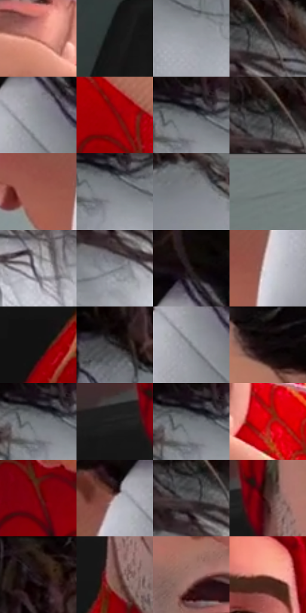

# 电影参考 350

- 状态：常规／活跃；来源世界：miles-home。
- 视角：high-angle；景别：close-up；场景：portrait。
- 时段：interior-time-unknown（外观依据，中置信度；具体时间／晨昏未知）；光照：cool-interior。
- 材质候选：skin, hair, fabric, glass, metal, paint（帧级，不是像素分割）。
- 明暗组：middle；L* P5/P50/P95：5.06331 / 47.66266 / 76.10406。
- 资格门禁：无附加门禁。
- 原截图 SHA-256：`280742c478d85383e04879dd213344501741d0f78387472debb6425a2dfbfd91`；尺寸：2880 × 1202。
- sRGB 像素 SHA-256：`989a20c8638a4b740bbdc457bce34e242127adaebc2607548c43934657787c2e`。

## 观察与迁移

近景表情与轻接触，不凭背景星形制造撞击爆点。

350彼得  /  眉骨、长鼻、颊部和下颌转折与研究员不同；眉眼不对称和口部张合传递反应，胡茬与阴影／印刷纹理并存  /  保持人物自己的成熟度、胡须与鼻颌关系；不要把参考中的疲惫、胡茬或脸上线条强加给用户

350  /  成人脸／衣料  /  彼得眉眼反应、鼻颌体块和胡茬，手持细物近口部；细物是实体，不是口边运动线

本公开版保存32个128×128原像素色卡上下文；图集格子并非原场景相邻位置。原rect、图集tile和像素SHA见 `data/palette-crops.json`。上下文不足时不得批准替色，不能以小样推断完整构图。

## 实测色卡

颜色比例分母为保留采样像素，不是材料面积；全部 32 色参与全库匹配。表内四舍五入仅用于阅读，原精度在 JSON。

| ID | HEX | Lab | 原图 xy | 像素数 | 比例 | 明度角色 |
| --- | --- | --- | --- | ---: | ---: | --- |
| 350-S01 | #CB7C6D | [60.085988, 29.048607, 21.23724] | [932, 752] | 9950 | 5.164860% | light |
| 350-S02 | #161515 | [6.874509, 0.451153, 0.159929] | [68, 592] | 9244 | 4.798389% | deep-shadow |
| 350-S03 | #9B9FA6 | [65.371482, -0.040471, -4.128826] | [2436, 312] | 9203 | 4.777106% | light |
| 350-S04 | #424040 | [27.283888, 0.84573, 0.302601] | [2596, 140] | 8688 | 4.509779% | shadow |
| 350-S05 | #8C9096 | [59.638362, -0.24201, -3.676267] | [1648, 192] | 8026 | 4.166148% | midtone |
| 350-S06 | #880309 | [27.629907, 49.829019, 36.961168] | [1160, 1092] | 8025 | 4.165629% | shadow |
| 350-S07 | #686C71 | [45.442268, -0.457017, -3.31296] | [2364, 232] | 7707 | 4.000561% | midtone |
| 350-S08 | #313133 | [20.395301, 0.47415, -1.269148] | [2556, 120] | 7338 | 3.809020% | shadow |
| 350-S09 | #A05B4D | [46.302736, 26.746959, 20.366416] | [1452, 344] | 7338 | 3.809020% | midtone |
| 350-S10 | #80858B | [55.306543, -0.600421, -3.8554] | [2380, 260] | 7132 | 3.702089% | midtone |
| 350-S11 | #7D8286 | [54.076087, -1.023934, -2.796556] | [2220, 288] | 7106 | 3.688593% | midtone |
| 350-S12 | #747E7D | [51.967154, -3.907896, -0.726046] | [388, 32] | 6730 | 3.493418% | midtone |
| 350-S13 | #BCBBC3 | [76.174735, 1.85245, -3.901324] | [2712, 252] | 6417 | 3.330946% | light |
| 350-S14 | #84898F | [56.860249, -0.599195, -3.835213] | [2556, 252] | 6286 | 3.262946% | midtone |
| 350-S15 | #261E1F | [12.218724, 4.086891, 0.769835] | [1644, 80] | 6133 | 3.183526% | deep-shadow |
| 350-S16 | #D9D7E0 | [86.372311, 2.322365, -4.17063] | [1528, 332] | 6101 | 3.166916% | highlight |
| 350-S17 | #121111 | [5.148492, 0.381719, 0.13522] | [556, 812] | 6032 | 3.131099% | deep-shadow |
| 350-S18 | #2B282A | [16.495563, 1.839429, -0.815725] | [2060, 212] | 6032 | 3.131099% | deep-shadow |
| 350-S19 | #797D82 | [52.223634, -0.452802, -3.229313] | [1640, 228] | 5990 | 3.109298% | midtone |
| 350-S20 | #0D0506 | [1.872275, 2.298897, 0.38279] | [1224, 48] | 5559 | 2.885574% | deep-shadow |
| 350-S21 | #74797E | [50.562883, -0.819566, -3.37627] | [2348, 240] | 5521 | 2.865849% | midtone |
| 350-S22 | #1B1B1B | [9.766934, -0.000545, 0.001034] | [552, 468] | 5477 | 2.843009% | deep-shadow |
| 350-S23 | #71757A | [49.054419, -0.454849, -3.267097] | [2348, 236] | 5410 | 2.808231% | midtone |
| 350-S24 | #C3070F | [40.884254, 64.893025, 49.768431] | [1052, 772] | 4801 | 2.492110% | midtone |
| 350-S25 | #66070D | [20.070786, 39.415088, 25.098004] | [856, 980] | 4724 | 2.452141% | shadow |
| 350-S26 | #BCA9AA | [70.85045, 7.03037, 1.992662] | [1568, 180] | 4489 | 2.330157% | light |
| 350-S27 | #565255 | [35.338909, 2.257889, -1.168127] | [2548, 156] | 3938 | 2.044143% | shadow |
| 350-S28 | #4C2C29 | [21.938235, 14.379568, 8.212314] | [636, 448] | 3934 | 2.042066% | shadow |
| 350-S29 | #1D0D0D | [5.222614, 7.11758, 2.508377] | [2380, 60] | 3177 | 1.649122% | deep-shadow |
| 350-S30 | #7D554F | [40.282879, 15.790718, 10.213306] | [672, 684] | 2788 | 1.447199% | midtone |
| 350-S31 | #9E746C | [52.778181, 15.359359, 10.904942] | [812, 640] | 2445 | 1.269154% | midtone |
| 350-S32 | #DB998B | [69.26217, 22.954803, 17.297624] | [1012, 312] | 907 | 0.470807% | light |

## 色阶与空间分布

- 采样 ROI：`[0.01, 0.02, 0.98, 0.94]`；步长：4；样本数：192648。
- 排除区：`[]`。
- 深暗、暗、中、亮、高光五段计数：`[48649, 33331, 75004, 29079, 6585]`。
- RGB 各 256 箱、L* 100 箱、13×5 色相明度表和 3×3 空间统计全部保存在 [总数据](../film-library.json)。
- [可视化档案](../../references/library.html)按需绘制直方图，不存 2,094 张重复图表图片。

## 纹理特征占比

**这是分块图像特征的面积占比，不是波点／排线／丝网／错版的精确语义覆盖率。** 窗格、发丝、织物也会产生方向或周期特征。
原图 ROI 像素 3087370；已测块覆盖 3087370（100.0000%）；未测 0。

| 特征 | 块覆盖像素 | 占已测面积 | 阈值敏感范围 |
| --- | ---: | ---: | --- |
| low-contrast | 315648 | 10.2238% | 8.1011% ~ 13.2131% |
| directional-structure | 933760 | 30.2445% | 18.7645% ~ 47.0314% |
| periodic-structure | 1620864 | 52.4998% | 41.2644% ~ 55.3356% |
| mixed-detail | 217098 | 7.0318% | 3.6031% ~ 12.6868% |

阈值敏感范围不是统计置信区间。逐块坐标、尺度、对比、方向一致性、频谱集中度、频率与角度见 [全量特征记录](../texture-features.jsonl)，以帧号定位。
四种印刷层的真实像素覆盖仍标为 `null`，不能填 0，也不能拿上表代替。不得据这些代理测量删除唯一证据。

[测量方法与保留策略](../../references/library-retention.md) · [分类索引](../archive/README.md)
