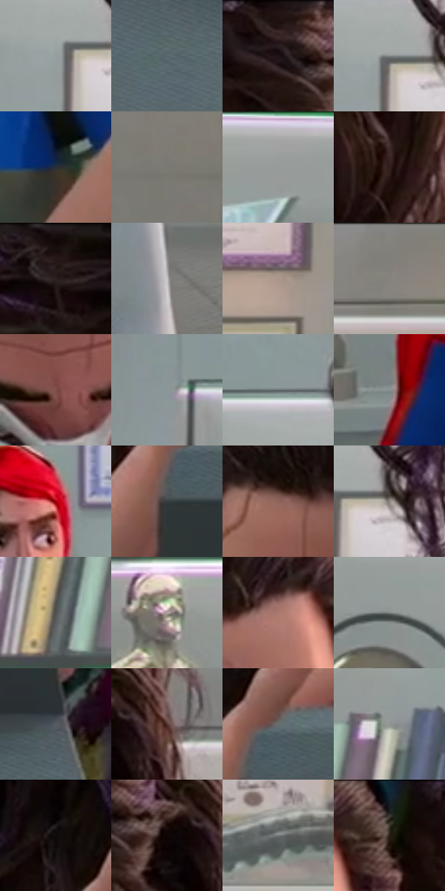

# 电影参考 351

- 状态：常规／活跃；来源世界：miles-home。
- 视角：near-level；景别：medium；场景：portrait。
- 时段：interior-time-unknown（外观依据，中置信度；具体时间／晨昏未知）；光照：cool-interior。
- 材质候选：skin, hair, fabric, glass, metal, paint（帧级，不是像素分割）。
- 明暗组：middle；L* P5/P50/P95：3.97765 / 47.4564 / 72.17901。
- 资格门禁：无附加门禁。
- 原截图 SHA-256：`a358a856b3f48b64bc434174d7a8f99d89871ab38a569fdef244cc72bc2ab660`；尺寸：2880 × 1204。
- sRGB 像素 SHA-256：`79d5a0f9f790f7d0f170ed3d52445c3c593b7769b1bf9fce5cd4928a17381d59`。

## 观察与迁移

近景表情与轻接触，不凭背景星形制造撞击爆点。

351  /  表情与遮挡／材质  /  研究员看显微镜，眼睛开闭不对称；保留可见五官，不能补被仪器遮住的眼睛

本公开版保存32个128×128原像素色卡上下文；图集格子并非原场景相邻位置。原rect、图集tile和像素SHA见 `data/palette-crops.json`。上下文不足时不得批准替色，不能以小样推断完整构图。

## 实测色卡

颜色比例分母为保留采样像素，不是材料面积；全部 32 色参与全库匹配。表内四舍五入仅用于阅读，原精度在 JSON。

| ID | HEX | Lab | 原图 xy | 像素数 | 比例 | 明度角色 |
| --- | --- | --- | --- | ---: | ---: | --- |
| 351-S01 | #969FA0 | [64.817897, -3.002001, -1.625307] | [820, 208] | 9615 | 4.990968% | light |
| 351-S02 | #58676D | [42.580369, -4.24436, -5.274623] | [1372, 824] | 8792 | 4.563764% | midtone |
| 351-S03 | #211312 | [7.522738, 7.036373, 3.218159] | [1988, 28] | 8712 | 4.522237% | deep-shadow |
| 351-S04 | #828785 | [55.853868, -2.244177, 0.434463] | [840, 192] | 8650 | 4.490054% | midtone |
| 351-S05 | #292F3A | [19.265681, 0.449184, -7.840854] | [884, 1008] | 8277 | 4.296437% | deep-shadow |
| 351-S06 | #7B7773 | [50.266353, 0.749729, 2.740691] | [2820, 816] | 8142 | 4.226361% | midtone |
| 351-S07 | #AEADAD | [70.803977, 0.352331, 0.128488] | [364, 28] | 7926 | 4.114239% | light |
| 351-S08 | #321F1D | [14.098814, 8.925221, 5.123879] | [2096, 336] | 7458 | 3.871309% | deep-shadow |
| 351-S09 | #170C0C | [4.260659, 4.214093, 1.485297] | [1080, 28] | 7138 | 3.705203% | deep-shadow |
| 351-S10 | #CAC8C9 | [80.784485, 0.869921, -0.250549] | [2228, 1020] | 6880 | 3.571280% | highlight |
| 351-S11 | #AA968A | [63.503365, 5.405318, 9.045456] | [2360, 332] | 6585 | 3.418151% | light |
| 351-S12 | #827E79 | [53.002172, 0.552056, 3.256611] | [2440, 52] | 6407 | 3.325755% | midtone |
| 351-S13 | #7E4E47 | [38.446404, 19.358276, 12.628507] | [1620, 284] | 6192 | 3.214152% | shadow |
| 351-S14 | #8C9698 | [61.355233, -3.17918, -2.286456] | [648, 112] | 5983 | 3.105664% | light |
| 351-S15 | #60676A | [43.104409, -2.026831, -2.610608] | [796, 100] | 5981 | 3.104626% | midtone |
| 351-S16 | #888F90 | [58.87475, -2.340689, -1.409784] | [452, 888] | 5952 | 3.089573% | midtone |
| 351-S17 | #A2030D | [33.516442, 56.812794, 42.244768] | [804, 464] | 5648 | 2.931772% | shadow |
| 351-S18 | #373E42 | [25.715591, -1.906922, -3.436327] | [1332, 556] | 5616 | 2.915161% | shadow |
| 351-S19 | #8F645C | [46.615324, 16.261879, 11.48657] | [1504, 104] | 5403 | 2.804597% | midtone |
| 351-S20 | #8F8681 | [56.560398, 2.452951, 3.902139] | [896, 204] | 5403 | 2.804597% | midtone |
| 351-S21 | #514F4E | [33.755657, 0.604776, 0.880996] | [352, 544] | 5191 | 2.694552% | shadow |
| 351-S22 | #AEA29B | [67.431619, 3.117487, 5.204794] | [200, 672] | 5125 | 2.660292% | light |
| 351-S23 | #AB786E | [55.296501, 18.61382, 13.479971] | [1740, 76] | 5067 | 2.630186% | midtone |
| 351-S24 | #7A807F | [53.067584, -2.431907, -0.228925] | [72, 396] | 5033 | 2.612537% | midtone |
| 351-S25 | #535C60 | [38.441721, -2.579978, -3.487493] | [1720, 724] | 4599 | 2.387256% | shadow |
| 351-S26 | #54322D | [24.814777, 14.742177, 9.66262] | [2164, 88] | 4485 | 2.328080% | shadow |
| 351-S27 | #686D6F | [45.6724, -1.482051, -1.773476] | [1368, 488] | 4450 | 2.309912% | midtone |
| 351-S28 | #949695 | [61.893753, -0.921178, 0.274626] | [464, 456] | 4382 | 2.274615% | light |
| 351-S29 | #100C0B | [3.588567, 1.14525, 0.868653] | [1280, 412] | 4353 | 2.259561% | deep-shadow |
| 351-S30 | #0E0505 | [1.922937, 2.4758, 0.872537] | [2080, 92] | 4054 | 2.104356% | deep-shadow |
| 351-S31 | #727677 | [49.333275, -1.3019, -1.072333] | [2312, 512] | 2872 | 1.490802% | midtone |
| 351-S32 | #161D24 | [10.383843, -1.018921, -5.818677] | [1852, 28] | 2277 | 1.181948% | deep-shadow |

## 色阶与空间分布

- 采样 ROI：`[0.01, 0.02, 0.98, 0.94]`；步长：4；样本数：192648。
- 排除区：`[]`。
- 深暗、暗、中、亮、高光五段计数：`[38799, 30493, 75651, 44327, 3378]`。
- RGB 各 256 箱、L* 100 箱、13×5 色相明度表和 3×3 空间统计全部保存在 [总数据](../film-library.json)。
- [可视化档案](../../references/library.html)按需绘制直方图，不存 2,094 张重复图表图片。

## 纹理特征占比

**这是分块图像特征的面积占比，不是波点／排线／丝网／错版的精确语义覆盖率。** 窗格、发丝、织物也会产生方向或周期特征。
原图 ROI 像素 3092958；已测块覆盖 3092958（100.0000%）；未测 0。

| 特征 | 块覆盖像素 | 占已测面积 | 阈值敏感范围 |
| --- | ---: | ---: | --- |
| low-contrast | 299230 | 9.6746% | 7.5485% ~ 10.8913% |
| directional-structure | 1161728 | 37.5604% | 19.6700% ~ 49.2835% |
| periodic-structure | 1632000 | 52.7650% | 43.1680% ~ 63.7319% |
| mixed-detail | 0 | 0.0000% | 0.0000% ~ 5.7069% |

阈值敏感范围不是统计置信区间。逐块坐标、尺度、对比、方向一致性、频谱集中度、频率与角度见 [全量特征记录](../texture-features.jsonl)，以帧号定位。
四种印刷层的真实像素覆盖仍标为 `null`，不能填 0，也不能拿上表代替。不得据这些代理测量删除唯一证据。

[测量方法与保留策略](../../references/library-retention.md) · [分类索引](../archive/README.md)
